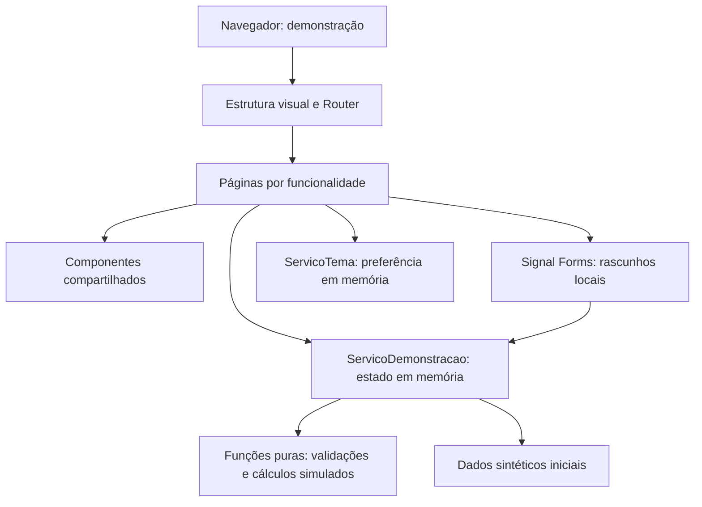
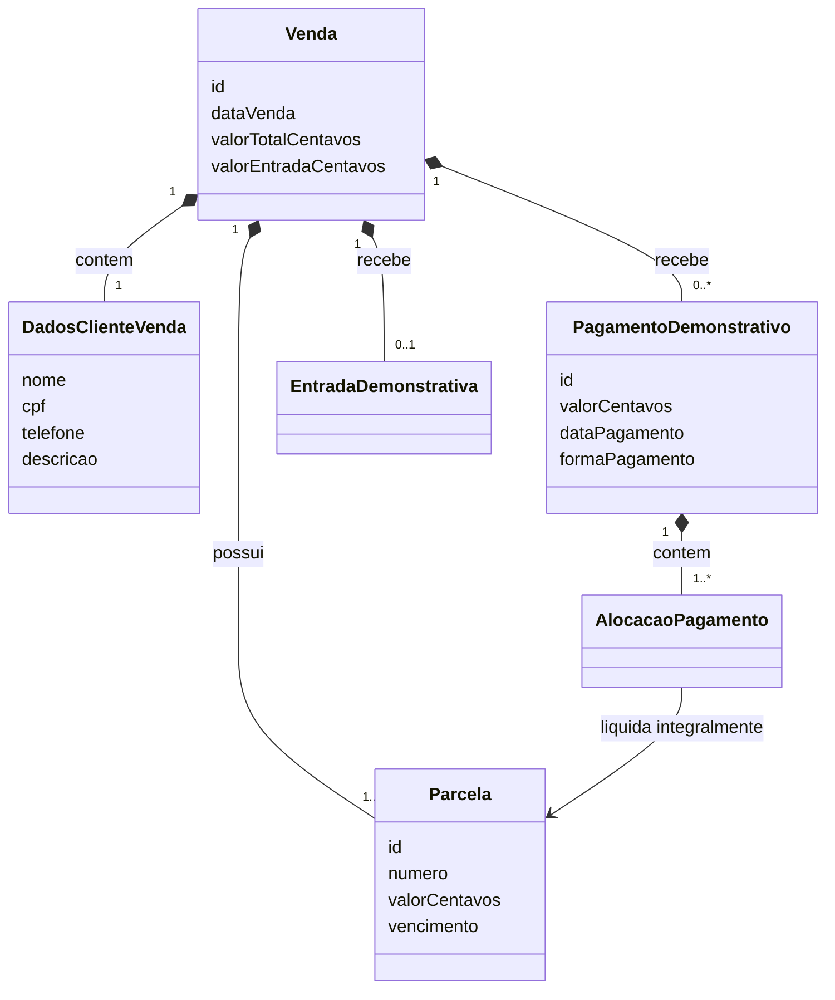
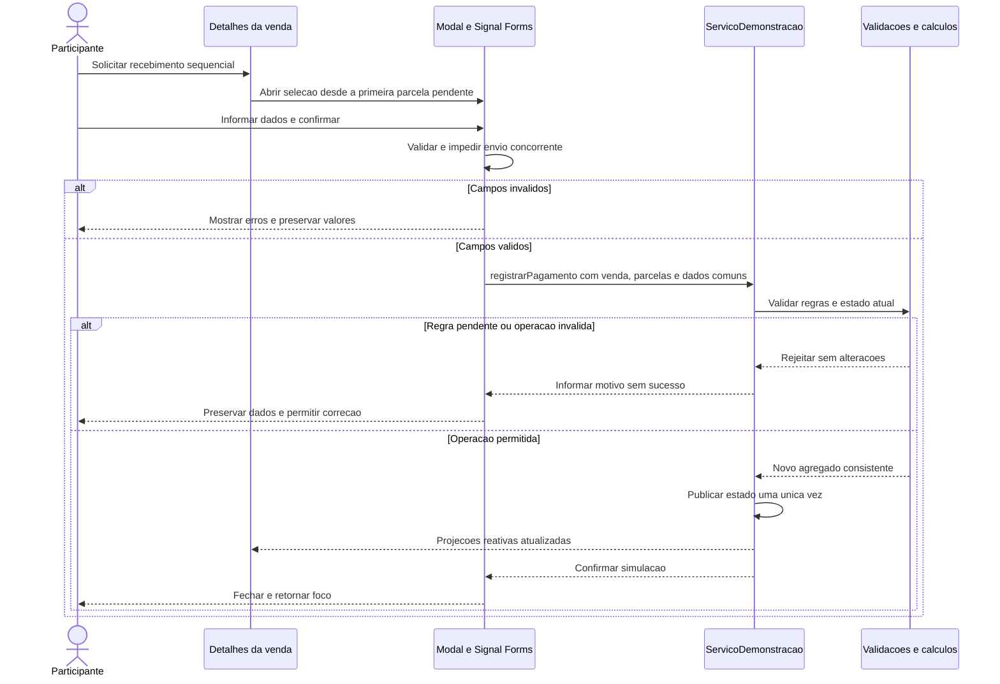
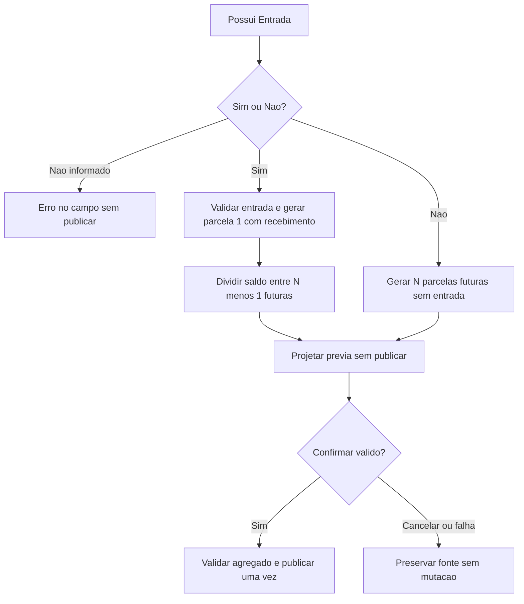

# TDD — Mercadão dos Óculos - Vendas em Aberto

## DEC-042 — Integração Angular local da fase 006 (27/11/2026)

### 1. Identificação e situação

Technical Design Document de `fase-006-integracao-angular`, baseado em PRD/FON-047/048,
RF-037–043 e CA-069–078. Planejamento concluído; apply autorizado em 27/11/2026 e
implementação em andamento nesta feature.
Escopo, proxy com credencial no servidor, referência fixa e conferência explícita foram
confirmados no Harness. O desenho foi revisado e o apply autorizado; compatibilidade
runtime permanece sujeita aos gates e isso não autoriza uso operacional.

### 2. Contexto, objetivos e limites

Integrar as funcionalidades atuais à API v1 sem acoplar o Pages ao backend e sem
reimplementar projeções financeiras no browser. Preservar demonstrativo como padrão,
formulários, prévia, busca/ordenação/paginação, temas e semântica de IDs. Fora: Tauri,
instalador, rede, dados reais, seed SQLite, schema, importação, exportação, backup,
idempotência distribuída, sincronização automática entre abas e dependências novas.

### 3. Fontes e estado real

Inspecionados `frontend/package.json`, `angular.json`, `app.config.ts`, `app.ts`,
`nucleo/demonstracao/`, cadastro/detalhe/recebimento, Visão Geral, Relatórios e
Configurações; testes adjacentes, configuração Playwright e specs pertinentes.
As telas dependem de `ServicoDemonstracao`, seus retornos síncronos e modelos de
domínio demonstrativo. `Relatorios` chama `calcularRelatorio` e Visão Geral deriva
listas de todas as vendas. Não há HttpClient configurado ou proxy no workspace.

Main integrada `a8de117` contém o contrato e a implementação da API v1 do PR #41
(head `4fe279ef65621cf0d2b3a70e396f5724d97dfa9e`), incluindo `api-local-vendas/spec.md`,
DEC-041 e os endpoints. A integração foi incorporada a esta feature pelo merge `9e3a0e9`;
PR #41 está merged desde 27/11/2026. Na tarefa 1.1, os seis GETs, cinco comandos,
prefixo autenticado `/api/v1`, segredo `Backend__SegredoLocal` em Base64 canônico de
32 bytes e revisão textual canônica foram comparados entre especificação e código; não
foi encontrada divergência material. FON-045/046, RF-031–036/CA-061–068 e DEC-041
continuam pertencendo à fase 005 integrada. Evidências históricas de 389 testes backend
e 430 frontend constam dos READMEs; não foram reexecutadas na tarefa 1.1.

Fontes externas FON-048, consultadas em 27/11/2026:
- Context7 `/websites/angular_dev`: HTTP requests/testing; `/angular/angular-cli`:
  proxy; `/vitejs/vite`: proxy options, configure/bypass e limites de allowedHosts.
- <https://angular.dev/guide/http/making-requests>
- <https://angular.dev/guide/http/testing>
- <https://angular.dev/tools/cli/serve>
- <https://vite.dev/config/server-options.html>
- Fontes oficiais `angular/angular-cli/main/packages/angular/build/src/utils/load-proxy-config.ts`
  e `vitejs/vite/main/packages/vite/src/node/server/middlewares/proxy.ts`: carga de
  configuração JS e gate antes de proxy.web. São fontes main, não prova da 22.2.6.
  A inspeção da instalação local confirmou Angular CLI/build 22.2.6 e Vite 8.3.5 do
  builder: configuração CommonJS carregada pelo CLI, contexto regex preservado, `bypass`
  antes de `proxy.web`, ramo string respeitando `res.writableEnded` e evento `proxyReq`
  emitido antes do streaming (exceto se houver `Expect`). A leitura da fonte instalada
  não substitui a execução real da CLI planejada em INT-01.3.

### 4. Síntese da entrevista

| Tema | Escolha explícita | Situação |
| --- | --- | --- |
| Resultado | Integrar Angular localmente com sintéticos, preservando Pages demo | Confirmada; não implementada |
| Conexão | Proxy local, segredo fora do browser e CORS da API desligado | Confirmada; não implementada |
| Tempo | Dia local capturado na abertura, fixo na sessão; recarga renova só referência | Confirmada; não implementada no modo local |
| Incerteza | Bloquear confirmações na aba até consulta e reconhecimento humano | Confirmada; não implementada |
| Demais detalhes | Composição, modelos de leitura, gates e roadmap abaixo | Propostos para revisão |

### 5. Arquitetura e responsabilidades propostas

```text
Componentes --> Fachada de dados por funcionalidade
                         |
                         +--> Adaptador demonstrativo --> ServicoDemonstracao
                         |
                         +--> Adaptador HTTP --> /api/v1 (mesma origem)
                                                   |
                                        Proxy dev Node/Angular CLI
                                        [Host/origem + Bearer ambiente]
                                                   |
                                          API loopback --> SQLite
```

Componentes dependem da fronteira de dados, não do modo concreto. Fachadas coordenam
estado de consulta/comando, invalidação e versões; adaptadores produzem modelos próprios
de leitura da UI. Não disfarçar DTO HTTP como `Venda` de domínio demonstrativo.
HTTP não chama fábricas do frontend para reconstruir a venda nem recalcula saldos,
situações, acréscimos, universos ou série mensal. Demo pode continuar usando suas
funções puras existentes; prévia/validação antecipada e formatação são reutilizáveis.
Não criar store global de todas as vendas, repository genérico ou framework de estado.

### 6. Linguagem, framework e ferramentas

Manter Angular/CLI/build 22.2.6, TypeScript 6.0.3, RxJS 7.8.2, Tailwind 4.3.5,
Vitest 5.1.0, Playwright 1.65.0, Node >=24.15 <25/npm 11.19.0 dos manifestos.
Sem atualização de versões, NgRx, SDK gerado ou novo pacote proxy. Usar HttpClient
com APIs públicas de providers/testes e RxJS existentes. Signal Forms já adotado
permanece; não migrar formulários por conveniência. Backend mantém baseline da fase 005.
Comprovar APIs usadas e restore/build no apply, sem alegar compatibilidade compilada agora.

### 7. Estrutura e convenções propostas

```text
frontend/src/app/nucleo/dados/
  fonte-vendas.ts                  [contrato/token, metodos tipados e respostas]
  modelos-leitura.ts               [somente modelos compartilhados necessarios]
  fonte-vendas-demonstracao.ts      [adaptador da fonte existente]
  fonte-vendas-http.ts              [cliente wire v1 e conversao explicita]
  contratos-api.ts                 [DTOs wire + validacao estrutural]
  controle-confirmacoes.ts         [busy/incerteza por aba e invalidacao]
  referencia-sessao.ts             [reutiliza politica atual sem gerar seed]
frontend/src/app/funcionalidades/*/ [estado/fachadas especificas junto da feature]
frontend/src/configuracoes/         [providers demo/local via fileReplacement; ativação após integração das telas]
frontend/proxy-local.cjs            [apenas Node; le ambiente no startup]
frontend/scripts/protecao-proxy-local.cjs [gate testavel sem Angular/segredo persistido]
frontend/e2e/integracao-local/      [fluxos e fixtures reais separadas do demo]
frontend/playwright.integracao-local.config.ts
```

Nomes ilustram responsabilidades concretas, não autorizam abstrações vazias.
`RetornoFormulario` pode continuar serviço de navegação/foco, sem responsabilidade de
transporte; ajustar seu uso e eventual localização só onde necessário. Remover dependência
direta de demo em App/Configurações/funcionalidades; não apagar cálculos/testes demo.

### 8. Estado, dados e composição

`FonteVendas` oferece coleções, detalhe, painel, mês e cinco comandos com retorno
assíncrono tipado. Implementar apenas operações consumidas: `/resumo` e `/periodo`
não têm tela dedicada e não exigem chamadas artificiais nem UI nova. Wire preserva
revisão string canônica 0..long.MaxValue, dinheiro number inteiro seguro, ISO civil,
enums textuais exatos e IDs não aparados. Validar respostas como unknown: tipos
genéricos de HttpClient não validam JSON em runtime. Resposta incompatível não é sucesso.
Mapear enums/campos explicitamente para modelos de apresentação; null/listas preservados.
Cada comando da fonte recebe o payload e a revisão observada explicitamente (`string | null`);
demo não fabrica revisão, enquanto o cliente HTTP recusa null/não canônica antes de enviar.
A referência vem do token fixado na composição e é serializada em cada operação. Não obter
revisão global, renovar no submit nem ler relógio por request.

Consultas usam discriminated union `inicial/carregando/pronto/erro/inexistente`, com
chave ID/coleção/mês/referência e geração de invalidação. Não usar arrays vazios como
placeholder de sucesso. Cancelar leituras obsoletas com switchMap/descarte; conferir
chave/geração antes de publicar. Após comando confirmado, invalidar todas as consultas
dependentes; resposta anterior em voo não pode sobrescrever detalhe confirmado.
Sem polling, service worker comercial ou cache persistente; dados antigos, se retidos,
ficam explicitamente desatualizados e não habilitam confirmar até recarga pertinente.

Revisão pertence ao snapshot que fundamenta a ação, não a um máximo global oportunista.
Edição/status/baixa/correção fixam a revisão do detalhe ao abrir/preparar o rascunho.
Cadastro consulta revisão por uma coleção antes de habilitar confirmar. Não buscar
revisão nova no submit para forçar sucesso. Conflito exige leitura explícita e novo
aceite sobre o mesmo alvo; não sobrescrever rascunho nem deslocar parcela/recebimento.

Configuração padrão/demo continua `npm start`, `npm run build` e Pages. Já existe um perfil
`serve:local` com proxy em 127.0.0.1:4200, mas ele permanece um harness de transporte que
serve a composição demonstrativa; não o apresentar como modo persistido. INT-02.1 cria a
fronteira, o adaptador demonstrativo e composições isoladas/testáveis; INT-02.2 implementa o
cliente HTTP. Manter `serve:local` ligado ao build de smoke até consultas/telas consumirem a
fonte local (INT-03.1–3.4) e App/Configurações declararem corretamente o modo (INT-03.5);
somente então selecionar o build/provider HTTP. Nenhum segredo no arquivo de ambiente
compilado. Build local é artefato técnico, não implantável sem proxy; não publicar no Pages.
Sem seletor runtime/URL ou fallback automático.

### 9. Proxy e fluxos de falha

**Proxy privilegiado, apenas de desenvolvimento:** `proxy-local.cjs` lê
`Backend__SegredoLocal` exclusivamente no processo Node e `Backend__Porta` (default
5070, intervalo da API) para alvo fixo `http://127.0.0.1:<porta>`. Validar segredo
Base64 canônico de 32 bytes e porta antes de servir modo local; não abrir arquivo,
capturar caminho de banco ou iniciar/preparar API pelo proxy. Configurar API separadamente
com seu caminho absoluto sintético e a mesma credencial. Nunca aceitar URL upstream do
browser. Match ancorado somente `/api/v1` e descendentes, sem reescrever query/IDs.

Gate obrigatório antes de encaminhar/injetar Bearer: Host único exatamente
`127.0.0.1:4200`; `Sec-Fetch-Site: same-origin` obrigatório; Origin, se presente,
exatamente `http://127.0.0.1:4200`, obrigatório para POST/PUT; rejeitar null, duplicatas,
cross-site/same-site/none e metadados ausentes; GET/POST/PUT comerciais apenas, sem
Upgrade, `Expect` ou OPTIONS proxied. Rejeitar `Expect` porque o Vite 8.3.5 omite seu
evento `proxyReq` nesse caso. Manter `ws: true` somente para que o listener de upgrade
do Vite invoque o gate; com `res` ausente, a recusa retorna `false` e fecha o handshake
como 404 antes de qualquer `proxy.ws`. Inspecionar rawHeaders para duplicatas. Não usar Referer
como autenticação nem confiar só em allowedHosts, pois Vite aceita IPs por padrão.
Isso admite Chromium fetch da mesma origem, não navegação direta para endpoint ou
clientes sem Fetch Metadata; tais clientes técnicos acessam API diretamente com Bearer.

Usar gate `bypass` e hook `configure` da configuração Node carregada pelo CLI. Recusa
encerra resposta genérica 403/no-store, substitui a URL do pedido por um sentinel fixo
e retorna esse path; no Vite instalado, o ramo string retorna antes de `next()` quando
`writableEnded`, sem executar `proxy.web` ou repetir o encerramento. Credencial de entrada Authorization/cookie
não é confiável: remover, injetar só Bearer do ambiente após admissão. Não adicionar
CORS permissivo, bypass por ambiente de teste, `allowedHosts=true`, target dinâmico,
ou credencial padrão. Nenhum header/endpoint devolve o segredo ao browser.

Interceptar erros do proxy antes do logger padrão para emitir diagnóstico genérico sem
query/headers/body/stack sensível; desabilitar debug de proxy no perfil local. Quando
for possível responder, erro upstream devolve 502/no-store/código genérico próprio,
**sem** afirmar se comando chegou ou gravou. Provar tanto gate como logging em servidor
CLI real da versão fixada; se hooks/ordem não cumprirem protocolo, parar e revisar
DEC-042/SDD antes de integrar telas, sem abrir CORS ou instalar pacote silenciosamente.

**Evidência INT-01.3 (27/11/2026):** Angular CLI/build 22.2.6 e Vite 8.3.5 instalados.
O smoke executou `npm run start:local` com `DEBUG` e `PORT` deliberadamente definidos:
o preloader limpou ambos e a origem serviu em 127.0.0.1:4200.
Chromium fez GET same-origin com query/ID reservado preservados e Bearer apenas no trecho
servidor→upstream; uma chamada de proveniência cross-site recebeu 403/no-store sem tráfego
upstream. Upgrade WebSocket encerrou em 404 sem encaminhamento. Upstream que fechou socket
gerou 502/no-store/código genérico; logs do CLI não continham marcadores de segredo, query,
body ou Authorization recebido. Assets/respostas do browser também não continham segredo.
API .NET real em SQLite sintético recebeu outro Bearer Base64 válido e respondeu 401/no-store,
sem expor qualquer das credenciais. `node --test --test-concurrency=1 proxy-local.test.cjs
proxy-local-cli.test.cjs` passou 9/9 e `npm run build` padrão passou (316,87 kB iniciais).
O build/teste comprova somente o harness do proxy, não o modo de persistência. A composição
HTTP e a ativação de `serve:local` permanecem pendentes de INT-02.1, INT-02.2 e INT-03.1–3.5.

**HTTP e comandos:** GETs não têm retry automático nesta fase; ação de recarregar é
explícita. Cada comando tem uma subscription controlada, sem retry/shareReplay que
reenvie escrita. Controle por aba bloqueia confirmação concorrente enquanto comando
está em voo. Navegação não dispara cancelamento automático do comando nem resubscription;
coordenador root mantém o resultado e invalida consultas mesmo se a tela for destruída.
Se não houver resposta confiável após envio (status 0, timeout, 502/504, 5xx genérico,
body de sucesso inválido) ou houver `confirmacao-indeterminada`, estado é incerto.
400/401/404/409/415/422 e 503 com Problem Details conhecido da API são recusas
identificáveis, sem inventar certeza a partir apenas de HTTP desconhecido.

No incerto: guardar rascunho/código e alvo em memória no coordenador, mostrar aviso
persistente ao navegar e bloquear os cinco comandos em toda a aba. Permitir consultas;
ação Conferir consulta coleção no cadastro, detalhe nos outros e atualiza/invalida
consultas dependentes. Só depois de leitura bem-sucedida habilitar reconhecimento
explícito de conferência; ele libera comandos, **não** reenvia nem confirma o anterior.
Mudança de cliente semelhante não identifica automaticamente cadastro perdido; sem
idempotency key não há prova exactly-once. Não guardar pendência/comando em storage.
Reabertura descarta rascunho/bloqueio, mas nunca reenvia e deve orientar conferência
antes de repetir operação cuja resposta foi perdida, sem prometer reconhecimento automático.

Erro de validação usa mapa explícito campo wire→campo rascunho (inclui `valorTotal`,
`quantidadeParcelas`, `entrada.forma`, `data` e `revisaoEsperada`); campo desconhecido
vira resumo seguro, não falha silenciosa. 401 informa configuração local inválida,
não pede login humano. 404 só vira Venda não encontrada com código contratual de venda
ausente; 503 não vira vazio. Depois de sucesso confirmado, erro de refresh é falha de
atualização separada; manter identidade/revisão confirmadas e nunca sugerir repetir comando.

### 10. Interface, formulários e acessibilidade

Preservar componentes, rotas e tokens existentes. UI recebe dados prontos para
apresentação; busca/sort/paginação sobre resumos completos, sem exigir parcelas em cada
linha. Painel usa `/visao-geral`, Relatórios `/relatorios/mensal` (cinco seções e série);
não fazer fan-out por venda nem somar dinheiro para gerar totais alternativos.
Prévia mantém regras locais já testadas, identificada como prévia, não confirmação.
Arredondamento da escala visual do gráfico não altera centavos dos dados.

Formulários aguardam Promises/Observable consumido uma vez; validação antecipada não
envia negócio. Erros preservam rascunho; loading real usa aria-busy/anúncio adequado,
sem roubar foco em cada resposta. Enquanto comando pendente, impedir nova confirmação;
fechar/navegar não promete rollback. Escape antes de enviar continua cancelamento sem
mutação; depois do envio pode fechar com aviso de operação em andamento/incerta, e
coordenador conserva resultado. Sucesso usa foco lógico existente, erros de campo focam
primeiro pertinente. Aviso incerto permite sair do modal para conferir sem perder
rascunho em memória. Configurações/mensagens deixam claro SQLite sintético versus demo.

### 11. Alternativas e contrapartidas

| Alternativa | Decisão e motivo |
| --- | --- |
| Token no bundle/storage e CORS amplo | Rejeitada: expõe credencial e contraria escolha do usuário |
| Browser direto com token temporário/CORS restrito | Não escolhida; exigiria provisionamento e mudar fase 005 |
| Hospedar SPA no backend ou desktop agora | Fora do escopo confirmado; aumenta distribuição/lifecycle |
| Proxy Node separado/plataforma nova | Não adotar por padrão; CLI existente deve comprovar gate, falha exige revisão |
| HttpClient/RxJS e signals existentes | Propostos; sem pacote novo/NgRx ou framework de cache |
| Adapter HTTP reconstruindo domínio TypeScript | Rejeitado: duplo motor financeiro e dependência de histórico completo |
| Retry automático, atualização otimista e inferência por cliente | Rejeitados: revisão global/commit perdido não garantem idempotência |

Custo aceito: adaptação de telas/testes síncronos, modelos de apresentação e estados
explícitos; não é troca trivial de serviço. Sem estimativa/prazo ou benchmark inventados.

### 12. Qualidade e verificação planejada

Vitest/HttpTestingController: contratos, tipos/IDs/enums, uma subscription/escrita,
zero retry, erros por campo, referências, revisão original, troca de ID/mês e geração
pós-invalidação. Componentes: loading/vazio/404/erro, rascunhos, dois modos, foco,
modais, busy, incerteza e recuperação. Testes Node/proxy e CLI real: Host/origem,
Fetch Metadata, configuração/rotação, destino fixo, logs/bundle/browser sem marcador
de segredo e negação antes de encaminhamento. Não importar dependência transitive
como API pública; usar Node built-in nos testes auxiliares.

Playwright em configuração local separada: API/CLI próprios com banco temporário,
credencial efêmera e fixtures sintéticas criadas via API autenticada, sem endpoint seed.
Portas próprias sem encerrar servidores alheios; se ocupadas, falhar e informar.
Sem paralelismo sobre mesmo banco: worker único ou destinos isolados. Recarregar browser,
reiniciar API no mesmo arquivo, duas abas/revisão, edição/status/baixa/correção e mês.
Incerteza: interceptar e perder resposta **após** backend confirmar em cenário controlado;
outro caso perde antes, comprovando UI conservadora em ambos. Mock de erro verifica
protocolo, não simula falha nativa de commit. Testes reais do gravador permanecem.

Executar sequencialmente frontend tests/build/format e E2E demo/local, backend restore
locked/build Release/test/format e auditoria conforme baseline integrada. Comandos
frontend existentes: `npm.cmd test -- --watch=false`, `npm.cmd run build`,
`npm.cmd run format:check`, `npm.cmd run test:e2e` e fixture de paginação vigente.
Propostos: `test:proxy-local`, `build:local`, `test:e2e:local`; criar/documentar somente
no apply. Sem npm ci se desnecessário; se necessário, lockfile apenas e preservar
processos alheios. SDK .NET deve satisfazer global.json; se ausente, registrar bloqueio,
sem instalar/rebaixar global nem herdar autorização de instalação de Change antiga.

Conferir temas em 1366×768 e 390×844 e fronteira 767/768 dos formulários; teclado,
contraste, densidade no pronto e anúncios. Zoom nativo 200% exige observação manual
própria; viewport reduzido não o substitui. Registrar limitação se indisponível.

### 13. Segurança, privacidade e desempenho

Proxy com segredo é ponte privilegiada, não autenticação humana. Headers protegem
contra proveniência web indevida, mas processo local pode forjá-los; dev server/conta
comprometidos não estão isolados. Não expor porta além de loopback, secretos em assets,
logs/traces ou dump de ambiente. Artifacts E2E sintéticos ainda não podem conter Bearer.
Queries podem conter IDs: higienizar logging inclusive erro upstream e debug.
Sem cookies/storage/IndexedDB de negócio, métricas remotas, benchmark ou meta nova de
escala; consultas completas mantêm custo proporcional à base aceito anteriormente.

### 14. Execução e Roadmap de implementação — obrigatório

Pré-requisitos: revisão dos artefatos + novo apply explícito; fase 005 integrada com
contrato equivalente; ambiente fixado disponível. Não incorporar código do PR #41
silenciosamente nesta proposta nem mesclá-lo. Se contrato mudar, revisar primeiro docs.

| Marco | Entregas | Dependências | Critério verificável | Estado |
| --- | --- | --- | --- | --- |
| INT-01 | Reconferir baseline integrada; composição demo/local; gate proxy/segredo e logging | Pré-requisitos acima | Demo sem API; CLI real recusa origem/Host antes de proxy; segredo não vaza | Não implementado |
| INT-02 | Fronteira/modelos/cliente/adaptador demo e estado de confirmação | INT-01 | Tipos exatos, uma escrita, referência fixa, revisão observada e testes de protocolo | Não implementado |
| INT-03 | Quatro coleções, detalhe, Visão Geral e mês; funcionalidades separadas | INT-02 | Pronto/erro/vazio/ausente, corridas e busca/paginação; sem cálculos financeiros HTTP | Não implementado |
| INT-04 | Cadastro, cliente, status, baixa e correção; commits individuais | INT-03 para contextos usados | Confirmação única, no-op, rascunho, conflito, foco e invalidação por funcionalidade | Não implementado |
| INT-05 | Conferência integrada/alerta por aba e recovery pós-sucesso | INT-02/04; protocolo básico já testado antes | Resposta perdida bloqueia toda aba; consulta+aceite liberam sem reenvio | Não implementado |
| INT-06 | E2E real/reinício/duas abas, regressão demo/backend, auditoria e evidências | INT-01–05 | CA-069–078 rastreados, privacidade e limitações reais documentadas | Não implementado |

Consultas podem ser desenvolvidas independentemente após INT-02, mas não compartilhar
builds/testes/SQLite em paralelo. Nenhuma delegação ou paralelismo de agentes necessário.
Cada funcionalidade inclui testes/documentação/tarefas e commit próprio em português;
planejamento em commit separado. Archive e PR único somente após toda Change concluída
e verificada; não arquivar no propose ou por artefatos prontos. Merge exige autorização.
Desktop/produção/importação/backup são evolução futura com outra decisão e autorização.

### 15. Registro central da decisão

DEC-042 complementa DEC-040/041 e reutiliza suas regras; não substitui schema/domínio.
Problema: consumidores síncronos demo não tratam fronteiras HTTP/revisão/resultado incerto.
Escolha: adapters separados, proxy dev com segredo no servidor e protocolos acima.
Origem: FON-047 para decisões materiais; FON-048 e inspeção para desenho proposto.
Situação: escolhas da entrevista confirmadas, desenho técnico proposto; implementação
não iniciada. Contrapartidas/alternativas nas seções 5–13. Validação: INT-01–06 e CA-069–078.

### 16. Riscos, hipóteses e pendências

PR #41 integrado e contrato reconferido na tarefa 1.1; a dependência está satisfeita.
Gate técnico: hooks do CLI/Vite exatos ainda sem execução observada; prova de proteção
antecede qualquer tela local. Falha bloqueia e exige revisão, não implementação insegura.
Não há regra comercial pendente para este recorte. PEN-013/014 e autorização operacional
continuam fora. Recarga perde bloqueio em memória: isso não autoriza replay nem garante
deduplicação; mensagens orientam conferência humana, com limite explicitado no PRD.

### 17. Rastreabilidade e revisão documental

FON-047/048 → RF-037–043/CA-069–078 → DEC-042 → Change
`fase-006-integracao-angular` → INT-01–06. Specs existentes de demonstração limitam
descarte/ausência de API ao modo demo; deltas devem expressar a exceção local sem
revogar esses contratos. Capability nova descreve integração/revisão/incerteza.
Lotes legados e dashboard têm textos históricos divergentes nas specs principais:
não introduzir novas baixas em lote nem retirar dashboard; preservar código/regras
atuais e RF-018–020, deixando manutenção de outras Changes fora do recorte.
Verificações aqui são documentais; nenhum build/teste/auditoria de código foi executado.

### 18. Histórico

27/11/2026: acrescenta DEC-042 após PRD da fase 006; preserva DEC-041 e o histórico
da fase 005; reconciliação com a main integrada e autorização do apply registradas na
tarefa 1.1 desta Change.

## DEC-041 — Contrato e API local da fase 005 (26/11/2026)

### 1. Identificação, situação e limites

Desenho para `fase-005-contrato-e-api-local`, baseado no PRD/FON-045/046,
RF-031–036 e CA-061–068. Escopo e escolhas materiais confirmados no Harness;
contrato detalhado abaixo foi **proposto para revisão no planejamento original**.
Na elaboração, nada estava implementado e o planejamento não autorizava apply; a
execução autorizada posterior e seu estado estão registrados ao final desta decisão.
Não é a FASE-005 histórica
do Angular. Homologação operacional e responsáveis por ela não foram definidos.

### 2. Contexto e objetivo

Expor casos existentes por HTTP local e acrescentar consulta consolidada de painel,
sem regra comercial nova ou lógica financeira no transporte. Preservar DEC-034/035,
037/038/040 no que não for explicitamente revisado abaixo. Não conectar Angular,
adicionar Tauri, SDK, instalador, importação, seed, banco operacional ou novo schema.

### 3. Fontes e estado observado

Aplicacao oferece cinco Commands e cinco Queries, DTOs protegidos e composição pública;
Infraestrutura oferece `AdicionarPersistenciaSqlite`. `Api/Program.cs` só expõe health;
`Api.csproj` só referencia Aplicacao. Testes HTTP usam `WebApplicationFactory<Program>`
sem configuração de banco; devem evoluir com a nova inicialização. Os testes de rotas
404 não podem ser simplesmente eliminados: `/vendas`, `/pagamentos`, Swagger, OpenAPI
e rota de falha de teste continuam ausentes no host de produção.

Visão Geral existente: spec `visao-geral` completa e arquivos
`frontend/src/app/funcionalidades/visao-geral/visao-geral.calculos.ts` e componente.
O seletor recebe projeções da fonte, e o backend deve filtrar explicitamente Ativas
conforme a spec, não transportar cegamente qualquer coleção. `ConsultarResumo` usa
`ConjuntoVendas.Projetar`; não contém os três resumos de cinco itens.

Evidências anteriores: PR #40 integrado; 285 testes backend e 430 frontend registrados
na fase 004, não reexecutados aqui. As marcações antigas de PR pendente são históricas.

### 4. Síntese da entrevista

| Tema | Decisão explícita em FON-045 |
| --- | --- |
| Escopo | Expor casos existentes e incluir consulta consolidada da Visão Geral |
| Banco | Host prepara explicitamente ao iniciar, antes de aceitar operações |
| Credencial | Segredo técnico obrigatório, fornecido pelo iniciador/desenvolvedor; sem login |
| Contrato | Referência por operação; revisão textual; IDs opacos em query/body |
| Fronteiras | CORS desabilitado; caminho absoluto com pai existente; API compõe Infraestrutura |
| Autorização | Revisar PRD/TDD e gerar SDD na feature; sem código/apply/archive/PR antecipado |

### 5. Arquitetura e revisão das fronteiras históricas

Proposta:

```text
Consumidor HTTP local --> Api --> ISender --> Aplicacao --> Dominio
                          |                     |
                          |                     v
                          +--> Infraestrutura --> SQLite
                               [composicao]
```

Adicionar referência **Api → Infraestrutura** para compor o adaptador público, sem
expor DbContext/modelos/EF nos endpoints. Aplicacao continua → Dominio; Infraestrutura
continua → Aplicacao/Dominio. Não ampliar InternalsVisibleTo nem criar projeto extra.
Na API: `Configuracao/`, `Seguranca/`, `Contratos/`, `Erros/` e `Endpoints/` por recurso.
Na Aplicacao: `Funcionalidades/VisaoGeral/ConsultarVisaoGeral/` e DTOs necessários.
Nomes próprios em português sem acentos; não criar repository/base handler genéricos.

**Revisão delimitada:** substitui apenas a obrigação de host sem persistência/negócio
de DEC-038/040 e spec `casos-de-uso-vendas/Isolamento do host e da demonstração`.
Preparar continua explícito, agora por composição do host, nunca em queries/commands.
EF/SQLite passarão a existir no grafo da API deliberadamente; auditar essa presença,
em vez de manter o antigo teste de ausência. Angular permanece independente.

### 6. Baseline e bibliotecas

Manter net10.0, SDK 10.0.404/latestPatch, runtime 10.0.15, MSTest.Sdk 4.5.3,
MediatR 12.5.0/Apache-2.0, FluentResults 4.0.0/MIT e EF/SQLite de DEC-038.
Usar Minimal APIs, System.Text.Json, autenticação customizada e Problem Details do
framework compartilhado, sem JWT, FluentResults.Extensions.AspNetCore ou biblioteca
de validação/mapeamento. Nenhuma dependência instalada durante o planejamento.
No apply, confirmar grafo/lockfiles, compatibilidade e auditoria sem atualização incidental.

### 7. Inicialização e configuração

Manter `Backend:Porta`/`Backend__Porta`, default 5070, intervalo 1024–65535 e
listener `IPAddress.Loopback`. Sem porta zero, LAN, TLS ou descoberta dinâmica.
Acrescentar `Backend:CaminhoBanco` (ambiente `Backend__CaminhoBanco`): obrigatório,
absoluto, pai existente, sem default/caminho relativo, sem diretório automático.

Credencial: variável de ambiente **`Backend__SegredoLocal`**, lida diretamente do
ambiente do processo, sem fallback a argumento/appsettings. Conteúdo canônico Base64
de 32 bytes aleatórios fornecidos pelo iniciador; nunca gerar/fixar segredo público
de fallback. Validar formato/tamanho sem afirmar que é possível provar sua entropia.
Futuro Tauri será responsável por gerar segredo novo; nesta fase testes/iniciador
fornecem um novo por execução. Não persistir, imprimir ou devolver a credencial.

Ordem: validar endpoints/porta, caminho e segredo → registrar Aplicacao/Infraestrutura
→ construir provider/host → aguardar `PrepararAsync` explicitamente **antes de Run**.
Não aceitar tráfego enquanto prepara. Banco incompatível/indisponível falha a partida
com diagnóstico público genérico e código seguro, sem caminho/SQL/exceção. Arquivo
novo fica vazio; preparação repetida conserva dados. Pai ausente não é criado.
Descarte e cancellation token do host devem ser observados; sem endpoint técnico
de preparar/reset nem migration disparada por uma requisição comercial.

### 8. Contrato externo v1

JSON UTF-8, camelCase; sucesso `application/json`; falhas `application/problem+json`.
DTOs HTTP próprios, projetados da Aplicacao; não devolver `Result`, domínio ou EF.
Corpos são objetos, nunca wrapper de Result. Todos os parâmetros da tabela são
obrigatórios, exceto `descricao`, `observacao` e `entrada` nullable/ausentes.
Todas as respostas comerciais, inclusive falhas, recebem `Cache-Control: no-store`.

#### Tipos e binding

- Datas em body/query: exatamente `yyyy-MM-dd`, anos 0001–9999, cultura invariável;
  campo obrigatório ausente não vira DateOnly.MinValue e não há relógio implícito.
- Centavos: token JSON inteiro entre 0 e 9.007.199.254.740.991, com restrições comerciais
  adicionais no domínio. Não aceitar string, fração ou conversão de reais. Quantidades,
  ano e mês são inteiros; binding estrutural distingue ausência de zero.
- `revisao` e `revisaoEsperada`: **string decimal canônica** `0` ou dígitos sem zero
  inicial, sem sinal/espaço, até 9223372036854775807. Rejeitar token numérico. Converter
  explicitamente só esses campos; não aplicar conversor global de long a dinheiro.
- IDs: strings opacas; query exige URL encoding uma vez, body conserva literalmente.
  Nunca usar ID como segmento de rota nem trim/converter para GUID. Conferir barras,
  `%`, `+`, `?`, `#` e Unicode; preservar as validações de vazio do caso de uso.
- Enums textuais exatos, sem número/cast implícito: coleções `Abertas`, `Quitadas`,
  `Inativas`, `Prejuizo`; status `Ativo`, `Inativo`, `Prejuizo`; formas `Dinheiro`,
  `Pix`, `CartaoDebito`, `CartaoCredito`; situações `Quitada`, `Atrasada`,
  `ProximosDias`, `EmAberto`; parcela usa `Paga` em vez de `Quitada`; origem
  `Entrada`, `Individual`, `HistoricoLote`. Mapear explicitamente os enums internos.
- Campos obrigatórios null, JSON malformado, tipos/enum/data/revisão inválidos: 400
  antes de ISender. `descricao` null continua null; observação ausente/null segue a
  normalização vigente do domínio, cuja resposta é string. Listas são arrays, nunca null.
- Propriedades JSON desconhecidas são ignoradas nesta v1; não autorizam alteração de
  nenhum campo extra. Chaves repetidas conhecidas são recusadas com 400 para evitar
  interpretações divergentes. Parâmetro query obrigatório repetido também é 400.

#### Endpoints e entradas

Todo prefixo `/api/v1` exige Bearer; health não faz parte do grupo.

| Método e caminho | Query ou body | Caso de uso e sucesso |
| --- | --- | --- |
| GET `/api/v1/vendas` | Query `colecao`, `referencia` | ConsultarColecaoVendas; 200 |
| GET `/api/v1/vendas/detalhe` | Query `vendaId`, `referencia` | ConsultarVenda; 200 |
| POST `/api/v1/vendas` | Body cadastro abaixo | CadastrarVenda; 201 + detalhe + Location |
| PUT `/api/v1/vendas/cliente` | Body edição abaixo | EditarClienteVenda; 200 detalhe, inclusive no-op |
| PUT `/api/v1/vendas/status` | Body `vendaId`, `novoStatus`, `referencia`, `revisaoEsperada` | AlterarStatusVenda; 200 detalhe |
| POST `/api/v1/recebimentos` | Body baixa abaixo | RegistrarPagamento; 200 detalhe confirmado |
| PUT `/api/v1/recebimentos` | Body correção abaixo | CorrigirPagamento; 200 detalhe confirmado |
| GET `/api/v1/resumo` | Query `referencia` | ConsultarResumo; 200 |
| GET `/api/v1/periodo` | Query `inicio`, `fim`, `referencia` | ConsultarPeriodo; 200 |
| GET `/api/v1/relatorios/mensal` | Query `ano`, `mes`, `referencia` | ConsultarRelatorioMensal; 200 |
| GET `/api/v1/visao-geral` | Query `referencia` | ConsultarVisaoGeral; 200 |

Cadastro: `nome`, `cpf`, `telefone`, `descricao?`, `dataVenda`, `valorTotalCentavos`,
`quantidadeParcelas`, `referencia`, `revisaoEsperada`, `entrada?`;
entrada = `{valorCentavos, forma}`. Edição: `vendaId`, os quatro campos de cliente,
`referencia`, `revisaoEsperada`. Baixa: `vendaId`, `parcelaId`,
`valorRecebidoCentavos`, `data`, `forma`, `observacao?`, `referencia`,
`revisaoEsperada`. Correção troca `parcelaId` por `recebimentoId`, preservando demais
campos. Mapeamento 1:1 para Commands existentes; nenhum ID novo vem do consumidor.
Location do cadastro é URI relativa `/api/v1/vendas/detalhe?vendaId=<encoded>&referencia=<ISO>`;
referência é a recebida e ID é o confirmado, sem construir URL a partir de Host não confiável.
Baixa não promete recurso GET individual de recebimento nem Location inexistente.

#### Estrutura de saída

Os campos dos DTOs de `Aplicacao/Contratos/` existentes na baseline são o inventário
de saída v1: transportar **todos** os campos em camelCase, mantendo aninhamento,
ordem e nulabilidade; transformar revisões e enums conforme acima. Isso inclui
todos os campos de ClienteResposta/VendaResumoResposta, resumo/parcelas/recebimentos/
alocacoes de VendaDetalheResposta, ColecaoVendasResposta, ResumoResposta,
PeriodoResposta e todas as seções/linhas/totais de RelatorioMensalResposta. O mapper
HTTP deve ser testado por campo; futuras adições internas não alteram v1 automaticamente.

Visão Geral: `{referencia, revisao, indicadores, vendasRecentes, parcelasProximas,
parcelasAtrasadas}`. `indicadores` contém os quatro campos numéricos de ResumoResposta
(sem duplicar referência/revisão); recentes são VendaResumoResposta HTTP; próximos/
atrasados são `{venda, parcela}`, com VendaResumoResposta e ParcelaDetalheResposta.
Revisões/referências dos resumos aninhados, se presentes, são iguais às do envelope.

### 9. Visão Geral interna e fluxos comerciais

Adicionar `ConsultarVisaoGeralQuery(Referencia)`/Handler via ISender e resposta própria
imutável. Fazer **uma** carga; projetar conjunto nessa referência, conservar indicadores
de Projetar e selecionar resumos somente das Ativas. Usar projeções vigentes, sem
recalcular dinheiro/calendário no handler. Ordenar recentes por DataVenda desc + índice
original; parcelas por Vencimento asc + índice da venda + índice da parcela; filtrar
situação antes de Take(5). Próximos segue classificação vigente, sem AddDays que
transborde em 9999. Copiar listas protegidas e nunca chamar outras Queries por venda.

Os cinco Commands continuam uma chamada a ISender por request e um Save no máximo;
revisão do consumidor permanece obrigatória. Não buscar revisão nova para forçar
sucesso, não auto-retry, não escolher outra parcela nem adicionar idempotency key.
Queries existentes não mudam; projeções não retornam domínio. RequestAborted segue
ao handler/armazenamento; sucesso confirmado não vira rollback por cancelamento tardio.
Desconexão/timeout pode impedir entrega da resposta após commit; consumidor precisa
conferir, pois recarga isoladamente nem sempre identifica um cadastro enviado sem ID.

### 10. Segurança, falhas e privacidade

Esquema ASP.NET de autenticação customizada para segredo opaco, sem JWT/cookies.
`Authorization: Bearer <Base64>` exatamente uma credencial, validar formato e comparar
bytes com `CryptographicOperations.FixedTimeEquals`, sem log de valores. Ausência,
duplicação ou credencial inválida: 401 Problem Details `acesso-local-negado`, challenge
`WWW-Authenticate: Bearer`, sem redirecionamento, antes de binding/ISender. Autorizar
somente grupo comercial, não fallback global que transforme rotas 404 em login.

`/health` continua 200 `text/plain` `Healthy`, sem cookies e sem informações do banco;
só existe após preparação. Não é prova criptográfica de identidade de processo nem
monitor de disponibilidade contínua do SQLite. CORS desabilitado, sem cookies ou
origens curingas; integração navegador futura exige nova decisão. Credencial em
ambiente não protege de comprometimento do usuário/processo local. Nenhum dado real.

Adaptador único de erro, por categoria/código, nunca por mensagem:

| Origem/categoria | HTTP | Código e política |
| --- | --- | --- |
| Binding/JSON/query inválido | 400 | `requisicao-invalida`; campo seguro quando conhecido |
| Content-Type de body não suportado | 415 | `tipo-conteudo-nao-suportado` |
| Validacao da Aplicacao | 400 | Preservar código/campo/mensagem públicos |
| Inexistencia | 404 | Preservar código, não confundir com banco ausente |
| Conflito | 409 | Preservar código; recarregar, sem retry automático |
| RegraNegocio | 422 | Preservar código/campo/mensagem |
| Infraestrutura | 503 | Preservar código/mensagem segura, sem Retry-After ou retry implícito |
| EstadoIndeterminado | 500 | `confirmacao-indeterminada`, `resultadoOperacao: "indeterminado"`; conferir antes de decidir |
| Exceção/categoria/código inesperados | 500 | `falha-interna`; mensagem genérica, nunca ex.Message |

Problem Details: `type: "about:blank"`, `title` pt-BR por status, `status`, `detail`
seguro e `codigo`. Opcional `campo`; apenas confirmação incerta conhecida adiciona
`resultadoOperacao`. Não incluir `instance` com query, Result/Reasons, valores de
entrada, SQL, caminho, token ou stack. Sem seleção de categoria pelo primeiro erro:
todos os ErroAplicacao devem ser conhecidos e coerentes; coleção vazia/mista ou erro
interno desconhecido vira falha técnica genérica. Somente múltiplos erros de categoria
Validacao coerentes usam `erros-validacao` e `erros` com codigo/mensagem/campo seguros,
na ordem recebida; múltiplos erros de outras categorias são falha técnica de contrato.

Uniformizar Development/Production. Em ASP.NET Core **10**, configurar binding para
lançar BadHttpRequestException e tratá-la com status 400/415 explicitamente: o
exception handler padrão pode transformar em 500. Não expor mensagem da exceção.
Não instalar DeveloperExceptionPage. Preservar outros status conhecidos de protocolo
(405/413) com Problem Details seguro. Rota não mapeada fica 404. Não prometer resposta
em conexão cancelada nem inventar status HTTP 499 como erro comercial.

Não ativar logging de corpos, headers, query strings ou EF sensitive-data. Tratar
diagnóstico inesperado com evento/código genérico, sem objeto de exceção potencialmente
sensível; revisar também logging automático do framework para esses caminhos.

### 11. Interface e alternativas

Sem UI: temas, foco, teclado, acessibilidade e testes visuais não alterados; E2E/zoom
nativos não se aplicam a endpoints. Frontend continua demonstrativo com API desligada.
Alternativas rejeitadas: Rust/novo host IPC (descarta fundação ASP.NET), acesso direto
SQLite pelo frontend (burla domínio), JWT/login (escopo desnecessário), persistência
por requisição sem preparo do host (primeiro uso incompleto), revisão number (perda de
precisão), IDs na rota (barras opacas), painel por N consultas (inconsistência e N+1).

### 12. Verificação planejada

Unitários: binding/tipos/mapper HTTP/erros/autenticação e novo handler de painel com
fake contador, oráculos literais, imutabilidade e extremos. Integração: factory própria
com configuração de banco temporário e segredo sintético fornecido no ambiente antes
da criação do host; restaurar variável em finally e serializar testes que a alterem.
Não modificar ambiente concorrentemente nem usar banco global de desenvolvimento.
Reutilizar SQLite real e provider novo para reabertura; dois clientes para concorrência.

Atualizar health/falhas/rotas existentes para a fixture preparada; conservar provas de
loopback, sem CORS/cookies/rotas de template e mensagens seguras nos dois ambientes.
Testar autenticação antes de binding com body malformado sem segredo; JSON em todos
os DTOs, revisões acima de 2^53 e long.MaxValue, IDs reservados e null; erro de
preparação impede listener. Doubles de confirmação/cancelamento não são prova de
falha nativa: manter testes SQLite existentes e identificar o nível da evidência.

Comandos existentes a executar no apply, sequencialmente em `backend/`: restore
`--locked-mode` após atualizar lockfile por referência, build Release `--no-restore`,
`dotnet test --solution VendasEmAberto.slnx -c Release --no-build`, descoberta não
vazia, `dotnet format VendasEmAberto.slnx --verify-no-changes --no-restore` e auditoria
NuGet transitiva. SDK isolado da fase 004 pode ser usado se disponível; não rebaixar pin.
Smoke real: DLL própria em porta livre configurada, destino temporário vazio e segredo;
health, 401, cadastro/consulta/pagamento/reinicialização, loopback, processo encerrado
e porta liberada. Frontend test/build com API desligada, sem modificar fontes/lockfile.
Registrar resultados efetivos em `backend/README.md`/tasks no apply, nunca nesta proposta.

### 13. Roadmap de implementação — obrigatório

| Marco | Entregas | Dependências | Critério verificável | Estado |
| --- | --- | --- | --- | --- |
| API-01 | Contratos/tipos/erros HTTP, preparação do host e autenticação; commits distintos por funcionalidade | Revisão PRD/TDD/SDD e autorização do apply | CA-061/062/067/068; configuração inválida sem I/O, startup idempotente, binding/401 seguro | Concluído e verificado em 27/11/2026 |
| API-02 | Query/DTO/handler de Visão Geral e respectivos testes unitários/SQLite | Contratos internos vigentes; API-01 para endpoint | CA-065; snapshot único, universos/ordem/limites/extremos e zero escrita | Concluído e verificado em 27/11/2026 |
| API-03 | Consultas HTTP: detalhe, coleções, resumo, período, mensal e painel, commits por funcionalidade | API-01; painel requer API-02 | CA-064/065/067; campos, vazios, ordens, datas e ausência de mutação | Concluído e verificado em 27/11/2026 |
| API-04 | Cadastro, cliente, status, baixa e correção HTTP, commits por funcionalidade | API-01 e consultas de conferência | CA-063/066; commit/reabertura, revisão/no-op, Location e nenhuma repetição | Concluído e verificado em 27/11/2026 |
| API-05 | Concorrência/falhas transversais, regressão, smoke, auditoria e evidências | API-01–04 completas | CA-061–068 rastreados, verificações reais e limitações documentadas | Concluído e verificado em 27/11/2026 |

### Atualização de execução da DEC-041 — 27/11/2026

Apply autorizado concluído em `feature/fase-005-contrato-e-api-local`, com 21/21
tarefas verificadas. A matriz de todos os cenários das duas deltas para CA-061–068,
resultados de teste/build, smoke da DLL Release e limitações está em
`backend/README.md` (API-05/5.4); a atualização do PRD resume os resultados por critério.
Em particular, restore bloqueado, build Release sem avisos/erros, suíte MSTest 389/389,
descoberta 389, format, auditoria NuGet, 430 testes/build frontend sem API e smoke
Production com loopback, 401, cadastro/Location, baixa, reinício e rotação de segredo
foram reproduzidos. O smoke usou somente credenciais e dados sintéticos/temporários.
As duas deltas foram sincronizadas nas specs principais; as duas capabilities afetadas
passaram validação estrita. A validação de todas as specs em modo estrito ainda acusa
descrições longas em três capabilities preexistentes e não alteradas, registradas no
README. Não houve mudança de integração Angular, schema, Tauri, seed ou acesso a banco
real; isso comprova critérios técnicos, não homologação da loja. A Change foi
arquivada em `openspec/changes/archive/2026-11-27-fase-005-contrato-e-api-local/`,
com metadata e 21/21 tarefas conferidas. Próxima etapa: PR único; merge continua
sujeito a revisão e autorização explícita.

Os marcos concluídos pertencem à mesma feature/PR único, sem PR de planejamento; cada
funcionalidade inclui testes, documentação e tarefas em commit próprio. Próxima etapa:
abrir o PR único da feature arquivada pelo template; revisão e autorização explícita
de merge continuam necessárias.

### 14. Evolução, riscos e condições de revisão

Integração Angular e Tauri ficam futuras; dependem de CORS/origens, localização de dados,
supervisão, porta/identidade do processo, publicação autocontida e backup. Não são
pendências bloqueantes para esta API sintética. Sem promessa de escala: snapshot tem
custo proporcional à base. Riscos: vazamento em logging automático; serialização global
de long; startup que aceita tráfego cedo; alteração inadvertida do contrato interno.
Mitigar por testes de fonte/logs, DTOs HTTP explícitos, bootstrap antes de Run e testes
de contrato. Revisar DEC-041 antes de mudar startup, segurança ou contrato v1.

### 15. Registro da decisão e rastreabilidade

**DEC-041:** escolhas materiais confirmadas por FON-045; detalhes técnicos propostos
para revisão; não implementada. Substitui apenas a restrição do host técnico isolado
de DEC-038/040; mantém invariantes, persistência e independência Angular. Consequência:
API passa a conter dependências de persistência e exige configuração para iniciar.
Alternativas e contrapartidas acima; validação futura por CA-061–068/API-01–05.

Fontes FON-046: Context7 `/dotnet/aspnetcore.docs`, consultado em 26/11/2026:
<https://learn.microsoft.com/aspnet/core/fundamentals/error-handling-api?view=aspnetcore-10.0>,
<https://learn.microsoft.com/aspnet/core/security/authentication/?view=aspnetcore-10.0>,
<https://learn.microsoft.com/aspnet/core/security/app-secrets?view=aspnetcore-10.0>.
Documentação retornada inclui diferenças do ASP.NET 11; somente comportamento da
baseline 10 deve ser usado. Sem alegação de build, auditoria ou teste executado.

PRD/FON-045/046 → RF-031–036/CA-061–068 → DEC-041 → proposal/specs/design/tasks
de `fase-005-contrato-e-api-local`. Revisão de 26/11/2026 preserva o histórico,
registra PR #40 integrado e propõe esta evolução, sem alterar código/configuração.

## DEC-040 — Casos de uso internos da fase 004 (26/11/2026)

### Situação, origem e síntese da entrevista

**Baseline desta revisão DEC-040:** escopo confirmado e apply ainda não autorizado
naquele momento. Base: PRD/FON-043/044, RF-027–030/CA-054–060, DEC-034/035/037/038.
A atualização de execução mais abaixo registra a autorização posterior e o estado
atual. Não é a FASE-004 histórica do Angular. O desenho concretiza as decisões
confirmadas, sem aprovar regras comerciais adicionais.

| Tema | Resposta explícita no Harness |
| --- | --- |
| Escopo | Aplicação completa interna; API e Angular não integrados |
| Tempo | DateOnly de referência fornecido em cada operação, sem relógio nos handlers |
| Identidade | Novos IDs gerados na aplicação por abstração; padrão GUID, testes determinísticos |
| Concorrência | Commands exigem revisão observada pelo consumidor; sem retry automático |
| Banco | Caminho absoluto por composição; preparação explícita separada, sem CLI |
| No-op | Mesmo status/cliente normalizado idêntico não grava; revisão obsoleta ainda falha |
| Queries | Projeções completas; sem busca, ordenação parametrizável ou paginação |
| Estrutura | Handler explícito por caso de uso, sem coordenador genérico ou behavior transacional |
| Retorno | DTOs próprios da Aplicacao, long em centavos, DateOnly e coleções protegidas |
| Dependências | MediatR 12.5.0 Apache-2.0 e FluentResults 4.0.0 MIT aceitos após correção da hipótese MIT do MediatR |

### Estado observado e problema

`Aplicacao` referencia apenas Dominio e contém `Persistencia/`. `IArmazenamentoVendas`
recebe caminho/referência e retorna snapshot/revisão ou falhas tipadas. Em Infraestrutura,
`ArmazenamentoVendasSqlite` é internal e só IntegrationTests tem InternalsVisibleTo.
`Venda` oferece Cadastrar/EditarCliente/AlterarStatusAdministrativo/RegistrarPagamento/
CorrigirPagamento; `ConjuntoVendas` valida IDs/somas e projeta coleções/período/mês.
`ProjecaoVenda` não inclui cliente, data contratual ou todo o histórico: DTOs devem
combinar raiz e projeção por ID, não devolver somente aquela projeção financeira.

API referencia somente Aplicacao, expõe health e não abre banco. UnitTests já referencia
Aplicacao diretamente; IntegrationTests referencia Infraestrutura. Última evidência
integrada pré-apply registrada em `backend/README.md`/VER-01: 205 testes backend e 430
frontend. Não foram reexecutados ao redigir o desenho inicial. Specs de persistência
ainda estão na Change 003,
e outras Changes concluídas não arquivadas não se tornam tarefas desta fase.

### Arquitetura, fronteiras e estrutura propostas

```text
Consumidor interno/testes --> ISender --> Handler explicito --> Dominio
                                           |
                                           v
                                  IArmazenamentoVendas
                                           ^
                                           |
                                        SQLite

Aplicacao --> Dominio
Infraestrutura --> Aplicacao + Dominio
Api --> Aplicacao   [sem registrar os casos de uso nem persistencia]
```

Aplicacao coordena; Dominio conserva regras; Infraestrutura implementa armazenamento
e gerador padrão. `AdicionarAplicacao` registra handlers do assembly Aplicacao e a
preparação explícita; `AdicionarPersistenciaSqlite(caminhoAbsoluto)` registra destino
imutável, adaptador interno e gerador padrão. Essas entradas de composição são públicas,
sem expor DbContext/modelos; são usadas apenas por código/testes nesta fase. Não ampliar
InternalsVisibleTo para Aplicacao nem torná-la dependente de Infraestrutura.

Compor/registrar não faz I/O nem prepara arquivo. Validar caminho absoluto e vazio na
fronteira de composição, sem criar diretórios; configuração inválida gera erro de
argumento seguro, sem caminho pessoal. O destino imutável pertence a Aplicacao/Persistencia
e é recebido pelos handlers junto de `IArmazenamentoVendas`; não muda o contrato existente.
Cada provider de DI representa um destino; sem estado global estático, cache de snapshot
ou DbContext compartilhado. Adaptador e handlers transient; destino e gerador GUID
imutáveis/stateless podem ser singleton. O consumidor controla o descarte do provider.

Estrutura proposta sob `backend/src/VendasEmAberto.Aplicacao/`:

```text
Composicao/                 [registro dos handlers]
Comum/Erros/                [ErroAplicacao, categorias e conversores]
Comum/Identificadores/      [IGeradorIdentificadores]
Contratos/                  [somente DTOs compartilhados efetivamente usados]
Persistencia/               [contratos existentes + destino + preparacao explicita]
Funcionalidades/Vendas/
  CadastrarVenda/ EditarClienteVenda/ AlterarStatusVenda/
  ConsultarVenda/ ConsultarColecaoVendas/
Funcionalidades/Recebimentos/
  RegistrarPagamento/ CorrigirPagamento/
Funcionalidades/Relatorios/
  ConsultarResumo/ ConsultarPeriodo/ ConsultarRelatorioMensal/
```

Cada pasta contém Command/Query, Handler e resposta específica quando necessária.
Compartilhar conversores de erros, mapeadores e pequenos auxiliares comprovadamente
repetidos; não criar serviço genérico de vendas, base handler, pipeline transacional,
repository genérico, CQRS físico, eventos ou bibliotecas de validação/mapeamento extras.
Nomes próprios em português sem acentos; APIs de bibliotecas preservam nomes oficiais.

### Dependências, ferramentas, compatibilidade e alternativas

Manter net10.0, nullable/implicit usings, SDK 10.0.404/latestPatch, runtime 10.0.15,
MSTest.Sdk 4.5.3, EF/SQLite existentes. Nenhum pacote é instalado pelo planejamento.

| Dependência proposta | Local/versão | Evidência e limitação |
| --- | --- | --- |
| MediatR | Aplicacao, 12.5.0 exata | NuGet declara Apache-2.0 e assets net6.0/netstandard2.0; tag v12.5.0 confirma licença e registro por assembly. Linha anterior escolhida conscientemente, sem pressupor suporte ou chave comercial. |
| FluentResults | Aplicacao, 4.0.0 exata | NuGet declara MIT e assets net8.0/net9.0/netstandard; documentação orienta erros tipados e não serializar Result. |
| Microsoft.Extensions.DependencyInjection.Abstractions | Aplicacao/Infraestrutura onde consumido diretamente, 10.0.15 | Alinhar à linha Microsoft já usada por EF; MediatR requer >=8.0.0. Conferir metadados/grafo antes de fixar no apply. |
| Microsoft.Extensions.Logging.Abstractions | Aplicacao, 10.0.15 | Evitar resolver o mínimo antigo >=2.1.1 declarado por FluentResults; auditar demais transitivas e confirmar compatibilidade. |

Assets e intervalos permitem planejar consumo em net10.0, mas não comprovam execução.
APP-01 deve conferir metadados/licenças/avisos, restore/build e auditoria do grafo
antes de código dependente; falha relevante bloqueia e exige revisar DEC-040/SDD.
Lockfiles devem registrar grafo exato; não adicionar o antigo pacote separado de DI do
MediatR, Extensions.AspNetCore do FluentResults nem suprimir avisos de licença.
Não adotar automaticamente APIs de LicenseKey da linha atual na 12.5.0.

Alternativas: MediatR atual exigiria resolver o acordo/RPL e foi preterido pela escolha
confirmada da linha Apache-2.0; dispatcher próprio revogaria DEC-034 sem necessidade;
retorno direto de domínio acoplaria consumidores e foi rejeitado. Handler explícito
repete alguma coordenação, aceito por tornar revisão/no-op/commit verificáveis.
Snapshot completo continua proporcional à base; não há nova promessa de escala.

### Contratos internos propostos

Requisições usam `IRequest<Result<TResposta>>` e handlers correspondentes. DTOs de
resposta incluem `Revisao` long e `Referencia` DateOnly, além dos dados do caso de uso;
são dados, não outro wrapper de sucesso/falha. Não usar Result.Value em falha nem
serializar Result/Reasons. Nenhum contrato contém status HTTP, EF ou entidade Venda.

**Comuns a todos os Commands:** `Referencia`, `RevisaoEsperada >= 0`. IDs existentes
obrigatórios são strings opacas comparadas ordinalmente. Campos monetários são long
em centavos; criar Dinheiro pelas fábricas vigentes, nunca converter reais/double.

| Command | Dados específicos | Operação existente |
| --- | --- | --- |
| CadastrarVenda | Nome, Cpf, Telefone, Descricao?, DataVenda, ValorTotalCentavos, QuantidadeParcelas, Entrada? com ValorCentavos/Forma | DadosClienteVenda.Criar + Dinheiro.Criar + Venda.Cadastrar; data da entrada é DataVenda; gerar ID da venda, N parcelas e recebimento da entrada se houver |
| EditarClienteVenda | VendaId, Nome, Cpf, Telefone, Descricao? | Venda.EditarCliente; comparar os quatro campos normalizados para no-op |
| AlterarStatusVenda | VendaId, NovoStatus | Venda.AlterarStatusAdministrativo; mesmo status é no-op |
| RegistrarPagamento | VendaId, ParcelaId, ValorRecebidoCentavos, Data, Forma, Observacao? | Venda.RegistrarPagamento; gerar um recebimento novo, sem escolher implicitamente outra parcela |
| CorrigirPagamento | VendaId, RecebimentoId, ValorRecebidoCentavos, Data, Forma, Observacao? | Venda.CorrigirPagamento com todas as vendas conhecidas; conservar ID e alocação |

Cada Command retorna detalhe atualizado da venda, revisão e referência; registrar/corrigir
também identificam RecebimentoId. Só cadastro/baixa geram IDs. `IGeradorIdentificadores`
expõe uma operação de gerar string, padrão GUID em formato N na Infraestrutura;
unicidade é validada pelo domínio/conjunto, sem retry de colisão. Não impor formato
GUID a IDs existentes nem fornecer idempotency key. Validar parâmetros/limites de
parcelamento antes de gerar listas de IDs, sem alocar com quantidade inválida.

**Queries:** cada uma recebe Referencia e carrega uma vez. `ConsultarVenda(VendaId)`;
`ConsultarColecaoVendas(Colecao)` com enum próprio Abertas/Quitadas/Inativas/Prejuizo;
`ConsultarResumo`; `ConsultarPeriodo(Inicio,Fim)`; `ConsultarRelatorioMensal(Ano,Mes)`.
Ano 1–9999 e mês 1–12 validados antes de construir DateOnly. Cliente consulta o mês da
referência informando esses valores; nenhuma Query lê relógio ou tem seleção global.
Revisão não negativa é retornada inclusive em coleção/banco vazios; inexistência de
detalhe não é lista vazia. Enum desconhecido/ID vazio/intervalo invertido são validação.

DTOs compartilhados mínimos, definidos na Aplicacao e não reutilizados como entidades:

- `ClienteResposta`: quatro campos normalizados, descrição nullable preservada.
- `VendaResumoResposta`: Id, cliente, DataVenda, status administrativo/financeiro,
  base/acréscimos/efetivo/recebido/saldo em centavos, quantidades e próximo vencimento.
- `VendaDetalheResposta`: resumo + parcelas completas e recebimentos/alocações em ordem.
  Parcela inclui ID/número/base/acréscimo/efetivo/recebido/saldo/vencimento/situação e
  data/forma de pagamento nullable. Recebimento inclui ID/data/forma/origem/valor/
  acréscimo/observação e alocações com ParcelaId/ValorCentavos.
- `ResumoResposta`: total aberto, atrasado, recebido no mês e quantidade de vendas
  Ativas, inclusive quitadas, a partir de ConjuntoVendas.Projetar.
- `PeriodoResposta`: Inicio/Fim, RecebidosCentavos e resumos das vendas Ativas do
  intervalo inclusivo. Não inventar detalhamento de recebimentos que a Query não pede.
- `RelatorioMensalResposta`: limites do mês, recebimentos identificados com venda/
  origem/data/forma/valor, série diária completa, vendas do mês, saldos, atrasadas,
  parcelas Prejuízo/IncluirNoTotal e todos os totais/quantidades do relatório existente.

Enuns de resposta próprios da Aplicacao mapeiam explicitamente os valores conhecidos
do domínio (status/situação/forma/origem); não usar cast silencioso de enum desconhecido.
Listas/copias defensivas realmente protegidas, sem arrays mutáveis expostos por
IReadOnlyList. Mapeadores juntam raiz/projeção por ID e transportam resultados prontos,
sem recalcular calendário, saldos, acréscimos, elegibilidade ou universos.

### Fluxos, atomicidade e no-op

Command valida estrutura em ordem fixa: revisão/IDs/campos escalares, respeitando a
ordem das fábricas do domínio; retorna a primeira falha esperada, sem misturar categorias.
Depois carrega snapshot com o token e referência, compara revisão **antes** de localizar
venda/operar/detectar no-op; ID da venda ausente é `venda-inexistente`. Executa domínio,
substitui apenas a raiz na posição original (cadastro acrescenta no fim) e valida todo
o candidato por ConjuntoVendas.Criar/AceitarCandidato. Nunca salvar só a venda alterada.

Preparar projeções/DTOs que possam falhar antes da escrita. Salvar uma vez com revisão
carregada, igual à esperada; SQLite detecta disputa entre carga e commit. Sucesso é DTO
pré-preparado com revisão confirmada, sem recarga obrigatória ou validação cancelável
após commit. Não devolver candidato como sucesso antes de confirmação; não desfazer
ou relatar falha por token recebido apenas depois de commit confirmado.

No-op aplica-se **somente** a status igual e cliente normalizado idêntico: após revisão
conferida, devolver DTO/revisão observada, sem SalvarAsync. Cancelamento já observado
antes desse retorno continua cancelamento. Não detectar correção idêntica como no-op
nesta fase nem tornar cadastro/baixa idempotentes. Leitura/no-op não reserva revisão:
outro escritor pode confirmar logo depois, exigindo novo controle no próximo Command.

Query valida parâmetros, carrega snapshot uma vez, chama projeção/consulta do domínio,
mapeia e devolve revisão daquele snapshot. Não chama InicializarAsync/SalvarAsync nem
gera IDs. Relatórios mantêm ordenações existentes e todos os dias do mês; seleção mensal
não troca referência. Não adicionar lock externo ao leitor nem cache persistente.

Preparação separada: `IPreparacaoArmazenamentoVendas.PrepararAsync(token)` em Aplicacao
retorna Result e delega InicializarAsync com o destino configurado. Não é Command de
negócio, não recebe referência/revisão nem adiciona seed; é chamada explicitamente pelo
consumidor interno. Herda idempotência da preparação existente sem executar no registro DI.

### Falhas e fronteiras

`ErroAplicacao : Error` expõe Categoria, Codigo estável, mensagem segura e Campo opcional.
Categorias internas: Validacao, Inexistencia, Conflito, RegraNegocio, Infraestrutura e
EstadoIndeterminado. Sem códigos HTTP. Conversão de domínio conserva sua categoria,
código/campo/mensagem; erros estruturais novos usam `revisao-invalida`/`revisaoEsperada`,
`colecao-invalida`/`colecao`, `mes-invalido`/`mes`, `venda-inexistente`/`vendaId` e os
códigos existentes pertinentes para ID/dinheiro. Não escolher categoria por mensagem.

| Código de armazenamento | Categoria na Aplicacao |
| --- | --- |
| caminho-invalido, candidato-invalido | Validacao |
| conflito-revisao, exclusao-nao-permitida, alteracao-historico-nao-permitida | Conflito |
| banco-ausente, schema-incompativel, dados-persistidos-invalidos, banco-ocupado, armazenamento-indisponivel, limite-revisao-excedido | Infraestrutura |
| confirmacao-indeterminada | EstadoIndeterminado |

Manter código/mensagem segura do armazenamento; Campo ausente quando não houver vínculo
confiável. Não tratar banco ausente como venda inexistente. EstadoIndeterminado não tem
revisão nova confirmada nem sucesso; consumidor recarrega antes de decidir. Código não
reconhecido é falha de contrato inesperada e propaga exceção técnica segura, não erro
de negócio improvisado. Não capturar tudo, não usar Result.Fail(ex.Message), não anexar
SQL/exceções/dados pessoais em Reasons. OperationCanceledException propaga; token segue
até armazenamento e é conferido antes de trabalho puro relevante, nunca após sucesso
de commit para reclassificá-lo. Não prometer cancelamento instantâneo de I/O nativo.

DEC-035 continua definindo futura tradução HTTP para as quatro categorias de negócio;
esta fase não implementa mapper HTTP nem inventa status para falhas físicas/indeterminadas.

### Segurança, interface e plano de verificação

Somente sintéticos, temporários próprios, sem logs de cliente/SQL/caminho pessoal.
Sem UI: teclado/foco/temas/BRL e acessibilidade existentes não mudam; E2E/visual/zoom
não aplicáveis sem alteração de interface. Sem benchmark, telemetria ou uso operacional.

MSTest unitário em `UnitTests/Aplicacao/` usa armazenamento fake, gerador determinístico
e contador de chamadas. IntegrationTests em `Aplicacao/` compõe provider real e envia
via ISender, usando arquivo SQLite próprio e reabertura por provider/conexão novos.
Testes existentes de persistência continuam cobrindo detalhes nativos; não substituí-los
por mocks. Fixtures de lote são reconstruídas apenas nos testes, não novo Command.

Cobrir CA-054–060 com oráculos literais e protocolo: referência/token/caminho corretos,
snapshot inteiro, revisão atual/obsoleta e corrida após carga, no-op sem Save, falhas
sem resposta candidata, colisões globais, Unicode, datas extremas, alteração entre
meses, todos os status, entrada/lote sem dupla contagem, saída imutável e códigos.
Usar doubles para confirmação indeterminada/cancelamento tardio no nível handler e
testes reais existentes como prova do gravador; manter distinção entre as evidências.

No apply, executar sequencialmente a partir de backend: restore inicial das dependências
novas/lockfiles; restore `--locked-mode`; build Release `--no-restore`; `dotnet test
--solution VendasEmAberto.slnx -c Release --no-build`; format `--verify-no-changes
--no-restore`; auditoria transitiva e inspeção do grafo da API sem EF/SQLite. Smoke real
mantém health/loopback/404/nenhum banco e encerra somente o processo próprio. Frontend
test/build com API desligada; restauração lockfile-only se necessária, sem atualizar
manifestos ou encerrar servidores alheios. Se o SDK definido em `backend/global.json`
não estiver instalado, é permitido instalar a versão exata/compatível somente em
`%LOCALAPPDATA%\\Temp\\opencode\\dotnet-10.0.404`, usando a distribuição oficial,
sem alterar o pin, instalar/rebaixar SDK globalmente ou afetar outras ferramentas.
Documentar resultados reais no README e tarefas durante apply, não nesta proposta.

### Roadmap de implementação — obrigatório

No baseline do desenho, todas as fases abaixo estavam **não implementadas** e dependiam
de apply explícito. Cada funcionalidade inclui testes, documentação, tarefas e commit
próprio; APP-03/04 devem ser divididas por caso de uso, não um commit grande por marco.

| Marco | Entrega | Dependência | Critério verificável |
| --- | --- | --- | --- |
| APP-01 | Gate de dependências/licenças; erros/DTOs mínimos; destino, gerador, preparação e composição interna | Revisão dos artefatos + autorização de apply; sem risco relevante não tratado | Restore/build/auditoria, isolamento de camadas, DI sem I/O e testes dos contratos |
| APP-02 | CadastrarVenda e ConsultarVenda, cada um com testes/commit | APP-01 | CA-054, detalhe completo/revisão e reabertura SQLite via ISender |
| APP-03 | EditarClienteVenda e AlterarStatusVenda, cada um com testes/commit | APP-02 | CA-055, matriz de status, CPF repetido e no-ops/revisão |
| APP-04 | RegistrarPagamento e CorrigirPagamento, cada um com testes/commit | APP-02 | CA-056, preservação de identidade, saldo e mudança de mês |
| APP-05 | Coleções, resumo, período e relatório mensal; entregas separadas | APP-02; regressão final após APP-03/04 | CA-057, vazios/ordens/universos e ausência de escrita |
| APP-06 | Protocolo concorrente/falhas, regressão, smoke e auditoria PRD/TDD/SDD | Todos os anteriores | CA-058–060; evidências reais, limitações e tarefas completas |

APP-03/04/05 podiam avançar independentemente após APP-02; builds/testes não devem
compartilhar saída em paralelo. Não havia pergunta de produto bloqueante remanescente;
o gate técnico do APP-01 foi executado no apply, conforme as evidências abaixo.
Não inserir importação, dados reais, endpoints, Angular, autenticação, backup, IPC,
instalador, CI ou archive de outras Changes neste roadmap.

Depois do apply integral e verificações, arquivar **esta** Change conforme AGENTS.md,
conferir sync/archive e abrir PR único pelo template. Agora não arquivar nem abrir PR:
artefatos prontos para revisão não são implementação concluída. Merge só autorizado.

### Fontes, riscos e rastreabilidade

Fontes locais: PRD/seção fase 004; projetos/contrato de armazenamento; Venda.*,
ConjuntoVendas.*, ProjecaoVenda/RelatorioMensalVendas; testes de domínio/persistência e
README/VER-01; specs dominio-vendas e delta persistencia-vendas da Change 003.
Fontes externas FON-044 consultadas em 26/11/2026:

- Context7 `/luckypennysoftware/mediatr`: contratos/registro; distinguir conteúdo da
  linha atual da 12.5.0 usando a tag oficial.
- <https://raw.githubusercontent.com/LuckyPennySoftware/MediatR/v12.5.0/README.md>
- <https://raw.githubusercontent.com/LuckyPennySoftware/MediatR/v12.5.0/LICENSE>
- <https://api.nuget.org/v3/catalog0/data/2025.04.01.16.11.43/mediatr.12.5.0.json>
- Context7 `/altmann/fluentresults`: erros próprios, acesso a Value e não serializar Result.
- <https://api.nuget.org/v3/catalog0/data/2025.06.29.15.50.23/fluentresults.4.0.0.json>

Riscos/mitigações: linha antiga sem servicing → gate/revisão, não atualização silenciosa;
DTO omitindo cliente/histórico → teste por campo/ordem; sucesso falho após commit →
pré-mapeamento e não rechecagem tardia de token; no-op em revisão velha → conferir antes;
snapshot parcial → verificar candidato inteiro; categorias por texto → conversores tipados.
Na revisão inicial do desenho não se declaravam auditoria NuGet, compatibilidade
compilada ou testes da fase executados; os resultados posteriores estão abaixo e em
`backend/README.md`.

Rastreabilidade: FON-043/044 → RF-027–030/CA-054–060 → DEC-040 →
`openspec/changes/fase-004-aplicacao/` → APP-01–06. Complementa DEC-034/035 (adoção
concreta/licença/retorno), DEC-037 (coordenação) e DEC-038 (consumo interno configurado);
não muda invariantes financeiras, schema, contrato SQLite ou isolamento da API.
Revisão inicial de 26/11/2026: planejamento após entrevista, sem implementação.

### Aplicação e evidências da Change `fase-004-aplicacao` — 26/11/2026

Após a revisão do PRD/TDD/SDD, o apply foi autorizado na branch
`feature/fase-004-aplicacao`. APP-01–05 e APP-06/6.1–6.4 foram concluídas; tarefas
6.1–6.4 estão commitadas na branch. A suíte completa executada com o SDK isolado
10.0.404/runtime 10.0.15 passou com 285 testes (197 UnitTests e 88 IntegrationTests),
0 falhas e 0 ignorados. Restore `--locked-mode`, build Release sem restore e format
passaram; auditoria NuGet não encontrou vulnerabilidades nas fontes consultadas e o
grafo da API contém somente FluentResults/MediatR/MediatR.Contracts, sem EF/SQLite.

O smoke direto da DLL Release observou `/health` 200 `text/plain` `Healthy`, `/vendas`
404 e listener apenas em loopback, sem `.db` novo; o processo próprio foi encerrado e
a porta liberada. Com a API desligada, o frontend passou 430 testes/33 arquivos e build.
A matriz CA-054–060, os testes por nível e os limites estão no README e na delta.

APP-06/6.5 concluiu a auditoria documental, `openspec validate fase-004-aplicacao
--strict`, `git diff --check` e revisão do diff contra `origion/main` atualizada. Todas
as tarefas estão concluídas; specs foram sincronizadas e a Change está arquivada em
`openspec/changes/archive/2026-11-26-fase-004-aplicacao/`. O PR único é o próximo passo.
Não alegar homologação operacional, uso de dados reais ou aprovação de produto; merge
continua dependendo de autorização explícita.

## DEC-039 — Resolução reproduzível de MSTest no VS Code (26/11/2026)

**Problema observado:** o C# Dev Kit reporta que não consegue resolver
`MSTest.Sdk` ao restaurar uma solução temporária sob `AppData\\Roaming\\Code`,
embora `backend/global.json` mapeie `MSTest.Sdk` para 4.5.3. Como a solução
temporária está fora da árvore `backend/`, o resolver NuGet da extensão pode não
consultar esse mapeamento. `NU1503` nos projetos é consequência do carregamento
inválido.

**Decisão:** fixar explicitamente `MSTest.Sdk/4.5.3` no atributo `Project Sdk`
dos projetos UnitTests e IntegrationTests. A documentação oficial do MSTest
permite a versão no atributo ou em `global.json`; o pin local do projeto atende
resolvers iniciados fora da pasta da solução sem trocar versão. Manter o
mapeamento 4.5.3 no `global.json` para a CLI e orientar abrir
`backend/VendasEmAberto.slnx` no VS Code.

**Distinção de pré-requisitos:** o SDK MSTest não é o SDK .NET. `backend/global.json`
continua exigindo .NET SDK 10.0.404 com `latestPatch`, portanto 10.0.103 não
satisfaz a baseline; a instalação do SDK .NET adequado deve ser feita pelo
desenvolvedor. A correção não rebaixa a versão, não instala ferramentas, não
muda pacotes/runner e não afeta a aplicação. PRD/CA-053 e Change
`corrigir-resolucao-sdk-mstest` detalham aceite e verificações.

**Verificação:** restore, build e testes da solução versionada partindo de
`backend/`; conferir a igualdade da versão nos três locais. A validação pela
extensão VS Code é separada e só pode ser declarada após execução observada na
máquina do solicitante. FON-042: erro apresentado pelo usuário; Context7
`/microsoft/testfx` v4.5.3 confirma as formas aceitas de pin do MSTest SDK.

**Resultado da Change em 26/11/2026:** com a instalação temporária
`%LOCALAPPDATA%\\Temp\\opencode\\dotnet-10.0.404`, restore bloqueado, build Release
e 203 testes (unitários + integração) passaram. `openspec validate
corrigir-resolucao-sdk-mstest --strict` e `git diff --check` passaram. A extensão
do VS Code no ambiente do solicitante não foi exercitada; não se declara ainda
reprodução local resolvida por observação direta. O comando `dotnet` global
continua selecionando 10.0.103 fora da pasta configurada; para o projeto, usar
SDK instalado compatível com `backend/global.json`.

**Nota de rastreabilidade e contrato (26/11/2026):** referências históricas à
correção MSTest como DEC-038/CA-049/FON-041 são aliases de DEC-039/CA-053/FON-042.
DEC-038/CA-049/FON-041 continuam sendo as identificações canônicas de persistência
SQLite, documentada abaixo e no PRD. Em PRD/RF-023/RN-026, vendas em períodos
operacionais são somente Ativas cuja data civil de venda está no intervalo inclusivo;
recebimentos continuam abrangendo todos os status pela data efetiva, mesmo quando
a venda é Inativa ou Prejuízo. A regra já decorre de DEC-037, e esta nota apenas
reconcilia sua aplicação à consulta por período; não altera os resultados históricos.

## DEC-038 — Persistência SQLite isolada da fase 003 (25/11/2026)

### Situação, fontes e entrevista

Base: PRD/FON-041/RF-024–026/CA-049–052, DEC-033/036/037 e correção
`0280d3b`. Escopo/arquitetura confirmados no Harness: EF Core/SQLite, modelos
separados, migrations explícitas, caminho absoluto fornecido, revisão global e
ausência de exclusão. Apply da Change autorizado; SQL-01/1.1–1.3 concluíram
dependências, isolamento da API, contrato, snapshot, resultados, schema e migration
inicial. SQL-02/2.1 implementou inicialização explícita, reconhecimento de schema e
revisão zero; SQL-02/2.2 implementou sessão de abertura por operação, sem criação
implícita e com validação física do schema. SQL-03/3.1 implementou leitura transacional
sem tracking e reidratação; SQL-03/3.2 cobriu entrada, lote, correção e relatórios;
SQL-03/3.3 verificou rejeição de corrupção e releitura após restauração; SQL-04/4.1
implementou gravador transacional com revisão condicional e round-trip; SQL-04/4.2
protege contrato, identidade e histórico existente; SQL-04/4.3 cobre escritores
concorrentes, leitura deferred consistente, timeout sem retry e revisão máxima; SQL-04/4.4
verifica rollback, exceções, cancelamento e confirmação indeterminada. SQL-05 concluiu
regressão, smoke isolado, auditoria de rastreabilidade e evidências finais.

Inspeção: `Venda` tem construtor privado e filhos imutáveis; `DadosReconstrucaoVenda`
e `Venda.Reconstruir` oferecem a fronteira de reidratação. `ConjuntoVendas.Criar`
valida unicidade global e somas mesmo de Inativas/Prejuízo. Não usar apenas a
validação de conjunto para provar integridade interna: a correção da entrada
demonstrou essa diferença. SQL-01/1.1 adicionou dependências na Infraestrutura,
SQL-01/1.2 contrato puro em Aplicacao, SQL-01/1.3 contexto/modelos/migration e
SQL-02/2.1–2.2 inicializador/abertura validada, SQL-03/3.1 leitor e SQL-04/4.1–4.3
gravador/adaptador, proteção e concorrência interna em Infraestrutura. Leitura e gravação
não estão registradas nem expostas pela API.
Integração usa MSTest, referencia API e adiciona referência direta à Infraestrutura.
README contém trechos históricos dizendo que não há
domínio: prevalecem fontes e seção recente de evidências, sem reescrever o histórico.

### Arquitetura e estrutura propostas

Manter Aplicacao → Dominio e Infraestrutura → Aplicacao/Dominio, mas remover a
referência preexistente Api → Infraestrutura: API não consome tipos de Infraestrutura
e a dependência faria EF/SQLite transitarem para o host técnico. API referencia somente
Aplicacao; `Program.cs` continua sem registrar, preparar, abrir ou chamar persistência.
Testes de persistência em IntegrationTests devem adicionar referência direta a
Infraestrutura quando necessária; não usar API como caminho indireto. Essa exceção
preserva a decisão histórica de DEC-037 sobre camadas de domínio e atende RF-026 sem
alterar health/endpoints. Em Aplicacao, SQL-01/1.2 criou o contrato
`Persistencia/IArmazenamentoVendas.cs`, snapshot e resultados próprios de armazenamento;
não são handlers nem substituem FluentResults dos futuros casos de uso. Em
Infraestrutura, `Persistencia/Sqlite/` contém `VendasDbContext`, modelos de linha,
configurações, migration, inicializador, abertura validada, leitor e gravador/adaptador
internos. Testes em
`IntegrationTests/Persistencia/`, com referência direta a Infraestrutura. Dominio
permanece sem ORM/pacotes/setters públicos. API não registra nem chama persistência.

Contrato mínimo definido para SQL-01/1.2: `IArmazenamentoVendas` expõe operações
assíncronas com `CancellationToken` e sem tipos HTTP/EF:
`Task<ResultadoOperacaoArmazenamento> InicializarAsync(string caminhoAbsoluto, ...)`,
`Task<ResultadoArmazenamento<SnapshotVendas>> CarregarAsync(string caminhoAbsoluto,
DateOnly referencia, ...)` e
`Task<ResultadoArmazenamento<long>> SalvarAsync(string caminhoAbsoluto,
IEnumerable<Venda> candidatoCompleto, long revisaoEsperada, DateOnly referencia, ...)`.
`SnapshotVendas` contém `ConjuntoVendas` e revisão `long` não negativa. Inicialização
retorna sucesso sem valor de negócio; carga retorna o snapshot completo; gravação
retorna a nova revisão somente após commit. Resultados são unions fechadas de sucesso
e falha, com `ErroArmazenamento(Codigo, Mensagem)` e nenhuma propriedade de valor na
falha; códigos estáveis vêm de constantes desta camada. Cancelamento continua sendo
propagado, não convertido em falha tipada. Não se promete que o provider SQLite
execute I/O verdadeiramente assíncrono nem cancelamento imediato.

Adotar `Microsoft.EntityFrameworkCore.Sqlite` e `Microsoft.EntityFrameworkCore.Design`
10.0.15 (Design com PrivateAssets=all), ferramenta local `dotnet-ef` 10.0.15 em
manifesto sob `backend/`, sem ferramenta global. EF SQLite declara SQLitePCLRaw
`>=2.1.13`; usar `SQLitePCLRaw.bundle_e_sqlite3` 2.1.14 explicitamente na
Infraestrutura para fixar o patch mais novo compatível, sem a major 3. Pacotes de
persistência não devem aparecer no grafo de dependências da API. SDK/runtime/MSTest
de DEC-036 permanecem. Na execução de 1.1, SDK/runtime, ferramenta e licenças foram
confirmados; restore bloqueado passou e a auditoria NuGet não reportou vulneráveis
nos seis projetos. Lockfiles contêm 40 pacotes da Infraestrutura (36 MIT, quatro
SQLitePCLRaw Apache-2.0); README registra fontes e limitações, inclusive que a
auditoria NuGet não é análise estática do binário nativo nem de ferramentas locais.
Reexecutar auditoria ao atualizar dependências; vulnerabilidade relevante bloqueia
código dependente e exige revisar esta decisão.

Alternativas: mapear entidades do domínio diretamente exigiria materialização que
pode contornar fábricas; serializar JSON dificulta vínculos/ordem/constraints;
SQL manual é viável, mas EF foi confirmado. Gravação isolada por venda sem validar
conjunto foi rejeitada por não garantir IDs/somas globais. Snapshot inteiro tem
custo proporcional à base, aceito neste incremento sem promessa de escala; não
introduzir cache, CQRS persistente ou repositório genérico.

### Dados persistidos e restrições implementadas em SQL-01/1.3

Modelo relacional criado pela migration inicial (nomes sem acentos):

| Tabela | Chave e conteúdo |
| --- | --- |
| EstadoArmazenamento | No máximo uma linha Id=1, Revisao long não negativa; SQL-02/2.1 insere revisão 0 idempotentemente |
| Identificadores | Id TEXT BINARY global, Tipo Venda/Parcela/Recebimento |
| Vendas | Id FK registro, Ordem única, status e quatro campos cliente, data e total-base |
| Parcelas | Id FK registro, VendaId FK, Numero único por venda, base e vencimento |
| Recebimentos | Id FK registro, VendaId FK, Ordem única por venda, data, forma, origem, valor, acrescimo, observacao |
| Alocacoes | PK RecebimentoId/Ordem; VendaId, ParcelaId, valor; vínculo composto assegura mesma venda |

Registro global impede colisão entre tipos; validar correspondência Tipo/tabela no
mapeador. FKs compostas usam chaves alternativas (VendaId, Id) nos dois pais.
Referências com exclusão restrita; nenhum cascade para apagar histórico.
Centavos INTEGER long com CHECK 0..9.007.199.254.740.991 e positivos onde exigido.
Não usar REAL/decimal nem SUM SQL como validador de limites globais. Datas TEXT ISO
`yyyy-MM-dd` de cultura invariável, parse exato DateOnly 0001–9999, sem UTC/relógio.
Enums com valores explícitos e CHECK conhecidos; CPF/telefone TEXT, sem índice único.
Descrição nula preservada; nota vazia e Unicode preservados. IDs opacos com comparação
ordinal/BINARY; não gerar nem converter em GUID de negócio. Ordem de vendas,
recebimentos e alocações persistida explicitamente; parcelas por Numero. Não ordenar
histórico por data, pois correção pode alterar a cronologia. Não persistir saldos,
situação financeira, totais projetados ou série mensal.

### Contratos e fluxos propostos

- `Inicializar(caminhoAbsoluto, cancellationToken)`: pai deve existir, sem criar
  diretórios arbitrários. Aceita arquivo inexistente ou banco vazio/próprio conhecido;
  aplica migrations explicitamente, nunca EnsureCreated. Banco alheio, migrations
  desconhecidas ou versão futura são recusados antes de alterar. Idempotente no
  schema atual, sem seed. Validar caminho antes de abrir; não aceitar string de
  conexão arbitrária. Sem auto-migration no host e sem wrapper de transação de
  negócio ao redor de Migrate, que gerencia o próprio mecanismo.
- `Carregar(caminho, referencia, cancellationToken)`: abrir somente arquivo existente,
  verificar schema exatamente atual e ler snapshot consistente numa transação de
  leitura. Usar consultas sem tracking e ordem explícita. Converter linhas validando
  dinheiro/data/enums/identificação, chamar `Venda.Reconstruir` em **todas** as raízes
  e `ConjuntoVendas.Criar`; só então devolver snapshot com revisão e conjunto.
  Falha em uma linha invalida a leitura inteira, sem corrigir ou pular a linha.
- `Salvar(caminho, candidatoCompleto, revisaoEsperada, referencia, cancellationToken)`:
  receber coleção de raízes candidatas, materializar defensivamente e validar/reconstruir
  candidato e conjunto; não exigir conjunto já aceito para poder informar colisão ou
  overflow do candidato como falha. Abrir arquivo existente, conferir schema,
  iniciar transação de escrita não diferida (equivalente BEGIN IMMEDIATE) antes de
  ler estado atual; conferir integridade atual, revisão e inclusão de todos os IDs
  de vendas persistidos. Atualizar linha de revisão condicionalmente pela esperada;
  exigir uma linha afetada. Revisão long.MaxValue falha sem transbordo.
  Inserir novas raízes e atualizar existentes; reconciliar filhos por ID, preservando
  identidade, ordem e vínculos. Não apagar/reinserir indiscriminadamente a base.
  Nunca aceitar remoção de parcelas/recebimentos de venda existente; comparar IDs e
  contrato-base/entrada/lotes imutáveis com estado atual antes de DML. Alteração de
  cliente/status/Individual deve respeitar invariantes vigentes, sem oferecer novos
  comandos comerciais. Commit confirma dados e revisão +1 juntos. Mesmo snapshot
  salvo com revisão atual é aceito e incrementa revisão; não promete deduplicação.

Snapshot de leitura é imutável. Usar contexto/conexão por operação, sem singleton
DbContext nem transação compartilhada. Configurar foreign_keys em toda conexão,
timeout de bloqueio finito de 5 segundos e journal DELETE padrão; sem WAL obrigatório
ou retry de escrita automático. Leitura não deve criar arquivo (modo ReadWrite).
Não executar EF paralelo no mesmo contexto. Operações SQLite podem usar I/O síncrono
internamente; não prometer cancelamento instantâneo de chamada nativa.

Resultados de armazenamento: sucesso tipado; falhas esperadas com código estável e
mensagem pt-BR, sem HTTP ou ErroDominio para falha física. Códigos:
`caminho-invalido`, `banco-ausente`, `schema-incompativel`, `dados-persistidos-invalidos`,
`candidato-invalido`, `conflito-revisao`, `exclusao-nao-permitida`,
`alteracao-historico-nao-permitida`, `banco-ocupado`, `armazenamento-indisponivel`,
`limite-revisao-excedido`. Traduzir apenas exceções conhecidas de acesso/SQLite;
exceção inesperada propaga, sem catch-all ou Result.Fail(ex.Message). Cancelamento
propaga como cancelamento e desfaz transação antes do commit; depois de confirmado,
não relatar rollback por token tardio. Falha de confirmação de commit é estado
indeterminado: código `confirmacao-indeterminada`, sem retry, exigir recarga e
conferência da revisão. Não prometer recuperar arquivo corrompido.

### Preparação, privacidade e migração

Não há banco anterior a migrar. Entregar migration inicial e ModelSnapshot; testar
aplicação em arquivo vazio e reaplicação sem perda. Factory de design-time reutiliza
modelo/provider, exige caminho explícito e não inicia API; scaffolding não deve
abrir banco real. Não entregar CLI própria ou comando destrutivo de reset/downgrade.
Banco de desenvolvimento fica fora do Git por ignore local de backend; testes usam
somente diretórios temporários próprios e liberam conexões antes da limpeza.

Sem criptografia ou backup operacional nesta fase: caminho fornecido não garante
ACL adequada. Documentar proteção pelo SO e proibição de dados reais. Desabilitar
sensitive-data logging e não emitir valores/CPF/telefone/caminho pessoal em falhas
públicas. Sem nova UI: acessibilidade/temas/zoom não são alterados. Backups confiáveis,
importação, IPC, handlers/FluentResults e endpoints pertencem a outras Changes.

### Roadmap de implementação

SQL-01/1.1–1.3, SQL-02/2.1–2.2, SQL-03/3.1–3.3, SQL-04/4.1–4.4 e SQL-05 foram
executados sob apply autorizado. A Change está aplicada; revisão e integração seguem o
processo de PR:

| Marco | Entregas e dependências | Critério verificável |
| --- | --- | --- |
| SQL-01 | Dependências, isolamento da API, contrato e schema/migration inicial (1.1–1.3 concluídos) | API sem EF/SQLite; migration/modelo coerentes, testes de constraints |
| SQL-02 | Inicializador explícito e abertura por operação (2.1–2.2 concluídos) | Ausente/vazio/repetido/futuro/alheio/relativo cobertos sem sobrescrita; abertura não cria arquivo e confere schema |
| SQL-03 | Leitura, histórico e dados inválidos (3.1–3.3 concluídos) | Campos/ordem/extremos, HIS-01/COR-01/ORD-01 e rejeição integral HIS-005–007 |
| SQL-04 | Escrita, revisão, preservação, concorrência e falhas (4.1–4.4 concluídos) | Round-trip, histórico protegido, um commit; rollback/cancelamento e confirmação incerta |
| SQL-05 | Regressão, README e evidências (concluído) | CA-049–052 auditados; smoke, testes/build Angular isolados, validação estrita e diff revisados |

Executar builds/testes sequencialmente na mesma saída. Cada funcionalidade inclui
testes/documentação e commit em português; planejamento pode ter commit separado,
sem PR antecipado. Um PR único ao completar todo o apply; merge somente autorizado.

### Estratégia de verificação e rastreabilidade

MSTest com SQLite real em arquivos temporários (não EF InMemory como substituto),
reabertura com conexões novas e dois consumidores para concorrência. Injetar falha
de teste após primeira mudança e antes do commit sem gancho público de produção.
Cobrir centavos extremos, datas 0001/9999 válidas, caracteres Unicode, dois clientes
com mesmo CPF, correção entre meses, todos os status, lotes e universos mensais.
Adulterar fixture controlada por SQL para testar histórico inválido que passa por
constraints simples; após a falha restaurar explicitamente a fixture e reler.

Reutilizar comandos de restore bloqueado/build Release/test MTP/format de DEC-033
em `backend/`, além de tool restore e auditoria de transitivas/nativas; ferramentas
e pacotes novos exigem restore inicial e lockfiles atualizados antes do modo bloqueado.
SQL-01/1.1 executou restore bloqueado, tool restore, versão da ferramenta, build
Release, conferência do grafo da API e auditoria NuGet. SQL-01/1.2 executou build
Release e seis testes direcionados do contrato. SQL-01/1.3 executou scaffolding sem
criar arquivo no caminho de design-time, `has-pending-model-changes` e cinco testes
SQLite de schema/constraints. SQL-02/2.1 executou seis testes de inicialização;
SQL-02/2.2, seis testes de abertura/sessão; SQL-03/3.1 adicionou quatro testes,
SQL-03/3.2 um cenário, SQL-03/3.3 dezessete casos, SQL-04/4.1 um round-trip,
SQL-04/4.2 cinco testes adicionais de preservação, SQL-04/4.3 quatro de concorrência e
SQL-04/4.4 cinco de falhas/cancelamento; a suíte de persistência passou 54/54. Cobertos
estado vazio/revisão, campos/ordem, CPF repetido, descrição nula, Unicode, datas
extremas, centavos máximos, entrada, lote, correção, status, totais mensais/diários,
corrupção, recusa por constraints/restauração, round-trip, histórico protegido,
mutações válidas, consumidores concorrentes, leitura consistente, timeout e limite de
revisão. Não houve acesso a dados reais ou operacionais. Evidências detalhadas
no README.
SQL-05 executou o smoke real health/404 sem banco e testes/build frontend com API
desligada em cópia temporária limpa, devido ao EPERM no `node_modules` original em uso.
E2E/visual/zoom não se aplicam porque não há alteração UI. Benchmark, teste de queda de
energia e homologação operacional não são prometidos.

Fontes externas consultadas em 25/11/2026: Context7 `/dotnet/entityframework.docs`,
guias SQLite limitations, concurrency, transactions, migrations/applying e
cli/dbcontext-creation; NuGet `Microsoft.EntityFrameworkCore.Sqlite/10.0.15`,
Design/dotnet-ef 10.0.15 e SQLitePCLRaw 2.1.14.
Confirmam token gerenciado, ausência de rowversion SQLite, migrations distintas de
EnsureCreated e factory de design-time. SQL-01/1.3 criou e aplicou a migration inicial
em arquivos temporários; cinco testes de schema/constraints passaram e não há mudança
pendente do modelo. SQL-02/2.1 executou seis testes de inicialização, SQL-02/2.2 seis
testes de abertura, SQL-03/3.1 quatro testes de leitura, SQL-03/3.2 um cenário integrado,
SQL-03/3.3 dezessete casos de corrupção/restauração, SQL-04/4.1 um round-trip,
SQL-04/4.2 cinco testes de preservação, SQL-04/4.3 quatro testes concorrentes e
SQL-04/4.4 cinco de rollback/cancelamento/confirmação; a suíte de persistência passou
54/54. No fechamento SQL-05, tool restore e restore bloqueado passaram; build Release
teve zero avisos/erros; solução passou 203/203 (62 integração, 141 unitários), descoberta
listou 203 e format verify passou. Auditoria NuGet não reportou vulneráveis. O smoke
real da API confirmou loopback em porta temporária, `/health` 200 `text/plain Healthy`,
`/vendas` 404, zero SQLite e liberação da porta ao encerrar o processo próprio. A API
continua sem referência Infraestrutura/EF/SQLite. No frontend, `npm ci` original falhou
com EPERM no binário Lightning CSS bloqueado por dois `ng serve` ativos, preservados a
pedido; na cópia temporária limpa, npm ci reportou zero vulneráveis,
33 arquivos/430 testes passaram e build concluiu. Sem UI, E2E/visual/zoom não se
aplicam; nenhuma verificação acessou dados reais.
Leitura/gravação cobrem vazio/revisão, campos, ordem, CPF repetido, datas extremas,
limite de centavos, descrição nula, Unicode, entrada, lote, correção, status, oráculos
mensais/diários, rejeição integral, reabertura completa, histórico imutável,
atualizações permitidas, concorrência com revisão global, leitura deferred consistente,
timeout de lock (aproximadamente 5 s para timeout configurado em 5 s), limite da revisão, rollback,
cancelamento e confirmação indeterminada.
Não houve acesso a dados reais ou operacionais. Restore bloqueado e auditoria foram
executados em SQL-01/1.1 e repetidos no fechamento SQL-05; resultados finais estão no
README e nas tarefas da Change.
Rastreabilidade: FON-041 → RF-024–026/CA-049–052 →
DEC-038 → `fase-003-persistencia-sqlite` → SQL-01–05. Sem decisões de produto
bloqueantes remanescentes; escopo implementado e evidenciado, pendente somente revisão/
integração via PR e autorização explícita de merge.

`openspec validate fase-003-persistencia-sqlite --strict` e `git diff --check` passaram
no fechamento. Resultados e limitação do frontend local estão discriminados em
`tasks.md` e no README. O apply está concluído; nenhuma verificação equivale a
homologação operacional ou acesso a dados reais.

## DEC-037 — Domínio C# completo e independente (25/11/2026)

### Contexto, origem e situação

Base: PRD/FON-040/RF-023/CA-046–048 e regras financeiras vigentes. Escopo e
contrato técnico foram confirmados pelo solicitante no Harness. Na elaboração
original desta decisão, a implementação ainda não havia começado e o apply não estava
autorizado; após revisão dos artefatos, o solicitante autorizou o apply de
`fase-002-dominio`, agora concluído conforme as evidências ao fim desta decisão.
Reutiliza DEC-033–036, sem adotar as bibliotecas de DEC-034/035.

**Avaliação da fase 001:** `backend/src/` tem quatro projetos; Dominio, Aplicacao e
Infraestrutura não possuem tipos de negócio. `Program.cs` valida endpoints antes
do host, fixa loopback, expõe health check e configura falhas genéricas.
`ConfiguracaoBackendTests.cs` cobre porta e sobrescritas; `FalhasTecnicasTests.cs`
injeta falha apenas em composição de teste. `backend/README.md` registra 24 testes
aprovados, restore bloqueado/build/formatação e smoke real, não repetidos aqui.
Base adequada ao próximo incremento, não backend operacional. O preâmbulo de tasks
e DEC-033 ainda descrevem planejamento e ambiente inicial; prevalecem as evidências
do README para o estado entregue. UnitTests referencia apenas Api hoje: adicionar
referência **direta** a Dominio no apply, preservando testes técnicos e sem exigir
ASP.NET para executar os casos puros. Não corrigir indiscriminadamente a fase 001.

### Arquitetura, estrutura e alternativas

Implementar em `backend/src/VendasEmAberto.Dominio/`, organizado em `Valores/`,
`Vendas/`, `Recebimentos/` e `Projecoes/`, com testes correspondentes em
`backend/tests/VendasEmAberto.UnitTests/Dominio/`. Caminhos são proposta, não pastas
criadas. Preservar grafo existente: Aplicacao → Dominio; Infraestrutura → Aplicacao
e Dominio; Api → Aplicacao e Infraestrutura. Dominio sem referências de projeto,
pacotes de produção, DI, serviços externos, HTTP ou relógio. Não criar slices,
repositórios, eventos genéricos ou abstrações vazias para demonstrar arquitetura.

Alternativas: portar funções sem fronteira de agregado foi rejeitado por permitir
estados inválidos; agregado mutável foi preterido pela atomicidade mais simples de
testar; decimal/double ou ampliar para todo long foi preterido pela paridade exata
com TypeScript. Adotar FluentResults no domínio foi rejeitado pela fronteira
confirmada; o pequeno resultado **de domínio** não substitui nem replica Reasons,
metadados ou composição da biblioteca futura da Aplicacao.

### Estado e contratos internos

- `Dinheiro`: valor em centavos `long` entre 0 e 9.007.199.254.740.991, validado
  também nas somas/subtrações e resultados agregados. Totais de venda positivos,
  parcelas ao menos um centavo; operações verificadas, sem arredondamento oculto.
- Datas `DateOnly` gregorianas 0001–9999; referência explícita em cada operação
  dependente de tempo. Caso haja entrada textual, parse exato ISO com cultura
  invariável; apresentação BRL/data pertence a consumidores, não à entidade.
  Calcular cada vencimento da **data original**, nunca encadear o mês anterior
  ajustado. Validar último mês antes de gerar a coleção; janela de +7 por diferença
  de dias, sem `AddDays(7)` que transborde em 9999-12-31.
- Identificadores opacos string não vazia fornecidos pelo chamador, únicos no
  conjunto para vendas, parcelas e recebimentos. Gerar IDs não é responsabilidade
  do domínio; não impor formato GUID, extrair CPF ou gerar identidade aleatória.
- `DadosClienteVenda` imutável, nome aparado, CPF/telefone normalizados apenas com
  formatação permitida e validação local atual; descrição ausente vira ausência
  explícita. Sem lista DDD, unicidade de CPF, +55 ou consulta de titularidade.
- `Venda` é raiz com parcelas e recebimentos/alocações protegidos: cópias defensivas
  e coleções realmente não mutáveis; `IReadOnlyList` sozinho não é garantia. Não
  expor setters/`with` públicos que burlem invariantes; validar caminhos de criação
  e reconstrução. Valores-base, IDs e calendário não mudam na edição de cliente.
- Origem explícita Entrada, Individual ou HistoricoLote; entrada liquida parcela 1
  uma vez, individual aloca valor efetivo a uma parcela, lote conserva soma-base
  de um prefixo. Reconstrução interna valida histórico sintético completo, inclusive
  identidade, sequência, datas e somas; não recalcula legado real nem oferece novo
  comando de lote. Forma enum restrita a Dinheiro, Pix, CartaoDebito, CartaoCredito.
- Retorno de domínio mínimo, discriminando sucesso e falha, valor disponível só
  no sucesso e erro tipado com código estável/mensagem pública pt-BR/campo opcional.
  Categorias Validacao, Inexistencia, Conflito e RegraNegocio, **sem** status HTTP.
  Não converter falha técnica inesperada em erro de negócio ou capturar tudo.
  Aplicacao futura traduzirá para FluentResults; sem implementá-la agora.

### Fluxos e falhas

Cadastro valida identificação, referência, total, entrada, quantidade e alcance do
calendário antes de materializar parcelas; distribui resto nas primeiras futuras,
gera estado Ativo e reconcilia entrada/recebimento. Pagamento só em Ativa e primeira
pendente, inclusive futura, exige ID novo, valor ≥ base, data entre venda/referência,
forma permitida e observação de até 20 **valores escalares Unicode** (não unidades
UTF-16; usar contagem por Rune para paridade com `Array.from`). Correção só em
Individual de venda Ativa, inclusive financeiramente quitada, preserva identidade
e alocação e substitui valor/data/forma/nota. Não impor cronologia adicional entre
pagamentos que o produto não exige. Repetir baixa recusa, sem avançar alvo.
Para distinguir recebimento de outra venda de um ID inexistente, a correção recebe
o conjunto de vendas conhecidas apenas como contexto de localização e devolve somente
a raiz corrigida; validação e aceitação do conjunto candidato permanecem em DOM-06.

Mudança administrativa respeita Ativo→Inativo, Ativo→Prejuizo com saldo, e retorno
de ambos a Ativo; sem Inativo↔Prejuizo, exclusão ou estorno. Mesmo status é no-op.
Cada operação prepara novo agregado e valida antes de devolvê-lo; validar conjunto
antes de aceitar versão candidata quando houver outras vendas. Falha no conjunto
devolve erro e não entrega candidato como sucesso. Descartar resultado não afeta
origem. Sem promessa de transação de banco, deduplicação de transporte, controle
de concorrência, auditoria persistente ou cancelamento de I/O inexistente.

Projeções puras derivam situação, próximo vencimento, base, acréscimo, efetivo,
pago e saldo; efetivo = base + acréscimos, saldo = bases pendentes = efetivo − pago.
No conjunto, validar unicidade global e somas inclusive de vendas não visíveis.
Separar abertas/quitadas Ativas, Inativas e Prejuizo. Períodos inclusivos e relatório
mensal têm recebimentos de todos os status; vendas e posição operacional só Ativas.
Prejuízo mostra todas suas pendências, totaliza apenas contratos sem recebimentos,
inclusive sem entrada. Série diária completa reconcilia o mês, sem alterar posição
na referência. Meses vazios são válidos; posição histórica não é reconstruída.

### Roadmap de implementação — resultado

O roadmap abaixo foi executado após revisão dos artefatos e autorização explícita do
apply. Cada entrega inclui MSTest e documentação; commits por funcionalidade estão
na feature branch. Evidências e limitações finais estão registradas em
`backend/README.md` e em `openspec/changes/fase-002-dominio/tasks.md`.

| Marco | Entrega e dependência | Critério verificável |
| --- | --- | --- |
| DOM-01 | Tipos, falhas, identificação e datas; depende de revisão | Limites seguros, CPF/telefone, calendário extremo e Unicode testados |
| DOM-02 | Cadastro, raiz, entrada e reconstrução; depende DOM-01 | Distribuição exata, IDs únicos, coleções protegidas, histórico inválido rejeitado |
| DOM-03 | Edição do cliente; depende DOM-02 | Só quatro campos, sem propagação e sem alterar finanças |
| DOM-04 | Baixa e correção individuais; depende DOM-02 | Sequência, acréscimo, mesma identidade e falha sem mutação testados |
| DOM-05 | Status; depende DOM-02 | Matriz completa, no-op e preservação histórica testados |
| DOM-06 | Projeções de venda/conjunto/período/mês; depende DOM-04/05 | Reconciliação, universos, série diária e overflow agregado testados |
| DOM-07 | Catálogo de paridade, regressão e evidências; depende todos | CA-046–048, restore/build/test/format e não regressão documentados |

**Resultado dos marcos:** DOM-01–DOM-07 concluídos. A verificação integrada aprovou
139 testes backend (115 de domínio, 16 técnicos unitários e 8 de integração), build
Release sem avisos/erros, restore bloqueado e formatação. O smoke real confirmou
listener somente em loopback, `/health` 200/text/plain/Healthy, `/vendas` 404 e
liberação da porta. Com a API desligada, o frontend aprovou 430 testes em 33 arquivos
e build. A validação OpenSpec estrita e `git diff --check` do fechamento estão
registrados no README; nenhuma verificação E2E/visual/zoom foi executada, pois não
houve mudança de UI. Os resultados não constituem homologação operacional.

DOM-03/04/05 podem ser desenvolvidos independentemente após DOM-02, sem executar
builds concorrentes na mesma saída (a fase 001 registrou conflito de DLL). Não há
decisões de produto bloqueantes neste recorte; pendências de importação/licenças
não o bloqueiam porque não são consumidas. Próximas Changes poderão tratar slices
(resolver versão/licença MediatR/FluentResults), persistência e IPC, cada qual com
PRD/TDD/SDD e autorização próprios; não são tarefas de fechamento desta fase.

### Verificação, fontes e limitações

CA-046–048: catálogo sintético com entradas e saídas explícitas, ligado a cenários
das specs atuais e testes TypeScript, convertido em MSTest sem chamar Node/Angular
em runtime. Cobrir sucessos/falhas, extremos de valor/calendário, sem mutação,
isolamento de coleções e soma insegura no conjunto. Não considerar paridade simples
comparação de contagem de testes. Repetir comandos existentes de DEC-033, em
`backend/`, sem mudar baseline DEC-036; adicionar referência direta a Dominio nos
testes. Inspecionar grafo/pacotes; executar suítes técnicas e smoke health/loopback,
build/unitários frontend com API desligada. E2E visual não aplicável sem alteração
de interface; acessibilidade não é alterada. Sem benchmark/meta nova ou dados reais.

Fontes locais inspecionadas em 25/11/2026: `backend/README.md`, projetos, Program,
configuração e testes da fase 001; `venda.validacoes.ts`, `venda.calculos.ts`,
`dinheiro.ts`, `data-civil.ts`, `identificacao.validacoes.ts`,
`pagamento.validacoes.ts` e `relatorios.calculos.ts` nas funcionalidades frontend;
specs `dominio-vendas`/`recebimentos-parcelas`. A spec de recebimentos contém regras
genéricas históricas de lote e fluxo visual individual atual: preservar lotes apenas
na reconstrução/consulta; não ampliar o comando novo nem editar specs da UI.

Fonte externa consultada via Context7 `/dotnet/docs`, guia oficial
`https://learn.microsoft.com/dotnet/standard/datetime/how-to-use-dateonly-timeonly`,
em 25/11/2026: DateOnly é imutável, sem fuso e abrange 0001–9999. Não se adiciona
biblioteca de datas. Riscos principais: coleções aparentemente imutáveis, perda do
dia-base, dupla contagem e UTF-16 divergente; mitigar com testes explícitos em cada
marco. Evidência desta revisão é inspeção e planejamento, não nova execução de
build, teste ou auditoria. Rastreabilidade: FON-040 → RF-023 → DEC-037 →
`openspec/changes/fase-002-dominio/` → CA-046–048. Histórico anterior preservado.

## DEC-036 — Atualização da baseline .NET 10 por segurança (25/11/2026)

**Base:** PRD/FON-039 e autorização do solicitante durante o apply de
`fase-001-backend`. Revisar esta decisão antes de qualquer código dependente; não
manter silenciosamente os números anteriores de DEC-033.

**Evidência observada:** `dotnet --info` neste computador ainda seleciona SDK
10.0.103 com runtimes .NET e ASP.NET Core 10.0.3. A página oficial de downloads
consultada em 25/11/2026 indica .NET 10.0.15 como patch de segurança atual (lançado
10/11/2026), SDK 10.0.404 e SDK 10.0.115; a política oficial mantém .NET 10 em
suporte até 14/11/2028. Avisos de segurança ASP.NET Core publicados em 10/11/2026
identificam versões até 10.0.14 como afetadas e 10.0.15 como corrigida. Assim, a
baseline 10.0.3 e Microsoft.AspNetCore.Mvc.Testing 10.0.3 não será consolidada.

**Baseline revisada:** manter target `net10.0`, fixar `backend/global.json` em SDK
10.0.404, `rollForward=latestPatch`, `allowPrerelease=false`, e alinhar runtime
ASP.NET Core e `Microsoft.AspNetCore.Mvc.Testing` em 10.0.15. MSTest.Sdk permanece
4.5.3. SDK 10.0.404 é a distribuição oficial atual consultada, da feature band
10.0.400; `latestPatch` evita avanço implícito para feature band/major diferente.
O 10.0.115 existe, mas não substitui o SDK de servicing mais recente. Antes de
fixar dependências, verificar NuGet, compatibilidade, avisos de suporte e auditoria
de vulnerabilidades em cadeia; qualquer patch mais novo disponível no início do
apply deve ser reavaliado no PRD/TDD/SDD antes da consolidação, sem pin obsoleto.

**Limite/verificação:** esta decisão não instala SDK nem runtimes na máquina. A
execução da task 1.1 deve confirmar qual SDK o `global.json` realmente seleciona
partindo de `backend/`; como o host observado só dispõe de 10.0.103, a execução da
solução requer o SDK 10.0.404 (ou patch na mesma feature band, se documentado) antes
de restore/build. O README registrará versão exigida, versão efetivamente usada,
pré-requisito de instalação e advisories consultados. Fontes consultadas em
25/11/2026: página oficial de download e política de suporte .NET; advisories
ASP.NET Core de 10/11/2026; galeria NuGet para os pacotes exatos. A consulta não é
uma auditoria completa de transitivas nem evidência de build.

**Alternativas:** permanecer em 10.0.3 foi rejeitado pelo solicitante após
identificação das correções; migrar para .NET 11 ampliaria o escopo e não é
necessário, pois .NET 10 continua LTS suportado. Preservar MSTest como decisão
explícita e não instalar outro framework/runner.

## DEC-035 — FluentResults na fronteira Aplicacao → API (25/11/2026)

**Base:** PRD/FON-038 e padrão MediatR/CQRS/Vertical Slices de DEC-034. O
solicitante aprovou o mapeamento abaixo e a atualização apenas documental da
`fase-001-backend`. Não ampliar dependências ou comportamento executável de DEC-033.

**Contrato interno futuro:** handlers de aplicação retornam `Result` para sucesso
sem valor e `Result<TResposta>` quando produzem dados, usando FluentResults.
Requisições MediatR correspondem a `IRequest<Result>` ou
`IRequest<Result<TResposta>>`. `TResposta` representa saída do caso de uso, não
entidade persistente ou objeto HTTP. Erros esperados têm categoria tipada e código
estável, mensagem pública segura e campo associado quando pertinente. A API nunca
decide status por comparação de mensagem. Não criar um segundo wrapper de resultado
que apenas replique a biblioteca.

**Separação de responsabilidades:** Aplicacao usa FluentResults sem depender de
ASP.NET Core, `IResult`, `IActionResult`, status HTTP ou ProblemDetails. A API traduz
o resultado em DTO/status de sucesso ou Problem Details para falhas esperadas,
por adaptação compartilhada para evitar políticas divergentes entre endpoints.
Dominio continua independente de MediatR, FluentResults e HTTP; Infraestrutura não
produz respostas HTTP. Não serializar `Result`, `Reasons`, `Errors`, causas internas
ou metadados arbitrários diretamente. Expor apenas informações públicas
explicitamente selecionadas, sem stack trace, chaves, dados pessoais ou exceções.

| Categoria interna | Resposta HTTP futura |
| --- | --- |
| Sucesso com representação | DTO e status do contrato do endpoint, normalmente 200 |
| Criação de recurso | 201 e representação/localização quando definidos no endpoint |
| Sucesso sem corpo | 204 quando definido no endpoint |
| Validação de entrada | 400, Problem Details com erros por campo quando aplicável |
| Recurso inexistente | 404, Problem Details |
| Conflito de estado/concorrência | 409, Problem Details |
| Regra de negócio/inelegibilidade | 422, Problem Details |
| Falha não classificada ou exceção inesperada | 500 genérico, sem detalhes internos |

Mensagens públicas em pt-BR e códigos estáveis; o status e o corpo precisam ser
coerentes. A presença de valor nulo ou lista vazia não implica automaticamente 404;
o caso de uso distingue ausência de recurso de consulta sem resultados. Não acessar
`Value` em resultado falho. Agregar erros de validação compatíveis sem escolher
status pelo primeiro item de uma lista; resultados com categorias diferentes
exigem política explícita no contrato da funcionalidade antes da implementação.

**Exceções e cancelamento:** falhas esperadas de negócio são resultados, não fluxo
normal por exceções. Falhas técnicas inesperadas permanecem no tratamento global
genérico e no diagnóstico interno, não são convertidas indiscriminadamente em
`Result.Fail(ex.Message)` ou 400/422. Preservar cancelamento e não classificá-lo
como erro de negócio. FluentResults não fornece atomicidade, rollback ou
idempotência; suas garantias dependerão dos casos de uso futuros.

**Integração técnica posterior:** antes da primeira adoção, selecionar/fixar versão,
verificar compatibilidade e licença e especificar categorias/códigos públicos e
contratos dos endpoints afetados. Adaptação HTTP fica na API usando os recursos
do ASP.NET Core; a adoção de FluentResults não autoriza automaticamente instalar
`FluentResults.Extensions.AspNetCore` ou outras extensões. Não criar mapper, DTOs
de erro ou handlers artificiais nesta fase para demonstrar o padrão.

**Testes futuros em MSTest:** verificar sucesso/falha dos handlers, categorias e
códigos, Query sem mutação e integridade em falhas esperadas; na API, testar o
mapeamento 400/404/409/422, sucesso segundo o endpoint, 500 para erro desconhecido,
erros de campo e ausência de vazamento/serialização de tipos internos. Manter testes
de cancelamento e de resultados vazios/nulos conforme o contrato da funcionalidade.

**Roadmap e verificação:** nesta Change, revisar PRD → TDD → proposal/design/tasks
e incluir o padrão no README a ser entregue no apply; preservar `/health`,
especificação de execução local e todas as tarefas executáveis. Em Change posterior,
fechar versão/contratos antes de implementar FluentResults e sua tradução HTTP.
Fonte consultada: documentação FluentResults via Context7 sobre resultados,
erros/metadados e não serialização direta em ações HTTP, e documentação ASP.NET
Core sobre Problem Details. Revisão documental não é teste de compatibilidade ou
implementação do adaptador.

## DEC-034 — MediatR, CQRS e Vertical Slices na aplicação (25/11/2026)

**Base:** PRD/FON-037 e confirmação de revisão exclusivamente documental da Change
`fase-001-backend`. O padrão vale para as funcionalidades futuras; não amplia o
escopo executável de DEC-033. É uma decisão arquitetural deste projeto, não um
requisito do framework .NET.

**Organização:** preservar os projetos Api, Aplicacao, Dominio e Infraestrutura
de DEC-033. Dentro de Aplicacao, agrupar por funcionalidade/caso de uso, por exemplo
`Funcionalidades/Vendas/CadastrarVenda/` e
`Funcionalidades/Vendas/ConsultarVenda/`. Esses caminhos são ilustrativos, não
pastas ou funcionalidades a criar nesta fase. Cada operação tem seu próprio
Command ou Query e Handler, com resposta/validação específicas quando necessárias.
“Uma classe por funcionalidade” significa responsabilidade concentrada em um caso
de uso, não uma única classe que mistura transporte, persistência e todas as regras.
Não criar uma estrutura global de pastas Commands/Queries/Handlers que disperse
os arquivos de uma mesma funcionalidade.

**Fluxo futuro:** endpoint fino → `ISender.Send` do MediatR → Handler do caso de
uso → domínio/abstrações de infraestrutura conforme a necessidade. A composição
da API registra os handlers do assembly Aplicacao quando a adoção for autorizada.
MediatR realiza despacho em processo; não é broker, persistência, transação ou
garantia automática de CQRS. Separar Command (altera estado) de Query (consulta
sem efeitos colaterais), com um handler por requisição. Não introduzir um serviço
genérico de vendas/pagamentos como concentrador de operações independentes.

**Fronteiras:** Vertical Slices organiza os casos de uso de ponta a ponta sem
eliminar as dependências entre projetos. Contrato HTTP/mapeamento ficam na API,
coordenação do caso de uso em Aplicacao, invariantes financeiras em Dominio e
implementações de acesso a recursos em Infraestrutura. Dominio não depende de
MediatR ou ASP.NET Core. CQRS não exige dois bancos, modelos físicos separados,
Event Sourcing, microserviços ou processamento assíncrono; nada disso está aprovado.
Behaviors de pipeline só devem ser adicionados com necessidade e testes próprios,
sem instalar dependências ou abstrações antecipadas.

**Testes:** manter MSTest; futuras funcionalidades terão testes de Command/Query e
Handler e testes de integração que comprovem despacho e comportamento HTTP,
incluindo cancelamento quando aplicável. Não criar testes triviais ou handlers
artificiais para declarar o padrão implementado na fase 001.

**Dependência e licença:** a documentação corrente do MediatR informa licenciamento
duplo e configuração de chave comercial. Antes da adoção efetiva, selecionar e
fixar versão, verificar seus termos e elegibilidade para este projeto e definir
tratamento da eventual chave fora do Git. Não presumir gratuidade, direito de uso
ou necessidade de compra a partir do porte da equipe; não suprimir avisos como
substituto da verificação de licença. Nenhuma versão/chave foi escolhida e nenhum
pacote foi instalado. A decisão deve ser concluída na proposta da primeira fase
que realmente dependa de MediatR, antes de sua implementação.

**Roadmap e compatibilidade:** nesta fase, revisar PRD → TDD → proposal/design/tasks
e documentar o padrão no futuro README da base. `/health` permanece em health
checks nativos, sem MediatR. Não adicionar pacote, registro de DI, pastas de slices,
requisições ou handlers vazios; as camadas podem permanecer sem tipos. Em Change
posterior, resolver versão/licença, especificar a primeira funcionalidade e então
implementar seu slice com MSTest. Contrato de execução local e CA-044/045 não mudam.

**Alternativas e verificação:** serviços amplos com métodos para todos os casos
foram rejeitados pela decisão do solicitante; substituir as camadas por um único
projeto também não faz parte desta revisão. Conferir coerência com DEC-033 e
design/D7 e validar os artefatos OpenSpec; não alegar dispatcher ou testes de
handlers implementados. Fonte consultada: documentação MediatR via Context7,
incluindo registro de serviços e configuração de licença.

## DEC-033 — Fundação C# da fase 001 do backend (25/11/2026)

**Base:** PRD/FON-036/RF-021/022/CA-044/045 e FON-035. Planejamento da Change
`fase-001-backend`, em `feature/fase-001-backend`; nenhum código C# criado. Revisa a
exclusão de backend de DEC-001 somente para uma API técnica independente. Não altera
o estado demonstrativo nem aprova persistência, regras financeiras ou desktop.

**Ambiente observado:** `dotnet --info` informou SDK 10.0.103 e runtimes .NET e
ASP.NET Core 10.0.3, Windows x64. Não existem solução C#, `global.json` ou projetos
.NET versionados. Esses números descrevem somente o ambiente pré-existente; a
baseline foi revisada por DEC-036 para SDK 10.0.404 e servicing 10.0.15, ainda não
instalados neste computador. O único workflow observado publica Angular no Pages;
não deve ser alterado nesta fase.

**Estrutura planejada:** `backend/VendasEmAberto.slnx`, `backend/global.json`,
`backend/Directory.Build.props`, `.editorconfig`, `.gitignore` e `README.md` locais;
projetos em `backend/src/VendasEmAberto.{Api,Aplicacao,Dominio,Infraestrutura}/` e
`backend/tests/VendasEmAberto.{UnitTests,IntegrationTests}/`. Evitar arquivos de
exemplo `Class1`, previsão do tempo, entidades vazias ou serviços de negócio
simulados. Class libraries podem não ter tipos até as próximas fases.

**Referências:** Dominio não referencia outros projetos; Aplicacao → Dominio;
Infraestrutura → Aplicacao e Dominio; Api → Aplicacao e Infraestrutura, como ponto
de composição. Não adicionar EF, bibliotecas de mediação/mapeamento, autenticação
ou referências Angular nesta fase. DEC-034 define o padrão MediatR/CQRS/Vertical
Slices para futuros casos de uso, sem antecipar sua instalação. A estrutura prepara
fronteiras, não regras financeiras.

**SDK e dependências:** todos os projetos em `net10.0`, nullable e implicit usings
habilitados, sem `LangVersion=preview`. `global.json` dentro de `backend/` seleciona
SDK 10.0.404 como baseline, `rollForward=latestPatch`, `allowPrerelease=false` e
runner `Microsoft.Testing.Platform`. Executar comandos a partir de `backend/` para
que a resolução do SDK use esse arquivo. Testes usam **MSTest.Sdk 4.5.3**, versão
exata no projeto, sem xUnit/NUnit ou runner VSTest paralelo; integração referencia
**Microsoft.AspNetCore.Mvc.Testing 10.0.15**. Os metadados destas versões foram
consultados no NuGet, não restaurados nem compilados. Gerar e versionar
`packages.lock.json` aplicáveis, usar restauração em modo bloqueado e registrar
versões efetivas do SDK, runner e dependências. Analisar vulnerabilidades/suporte
no início do apply antes de consolidar a base; se houver patch mais novo ou advisory
que exija ajuste, revisar PRD/TDD/SDD antes do código afetado. Não usar versões
flutuantes.

**API técnica:** Minimal API ASP.NET Core com `AddHealthChecks`/`MapHealthChecks`
em `/health`, resposta padrão 200 `text/plain`, corpo `Healthy`, sem checks de
banco ou serviços externos. Não instalar OpenAPI/Swagger, CORS, HTTPS de
desenvolvimento, cookies, Identity ou JWT. HTTP é restrito ao loopback neste
recorte sem dados; não é o protocolo de produção do desktop. Rota desconhecida
retorna 404. Exceções inesperadas usam Problem Details genérico, sem expor stack
trace/configuração inclusive em Development; não criar endpoint público de erro
para testes. Logs técnicos no console, sem leitura de dados da planilha.

**Inicialização:** endereço IPv4 `127.0.0.1`, porta padrão 5070, alterável por
`Backend:Porta`/`Backend__Porta` (inteiro 1024–65535). Não usar 4200/4300 da interface.
Aplicar binding explícito e validar/rejeitar configurações de endpoint conflitantes
que tentem abrir interfaces externas, inclusive `--urls`, `ASPNETCORE_URLS` e
`Kestrel:Endpoints`. Não confiar somente em `launchSettings.json`. Porta ocupada ou
configuração inválida encerra com erro claro e código não zero, sem escolher porta
silenciosamente. Ctrl+C encerra o host e libera a porta. Isso não implementa token
de IPC, sidecar ou gerenciamento de processos Tauri.

**Testes obrigatórios em MSTest:** UnitTests cobre validação de porta/configuração,
inclusive entradas inválidas e tentativas de binding externo, sem regras fictícias
do domínio. IntegrationTests usa `WebApplicationFactory` para `/health`, 404,
ausência de desafio de login/CORS permissivo, erro genérico e inicialização com
configuração inválida. Habilitar acesso ao entry point pelo mecanismo suportado
no pacote fixado, sem duplicar declaração gerada de `Program`; preservar o contrato
do host real. Exceção pode ser provocada só por composição exclusiva de teste,
nunca por rota publicada. Rejeição de configuração deve ser testada também na
validação da aplicação, não apenas nas particularidades do TestServer.

**Roadmap obrigatório:** (1) revisar PRD/TDD e proposta/spec/design/tasks e aguardar
apply explícito; (2) criar solução/configuração/camadas e restaurar/compilar;
(3) implementar inicialização, disponibilidade e erro técnico com MSTest e testes
de integração; (4) documentar comandos, ignorar saídas apenas no escopo de backend
e registrar verificação de formatação, dependências e smoke real; (5) build e
testes unitários do frontend, revisão do diff e PR único ao concluir toda a Change.
Cada entrega coerente deve ter seus testes, documentação e commit próprio; não
abrir PR apenas por estes artefatos. Não incluir a mudança alheia em `.gitignore`.

**Estratégia de verificação planejada:** a partir de `backend/`, `dotnet restore
VendasEmAberto.slnx --locked-mode`, `dotnet build VendasEmAberto.slnx -c Release
--no-restore`, `dotnet test --solution VendasEmAberto.slnx -c Release --no-build` e
`dotnet format VendasEmAberto.slnx --verify-no-changes --no-restore`; confirmar
descoberta não vazia dos dois projetos de testes. Fazer smoke em processo Kestrel
real, conferir socket loopback e HTTP, conflito de porta, configuração externa
rejeitada e encerramento, sempre limpando apenas processos iniciados pelo teste.
Em `frontend/`, build e testes unitários, sem servidor/backend integrado. E2E e
testes de dados financeiros não são obrigatórios neste recorte sem alteração da
interface; documentar explicitamente os não executados.

**Evidências desta proposta:** inspeção de arquivos, SDK e documentação corrente
de .NET, ASP.NET Core e MSTest via Context7 e metadados NuGet. Não houve restore,
build, teste, inicialização da API, alteração de ferramentas ou prova de
compatibilidade dos pacotes nesta revisão. Instalação e restore inicial podem
precisar de rede; execução da API já preparada não depende da internet. Ambiente
offline de desenvolvimento sem cache NuGet não é prometido.

**Validação documental em 25/11/2026:** `openspec validate fase-001-backend
--strict` aprovado; `git diff --check` sem erros de whitespace, com avisos de
conversão LF/CRLF. Os quatro artefatos de planejamento existem e foram revisados;
isso não comprova implementação ou conclusão das tarefas do apply.

## Restrição de acesso da evolução local — 25/11/2026

**Base:** PRD/FON-035. Público confirmado: uma equipe específica da loja, em um
computador offline, sem autenticação de usuários. O desenho futuro não deve incluir
subsistema de contas, login/logout, senhas, recuperação de acesso, sessões de
usuário ou autorização por papéis. Atendimento e gestão são contextos de uso, não
roles técnicas. Essa definição não fica bloqueada por PEN-014, que trata de
avaliação e aceite, nem pela escolha de quem confere a importação.

**Limites técnicos:** a ausência de autenticação de pessoas não autoriza expor uma
API na rede ou remover proteções da comunicação entre os processos locais. Caso o
backend local seja aprovado, seu isolamento e a validação das chamadas entre
processos devem ser especificados no desenho próprio, sem exigir login da equipe.
Proteção dos arquivos pelo sistema operacional, acesso aos backups e recuperação
continuam necessários; não afirmar que o uso offline impede acesso indevido.

**Auditoria futura:** registros de alterações podem preservar operação, instante,
origem e valores anteriores/posteriores conforme escopo a aprovar, mas não podem
atribuir identidade autenticada a um integrante sem mecanismo de identificação.
Não adicionar contas apenas para preencher um campo de autor nem registrar o
rótulo estático “Administrador” como prova de autoria individual.

**Roadmap e verificação:** levar FON-035 como restrição à futura proposta de backend,
mantendo fora do escopo gestão de usuários e autenticação. Conferir coerência com o
PRD e inventário antes dessa proposta; reavaliar se houver mudança para rede,
acesso remoto ou outras equipes. Nenhuma capacidade OpenSpec foi alterada nesta
clarificação documental e nenhum controle de segurança foi implementado ou testado.

## Estudo estrutural da planilha local — 25/11/2026

**Base:** PRD/FON-034 e [inventário da fonte](../planilha-loja/README.md).
Esta revisão documenta uma dependência da migração futura; não altera DEC-001,
não define o schema do banco e não autoriza implementação.

**Inspeção executada:** leitura somente do pacote ZIP/XML do XLSX por
`System.IO.Compression` e análise dos cabeçalhos, dimensões, tipos físicos de
células, fórmulas e mesclagens. Sem execução de macros, recálculo, gravação na
planilha ou carga em banco. A leitura não valida a consistência contábil dos dados.
As quatro abas compartilham A:G, mas contêm valores heterogêneos, campos ausentes,
anotações e conteúdo auxiliar. Nenhuma fórmula de célula foi encontrada nas quatro
worksheets inspecionadas; não presumir total contratual calculado ou arquivo já
normalizado. Contagem de linhas XML e dimensão não são contagem de contratos.

**Direção técnica proposta, não implementada:** futura importação separada do
cadastro de venda nova, com área temporária, preservação controlada de origem
(arquivo/lote, aba e linha), validação, prévia, conciliação e confirmação antes da
gravação transacional. Manter datas e valores históricos comprovados; não gerar
parcelamento retroativo pelas regras de novas vendas, deduzir recebimentos de
anotações ambíguas ou somar entrada duas vezes. Planejar detecção de reimportação
sem usar CPF/nome/data isolados como identificador de contrato.

**Roadmap condicionado:** (1) resolver no PRD as ambiguidades listadas no inventário;
(2) revisar TDD com modelo persistente e política explícita para dados legados
incompletos; (3) criar e revisar proposta, especificações e tarefas OpenSpec próprias;
(4) somente após autorização, implementar e testar com fixtures sintéticas;
(5) ensaiar importação e conciliação em base isolada, provar restauração de backup e
obter conferência responsável antes da carga definitiva. Nenhuma dessas etapas de
implementação foi executada nesta revisão.

**Verificação desta mudança documental:** conferir referências, inventário e
ausência de registros pessoais nos três arquivos alterados. SDD novo não se aplica
à catalogação da fonte e à clarificação de público sem autenticação: as capabilities
existentes permanecem inalteradas; não criar Change vazia nem tratar este registro
como contrato executável de migração.

## DEC-032 — Dashboard contextual de Relatórios (revisão de 25/11/2026)

**Base:** PRD/FON-018/RF-018–020/CA-042–043 e RN-025/026. Revisa o rascunho do dashboard de 24/11, então denominado DEC-029; esse ID fica preservado para a navegação integrada na `main`, e o dashboard passa a DEC-032 conforme registro de colisões no PRD. `feedback-luighi` está integrado à base atual e seus cinco relatórios foram inspecionados; não há dependência de implementação daquela Change. Reutilizar `feature/dashboard-relatorios`, atualizada com `main`. O apply autorizado implementou o dashboard; a extensão da regressão integrada está autorizada e aguarda a revisão dos artefatos atualizados.

**Decisão técnica:** estender `calcularRelatorio(vendas, referencia)` com parâmetro mensal opcional, padrão no mês da referência, sem quebrar consumidores atuais. O parâmetro define apenas limites civis para `consultarPeriodo`, vendas e recebimentos; as posições continuam derivadas das projeções na referência original. Manter `ServicoDemonstracao` como fonte única, sem nova store ou mudança de modelos financeiros. Derivar uma série diária em centavos a partir dos mesmos recebimentos, com 28–31 pontos e zeros de apresentação, nunca lançamentos fictícios. Usar helpers de calendário civil, sem conversão de fuso ou relógio.

**Apresentação e estado:** `Relatorios` mantém seleção validada em sinal local e deriva resultados com `computed`; mês/ano por select de mês e campo numérico de ano com ação Aplicar, erro acessível e preservação da última seleção válida. Evitar lista de 9.999 anos. Dois cartões mensais e gráfico de barras SVG local com tabela diária equivalente, seguidos de três cartões de posição atual e cinco `details`/`summary` independentes, inicialmente fechados. Identidade e tokens atuais, sem biblioteca de gráficos, dependências ou estilos globais novos. Preservar abertura/foco nas atualizações mensais; estado local reinicia ao recriar a página. SVG não interativo com título/descrição, unidade/eixos e tabela textual acessível fora das cinco expansões; não exigir hover. Detalhes preservam os campos, links e regras de exclusão do total de Prejuízo. Não reconstruir histórico de status/saldo: a sessão não dispõe de histórico temporal para isso. Alternativas rejeitadas: biblioteca de gráfico para uma série simples, accordion exclusivo e gráficos/resumos adicionais, conforme simplificação confirmada.

**Roadmap obrigatório e verificação:** (1) revisar PRD/TDD e quatro artefatos SDD, validar OpenSpec e aguardar apply explícito; (2) implementar período mensal e série diária puros com testes de datas, centavos, entradas/lotes, correção entre meses, status e invariância das posições; (3) implementar seletor e cartões agrupados com testes de componentes e documentação no commit; (4) implementar gráfico e equivalente diário com reconciliação e testes acessíveis; (5) implementar cinco expansões com testes e adaptar E2E existentes para abrir os detalhes sem retirar asserções financeiras; (6) regressão unitária/E2E e fixture aplicável, builds, formatação, inspeção visual antes/depois em temas/viewports, contraste, teclado e zoom nativo 200% quando verificável. Cada funcionalidade leva testes/documentação e commit próprio. Sem migração de dados; nenhuma verificação de aplicação executada nesta revisão documental. PR único somente ao concluir o escopo aplicado; merge exige autorização explícita.

**Extensão da regressão aprovada em 25/11/2026:** o fechamento E2E da aplicação também cobre a edição restrita de cliente conforme PRD/CA-007 e a capability `formularios-vendas`; não modifica regras financeiras nem os quatro campos autorizados. A tela já usa Signal Forms `submit`/`onInvalid` e `focusBoundControl()`, mas a execução real no navegador não manteve foco no CPF inválido no viewport móvel. Diagnosticar associação do campo, momento de renderização do erro e elemento focado; a correção deve orientar ao primeiro controle inválido após exibir seu erro e preservar rascunho/estado. Manter a verificação de foco no browser. O teste de matriz de cinco larguras e dois temas pode ser repartido em casos menores, mantendo todos os casos e assertions; não tratar o timeout do teste como autorização para remover cobertura ou somente aumentá-lo. Executar a suíte completa serialmente em servidor isolado e aguardar sua conclusão, distinguindo limite do Harness de falha de teste.

**Zoom nativo 200% — evidência manual de 25/11/2026:** o solicitante verificou o dashboard nas configurações previamente registradas para RNF-007/CA-028 (Chrome 157.0.8103.79, Windows a 125%, viewport útil 506×528,65 CSS px) e informou que os elementos não distorcem e permanecem corretamente exibidos. Registrar como relato manual, sem atribuir medição independente ou aceite da ótica. Chromium headless continua sem controle de zoom nativo; não usar viewport reduzido nem CSS zoom como substituto. Detalhes em `frontend/README.md`.

## Deploy automatizado no GitHub Pages — desenho de 23/11/2026

**Base:** planejamento do PRD “Publicação demonstrativa no GitHub Pages”. Preservar
Angular SPA e o isolamento em `frontend/`; não introduzir plataforma de hospedagem
externa nem dependências de runtime.

**Decisões técnicas:** workflow em `.github/workflows/` acionado exclusivamente por
`push` na `main`, com `workflow_dispatch` opcional para operação manual; checkout,
Node.js 24, instalação `npm ci` e `npm run build` no diretório `frontend/`. Configurar
`base-href` para a URL de projeto correspondente ao nome real do repositório, publicar
somente o diretório de saída de produção do Angular via `actions/upload-pages-artifact`
e `actions/deploy-pages`. Declarar `pages: write`, `id-token: write` e `contents: read`
no menor escopo necessário; ambiente `github-pages`, concorrência por grupo e sem
cancelamento do deploy já em andamento. Configurar Pages com source `GitHub Actions`.

Recursos da pasta `public/` referenciados pela aplicação devem usar caminhos relativos
ao `<base href>` (sem `/` inicial), para que imagens e favicon sejam resolvidos sob o
subcaminho; validar especificamente `imgs/logo-franquia.jpg`. O fallback de rotas
diretas deve ser tratado de modo compatível com GitHub Pages (por exemplo, cópia
controlada do `index.html` para `404.html` no artefato), sem modificar
roteamento/URL pública da aplicação sem necessidade. Validar a saída real do build,
incluindo subcaminhos e assets, antes de fixar o diretório do artefato. Credenciais
permanecem no `GITHUB_TOKEN` com permissões declaradas; não criar secrets próprios.

**Verificação:** inspeção/validação do YAML, build local de produção com base path,
conferência do conteúdo do artefato e deploy real pela execução do workflow após merge
na `main`; validar a URL publicada, carregamento dos assets e uma rota interna acessada
diretamente. Registrar falhas, limitações e resultado do Pages sem alegar sucesso antes
de evidência do GitHub. Não executar alterações de configuração remota até a etapa de
apply autorizada.

> Technical Design Document: documento de desenho técnico do MVP visual. Não representa
> aprovação da ótica nem desenvolvimento orientado a testes. Registros de planejamento abaixo
> são históricos; a situação corrente de cada fase e suas evidências constam na seção 1 e no
> roadmap. Implementação técnica não equivale a aceite do produto.

## DEC-031 — Consistência visual das consultas por coleção (24/11/2026)

**Base:** PRD/FON-033, RF-017 e CA-041. Aplicar às consultas de Quitadas, Inativas e Prejuízo a linguagem visual dos controles de Vendas abertas, sem alterar comportamento nem introduzir filtros.

**Escolha técnica:** atualizar somente as classes Tailwind das seções de pesquisa em `listar-vendas-quitadas.html` e `listar-vendas-administrativas.html`; este último template serve Inativas e Prejuízo. Reutilizar altura de 3rem, borda, raio, superfície, padding, foco, hover e espaçamento presentes em `listar-vendas.html`. Manter em cada tela apenas busca e Limpar pesquisa. Não modificar o filtro de situação existente em Vendas abertas, nem adicionar filtro, ordenação, componente compartilhado, lógica ou dependência.

**Verificação proposta:** testes de componente devem confirmar a apresentação equivalente de busca/limpeza nas quatro rotas, a ausência de filtro por situação em Quitadas/Inativas/Prejuízo e a preservação do filtro em Vendas abertas. Executar testes direcionados, build e validação estrita OpenSpec; registrar resultados reais e limitações.

## DEC-029 — Coleções administrativas em coluna na barra lateral (24/11/2026)

**Base:** solicitação posterior do usuário, PRD/FON-031, RF-013 e CA-039. A barra lateral deve apresentar Quitadas, Inativas e Prejuízo como três destinos próprios, em coluna vertical e nessa ordem, dentro do grupo Vendas quando este estiver ativo.

**Escolha técnica:** os subdestinos não podem permanecer como âncoras inline lado a lado. Agrupá-los em um contêiner vertical (`flex-col`) no template de `BarraNavegacao`, mantendo recuo e estilos existentes. Não alterar rotas, coleções, ordem de foco, nome acessível, estado ativo, indicação `aria-current`, módulos principais ou comportamento dos temas/viewports. Não adicionar dependências.

**Verificação realizada:** E2E geométrico e de navegação por teclado, 4/4 nos viewports Chromium 1366×768 e 390×844 e nos dois temas; suíte unitária 416/416, build e validação estrita OpenSpec aprovados. O `format:check` global continua falhando por formatação preexistente de `frontend/README.md`, também confirmada em `HEAD`; Prettier direcionado ao template e E2E passou. Evidências e limitação em `frontend/README.md`; zoom não foi parte deste recorte.

## DEC-030 — Espaçamento e ícones dos destinos administrativos (24/11/2026)

**Base:** solicitação posterior do usuário, PRD/FON-032 e CA-040. Refinar o grupo lateral já empilhado para que os links não fiquem colados e cada coleção tenha um sinal visual próprio.

**Escolha técnica:** usar `gap-2` (8 px) no contêiner vertical sem remover o espaçamento existente entre módulo e grupo. Incluir SVGs inline pequenos e decorativos nos links: check em círculo para Quitadas, pausa/arquivo para Inativas e triângulo de alerta para Prejuízo. Os SVGs recebem `aria-hidden="true"` e `focusable="false"`; os nomes acessíveis continuam sendo somente os rótulos visíveis. Não adicionar dependências nem mudar destino, ordem, estilos de ativo ou sequência de foco.

**Verificação realizada:** suíte E2E de navegação serial passou 4/4 nos viewports Chromium 1366×768 e 390×844; testes geométricos incluíram gap mínimo de 7 px, alinhamento dos ícones, rótulos acessíveis e atributos decorativos nos dois temas. Suíte unitária passou 416/416 em 33 arquivos, build, Prettier direcionado, `git diff --check` e validação estrita OpenSpec passaram. Uma falha isolada numa execução E2E paralela foi reproduzida como transitória: a repetição isolada e a suíte serial passaram. Evidências em `frontend/README.md`.

## DEC-028 — Feedback de Luighi: status, pagamentos e relatórios (24/11/2026)

**Base:** `docs/prd/vendas-em-aberto.md`, seção “Feedback de Luighi”, FON-017, RF-013/014/015/016, RN-025/026 e CA-036/037/038. Esta decisão definiu o desenho da Change `feedback-luighi`, aplicada na feature branch. No escopo da Change, substitui as restrições técnicas de valor derivado imutável (DEC-027) e a consulta sem ordenação (DEC-018); preserva o pagamento individual sequencial, o seed histórico, a referência civil, o estado em memória e os IDs existentes. Este TDD documenta decisões, mas não é evidência de aceite operacional.

**Modelo e fronteiras:** manter `ServicoDemonstracao` como fonte única imutável e as projeções puras de `venda.calculos.ts`, `parcela.calculos.ts` e `relatorios.calculos.ts`. Adicionar status administrativo explícito à `Venda` canônica, padrão Ativo, com transições atômicas Ativo→Inativo, Ativo→Prejuízo somente com saldo aberto, Inativo→Ativo e Prejuízo→Ativo. Rejeitar transição direta Inativo↔Prejuízo; solicitar novamente o status atual é um no-op idempotente, sem alteração de dados ou efeitos duplicados. Status financeiro continua derivado do saldo/vencimentos. A matriz e a idempotência foram confirmadas explicitamente pelo solicitante no Harness em 24/11/2026 e implementadas nas tarefas 1.1/1.3 da Change; evidências estão no README do frontend. Restringir ações de pagamento a Ativas; não criar cobrança em Inativas/Prejuízo. Distinguir coleções Ativas abertas, Ativas quitadas, Inativas e Prejuízo antes de busca/paginação; ID preservado e detalhe acessível em qualquer coleção. Totais de saldos/atrasos/vendas e resumos operacionais derivam apenas de Ativas; relatório de recebimentos mensais deriva de todos os pagamentos realmente registrados, mesmo após troca de status. Prejuízo usa projeção separada e só soma pendências de contratos sem pagamento algum, sem ocultar os outros contratos.

**Valores e histórico:** guardar o valor-base contratual imutável em `Venda.valorTotalCentavos` e `Parcela.valorCentavos`; para pagamentos individuais novos, gravar montante efetivo informado e observação de até 20 caracteres no recebimento/alocação, e calcular acréscimo = efetivo − base (não negativo). Expor total efetivo da venda = base contratual + acréscimos de pagamentos individuais; quando o PRD diz que o “total da venda aumenta”, trata-se desse total efetivo exibido e relatado, preservando o total-base para validação/auditoria. O saldo é sempre a soma das parcelas pendentes pelo valor-base; não deduzir R$ 110 de uma dívida-base de R$ 100 como crédito residual. Históricos em lote e entrada permanecem como estão, sem edição neste recorte; correção se aplica somente a pagamentos individuais feitos pela interface. A correção substitui valor, data, forma e observação do mesmo recebimento, preserva IDs e alocação à parcela e revalida data e mínimo da parcela-base, com publicação atômica. Recalcular projeções e totais de período pela data corrigida, sem novo recebimento ou duplicidade. Se o estado existente não distinguir um pagamento individual de um lote histórico sem ambiguidade, exigir identificação explícita segura antes do apply dessa funcionalidade.

**Interface e relatórios:** em `detalhes-venda` apresentar status no cabeçalho e ações acessíveis de mudança, com confirmação e mensagens; reutilizar modal/rascunho de `registrar-pagamento` para valor manual, data, forma, nota e aviso textual “Checar juros do Crediloja!” quando vencimento anteceder a referência fixa, sem chamar serviço externo. Edição de pagamento em fluxo separado para parcela já paga elegível, com foco, cancelar/retry e valores atuais. Em `listar-vendas` manter pesquisa/situação financeira local e ordenar por cliente A–Z, data da venda crescente ou primeiro vencimento pendente crescente; desempatar por ID crescente, colocar vencimentos ausentes por último, ordenar após busca/filtros e antes de `obterPagina`, e voltar à página 1 ao mudar critério. Estas direções foram confirmadas no Harness em 24/11/2026. Consultar Inativas e Prejuízo por coleções/rotas dedicadas com links; não adicionar seletor administrativo misturando-as à lista normal de Vendas. Nova seção/rota Prejuízo e acesso a Inativas mantêm IDs e coleções exclusivas. Em `relatorios.calculos.ts`, selecionar universo por status antes das posições, ordenar vencidas por `compararDatasCivis`, adicionar primeiro vencimento pendente aos saldos e projeção separada de Prejuízo; os templates renomeiam títulos/rótulos acessíveis e mostram CPF/telefone e link já existente. Preservar responsividade e evitar atribuir ao valor recebido a função de saldo contratual. Cartões, gráficos e reorganização em dashboard são responsabilidade da Change posterior `dashboard-relatorios`.

**Roadmap obrigatório, na ordem:** (1) PRD confirmado, TDD/DEC-028 e deltas OpenSpec revistos antes do apply; (2) status no domínio/fonte, coleções, filtros, detalhe e seção Prejuízo, com testes; (3) recebimento com valor efetivo/observação e aviso de atraso, com invariantes e testes; (4) edição do pagamento individual, reconciliação e histórico, com testes; (5) ordenação da lista antes da paginação; (6) projeções/títulos/identificação/ordenação e grid separado de Prejuízo nos relatórios, com testes; (7) regressão integrada, build, formatação, OpenSpec validate, inspeção nos temas/viewports/teclado e registro de evidências reais. As etapas foram executadas conforme `openspec/changes/feedback-luighi/tasks.md`; as evidências e limitações finais estão em `frontend/README.md`. O PR único será preparado após a revisão final desta Change; nenhum merge sem autorização explícita. `dashboard-relatorios` permanece fora deste escopo.

**Verificação proposta e resultado do apply:** cenários CA-036/037/038 com centavos diferentes, correção de data entre meses, entrada e lote histórico preservados, quitação após acréscimo, transições administrativas, repetição idempotente, pesquisa/filtros/ordenação/paginação, recebimentos históricos, foco/contraste e descarte da sessão foram exercitados por testes unitários/componentes e E2E. Em 24/11/2026, a regressão registrou 416/416 unitários, 132/132 E2E da aplicação, 24/24 da fixture, build e formatação aprovados; detalhes e comandos estão em `frontend/README.md`. Zoom nativo de 200% não foi verificável no Chromium headless e não foi simulado por CSS. Os testes usam dados sintéticos e não constituem aceite operacional. Não verificar gráficos/cartões como parte do aceite desta Change.

## Seed com nomes e valores variados — desenho de 23/11/2026

Base: refinamento do PRD de 23/11/2026. Alterar somente `criarDadosDemonstrativos`
e os testes diretamente ligados ao conjunto inicial. Usar listas determinísticas de
12 nomes completos sintéticos distintos e 12 totais em centavos, todos entre
60.000 e 240.000 e sem repetição. Não gerar identificação a partir de pessoas ou
serviços externos; manter `criarIdentificacaoSintetica` e seu aviso de que números
válidos podem coincidir com titulares.

Manter estáveis IDs, datas, grupo de situação, critério de bordas do calendário,
quantidade de parcelas futuras e presença de entrada. Nas vendas com entrada, usar
20% do total em centavos (total escolhido divisível por cinco); deixar a preparação
de cadastro distribuir exatamente o saldo nas futuras. Recriar liquidações históricas
usando os valores efetivos das parcelas, sem duplicar a entrada ou modificar regras
do domínio. Atualizar asserts que hoje fixam nomes ou valores uniformes; manter os
testes de determinismo, validação, isolamento, situações e limites 0001–9999.

Verificação: testes focados do seed, regressão unitária, build e formatação. Comparar
antes/depois para uma referência comum, confirmando 12 IDs preservados, todos os
totais distintos na faixa, valores de parcelas somando cada total e situações/estrutura
temporal inalteradas. Não ampliar para fixtures independentes, dados criados pela UI
ou regras gerais de produto.

## Piloto visual da listagem de Vendas — desenho proposto em 22/11/2026

Base: PRD, seção “Piloto visual de Vendas”, RF-002/003, RNF-002/007 e CA-027/028/029.
Referência visual prioritária:
`references/a_clean_modern_dashboard_ui_using_the_mercadão_do.png`. A Change
anterior `novo-design` concluiu verificações funcionais, mas não estabeleceu
fidelidade estética satisfatória; esta proposta é um novo piloto, não evidência de
implementação. A adoção em outras páginas requer decisão posterior.

**Decisão técnica — piloto restrito à listagem:** manter `ListarVendas`/Signals,
`ServicoDemonstracao`, `buscarVendas`, `TabelaVendas`, `PaginacaoVendas`,
`SeloSituacao`, links e seus inputs/outputs. Planejar uma composição de página
própria para Vendas e um tratamento visual contextual dos componentes filhos
(por exemplo, classe no host/contêiner da listagem e seletores descendentes), sem
modificar o visual de Quitadas. Reutilizar tokens CSS de `styles.css`; se o desenho
exigir novos valores, defini-los como variantes locais sem alterar a sidebar,
o tema global ou criar uma segunda paleta/dependência. O cabeçalho e a faixa de
critérios podem ser reorganizados **dentro da listagem**, preservando CTA e controles
na linha contratual desktop; a busca do mockup no shell e o CTA deslocado para fora
da faixa são alternativas rejeitadas por duplicação/CA-028. Colunas, fonte tabular
18 px/20 px, paddings de células 10×4 px/dados e 10×8 px/cabeçalhos e todos os
nomes acessíveis permanecem; a semelhança buscada é de composição e acabamento,
não redução tipográfica. Evitar aplicar CSS global que faça outras rotas mudarem.

**Roadmap do piloto:** (1) registrar baseline e mapa explícito de diferenças
imagem↔Vendas atual em dois temas/viewports; (2) implementar o redesenho de
cabeçalho/critério e tabela/rodapé contextual, com testes por funcionalidade;
(3) verificar densidade, responsividade, contraste, foco e fluxos existentes;
(4) produzir pares antes/depois e submeter à avaliação humana, antes de propor
expansão. Verificação: testes unitários de listagem/componentes, E2E da consulta e
fixture de paginação, build/formatação e regressão completa aplicável; comparação
visual de capturas com a referência e registro de diferenças intencionais.
Zoom nativo só pode ser alegado se realmente verificado para esta versão; relato
anterior não é automaticamente nova evidência. Não iniciar o apply com decisão
funcional bloqueante aberta, nem extrapolar o piloto para outros módulos.

## 1. Identificação e situação

**Pagamento individual — revisão 1.23, 22/11/2026:** PRD 1.19/FON-016,
JOR-004, RF-005/007, RN-016 e CA-011/013/024/028 sustentam DEC-027 e o roadmap
FASE-014 a FASE-016. Produto confirmado: somente a primeira pendente oferece
Pagar, inclusive futura; posteriores mostram “Aguardando parcela anterior”; pagas
sem ação. Modal sem quantidade ou valor editável, apenas data e forma; referência
fixa da sessão mantida. O desenho técnico foi aplicado na branch
`feature/simplificar-pagamento-parcelas`; isso
comprova implementação técnica, não aceite da ótica nem homologação final.

No estado da implementação, FASE-014/015 e os cenários automatizados da FASE-016
estão implementados e verificados conforme `frontend/README.md`: novo comando
individual, helper de lote restrito ao seed, ações sequenciais, modal data/forma,
reconciliação e foco. O conjunto unitário, os E2E isolados e fixture, builds e
formatação passaram. A porta padrão do E2E estava ocupada; a suíte foi executada
com a configuração isolada. A inspeção manual de zoom nativo 200% do fluxo alterado
permanece pendente; não se declara aceite da ótica ou conclusão da FASE-016.

**Zoom nativo 200% — revisão 1.22, 22/11/2026:** em atendimento a RNF-007/CA-028,
o solicitante confirmou que a interface atende ao requisito usando as configurações
já documentadas: Chrome 157.0.8103.79 (64 bits), escala Windows 125% e viewport útil
506×528,65 CSS px. O registro é evidência manual declarada, não medição independente;
PEN-013/014, homologação geral e aceite da ótica não são concluídos por esta verificação.
Cobertura e limitações constam em `frontend/README.md` e na tarefa 8.3 da Change ativa.

**Entrada como primeira parcela — revisão 1.21, 21/11/2026:** PRD 1.17/FON-015,
RN-011/012/013/017/024 e CA-008/033/034/035 fundamentam DEC-026. O solicitante
confirmou uma única origem contábil (recebimento alocado à parcela 1) e preservação
do rascunho de entrada ao alternar Sim/Não. Planejamento documental autorizado,
não implementado; não executar apply nesta solicitação. A main foi atualizada e o
merge do PR #20 confirmado no GitHub antes da criação da branch dedicada
`feature/entrada-como-primeira-parcela`. As evidências anteriores do refinamento,
inclusive encerramento de zoom com relato limitado, estão em `frontend/README.md`;
não foram repetidas nesta revisão. Trechos anteriores que tratam entrada separada
e contagem que a ignora são históricos/substituídos por DEC-026, não regras atuais
do plano. O código inspecionado ainda segue esse modelo anterior.

**Cadastro com prévia lateral — revisão 1.20, 21/11/2026:** PRD 1.16/FON-014,
RF-004 e CA-032 sustentam a DEC-025. Planejar duas colunas a partir de `md`
(48rem/768 px na configuração padrão), formulário à esquerda e prévia à direita;
abaixo disso, empilhar. O solicitante aprovou a documentação e autorizou o apply em
21/11/2026. Implementação e verificações específicas estão registradas em
`frontend/README.md`; a suíte E2E integral e o zoom nativo 200% permanecem,
respectivamente, não repetida nesta extensão e pendente na tarefa 7.3.

**Conciliação da migração visual — revisão 1.15, 20/11/2026:** PRD 1.11
explicita a aplicação da linguagem visual das referências em todos os módulos e
estados existentes, sem impor tecnologia. DEC-021 substitui a escolha de base
visual da DEC-013 por Tailwind CSS v4 com PostCSS, condicionando a migração ampla
à comprovação local nos builds da aplicação e da fixture. A Change
`troca-para-tailwind` permanece planejamento: esta revisão documental não comprova
compatibilidade, implementação ou autorização das tarefas técnicas.

**Refinamento tipográfico — revisão 1.17, 21/11/2026:** PRD 1.13 define fonte
de 18 px e padding compartilhado nas tabelas de Vendas/Quitadas e parcelas. DEC-022
determina utilitários comuns e line-height de 20 px para preservar a geometria de
dez linhas/parcelas e a rolagem horizontal contida. Após medição, o solicitante
confirmou compactar os blocos existentes do detalhe para recuperar espaço sem
remover dados. A implementação passou a fixture nos dois temas/viewports; medidas
e a única limitação pendente constam em `frontend/README.md`.

**Consulta sem aviso global — revisão 1.18, 21/11/2026:** PRD 1.14 registra a
remoção confirmada do aviso persistente e do botão “Limpar critérios”. A transparência
do caráter demonstrativo permanece em Configurações e confirmações; restaurar a lista
aberta exige limpar pesquisa e selecionar “Todas”. A ação “Nova venda” ocupa a posição
na faixa de filtros. O atalho contextual para Quitadas sai do cabeçalho, sem remover a
rota da navegação lateral. DEC-023 registra esse contrato; os testes atualizados não
devem reintroduzir as ações removidas.

**Tabelas de Relatórios — revisão 1.19, 21/11/2026:** PRD 1.15/FON-013 estende
às quatro tabelas de Relatórios os 18 px, line-height 20 px e paddings já adotados
nas tabelas de Vendas/Quitadas e parcelas. DEC-024 mantém as regiões e rolagem
existentes e não impõe à página longa de Relatórios a densidade vertical de Vendas.

**Planejamento da FASE-007 — revisão 1.14, 20/11/2026:** PRD 1.10 revisado
primeiro com respostas no Harness. Reutilizar arquitetura, domínio e dependências;
DEC-020 detalha os resumos de cinco e Relatórios do mês fixo, sem gráfico/seletor.
Inspeção read-only confirmou `ServicoDemonstracao.resumo`, `vendas` e
`consultarPeriodo`; a indisponibilidade descrita nesta revisão é histórica.

**Acompanhamento da implementação FASE-007 — 20/11/2026:** DEC-020 foi aplicada na
`feature/fase-007`, sem alteração de arquitetura, dependências, requisitos ou IDs.
Visão Geral e Relatórios leem a fonte raiz existente, Configurações segue
explicativa e exportação permanece indisponível. A Change está em 13/13 tarefas.
A tarefa 3.2 foi concluída com E2E em Chromium nos dois viewports/temas e relato
manual do solicitante para zoom nativo 200%, sem medição independente; 3.4 e
validação estrita foram concluídas. Evidências correntes e avisos estão em
`frontend/README.md`: 356 testes unitários, 64 E2E, 8 E2E da fixture, build
511,34 kB (11,34 kB acima do budget de aviso de 500 kB, sem alterar budgets) e
`format:check` aprovado. Compatibilidade Chrome e aceite permanecem pendentes.
Não confundir conclusão técnica desta Change com FASE-008 ou aprovação da ótica.

**Acompanhamento da FASE-006 — 18/11/2026:** PRD 1.8 conciliado antes deste
registro, sem alteração de requisitos/IDs; reutilizado TDD 1.12. Apply autorizado
na `feature/fase-006` entrega rotas lazy `/vendas/nova` e `/vendas/:id/editar`,
adaptadores puros, identificação compartilhada por referências dos quatro campos,
Signal Forms públicos de `@angular/forms@22.2.6`, prévia sem publicação e comandos
da fonte raiz. Modal usa `showModal`, ciclagem explícita de Tab/Shift+Tab nos limites,
cancel/close e retorno pós-render com fallback após quitação. Seleção captura IDs
do prefixo na abertura e não os desloca quando obsoleta. Sem Reactive Forms, CDK,
plugins Bootstrap, nova store, persistência ou regra financeira nova.
Rotas efetivas acima refinam os caminhos apenas propostos na seção 7, conforme
desenho D1 da Change; não representam mudança de requisito de navegação.
Regressão real no README: 340 unitários/componentes, 52 E2E, 8 E2E da fixture,
build e formatação aprovados. Consultas mantêm dez linhas/dez parcelas no desktop;
capturas/contrastes dos novos fluxos em ambos os temas/viewports e zoom nativo de
200% por relato manual do solicitante, não medição independente. Limitações:
Sass, bundle inicial de 510,89 kB (aviso de 500 kB), navegador/versão da verificação
manual não informados. PEN-013/014/HIP-006, FASE-007 e avaliação global permanecem
pendentes. Entrega na feature não presume merge ou aceite; sync/archive em etapa
própria. Registros datados abaixo preservam o histórico, não ausência atual da UI.

**Consolidação documental e arquivamento da FASE-006 — 18/11/2026:** após a
implementação e a regressão aprovadas, as cinco deltas foram sincronizadas em
`openspec/specs`: a capability `formularios-vendas` foi criada e `consulta-vendas`,
`estado-demonstrativo`, `navegacao-aplicacao` e `recebimentos-parcelas` receberam as
modificações previstas. A Change foi arquivada em
`openspec/changes/archive/2026-11-18-fase-006/`, com 15/15 tarefas e artefatos
completos. PRD 1.9 e TDD 1.13 conciliam estado e rastreabilidade sem alterar
requisitos, decisões ou IDs. Nenhuma verificação de aplicação foi reexecutada nesta
consolidação; validações documentais e `format:check` são registradas no README.
A FASE-006 permanece na feature, aguardando revisão, PR único e merge; não há aceite
da ótica nem conclusão da FASE-007/008.

**Acompanhamento de implementação — 18/11/2026:** reutilizados PRD 1.8 e TDD
1.12, sem novas regras/decisões. Apply autorizado no Harness, em
`feature/edicao-identificacao-vendas`, após integração documental do PR #13.
DEC-019 implementada no núcleo: validadores puros compartilhados, identificação
sintética compatível e comando `editarCliente`, com cópia defensiva, revalidação
do agregado e publicação atômica. O adaptador sem estado `PreparadorEdicaoCliente`
segue a fronteira de recebimento existente e permite doubles exclusivos do TestBed.
Sem nova dependência, rota ou UI de negócio. Verificações reais no README:
265 testes em 21 arquivos, 36 E2E da aplicação, 8 da fixture, build/formatação.
FASE-006 continua parcial, exigindo SDD próprio para interfaces. PEN-013/014 e
HIP-006 não foram encerradas por testes automatizados. Sync/archive, revisão,
merge e aceite não são presumidos; as descrições de planejamento abaixo são históricas.

**Registro do planejamento — revisão 1.12, 17/11/2026:** PRD 1.8 revisado primeiro por decisões
explícitas no Harness. PEN-008/010 resolvidas documentalmente: edição restrita aos
quatro campos do cliente em qualquer venda e identificação conforme RN-022/023.
DEC-019 planeja validação compartilhada, comando restrito e futura adequação do seed;
não altera código, contratos existentes ou dados nesta revisão. Change documental
`decisoes-edicao-identificacao-avaliacao`, com implementação dependente de novo pedido.
PEN-013 tem máquina/ambiente definidos, mas versão Chrome, viewport útil e execução
ainda pendentes. PEN-014 mantém papéis/autoridade, metas e confirmação de entrevistas
abertos; solicitante e equipe da ótica são participantes previstos, não avaliação feita.
HIP-006 e MET-001 a MET-005 permanecem para discussão. Esta revisão atualiza o mesmo
PR #13 sem autorizar apply, sync/archive de novos requisitos ou merge.

**Entrega vigente da FASE-005 — revisão 1.11 conciliada:** PRD 1.7 conciliado primeiro,
sem mudança de requisitos ou decisões. FASE-005 integrada pelo PR #9; ajustes de
DEC-018 integrados pelo [PR #10](https://github.com/Thig0S/TCC-Academia---Programation/pull/10),
commit `59af9a2`, confirmado no GitHub (18/11/2026 às 01:19 UTC, 17/11 local).
As Changes 004 e 005 estão arquivadas. Os deltas de `ajutes-fase-005` foram
sincronizados nas specs principais pelo commit `72ade92` da `main`; o registro da Change fica
em `openspec/changes/archive/2026-11-17-ajutes-fase-005/`. Essa consolidação documental
foi integrada à `main` pelo [PR #12](https://github.com/Thig0S/TCC-Academia---Programation/pull/12),
commit `c845ce9`, em 18/11/2026 às 01:51:53 UTC (17/11 local), conforme confirmação
no GitHub. O hash anterior `91208a7` pertence à branch original, não à `main`.

Listas paginadas sem cartões, filtros compactos, detalhe e links de DEC-017/018
estão implementados. A verificação integrada anterior em `frontend/README.md`
registra 197 testes unitários/componentes, 36 E2E reais, 8 E2E de fixtures e
build/formatação aprovados, com limitações explícitas: Chromium/Windows nos dois
viewports técnicos, zoom nativo por relato manual, aviso Sass e auditoria de
dependências pendente de análise. Nenhuma suíte de aplicação foi reexecutada nesta
revisão documental. FASE-006 e conteúdo financeiro da FASE-007 não foram antecipados.
As decisões atuais de PEN-008/010 estão na DEC-019; avaliação de PEN-013/014 permanece
pendente. Os registros anteriores
de planejamento e ausência de implementação são históricos; não exigem novo apply
das consultas entregues nem comprovam aceite comercial ou conclusão do MVP.

**Registro histórico — revisão 1.10, 16/11/2026:** PRD 1.6 revisado primeiro.
Planejamento dos ajustes transferido, por confirmação no Harness, para a nova
Change `ajutes-fase-005`; `fase-005` preserva o planejamento e as 20 tarefas anteriores.
Refinamento documental da consulta existente na `feature/ajustes-fase-005`, limpa
antes das edições; Change com 20/20 tarefas anteriores marcadas e commits locais de
implementação/verificação, sem nova execução ou confirmação de merge remoto.
DEC-018 substitui a exigência anterior de cartões em Vendas e a ausência de paginação
na DEC-017. Novos ajustes ainda não implementados; não alterar fonte, dependências,
regras financeiras ou seed. A regra civil de atraso no dia seguinte é mantida.
Visão Geral permanece planejada na FASE-007, não antecipada por esta revisão.
As descrições de indisponibilidade das consultas e da Change 004 não consolidada
abaixo são históricas: o histórico local já registra `b6a3f8b` de seu arquivamento.

**Registro anterior — revisão 1.9, 16/11/2026:** PRD 1.5 revisado primeiro, com
PEN-005/012 resolvidas no Harness. FASE-004 implementada na `main` (PR #7,
merge `1f184e3`, confirmado no GitHub e Git local); 156 testes e 26 E2E registrados
em `frontend/README.md`, sem reexecução nesta revisão. A Change 004 ainda não está
sincronizada/arquivada; isso fica fora do escopo. Esta revisão desenha a FASE-005:
listas, quatro cartões globais em Vendas, busca nas duas coleções, filtro de situação
somente nas abertas e detalhe/parcelas
somente leitura. Não implementa consultas ou mutações. Autorizados somente PRD/TDD
e artefatos OpenSpec da nova Change; novo pedido de apply após sua apresentação.
DEC-017 detalha a proposta técnica; o roadmap abaixo passa a refletir esse estado.
Afirmações históricas de ausência do núcleo, patches pendentes ou merge ainda não
executado não descrevem a situação vigente. Nenhum aceite da ótica é alegado.

**Verificação da FASE-004 — registro anterior ao merge, 16/11/2026:** seed adaptativo e integração implementados;
regressão limpa da FASE-004 com 156 testes e 26 E2E aprovados, build e formatação
saída 0. Evidências/limitações em `frontend/README.md`. O bloqueio anterior do seed
foi resolvido pela política e refinamento abaixo. Não comprova aceite de produto,
UI comercial ou integração na main; merge permanece sujeito a autorização.

**Decisão vigente — 16/11/2026, revisão 1.8:** PRD 1.4 aprovado no Harness, seguido
da aprovação desta política técnica para retomar o apply da FASE-004. Manter a
referência capturada e 12 vendas; limitar o mês calculado de cada venda entre
janeiro/0001 e novembro/9999, preservando o dia-base ou o último dia do mês-alvo.
Usar até quatro parcelas, reduzindo a quantidade ao número de meses disponíveis até
dezembro/9999. Calcular valores e liquidações pelas preparações puras existentes,
sem pressupor parcela de 20.000 centavos após reduzir a quantidade. Preservar o
conjunto anterior onde couber; variedade de situações só é dispensada onde impossível.
Testar bordas, transições e calendário gregoriano, determinismo e isolamento, além
da integração do serviço, reconciliação e recriação. Sem restrição adicional do
domínio, fallback de referência, UI nova ou dependências. Atualizar SDD antes do
código. O bloqueio e as evidências descritos abaixo são históricos.

Refinamento aprovado após revisão: o dia-base sintético e o prefixo pago também
podem variar nas bordas. Para próximos dias no início, usar 01/01/0001 (primeira
parcela 01/02); para atraso em fevereiro/0001, usar a mesma venda. Em dezembro/9999,
usar 31/10 com duas parcelas e a primeira liquidada para representar vencimento
pendente em 31/12 (aberto enquanto distante mais de sete dias e próximo depois).
No grupo próximo, esse histórico é necessário em 31/12; nos demais dias de dezembro
o mês anterior preserva o dia. Continuar somando os valores efetivos dos prefixos.

**Estado do apply em 15/11/2026:** núcleo de recebimentos e sessão implementados na
`feature/fase-004` (commits `72fba45`/`17255d2`), com regressão limpa registrada em
`frontend/README.md`: 143/143 testes e 26/26 E2E. Progresso 18/21; não é conclusão
da FASE-004. Revisão final identificou que o seed usa três meses anteriores e quatro
vencimentos futuros, podendo extrapolar 0001–9999 nas referências extremas. O
solicitante escolheu pausar para revisão: nenhum limite adicional ou fallback foi
aprovado, e a tarefa 4.1 foi reaberta. Resolver requisito no PRD antes de revisar o
desenho e SDD; sem PR, merge, sync ou arquivamento nesta retomada. Os estados e
avaliações anteriores abaixo são históricos, não evidência de entrega integral.

- **Produto:** Mercadão dos Óculos - Vendas em Aberto, demonstração de acompanhamento de vendas a prazo de uma ótica.
- **Etapa:** MVP visual no navegador, exclusivamente frontend.
- **Data e revisão:** 22/11/2026, revisão 1.23.
- **Destino:** `docs/tdd/tdd.md`, relativo à raiz do repositório.
- **Situação:** FASE-006 implementada e verificada na feature, com specs sincronizadas
  e Change arquivada; revisão e merge pendentes. FASE-007/008, avaliação e aceite
  conservam suas pendências.
- **Origem:** solicitação de especificação técnica baseada no `AGENTS.md`, com Angular 22,
  standalone, zoneless e Signals, seguida de duas rodadas de perguntas.
- **Autoridade:** escolhas técnicas e direção de temas confirmadas pelo solicitante nesta
  conversa. Não houve validação das regras comerciais pela equipe da ótica.
- **Implementação observada em 14/11/2026:** base técnica e FASE-003 presentes na `main` local,
  com rotas, temas, aviso e Configurações explicativa; mudança arquivada em
  `openspec/changes/archive/2026-11-14-fase-003/`. Evidências anteriores em `frontend/README.md`,
  incluindo complemento manual de zoom. Não se verificou PR remoto nesta revisão.
  FASE-001 global parcial; FASE-004 a FASE-008 não implementadas. Esta revisão apenas planeja.

As decisões completas estão centralizadas na seção 15. As demais seções detalham sua aplicação,
sem criar registros concorrentes. Pendências de produto são referidas como `PRD/PEN-xxx` e
hipóteses como `PRD/HIP-xxx`, para não confundir seus IDs com os deste documento.

**Atualização 1.7 durante apply autorizado:** o pedido explícito de apply `fase-004`
autoriza o núcleo descrito, não UI comercial. Os registros de planejamento 1.6 acima
e nas tabelas são históricos: utilitários e domínio de vendas possuem commits e
102 testes aprovados em `frontend/README.md`. Progresso atual 9/21 tarefas; recebimentos
parciais sem commit, fonte de sessão não implementada. Uma execução posterior passou
127/128 testes; a falha foi no mock de módulo, não evidência de atomicidade. A revisão
pontual de DEC-016 abaixo foi aprovada pelo solicitante; sua solução ainda não foi
implementada ou verificada. PRD 1.3 e suas regras permanecem inalterados.

## 2. Contexto, objetivos e limites

O MVP deve permitir validar navegação, cadastro e consulta de vendas, visualização de parcelas,
recebimentos simulados e resumos financeiros. A implementação futura deve ser pequena,
compreensível e consistente, sem antecipar infraestrutura de produção.

### Objetivos técnicos

1. Separar apresentação, estado demonstrativo e cálculos simulados.
2. Manter uma única fonte de dados em memória entre rotas, com indicadores derivados.
3. Evitar mutações parciais, submissões duplicadas e alterações ao cancelar formulários.
4. Usar APIs reativas compatíveis com execução zoneless e TypeScript estrito.
5. Suportar temas claro e escuro, teclado, foco e situações compreensíveis além da cor.
6. Permitir testes de regras, componentes e fluxos no navegador sem backend.

### Escopo e exclusões — DEC-001

Incluem-se os quatro módulos previstos no README e PRD: Visão Geral, Vendas, Relatórios e
Configurações. Quitadas pertence a Vendas. Dados do cliente ficam no cadastro e detalhe da
venda, sem cadastro mestre, unicidade de CPF ou módulo independente de clientes. Parcelas são
consultadas no contexto da venda; uma pasta de domínio não implica um módulo de navegação.

Ficam excluídos backend, HTTP de dados, banco, persistência em navegador ou arquivo, login,
integrações, dados reais, importação de planilha, exportação real, SSR, PWA e empacotamento
Tauri. Tauri, ASP.NET Core e SQLite permanecem somente como direção futura.

O aviso permanente deve dizer, em linguagem equivalente: **“Demonstração com dados fictícios.
As alterações são perdidas ao recarregar.”** Cadastro e pagamento são simulações, não cobranças.

### Critérios para avaliar o desenho

- Uma mutação aceita altera uma única fonte e todas as projeções observam a mesma versão.
- Cancelamento e falha mantêm o estado anterior; erros não produzem mensagem de sucesso.
- Valores são centavos inteiros; datas civis não mudam de dia por fuso.
- Nenhuma regra pendente é resolvida silenciosamente por código.
- Rotas, formulários, modais e temas possuem cenários de verificação descritos na seção 12.

## 3. Fontes e estado atual

| Fonte | Caminho ou URL e seção | Versão/consulta | Contribuição |
| --- | --- | --- | --- |
| FON-001 | `AGENTS.md`, escopo, estrutura, componentes, formulários e verificação | Leitura em 12/11/2026 | Restrições técnicas e limites obrigatórios |
| FON-002 | `README.md`, direção visual, módulos e fluxos de vendas | Leitura em 12/11/2026 | Escopo funcional e conflito de tema |
| FON-003 | `docs/prd/vendas-em-aberto.md`, requisitos, critérios e pendências | Revisão 1.0, leitura em 12/11/2026 | Rastreabilidade e regras não decididas |
| FON-004 | Solicitação e respostas às duas rodadas de perguntas nesta conversa | 12/11/2026 | Angular 22 e confirmações técnicas |
| FON-005 | Inspeção de `frontend/`, `frontend/src/app/`, `openspec/specs/`, `openspec/changes/` e busca por `package.json` | 12/11/2026 | Estado local, não execução |
| FON-006 | https://angular.dev/reference/versions | Documentação v22, 12/11/2026 | Compatibilidade de Node.js, TypeScript e RxJS |
| FON-007 | https://angular.dev/guide/zoneless | Documentação v22, 12/11/2026 | Zoneless, notificações e testes |
| FON-008 | https://angular.dev/guide/forms/signals/overview e https://angular.dev/api/forms/signals/form | Documentação v22, 12/11/2026 | Signal Forms; `form` estável desde v22.0 |
| FON-009 | https://angular.dev/guide/forms/signals/form-submission | Consulta pelo Context7 em 12/11/2026 | Validação, `submit`, erros e concorrência |
| FON-010 | https://angular.dev/guide/testing | Documentação v22, 12/11/2026 | Integração Angular CLI, Vitest e jsdom |
| FON-011 | https://playwright.dev/docs/test-webserver | Consulta pelo Context7 em 12/11/2026 | Servidor local e configuração de E2E |
| FON-012 | https://developer.mozilla.org/en-US/docs/Web/HTML/Reference/Elements/dialog | Consulta em 12/11/2026 | Modal nativo, teclado e foco |
| FON-013 | https://getbootstrap.com/docs/5.3/customize/ e https://getbootstrap.com/docs/5.3/customize/color-modes/ | Bootstrap 5.3.8, consulta via Context7 em 12/11/2026 | Personalização Sass, variáveis CSS e temas com `data-bs-theme` |
| FON-014 | Solicitação de revisão para utilizar Bootstrap em vez de CSS puro | 12/11/2026, revisão 1.2 | Substituição da base visual própria por Bootstrap; DEC-013 |
| FON-015 | Respostas do solicitante no planejamento OpenSpec das FASE-001/002 | 12/11/2026, revisão 1.3 | Recorte das duas fases, Prettier sem lint e smoke E2E Chromium/Windows; autorização de revisão pontual deste TDD, não de implementação |
| FON-016 | Documentação via Context7: Angular CLI `/angular/angular-cli/v22.2.2`, Playwright `/microsoft/playwright`, Prettier `/prettier/prettier` e Bootstrap `/twbs/bootstrap/v5.3.8` | 12/11/2026 | Builder de testes/build, webServer e viewport, formatação e importação Sass; não prova compatibilidade local dos patches |
| FON-017 | Respostas do solicitante no planejamento `fase-004`; PRD 1.3, RN-011 a RN-017, CA-024/025 | 14/11/2026 | Regras demonstrativas confirmadas; lote sequencial amplia o recebimento original; não autoriza apply |
| FON-018 | `frontend/src/app/nucleo/configuracao/servico-tema.ts`, seu teste com RouterTestingHarness, `reatividade.spec.ts`, `app.config.ts`, rotas, testes de conteúdo e manifesto | 14/11/2026, inspeção sem execução | Padrão de serviço raiz, Signals e testes; páginas comerciais indisponíveis, nenhum domínio financeiro existente |
| FON-019 | Context7 `/websites/angular_dev`, guia Signals e API WritableSignal (`https://angular.dev/guide/signals`, `https://angular.dev/api/core/WritableSignal`) | 14/11/2026 | Signal privado e leitura readonly; `asReadonly` não impede mutações profundas. Consulta geral, não comprova execução no patch 22.2.6 |
| FON-020 | PRD 1.5; Harness de 16/11/2026; fonte, rotas, conteúdo, seed e testes existentes | Inspeção nesta revisão | Busca nas duas coleções aprovada; IDs com barras (`seed/venda/1`), serviço readonly e testes de indisponibilidade a revisar somente em Vendas |
| FON-021 | Context7 `/websites/angular_dev`, `https://angular.dev/api/router/Router`, `https://angular.dev/guide/signals` | 16/11/2026 | Router constrói URLs por segmentos; signals/computed derivam filtros. Consulta geral, não comprova comportamento do patch 22.2.6; round-trip de ID e navegação precisam de teste local no apply |
| FON-022 | PRD 1.6/FON-010; imagens de `frontend/public/imgs/exemplos/`; respostas no Harness | 16/11/2026 | Desktop 1366×768/100%, paginação de 10 nas duas coleções, detalhe compacto com excedente interno, links integrados, atraso civil mantido; autorização exclusivamente documental |
| FON-023 | PRD 1.8/FON-011 e aprovação no Harness; inspeção de `venda.validacoes.ts`, `servico-demonstracao.ts`, seed e specs principais; consulta local do Windows | 17/11/2026 | Edição só de nome/CPF/telefone/descrição, CPF com verificadores, telefone 10/11, adequação futura do seed e ambiente do solicitante com escala 125%; sem implementação ou novas APIs de biblioteca |
| FON-024 | PRD 1.13 e confirmações explícitas no Harness | 21/11/2026 | Tabelas de Vendas/Quitadas e parcelas com tipografia de 18 px e padding consistente; compactar o resumo sem perda de dados e manter densidade em ambos os temas |
| FON-025 | PRD 1.14 e confirmação explícita no Harness | 21/11/2026 | Sem aviso global persistente ou ação conjunta “Limpar critérios”; contexto demonstrativo em Configurações/confirmações e limpeza via termo + situação Todas |
| FON-026 | PRD 1.15 e solicitação explícita no Harness | 21/11/2026 | Tabelas de Relatórios com fonte 18 px, line-height 20 px e paddings iguais aos de Vendas/Quitadas e parcelas; verificação em dois temas/viewports registrada no frontend/README.md |
| FON-027 | PRD 1.17/FON-015 e respostas explícitas no Harness; inspeção de rascunhos, cadastro, modelos, cálculos, relatório e seed | 21/11/2026 | Entrada é parcela 1 Paga, N inclui entrada, saldo em N−1, mínimo 2; seleção obrigatória; recebimento alocado como fonte única e rascunho preservado confirmados; planejamento somente |
| FON-028 | Context7 `/angular/angular`, fontes oficiais `packages/forms/signals/src/api/structure.ts` e `api/rules/validation/validate.ts` no GitHub Angular | Consulta nesta revisão | `form`, `validate` e `submit`/`onInvalid` sustentam o padrão existente. Consulta geral, não comprova execução no patch instalado 22.2.6; verificar select e erro/foco localmente no apply, sem atualizar dependências |
| FON-029 | PRD 1.19/FON-016; Harness e inspeção de `registrar-pagamento`, `detalhes-venda`, `rascunhos.ts`, `pagamento.modelos.ts`, `pagamento.validacoes.ts`, `servico-demonstracao.ts`, seed e testes adjacentes/E2E | 22/11/2026 | Uma parcela por confirmação, antecipação, data fixa/editável e texto nas bloqueadas confirmados; fronteira de comando individual e compatibilidade histórica propostas para revisão |
| FON-030 | Context7 `/angular/angular`, fonte oficial `packages/forms/signals/src/api/structure.ts` e `src/field/node.ts` | 22/11/2026 | `submit` impede envio concorrente, chama `onInvalid` e libera estado em `finally`; `focusBoundControl` permite foco no campo inválido. Consulta não comprova comportamento do patch 22.2.6 instalado; testes locais continuam necessários |
| FON-031 | Solicitação explícita do usuário no Harness e inspeção de `barra-navegacao.html`, `barra-navegacao.css`, `app.spec.ts` e testes E2E de coleções | 24/11/2026 | Quitadas, Inativas e Prejuízo devem ocupar linhas verticais distintas na lateral quando Vendas estiver ativo; não alterar rotas/coleções; critério CA-039 |
| FON-032 | Solicitação explícita do usuário no Harness | 24/11/2026 | Aumentar o espaço entre os três destinos e acrescentar ícones distintos que remetam a cada coleção; critérios CA-040 |

As consultas ao Context7 incluíram Angular e Playwright. Para Angular 22, as páginas oficiais
v22 foram usadas para confirmar a compatibilidade e resolver a falta de precisão dos trechos
retornados para a branch `22.0.x`. Não foram enviados arquivos privados às consultas.

### Evidências locais e divergências

**Atualização da revisão 1.4:** os itens abaixo registram a inspeção histórica inicial,
não o estado atual. A base técnica foi entregue e a mudança arquivada em
`openspec/changes/archive/2026-11-13-preparar-base-tecnica-frontend/`, com capacidade
`demonstracao-inicial` consolidada. O PR #4 está mesclado e seu commit consta na `main`.
`frontend/README.md` registra build, 5 testes unitários/componentes e 8 execuções E2E
aprovados anteriormente, sem nova execução nesta revisão. O solicitante confirmou dois
temas com escuro inicial e autorizou conciliar o PRD 1.1; PEN-006 está resolvida
documentalmente. HIP-004 foi aceita para Configurações explicativa; filtros de Quitadas
continuam pendentes em PRD/PEN-012. Os registros históricos não revogam essas atualizações.

- Existem `frontend/src/app/`, `public/`, `.vscode/`, `dist/` e `.angular/`; a pasta da aplicação
  está vazia e não foi encontrado manifesto. Saídas e caches não provam implementação.
- `openspec/specs/` contém `.gitkeep`; não há mudança ativa visível em `openspec/changes/`.
  O TDD é independente e não modifica configuração ou artefatos OpenSpec.
- A ausência absoluta de pasta de aplicação descrita no `AGENTS.md` está desatualizada quanto
  à estrutura, mas não comprova a existência de código ou testes.
- `AGENTS.md` pede tema claro; README pede dois temas com escuro inicial. O solicitante
  **confirmou dois temas com escuro inicial para este desenho**: DEC-006. O PRD e as instruções
  permanecem intactos; sua conciliação documental exige tarefa posterior. Uma implementação
  futura deve observar essa divergência e as instruções então vigentes.
- A árvore recomendada no `AGENTS.md` inclui clientes e parcelas. Ela é organizacional, não
  obrigação de criar páginas que contrariem o recorte funcional explícito do README e PRD.

## 4. Síntese da entrevista técnica

| Tema | Resposta explícita | Decisão |
| --- | --- | --- |
| Framework | Angular 22, standalone, zoneless e Signals | DEC-002 |
| Execução e diretório | SPA no navegador, em `frontend/`, sem SSR ou Tauri nesta etapa | DEC-001, DEC-003 |
| Estilos | SCSS e componentes próprios inicialmente; Tailwind CSS v4/PostCSS como base proposta na revisão 1.15 | DEC-006, DEC-021 |
| Temas | Claro e escuro; escuro na abertura | DEC-006 |
| Estado | Serviço demonstrativo com Signals, sem biblioteca adicional | DEC-004 |
| Qualidade | Testes unitários, de componentes e E2E; plano Vitest + Playwright confirmado | DEC-008 |
| Ambiente | Node.js 24 a partir de 24.15.0, npm, lockfile e TypeScript 6.0.x | DEC-009 |
| Modais e ícones | `dialog` nativo e SVG local | DEC-007 |
| Regras abertas | Registrar pendências; não decidir regras de produto neste TDD | DEC-011 |
| Entrega | Consolidar o plano com diagramas Mermaid em `tdd.md` | DEC-012 |

Signal Forms já é exigência de FON-001 e foi incluído no resumo do plano confirmado.
Nenhuma resposta aprovou as hipóteses demonstrativas do PRD nem políticas financeiras.

## 5. Arquitetura e responsabilidades

### Visão proposta — DEC-003, DEC-004 e DEC-005



O diagrama representa dependências propostas, não comunicação com backend. As páginas
orquestram interação; o serviço concentra os comandos de cadastro, edição e recebimento;
funções puras fazem cálculos verificáveis. Os componentes compartilhados não importam páginas
nem acessam diretamente o estado financeiro. O serviço não depende de HTML, Router ou modal.

| Parte | Responsabilidade | Não deve fazer |
| --- | --- | --- |
| Estrutura visual | Navegação, aviso demonstrativo e área de conteúdo | Calcular saldos ou modificar vendas |
| Páginas | Consultar projeções e encaminhar comandos validados | Manter cópias concorrentes de totais |
| Formulários | Rascunho, validação de campos e interação de envio | Editar objetos originais antes de confirmar |
| Fonte demonstrativa | Estado canônico e mutações atômicas | Persistir, simular HTTP ou definir política comercial |
| Utilitários de domínio | Dinheiro, datas, parcelas e projeções conforme regras confirmadas | Depender de componentes ou acessar DOM |
| Componentes compartilhados | Apresentação e eventos tipados | Virar plataforma genérica de tabelas |
| Serviço de tema | Tema ativo e alternância da sessão | Salvar preferência no navegador |

Na FASE-004 somente o núcleo de domínio e seus testes serão acrescentados; as páginas
continuarão honestamente indisponíveis. DEC-015/016 detalham os contratos propostos.
Não haverá repositório abstrato, interface HTTP fictícia ou camadas vazias “para o futuro”.
A futura integração exigirá planejamento próprio; os modelos internos não são contratos de API.

## 6. Linguagem, framework e ferramentas

| Tecnologia | Uso planejado | Versão/faixa | Situação e referência |
| --- | --- | --- | --- |
| Angular e Angular CLI | SPA, componentes, rotas e build | Linha 22.x, pacotes Angular compatíveis e alinhados | Confirmado; DEC-002 e DEC-009 |
| TypeScript | Aplicação e configurações | `>=6.0.0 <6.1.0` | Confirmado; tabela oficial FON-006 |
| Node.js | CLI e ferramentas, não servidor de negócio | Linha 24.x, `>=24.15.0 <25.0.0` | Confirmado; FON-006 |
| npm | Dependências e scripts | Versão compatível com Node.js escolhido, a fixar na base | Gerenciador confirmado; patch pendente |
| RxJS | Dependência do ecossistema Angular quando necessária | Linha 7 compatível com `^7.4.0` | Faixa permitida por FON-006; não biblioteca de estado |
| Signal Forms | Cadastro, edição e recebimento | `@angular/forms/signals`, mesma linha do Angular | Confirmado; `form` estável em v22.0, FON-008 |
| Tailwind CSS | Utilitários de apresentação nos templates e estilos específicos | Linha 4.x; patch compatível a fixar após verificar peers/engines | Escolha técnica proposta; integração PostCSS local precisa ser provada nos dois alvos Angular; DEC-021 |
| PostCSS | Pipeline CSS do Tailwind | Plugin oficial compatível com Angular CLI 22, a fixar | Sem processamento Tailwind via Sass; integração local ainda não comprovada; DEC-021 |
| CSS | Entrada global e folhas locais dos componentes | Suporte do builder Angular 22 | Substitui SCSS no pipeline migrado; verificar uso residual de Sass antes de remover dependência; DEC-021 |
| Vitest e jsdom | Unitários e componentes | Versões compatíveis com CLI 22 e TypeScript escolhido | Ferramentas confirmadas; versões exatas pendentes |
| Playwright Test | E2E em navegador real | Versão a verificar e fixar na criação da base | Ferramenta confirmada, não instalação validada |

Faixas não substituem o lockfile: na criação da base, resolver patches compatíveis, verificar
`peerDependencies` e `engines`, registrar versões e gerar `package-lock.json`. Não copiar
versões de ferramentas antigas nem adotar a próxima major automaticamente.

### Convenções Angular — DEC-002

- Bootstrap standalone com `bootstrapApplication`; configuração em `app.config.ts` e rotas
  em `app.routes.ts`. Sem `AppModule` ou módulos próprios de funcionalidades.
- Zoneless é o padrão em Angular 21+ segundo FON-007. Não adicionar `zone.js`,
  `zone.js/testing` ou `provideZoneChangeDetection` na base nova.
- Atualizar a interface por signals lidos no template e eventos vinculados. Evitar depender
  de `NgZone.onStable` ou de alteração silenciosa de propriedades comuns.
- Componentes compatíveis com `OnPush`; explicitar a estratégia quando útil para tornar o
  contrato evidente, sem tratá-la como requisito isolado para ativar zoneless.
- `signal` para estado, `computed` para projeções, `effect` somente para efeitos externos
  indispensáveis. Não usar effects para sincronizar cópias de saldo.
- Preferir `inject()`, dependências internas `private readonly`, membros do template
  `protected`, referências de signals `readonly` e tipos públicos de retorno explícitos.
- HTML separado, imports explícitos, `@if`, `@for` com `track` por identificador estável.
- TypeScript e templates estritos; sem `any` para contornar os contratos de domínio.

## 7. Organização estrutural e convenções

### Árvore proposta, relativa à raiz — DEC-003

```text
frontend/
  package.json                 (a criar)
  package-lock.json            (a gerar pelas ferramentas)
  angular.json                 (a criar)
  tsconfig.json                (a criar)
  playwright.config.ts         (a criar para E2E)
  public/                      (pasta existente; conteúdo não auditado)
  e2e/                         (cenários a criar)
  src/
    main.ts
    index.html
    styles.scss
    estilos/
      _tokens.scss
      _temas.scss
    app/                       (pasta existente, vazia na inspeção)
      app.ts
      app.html
      app.scss
      app.config.ts
      app.routes.ts
      nucleo/
        configuracao/
          servico-tema.ts
        demonstracao/
          servico-demonstracao.ts
          dados-demonstrativos.ts
          demonstracao.modelos.ts
      compartilhado/
        componentes/
          barra-navegacao/
          cabecalho/
          indicador-resumo/
          selo-situacao/
          modal/
      funcionalidades/
        vendas/
          listar-vendas/
          listar-vendas-quitadas/
          cadastrar-venda/
          editar-venda/
          detalhes-venda/
          formulario-venda/
          venda.modelos.ts
          venda.validacoes.ts
          venda.calculos.ts
        parcelas/
          registrar-pagamento/
          parcela.modelos.ts
          parcela.calculos.ts
        visao-geral/
        relatorios/
        configuracoes/
```

A árvore descreve destino, não arquivos entregues. Só criar componentes e arquivos quando
necessários. Testes `*.spec.ts` ficam junto ao código; não foram repetidos na árvore.
`parcelas/` contém domínio e interação de recebimento, não uma rota independente de listagem.
Dados do cliente serão um tipo interno de venda, sem duplicar um cadastro mestre.

Direção das dependências: páginas importam componentes, contratos e fonte; a fonte importa
modelos e funções de domínio; modelos não importam serviços ou componentes. Funções de um
domínio permanecem nele; dinheiro e datas só são compartilhados se houver reutilização real.

Nomes próprios seguem português sem acentos nos identificadores: `Venda`, `Parcela`,
`PagamentoDemonstrativo`, `clienteSelecionado`, `registrarPagamento` e seletores `app-...`.
Textos e comentários usam acentuação normal. Preservar nomes de APIs e arquivos convencionais.
UTF-8, dois espaços, aspas simples e largura de formatação de 100 caracteres.

### Rotas propostas

| Caminho | Conteúdo |
| --- | --- |
| `/visao-geral` | Indicadores gerais |
| `/vendas` | Vendas em aberto |
| `/vendas/quitadas` | Vendas quitadas |
| `/vendas/cadastrar` | Cadastro com dados do cliente |
| `/vendas/editar/:id` | Edição futura somente dos quatro campos do cliente, conforme DEC-019 |
| `/vendas/:id` | Detalhes e parcelas da venda |
| `/relatorios` | Resumo financeiro demonstrativo |
| `/configuracoes` | Página de configurações e limites da demonstração |

Carregar páginas com `loadComponent` quando adequado. Declarar caminhos específicos antes do
dinâmico `:id`. Encaminhar a entrada vazia à Visão Geral e oferecer retorno para caminho
desconhecido. Registro ausente deve ser distinto de coleção vazia. Caso se adotem inputs de
rota, habilitar a vinculação correspondente e usar `id` consistentemente. O mecanismo exato
de vinculação não foi decidido; não é necessário para consolidar os caminhos propostos.

## 8. Estado, dados e cálculos

### Estado canônico — DEC-004

`ServicoDemonstracao`, com escopo raiz da aplicação, possui um signal privado para o agregado
demonstrativo e expõe leitura e consultas derivadas. Não fornecer outra instância nas páginas
lazy, o que reiniciaria os dados ao navegar. A recarga cria uma nova instância e restaura o
conjunto sintético inicial.

Usar modelos somente leitura para consultas e atualizações imutáveis. `asReadonly()` não faz
congelamento profundo: não expor referências mutáveis como se fossem seguras. Formulários
recebem cópias independentes e a coleção inicial não é modificada em operações da sessão.

Cada comando valida primeiro e constrói um novo agregado antes de publicar uma única
atualização. Erros de validação não alteram estado; exceções imprevistas também não podem
deixar venda, parcelas e pagamentos em versões diferentes. O resultado interno deve distinguir
sucesso, validação, regra pendente e registro inexistente, com mensagens em português.

### Modelos conceituais propostos — DEC-005



Este é um modelo interno proposto, não esquema SQL ou contrato HTTP. Cada venda mantém
seus dados de cliente. Conforme DEC-015 e PRD/RN-013/016, um pagamento pertence a uma venda
e aloca o valor integral de uma ou mais parcelas consecutivas; cada parcela possui zero ou
uma alocação aceita. A representação separada da entrada desta seção é histórica:
DEC-026 passa a exigir parcela 1 e recebimento integral alocado; o objeto de entrada
fica somente como metadado consistente, sem valor financeiro adicional.

- Identificadores são estáveis, independentes do índice de uma lista ou nome do cliente.
- Ausência de descrição, data de pagamento ou forma deve ser representada explicitamente,
  sem inventar valores. A nulabilidade depende da semântica, não de conveniência de template.
- Não manter `totalPago`, `saldoDevedor` e totais de painel como valores editáveis duplicados:
  são projeções da mesma fonte segundo as regras confirmadas.
- Situações de parcela e venda são derivadas pelas prioridades de PRD/RN-014, não armazenadas
  como campos editáveis nem inferidas a partir de cores. Próximo vencimento é a menor data
  entre parcelas pendentes, inclusive vencidas; ausente quando todas forem liquidadas.

### Dinheiro e datas — DEC-005 e DEC-011

Representar valores monetários por inteiros seguros em centavos. Converter entradas textuais
explicitamente, rejeitando valores ambíguos ou inválidos; não calcular finanças com frações
binárias nem arredondar silenciosamente o resultado final. Converter centavos para BRL somente
na apresentação, usando recursos de internacionalização da plataforma/Angular.

Fórmula: `valorAParcelarCentavos = valorTotalCentavos - valorEntradaCentavos`.
A distribuição, os limites financeiros e a contabilização seguem PRD/RN-012/013/017,
centralizados tecnicamente em DEC-015, com a substituição da entrada por DEC-026.
Somar ou multiplicar centavos exige verificar também
o resultado como inteiro seguro, inclusive nas projeções globais; overflow rejeita o comando.

Representar datas civis com formato interno `AAAA-MM-DD` validado, não como instantes UTC.
Separar parse, comparação civil e formatação `DD/MM/AAAA`. Não usar conversão para UTC como
atalho para obter o dia local. Operações de calendário não devem somar blocos de 24 horas ou
30 dias para produzir meses. Meses sem o dia original seguem PRD/RN-011, usando o último dia
do mês afetado sem alterar o dia-base dos seguintes. Contrato técnico: calendário gregoriano,
anos 0001 a 9999; rejeitar datas inválidas ou geração que ultrapasse esse intervalo.

A referência é capturada no início da aplicação e mantida na sessão, conforme PRD/RN-015.
A data da venda inicia nessa referência e pode ser alterada no cadastro para uma data não futura;
após cadastro, não é editável por DEC-019. Entrada usa a data da venda. Testes fornecem
a referência explicitamente; funções de domínio
não leem relógio nem fuso. DEC-016 define inicialização e injeção testável.

## 9. Fluxos técnicos e tratamento de falhas

### Cadastro e edição — DEC-004, DEC-010 e DEC-019

1. Criar o rascunho a partir de valores iniciais centralizados ou cópia da venda existente.
2. Construir Signal Forms sobre esse rascunho; a prévia é derivada e não grava registros.
3. Ao confirmar, validar identificação por RN-022/023 também no núcleo. Na edição, enviar
   somente nome, CPF, telefone e descrição; não usar o comando de cadastro para recriar
   parcelas. Todos os dados financeiros e a data da venda permanecem fora do rascunho editável.
4. Encaminhar comando tipado ao serviço, que revalida os dados e a elegibilidade atual.
5. Em sucesso, publicar o novo agregado e comunicar que o registro foi simulado.
6. Em falha, manter rascunho, apresentar erro e liberar nova tentativa. Cancelar descarta o
   rascunho sem chamar o comando. A edição não deve reescrever pagamentos por conveniência.

### Recebimento proposto — DEC-007, DEC-010, DEC-011 e DEC-015

**Fluxo histórico de lote:** o diagrama e o prefixo de múltiplas parcelas abaixo
descrevem a solução anterior. Para novos pagamentos, prevalece DEC-027: ID único
capturado no acionamento, valor derivado no núcleo e data/forma do rascunho.



O fluxo representa a futura interface da FASE-006; na FASE-004 são planejados somente
o comando e suas funções puras. Elegibilidade, integralidade, ordem, antecipação, datas e
formas seguem PRD/RN-016. Revalidar o prefixo de parcelas pendentes no estado atual antes
de construir qualquer alocação. Uma seleção obsoleta ou repetida rejeita o lote inteiro,
mesmo se o formulário anteriormente fosse válido. Não exigir datas cronologicamente crescentes
entre lotes: somente o intervalo aprovado entre venda e referência, sem regra adicional.

Se a quitação integral for válida segundo as decisões de produto, a venda passa das abertas
para quitadas por projeções do estado, sem copiar ou mover registros entre coleções canônicas.
Cancelar, inclusive por Escape, nunca confirma recebimento. Exceção inesperada deve preservar
o agregado anterior e não deixar o formulário permanentemente em envio.

### Busca, navegação e relatórios

- Busca será local e derivada, conforme PRD/RN-018/019 e DEC-017; PEN-005 foi
  resolvida para a FASE-005. Não adotar debounce ou rede fictícia sem necessidade.
- Navegação preserva o estado da sessão, mas não exige persistência dos rascunhos abandonados.
- Coleção vazia, filtro sem resultado e venda inexistente têm mensagens e ações distintas.
- Relatórios e painéis leem a fonte compartilhada. Não substituir métricas por números fixos
  incompatíveis com as mutações; universos e períodos seguem PRD/RN-015.
- Exportação permanece ilustrativa, sem arquivo e sem mensagem falsa de conclusão.

## 10. Interface, estilos, formulários e acessibilidade

**Contrato vigente do refinamento 1.10:** aplicar DEC-018 e PRD/CA-027/028/029 às
listas/detalhe e aos links compartilhados afetados. As restrições históricas de não
refinar o conteúdo principal ou de exigir sublinhado permanente cedem ao padrão das
referências, sem retirar foco, semântica, contraste ou indicação de página atual.
Não redesenhar a logo nem introduzir funcionalidades copiadas das imagens.

### Estilos e temas — DEC-006, DEC-013 (histórica) e DEC-021

**Registro histórico do refinamento visual 1.5, baseado no PRD 1.2:** a lateral terá superfície vermelha no tema
claro e degradê vertical estático vermelho → vinho no escuro, seguindo os dois exemplos
indicados pelo solicitante. Interpretar “transição” como gradação espacial, não animação.
Usar propriedades CSS locais de fundo, texto/ícones, texto secundário, bordas, foco, hover
e ativo, aplicadas sob `data-bs-theme`, sem substituir os tokens do conteúdo principal.
No claro, ativo com superfície clara e texto vermelho escuro; no escuro, ativo vermelho
destacado com texto claro, sempre sujeito aos mínimos de contraste. Preservar sublinhado,
aria-current e Quitadas, inclusive no bloco responsivo. A logo permanece intacta.
Não adicionar dependências nem plugins. A verificação deve cobrir os dois viewports,
extremos e região intermediária do degradê, texto secundário/perfil, ativo/hover e foco:
4,5:1 para texto comum e 3:1 para foco/controles essenciais. Os resultados anteriores
continuam históricos; repetir a regressão afetada. Zoom nativo 200% segue pendente e não
será substituído por CSS zoom; nenhuma abertura de PR antes de concluir a Change.

**Direção técnica vigente — DEC-021:** usar Tailwind CSS v4 com a integração PostCSS
compatível com Angular CLI 22 e expressar layout, espaçamento, tipografia, responsividade
e estados prioritariamente por utilitários literais nos templates. A decisão não presume
compatibilidade: antes da migração ampla, um protótipo mínimo deve passar `npm run build`
e `npx ng run vendas-em-aberto:build-paginacao-fixture`, com utilitários presentes nos
estilos computados do build otimizado. Falha interrompe o avanço e exige revisão da decisão.

O pipeline Tailwind usa entrada CSS e não é processado por Sass. Converter entradas globais,
`styleUrl`, os dois alvos Angular e schematics para CSS; manter folhas locais apenas para
composição específica sustentável. Detectar classes em HTML e TypeScript, inclusive templates
inline e fixture, usando nomes completos/literais. Usar Preflight somente após migrar todas as
telas; durante a transição, manter ponte Bootstrap temporária com camadas e precedência
explicitamente verificadas. A entrega final remove Bootstrap, classes/tokens/atributos visuais
exclusivos e a dependência direta de Sass apenas se não houver uso residual. Preservar
`bootstrapApplication`, que é inicialização Angular, não dependência visual.

Definir tokens semânticos próprios para fundos, superfícies, texto, bordas, identidade,
estados, foco e navegação nos dois temas. O tema continua controlado pelo serviço Angular,
escuro inicial, em memória e sem preferência do sistema ou persistência; usar
`data-tema="light|dark"` em `app-root` e variante escura explicitamente vinculada a esse
atributo, incluindo host e descendentes. O `dialog` nativo permanece sob o contexto temático
da árvore; não adicionar plugin JavaScript ou biblioteca visual.

`ServicoTema` mantém um signal com tema claro ou escuro; o inicial é escuro por decisão do
solicitante. Aplicar o tema ao contêiner da aplicação e manter todos os modais sob o mesmo
contexto visual. Vincular o tema ao atributo `data-tema`, mapeando os valores internos para
`light` e `dark`. Não consultar preferência do sistema para contrariar o padrão escolhido nem
salvar em `localStorage`. Recarregar volta ao escuro. Alternância tem nome acessível e indicação
do tema ativo, preservando contraste e foco em ambos.

Layout otimizado para desktop e adaptável, com tabela sem perda de informação e rolagem
horizontal quando necessária. Tamanhos mínimos e máquina de validação ainda não estão
aprovados. Gráficos são opcionais: não adicionar biblioteca antes de justificar a necessidade.

Para tabelas de vendas abertas/quitadas e parcelas, aplicar a escala tipográfica e
padding de célula uniformes definidos pela DEC-022: fonte de 18 px, line-height de
20 px e padding horizontal de 10 px, vertical de 4 px nas células de dados; cabeçalho
mantém padding vertical de 8 px. Manter rolagem horizontal dentro do contêiner da tabela.

### Formulários — DEC-010

Para o layout de Nova venda, complementar com DEC-025: composição responsiva e
compactação local, preservando o contrato funcional de Signal Forms abaixo.

- Usar `form` e `FormField` de `@angular/forms/signals`, sem duplicar estado com Reactive Forms.
  A API `form` é estável desde Angular 22.0; confirmar a estabilidade das demais APIs utilizadas
  na versão exata antes da implementação, sem ativar recursos experimentais por padrão.
- O signal fornecido a `form` é a fonte dos valores. Nunca vinculá-lo diretamente ao objeto
  canônico da venda em edição: a documentação alerta que alterações escrevem no modelo.
- Centralizar valores iniciais e esquema de validação. Regras estruturais e validações de
  domínio devem ser reutilizadas pela fonte, sem copiar lógica financeira para componentes.
- Tratar submissão pelo caminho oficial de Signal Forms (`submit` ou integração documentada
  de `FormRoot`), revelando erros de campos inválidos e focando o primeiro campo pertinente.
- `submit` bloqueia submissões concorrentes e pode rejeitar a Promise se a ação lançar erro.
  Tratar tanto erros retornados quanto exceções; não fechar o modal apenas porque a Promise
  resolveu sem examinar o resultado. Ação local não exige RxJS ou atraso artificial.
- Bloquear o botão durante envio não basta: revalidar no caminho de confirmação e na fonte.
  Cancelar deve ser um botão que não submete; campos preenchidos permanecem após falha.

### Modal e acessibilidade — DEC-007

Encapsular `<dialog>` em componente próprio e abrir com `showModal()`, não apenas com atributo
`open`. O navegador fornece modalidade e torna o restante da página inerte. A camada própria
fornece título associado, foco inicial adequado, botão de cancelar/fechar, tratamento coerente
dos eventos de cancelamento e fechamento e retorno ao acionador.

Não adicionar `tabindex` ao elemento `dialog`. Se o acionador desaparecer após quitação,
retornar foco a uma ação lógica remanescente, não a um nó removido. Escape deve cancelar e o
rascunho não pode ser confirmado pelo fechamento. Os comportamentos serão testados no browser:
jsdom não comprova top layer, contenção de foco ou acessibilidade nativa.

Usar `lang="pt-BR"`, rótulos ligados aos campos, erros associados via `aria-describedby` quando
aplicável, títulos hierárquicos, nomes em botões de ícone e estados ARIA coerentes. Ícones
decorativos SVG ficam ocultos de tecnologias assistivas; texto comunica situação além da cor.
Mensagens de resultado devem ser anunciáveis sem roubar foco indevidamente. Respeitar
preferência de movimento reduzido; não introduzir animação como requisito de compreensão.

## 11. Bibliotecas e alternativas

| Necessidade | Escolha | Alternativa considerada | Impactos e limites | Decisão |
| --- | --- | --- | --- | --- |
| Estado | Signals e serviço próprio | NgRx ou outra store | Sem dependência adicional; requer disciplina de imutabilidade | DEC-004 |
| Formulários | Signal Forms | Reactive Forms | Alinhado ao AGENTS.md; API compatível com v22 | DEC-010 |
| Estilos | Bootstrap 5.3.x, com personalização SCSS e componentes Angular próprios | Somente estilos próprios; Tailwind; biblioteca de componentes Angular | Dependência visual adicional; reduz reconstrução de padrões, mas exige personalização e verificação de acessibilidade | DEC-013; substitui a parte de estilos da DEC-006 |
| Modal | `dialog` nativo encapsulado | Angular CDK ou biblioteca visual | Requer testes reais de foco e retorno | DEC-007 |
| Ícones | SVG local | Biblioteca de ícones | Sem importação de catálogo inteiro; verificar procedência de assets | DEC-007 |
| Unitários/componentes | Vitest, jsdom e TestBed | Karma/Jasmine | Integração padrão documentada da CLI atual; DOM não é browser real | DEC-008 |
| E2E | Playwright Test | Só roteiro manual | Testa browser real; requer binários e ambiente compatíveis | DEC-008 |
| Datas/dinheiro | Funções pequenas de domínio e plataforma | Biblioteca adicional | Evita custo desnecessário; exige casos de borda bem testados | DEC-005 |

Não há novas dependências instaladas por este documento. Patches, licenças exatas e requisitos
transitivos devem ser verificados na criação do manifesto; esta consulta não foi auditoria de
licenças ou vulnerabilidades. SVG copiado de terceiro exige licença compatível e atribuição
quando aplicável. Sem origem definida, não presumir que um ícone pode ser redistribuído.

## 12. Qualidade e plano de verificação

### Estratégia confirmada — DEC-008

Vitest com integração da Angular CLI para funções, serviços e componentes; TestBed zoneless;
jsdom para DOM simulado. Playwright Test para E2E, incluindo dialog nativo e teclado nas fases
funcionais. O smoke inicial usa DEC-014; versões exatas e requisitos do Windows devem ser
conferidos na base, sem antecipar testes de funcionalidades ainda ausentes.

Preferir eventos e `await fixture.whenStable()` a forçar atualização indiscriminadamente com
`detectChanges()`, evitando mascarar ausência de notificações zoneless. Cenários E2E devem
isolar sessões por recarga/contexto novo, sem persistir dados ou criar endpoints de teste.

**Revisão 1.7 — falhas de preparação:** não usar mock de exportação de módulo relativo
para o núcleo puro no runner Angular existente. Usar a fronteira específica
`PreparadorRecebimento` de DEC-016, substituível por doubles em TestBed, preservando a
preparação pura e a comparação de snapshots completos em falhas posteriores e finais.
Não excluir esses cenários nem aceitar a falha do mecanismo de mock como teste aprovado.

| Área | Cenários e resultado esperado | Nível | Referências |
| --- | --- | --- | --- |
| Dinheiro | Parse, inteiros seguros, soma, entrada e invariantes sem arredondamento silencioso | Unitário | DEC-005; PRD/CA-008 e CA-014 |
| Parcelamento | Soma exata, resto nas primeiras e parcela mínima de um centavo | Unitário, planejado | PRD/CA-009; RN-012/017 |
| Datas | Fusos distintos, bissexto, dia-base preservado e último dia no mês afetado | Unitário, planejado | PRD/CA-009/020; RN-011 |
| Estado | Cancelamento não altera; erro mantém agregado; sucesso publica versão coerente | Serviço | PRD/CA-016 e CA-017 |
| Formulários | Descrição opcional, obrigatórios, envio inválido revela erros, rascunho preservado | Componente e E2E | PRD/CA-006, CA-007, CA-016 |
| Identificação e edição restrita | CPF com/sem pontuação, verificadores/sequências; telefone 10/11 sem +55; CPF repetido; edição em venda sem recebimentos/com entrada/paga/quitada sem alterar finanças ou outras vendas; seed compatível e busca preservada | Unitário, serviço e integração futuros; UI na FASE-006, sem execução nesta revisão | DEC-019; PRD/RN-021/022/023 e CA-007/012/016/017/030 |
| Duplicidade | Clique repetido não duplica pagamento; parcela já liquidada é revalidada | Serviço e E2E | PRD/CA-013 |
| Busca | Vazios, ausência de resultados e critérios conforme política aprovada | Unitário, componente e E2E | PRD/CA-004, CA-005, CA-019 |
| Navegação | Quatro módulos, quitadas interna, ID ausente e retorno | Componente e E2E | PRD/CA-001, CA-003, CA-018 |
| Pagamento | Lote integral consecutivo, rejeição de salto/duplicidade/erro sem mutação, soma reconciliada com entrada | Serviço na FASE-004; UI/E2E de negócio na FASE-006 | PRD/CA-008/011/013/014/024 |
| Referência e projeções | Data fixa por sessão, mês civil inclusivo, cartões globais, contagem incluindo quitadas e vazio zero | Funções e serviço na FASE-004; UI nas fases seguintes | PRD/CA-025; RN-015 |
| Temas | Escuro inicial, alternância global e recarga restaurando escuro | Componente e E2E | DEC-006; PRD/PEN-006 |
| Bootstrap | Layout responsivo, tabelas e campos legíveis, erros acessíveis, temas em páginas e `dialog`, sem dependência de plugins JavaScript | Componente, E2E e inspeção manual | DEC-013; FON-013 |
| Refinamento de consulta | Paginação após critérios, limites/reset/redução de coleção; sem cartões em Vendas/Quitadas; geometria sem rolagem da página no cenário padrão; detalhe com excedente interno; links e comparação visual light/dark | Evidências anteriores de unitários/componentes, E2E e inspeção visual no README; zoom por relato manual, sem reexecução nesta revisão | DEC-018; PRD/CA-027/028/029 |
| Modal | Teclado, foco inicial, Escape, retorno, acionador removido e cancelamento | E2E e inspeção manual | DEC-007; PRD/CA-016 |
| Demonstração | Aviso visível, memória preservada entre rotas e descartada na recarga | E2E | PRD/CA-021 |
| Relatórios | Projeções coerentes, zero com coleção vazia e exportação ilustrativa | Unitário e E2E | PRD/CA-014 e CA-015 |

Critério de conclusão técnica proposto: build estrito aprovado, cenários aplicáveis aprovados,
ausência de erros inesperados no console, verificação manual de teclado e contraste em ambos
os temas e registro explícito das limitações de produto. Não há percentual de cobertura
aprovado; cobertura futura não substitui casos críticos.

Formatação deve aplicar as convenções da seção 7 com Prettier, conforme DEC-014. Lint fica
fora do recorte inicial; não há script de lint ou cobertura existente comprovado. Metas de
desempenho do PRD são propostas, não medições ou compromissos já aceitos.

## 13. Segurança, privacidade e desempenho

- Conjunto inicial com 10 a 15 vendas sintéticas, variado e identificável como demonstração.
  Não copiar dados pessoais da planilha ou das entrevistas.
- Não coletar CPF real ou enviar formulários a serviços externos. Inputs e identificadores
  continuam sendo dados não confiáveis, mesmo em uma demonstração.
- Renderizar textos por mecanismos seguros de template; não transformar descrições em HTML
  arbitrário nem contornar sanitização para apresentar dados sintéticos.
- Não incluir segredos no frontend, logs de dados pessoais, rastreamento ou telemetria.
- Assets locais evitam depender de CDN de fontes ou ícones durante apresentação. Avaliar fontes
  do sistema antes de adicionar uma fonte redistribuída e conferir licença se houver inclusão.
- Usar carregamento de páginas sob demanda, `track` estável e projeções sem duplicar estado.
  Não adicionar cache persistente ou biblioteca de otimização sem evidência de necessidade.
- Medir busca e atualizações somente no ambiente de avaliação definido; não alegar ganho de
  desempenho por adotar Signals ou zoneless sem medição local.

## 14. Execução, entrega e evolução

### Pré-requisitos e comandos — registro inicial de planejamento

**Atualização 1.6:** manifesto e scripts já existem. As declarações de indisponibilidade
abaixo pertencem ao planejamento inicial; evidências anteriores ficam em `frontend/README.md`.
Esta revisão não executa instalação, build ou testes. Usar os scripts existentes no apply,
sem upgrades incidentais. O complemento manual de 14/11 supera o bloqueio antigo de zoom.

Diretório de execução: `frontend/`, após existir um manifesto válido. Node.js 24 compatível,
npm, TypeScript 6.0.x e dependências alinhadas conforme DEC-009. Não executar scaffolding
sobre as pastas existentes sem inspecioná-las; não apagar `dist/` ou `.angular/` como parte
deste planejamento.

Os comandos abaixo vêm de FON-001 e devem ser associados aos scripts correspondentes na
criação da base. **Não estão disponíveis nem foram executados nesta entrega.**

```powershell
npm.cmd ci
npm.cmd start
npm.cmd run build
npm.cmd test -- --watch=false
```

`npm.cmd ci` pressupõe `package-lock.json` coerente. `start`, `build` e `test` deverão apontar
para comandos da CLI compatível. O script E2E inicial será `test:e2e`, com configuração
planejada pela DEC-014 e ainda não criada. O servidor local dos E2E deve usar
a mesma URL configurada no runner; sua porta é de desenvolvimento e não contrato de backend.
Não fixar porta de serviço .NET nem política de implantação neste TDD.

**Recorte histórico confirmado da revisão 1.3:** planejar FASE-001 + FASE-002, sem executar código.
A base terá apenas página técnica mínima com identidade e aviso demonstrativo, sem navegação
dos módulos, dados comerciais, formulários ou serviço de tema. Bootstrap deve ter sua compilação
Sass comprovada na base, sem antecipar a identidade visual da FASE-003. DEC-014 define as
automações iniciais. PRD/PEN-013 continua aberto para avaliação do produto; o ambiente técnico
de smoke test não o resolve. PEN-006 continua bloqueando temas, não esta base sem alternância.
A preparação pode ser concluída para esse recorte com bloqueios explicitamente diferidos;
a FASE-001 global permanece parcial enquanto depender de decisões das fases seguintes.

### Roadmap de implementação — fases propostas, não autorização

O roadmap detalha a sequência sem autorizar implementação. FASE-002/003/004/005 possuem
evidências anteriores; FASE-006 e FASE-007 têm acompanhamento técnico nas seções anteriores.
FASE-001 permanece parcial; a migração visual da FASE-009 está apenas planejada, e FASE-008
aguarda regressão integrada posterior. Esta revisão não executou a aplicação.
Prazos, estimativas e responsáveis não foram definidos. As referências
`PEN-xxx` abaixo pertencem à seção 16, que mantém a correspondência com as pendências do PRD.

| Fase | Objetivo e entregas | Dependências e bloqueios | Critérios verificáveis de conclusão |
| --- | --- | --- | --- |
| FASE-001 — Preparação e decisões de desbloqueio | Inspecionar a estrutura existente, confirmar o recorte a implementar e registrar decisões necessárias com exemplos de aceite, sem adotar hipóteses como regras. | DEC-001/011; autorização explícita para implementação. PEN-006 exige conciliação documental autorizada antes de implementar temas. Demais pendências são resolvidas antes dos respectivos casos. | Recorte e bloqueios rastreáveis; nenhuma divergência tratada como resolvida sem decisão. A fase permanece parcial enquanto houver decisões necessárias em aberto. |
| FASE-002 — Base técnica e automações | Criar a base em `frontend/`, configurações estritas, versões compatíveis, lockfile, formatação, scripts reais e infraestrutura mínima de testes unitários, componentes e E2E. | Inspeção e autorização da FASE-001; DEC-002/003/008/009; PEN-015/016 para versões e automações; PEN-013 para o ambiente E2E. | Instalação reprodutível, build estrito e testes mínimos aprovados no ambiente definido; comandos e versões registrados, sem sobrescrever conteúdo existente. |
| FASE-003 — Estrutura visual e navegação | Construir navegação dos quatro módulos, rotas e retornos, aviso demonstrativo, tokens, temas e componentes compartilhados efetivamente necessários. Conteúdos dependentes do domínio entram nas fases seguintes. | FASE-002; DEC-003/006/007; PEN-006 antes dos temas. | Navegação e caminho desconhecido verificados; aviso visível; teclado e foco funcionais; alternância, contraste e recarga dos temas verificados conforme a decisão conciliada. |
| FASE-004 — Domínio demonstrativo e estado | Modelos, 12 vendas sintéticas, funções puras, estado raiz, cadastro e recebimento sequencial internos, projeções e testes. | DEC-004/005/015/016; PRD 1.4. Sem UI comercial ou edição. | Implementada e integrada via PR #7; evidências anteriores: 156 testes, 26 E2E e build/formatação aprovados. Specs consolidadas e Change arquivada via PR #8. |
| FASE-005 — Consulta de vendas e parcelas | Consultas somente leitura, busca/filtro e detalhe; refinamento sem cartões, paginação de 10 nas duas coleções, barra horizontal, detalhe compacto e links fiéis às referências. | FASE-003/004; DEC-017/018; PRD 1.7/RN-018/019/020/CA-026 a CA-029, sem novos requisitos. | Implementada via PR #9 e refinada via PR #10; 20/20 tarefas da base e 9/9 dos ajustes. Evidências anteriores: 197 testes, 36 E2E reais, 8 E2E de fixtures; geometria/contraste e zoom manual registrados no README. Specs sincronizadas na main em `72ade92`; consolidação documental e arquivamento integrados pelo PR #12 (`c845ce9`), sem aceite da ótica. |
| FASE-006 — Cadastro, edição e recebimento | Signal Forms com rascunhos, prévia, edição somente dos quatro campos do cliente, validação CPF/telefone e seed compatível; modal de lote sequencial e atualização das consultas. | FASE-005; DEC-004/005/007/010/015/019; PRD/RN-021/022/023 resolve PEN-008/010. Recebimento segue RN-016. | Implementada e verificada na feature em 18/11/2026: 15/15 tarefas, 340 testes, 52 E2E, 8 E2E da fixture, build/formatação; zoom nativo de 200% por relato manual. Specs sincronizadas e Change arquivada em 18/11/2026; revisão, PR único e merge pendentes, sem aceite da ótica. |
| FASE-007 — Visão Geral, relatórios e configurações | Quatro indicadores exclusivos da Visão Geral e três resumos de cinco; Relatórios do mês fixo e posição de saldos/atrasos na referência; preservar Configurações. | FASE-005/006; DEC-003/004/005/015/018/020; PRD 1.10 RF-009/010/RN-015. Sem seletor, gráfico ou novos filtros. | Implementada na `feature/fase-007`; 13/13 tarefas. Regressão: 356 testes, 64 E2E, 8 fixture, build/format executados; 48 E2E focados em acessibilidade passaram na execução serial. Tarefa 3.2 documenta contraste/foco/teclado nos dois viewports/temas e relato manual de zoom nativo, sem medição independente. Sem aceite da ótica. |
| FASE-009 — Migração visual Tailwind | Migrar progressivamente a apresentação existente para Tailwind v4/PostCSS, mantendo os dois temas, conteúdo e fluxos; remover Bootstrap/Sass direto somente após a migração e auditoria de uso residual. | PRD 1.11; DEC-006/007/008/009/021; Change `troca-para-tailwind`; comprovar previamente os builds principal e fixture com estilos computados; falha bloqueia migração ampla. | Todas as tarefas da Change e verificações aplicáveis concluídas, com testes/capturas e limitações reais no README; nenhum Bootstrap visual residual. Planejada, não implementada nem autorizada por esta revisão documental. |
| FASE-008 — Verificação integrada e entrega para validação | Executar regressão da seção 12, revisar teclado/foco/contraste e preparar roteiro demonstrativo com limitações. | FASE-003 a FASE-007 e FASE-009 no recorte aprovado; DEC-008/019/021; máquina de PEN-013 definida, versão Chrome/viewport útil a registrar; papéis/autoridade e metas de PEN-014/HIP-006 pendentes. | Resultados e limitações registrados no ambiente real; não equiparar resolução física a viewport CSS nem evidência Chromium a Chrome. Aceite somente por responsável ainda a definir após avaliação explícita, distinto da conclusão técnica. |

Estado das fases, com acompanhamento da consolidação da FASE-006 em 18/11/2026:

| Fase | Estado da implementação |
| --- | --- |
| FASE-001 | Parcial; decisões das fases futuras ainda abertas |
| FASE-002 | Implementada com evidências anteriores em frontend/README.md |
| FASE-003 | Implementada com evidências anteriores e Change arquivada; sem aceite da ótica |
| FASE-004 | Implementada e integrada na main via PR #7; specs consolidadas e Change arquivada via PR #8 |
| FASE-005 | Consultas e ajustes integrados na main pelos PRs #9/#10; base arquivada pelo PR #11; specs dos ajustes sincronizadas em `72ade92` e registro em archive integrado pelo PR #12 (`c845ce9`) |
| FASE-006 | Implementada e verificada na feature em 18/11/2026 (15/15 tarefas; cadastro, edição e recebimento funcionais); specs principais sincronizadas em `openspec/specs` e Change arquivada em `openspec/changes/archive/2026-11-18-fase-006/`; revisão/merge pendentes |
| FASE-007 | Implementada e verificada na `feature/fase-007` (13/13 tarefas); zoom nativo 200% registrado por relato manual, sem medição independente; sem aceite/merge |
| FASE-009 | Planejada na revisão 1.15, com Change `troca-para-tailwind`; sem implementação ou compatibilidade local comprovada |
| FASE-008 | Não concluída; regressões técnicas anteriores não são validação do MVP completo |

### Roadmap de implementação — entrada como primeira parcela (DEC-026)

Complemento da revisão 1.21, ainda não implementado. A base visual necessária foi
integrada pelos PRs #19/#20; os estados antigos de FASE-009 acima são históricos.
As fases abaixo não substituem nem concluem FASE-008 e dependem de autorização
separada de apply após revisão dos artefatos. Qualidade acompanha cada entrega.

| Fase | Objetivo e entregas | Dependências e bloqueios | Critério verificável | Estado |
| --- | --- | --- | --- | --- |
| FASE-010 — Domínio da entrada | N inclui entrada; parcela 1 paga com recebimento alocado; invariantes, calendário, projeções, período e relatório sem dupla contagem; testes de núcleo/serviço | PRD 1.17, DEC-026, autorização de apply | CA-008/009/011/014/034; soma das parcelas = total e pago = soma de recebimentos, sem novo recebimento da entrada | Planejada, não implementada |
| FASE-011 — Coleção demonstrativa e fixtures | Adaptar seed e fixtures/testes ao novo domínio, mantendo 12 vendas, IDs de venda, valores financeiros, histórico e datas pendentes | FASE-010; preservar política de bordas da DEC-016 | CA-035 em referências comuns e extremas; contagens incluem entrada; nenhum recebimento duplicado | Planejada, não implementada |
| FASE-012 — Cadastro, prévia e consumidores | Select obrigatório antes dos dados; rascunho triestado; erros/foco; prévia com situação e entrada; detalhe/contagens/seleção de recebimento e edição compatíveis | FASE-010/011; DEC-010/025/026 | CA-007/008/016/017/032/033; ambos os temas, 1366×768, 390×844 e fronteira 767/768, sem overflow global | Planejada, não implementada |
| FASE-013 — Regressão e entrega da Change | Unitários, E2E app/fixture, dois builds, formatação, validação OpenSpec, revisão visual/teclado e zoom manual do fluxo alterado; registrar resultados reais | FASE-010/011/012 concluídas; nenhuma aprovação global presumida | CA-008/014/033/034/035 conciliados; tarefas concluídas com evidências/limitações e PR único para main, sem merge automático | Planejada, não implementada |

Asserções/E2E do cadastro podem ser preparados após o contrato de FASE-010 estar
coerente, mas a integração depende do seed válido de FASE-011. Não publicar estado
transitório incompatível. Commits por funcionalidade, incluindo seus testes e
documentação; um único PR apenas ao concluir todo o escopo, não após planejamento.

**Recorte histórico da FASE-003 — revisão 1.4, entregue posteriormente:** somente estrutura visual, navegação e temas.
Destinos `/visao-geral`, `/vendas`, `/vendas/quitadas`, `/relatorios` e `/configuracoes`;
entrada vazia redirecionada à Visão Geral e caminho desconhecido com retorno explícito.
Quatro módulos principais, Quitadas interna e perfil Administrador claramente estático.
Páginas comerciais mostram indisponibilidade honesta, não tabelas vazias que sugiram
consulta realizada, cartões numéricos, filtros, cadastro, edição ou pagamento.
Configurações explica os limites confirmados em PRD/HIP-004 e CA-022, sem controles
fictícios. A alternância é global e acessível, escuro inicial, preservada somente entre
rotas da sessão; recarga volta ao escuro (PRD/CA-023). Usar Bootstrap já instalado,
SCSS complementar e somente componentes compartilhados consumidos nesta fase.
`@angular/router` ainda não consta no manifesto e deverá ser acrescentado no apply na
mesma versão dos pacotes Angular existentes (22.2.6), após conferir peers, sem upgrade
incidental. Não acrescentar Forms, modal, selos financeiros ou serviço demonstrativo.
O design da mudança detalha foco pós-navegação, comportamento em viewport pequeno e
evolução dos testes da página técnica. Chromium/Windows nos dois viewports existentes
é a base de verificação técnica; PRD/PEN-013/014 continuam abertos para aceite de produto.

**Ordem e paralelismo:** após a base, estrutura visual (FASE-003) e núcleo demonstrativo
(FASE-004) podem avançar em paralelo nos trechos desbloqueados. A resolução de pendências da
FASE-001 acompanha o trabalho, sem exigir que decisões não relacionadas bloqueiem toda a base.
Consultas integram essas duas frentes; mutações vêm depois para que seus efeitos sejam verificáveis.
O layout dos resumos pode avançar antes, mas sua conclusão depende das projeções e mutações.
Testes e acessibilidade fazem parte de cada fase; a FASE-008 consolida a regressão, não inicia
a qualidade. Avanço de fase não significa aprovação automática das dependências ainda abertas.

**Recorte atual da FASE-004 — revisão 1.6:** somente domínio e testes, conforme DEC-015/016.
Não acrescentar Forms, modais, rotas, listas, indicadores visíveis, HTTP ou dependências.
As páginas e os testes de conteúdo indisponível da FASE-003 permanecem válidos; a inicialização
do núcleo na aplicação não torna consultas comerciais disponíveis. Comandos de cadastro e
recebimento são internos e testáveis, não ações da interface. Edição aguarda PRD/PEN-008;
busca aguarda PEN-005; CPF/telefone possuem apenas presença obrigatória, sem validação de
formato/checksum inventada, até resolver o restante de PEN-010 antes da interface de cadastro.
PEN-012/013/014 não são resolvidas por este planejamento. A FASE-004 não satisfaz sozinha
os critérios de interação CA-018/021/024/025; comprova apenas suas responsabilidades de domínio.

**Controle de conclusão:** uma fase só poderá ser marcada como concluída com evidências dos
critérios aplicáveis. Entrega parcial deve listar os casos bloqueados, sem apresentá-los como
funcionais nem declarar concluído o escopo integral. A avaliação com a ótica não comprova
persistência, regras definitivas ou aptidão para uso operacional.

**Inclusão do Bootstrap no roadmap — revisão 1.2:** a FASE-002 deve fixar a dependência e
verificar sua compilação Sass com o ambiente adotado. A FASE-003 deve integrar os estilos
globais, aplicar padrões Bootstrap e conectar `data-bs-theme` ao serviço de tema, conforme
DEC-013. Nas FASE-005 a FASE-007, reutilizar esses padrões em tabelas, formulários e resumos.
Os critérios de conclusão incluem a linha Bootstrap da seção 12, sem substituir o modal nativo
ou introduzir plugins JavaScript. A FASE-008 confirma a regressão visual e de acessibilidade.

### Roadmap de implementação — pagamento individual (DEC-027)

| Fase | Objetivo e entregas | Dependências e bloqueios | Critério verificável | Estado |
| --- | --- | --- | --- | --- |
| FASE-014 — Comando individual | Contrato com venda/parcela/data/forma, valor derivado e revalidação da primeira pendente; preservar histórico em lote e seed; testes de núcleo, preparador, fonte e conversor | PRD 1.19, DEC-027 e SDD `simplificar-pagamento-parcelas` | CA-013/014/024: rejeitar salto, repetição, desconhecida, paga e comando de múltiplas; sem valor externo; saldo/histórico intactos em falha | Implementada; testes de núcleo e seed registrados em `frontend/README.md` |
| FASE-015 — Detalhe e modal | Coluna Ações, Pagar somente na primeira pendente, texto nas posteriores, remoção do Receber geral; modal com conferência, data/forma, cancelamento/retry/foco; testes de componentes e E2E do fluxo | FASE-014; DEC-007/010/022/027 | CA-011/016/017/024/028: antecipação individual até quitação, foco e erros corretos, sem quantidade/valor digitável, sem alterar entrada | Implementada; componentes/E2E nos dois temas e viewports registrados em `frontend/README.md` |
| FASE-016 — Regressão e entrega | Unitários/componentes, E2E app/fixture, builds app/fixture, formatação, validação OpenSpec, visual/teclado/contraste e zoom nativo do fluxo alterado; evidências reais e PR único ao concluir | FASE-014/015; evidência de zoom do novo fluxo não pode ser substituída por aprovação anterior | Histórico em lote preservado, relatórios conciliados, temas/viewports e densidade mantidos; registrar verificações não executadas/bloqueios; não marcar tarefa parcial como concluída | Em andamento: regressão automatizada/visual concluída; zoom nativo 200% pendente; validação OpenSpec em fechamento |

Testes e acesso por teclado acompanham cada funcionalidade. Casos E2E podem ser
preparados após estabilizar FASE-014, mas a verificação integrada depende de
FASE-015. Não executar em paralelo contratos incompatíveis, nem abrir PR enquanto
faltarem tarefas/verificações da Change. Um commit por funcionalidade coerente,
incluindo testes e documentação; nenhum merge automático. As fases não concluem
FASE-008 ou aceite da ótica e não autorizam apply por si mesmas.

### Evolução futura

A direção Tauri → Angular → ASP.NET Core → SQLite permanece apenas uma referência de evolução:
Tauri será janela, Angular interface, backend regras definitivas e acesso ao SQLite. Nenhum
contrato de API, esquema, autenticação, inicialização de processo .NET ou empacotamento foi
decidido aqui. Não acessar SQLite pelo Angular. Uma nova etapa deverá reavaliar modelos,
validações, comunicação e migração da fonte demonstrativa, sem tratar o serviço em memória
como um backend definitivo.

## 15. Registro central de decisões técnicas

Os registros de decisão abaixo preservam o histórico de desenho. As marcações originais
“Não implementada” descrevem a época de cada registro. Para o estado atual, prevalecem a
seção 1, a tabela de estado do roadmap e as evidências em `frontend/README.md`; esta revisão
não implementa comportamento novo. DEC-006 possui evidências anteriores da FASE-003;
DEC-015/016 possuem evidências do núcleo na FASE-004; DEC-017/018 possuem evidências
das consultas e refinamentos na FASE-005. Textos de verificação futura nas decisões
originais descrevem o plano histórico; os resultados ficam em `frontend/README.md`.

| ID | Tema | Escolha | Situação | Dependências |
| --- | --- | --- | --- | --- |
| DEC-001 | Escopo | MVP visual SPA, sem infraestrutura operacional | Confirmada | FON-001 e FON-004 |
| DEC-002 | Angular | Linha 22, standalone, zoneless e Signals | Confirmada | DEC-009 |
| DEC-003 | Estrutura | `frontend/`, funcionalidades e rotas lazy | Confirmada quanto à direção; árvore e rotas propostas | DEC-001 e DEC-002 |
| DEC-004 | Estado | Serviço raiz com Signals e mutações atômicas | Confirmada | DEC-005 e DEC-011 |
| DEC-005 | Dados | Centavos inteiros e datas civis, cálculos fora dos componentes | Confirmada; modelos detalhados propostos | DEC-011 |
| DEC-006 | Visual | Dois temas e escuro inicial mantidos; base de estilos próprios substituída pela DEC-013 | Confirmada; implementada com evidências anteriores da FASE-003 | Novos componentes mantêm o contrato |
| DEC-007 | Interações | Dialog nativo e SVG local | Confirmada | Testes em browser |
| DEC-008 | Testes | Vitest, TestBed/jsdom e Playwright E2E | Confirmada | DEC-009 e regras de produto |
| DEC-009 | Ambiente | Node.js 24, npm/lockfile e TypeScript 6.0.x | Confirmada; patches pendentes | FON-006 e verificação da base |
| DEC-010 | Formulários | Signal Forms, rascunho independente e revalidação | Confirmada | DEC-002, DEC-004 e DEC-011 |
| DEC-011 | Regras abertas | Manter pendências sem políticas presumidas | Confirmada | Decisões posteriores de produto |
| DEC-012 | Documento | TDD central em `docs/tdd/tdd.md`, com Mermaid e roadmap | Confirmada | FON-004 e solicitação de revisão 1.1 |
| DEC-013 | Base visual | Bootstrap 5.3.x somente para estilos, SCSS complementar e interações Angular | Bootstrap confirmado pelo solicitante; integração técnica planejada | DEC-002/007/009; FON-013/014 |
| DEC-014 | Automações iniciais | Prettier sem lint; smoke Playwright Chromium no Windows em dois viewports | Confirmada; não implementada | DEC-008/009; FON-015/016; patches em PEN-015 |
| DEC-015 | Domínio financeiro | Entrada separada, parcelas integrais, recebimento com alocações de lote sequencial e regras do PRD 1.3 | Confirmada; implementada com evidências da FASE-004 em frontend/README.md | DEC-004/005/011; PRD/RN-011 a RN-017 |
| DEC-016 | Ciclo de vida e verificação do núcleo | Inicialização explícita na abertura, referência injetável, agregado imutável, comandos sem UI e testes de domínio/integração | Confirmada no apply anterior; implementada com evidências da FASE-004 | DEC-002/004/008/015; PRD/RN-009/015 |
| DEC-017 | Consultas visíveis e busca | Consumir projeções readonly, derivar pesquisa local e vincular detalhe por ID opaco com Router | Implementada no PR #9; cartões e refinamentos substituídos pela DEC-018 no PR #10 | DEC-003/004/005/008/013; PRD 1.7/RN-018/019/CA-026 |
| DEC-018 | Refinamento compacto da consulta | Paginação local de 10, sem cartões em Vendas, detalhe compacto, links e temas fiéis às referências | Implementada no PR #10; evidências anteriores no README, sem aceite da ótica | DEC-017; PRD 1.7/RN-014/020/CA-027/028/029 |
| DEC-019 | Edição, identificação e avaliação | Comando restrito aos dados do cliente, validação compartilhada, seed compatível futuro e avaliação separada de homologação | Regras confirmadas pelo solicitante; desenho proposto, não implementado; metas/aceite pendentes | DEC-004/010/015/016; PRD 1.8/RN-021/022/023/CA-030 e PEN-013/014 |
| DEC-020 | Visão Geral e Relatórios | Resumos de cinco, mês fixo e posição atual derivados da fonte raiz | Recorte confirmado; desenho proposto, não implementado | DEC-003/004/005/008/015/018; PRD 1.10 RF-009/010, CA-014/015/020/025 |
| DEC-022 | Tipografia das tabelas | Fonte de 18 px e padding consistente em vendas e parcelas, com line-height controlado | Implementada e verificada nos dois temas/viewports; zoom nativo 200% permanece pendente | DEC-018/021; PRD 1.13/RF-002/005/RNF-007/CA-028; FON-024 |
| DEC-023 | Aviso e limpeza de consultas | Sem aviso global ou “Limpar critérios”; ação Nova venda na faixa, restaurar lista via campo e situação | Implementação do solicitante e regressão ajustada; unitários 363/363, E2E 80/80, fixture 12/12 | DEC-018/022; PRD 1.14/RF-001/003/RN-019/CA-001/005/028; FON-025 |
| DEC-024 | Tipografia das tabelas de Relatórios | Igualar dados/cabeçalhos das quatro tabelas ao padrão de 18 px e padding compartilhado | Implementada/verificada nos dois temas e viewports; regressão completa teve falha intermitente externa repetida com sucesso isoladamente | DEC-020/022; PRD 1.15/RF-010/RNF-003/007/009/CA-031; FON-026 |
| DEC-027 | Pagamento individual | Comando com parcela única e valor derivado; histórico em lote compatível; modal data/forma e ações sequenciais | Implementação técnica na Change `simplificar-pagamento-parcelas`; regressão automatizada verificada; zoom nativo 200% e aceite da ótica pendentes | DEC-004/007/010/015/016/022/026; PRD 1.19/RN-016/CA-024; FON-029/030; evidências em `frontend/README.md` |
| DEC-028 | Feedback de Luighi | Status administrativo, recebimento efetivo/correção e universos de relatórios | Implementada na branch `feature/feedback-luighi`; Change arquivada e PR #30 aberto | PRD/FON-017, RF-013–016, CA-036–038; evidências em `frontend/README.md` |
| DEC-029 | Navegação das coleções administrativas | Quitadas, Inativas e Prejuízo em coluna vertical, uma por linha, sob Vendas | Implementada e verificada na Change `empilhar-links-sidebar`; `format:check` global limitado por falha preexistente no README | PRD/FON-031, RF-013/CA-039; evidências em `frontend/README.md` |
| DEC-030 | Espaçamento e ícones das coleções | `gap-2`, check, pausa/arquivo e alerta decorativos | Implementada e verificada na Change `empilhar-links-sidebar`; suíte E2E serial, unitários e build aprovados | PRD/FON-032/CA-040; evidências em `frontend/README.md` |

### DEC-023 — Remoção do aviso global e limpeza conjunta

- **Problema/contexto:** o aviso persistente ocupa espaço compartilhado em todas as rotas,
  e a ação “Limpar critérios” duplica a limpeza do termo e a seleção explícita de situação.
- **Escolha:** remover o aviso global persistente, a ação conjunta e o atalho contextual
  para Quitadas do cabeçalho. Preservar informações
  de demonstração/descarte em Configurações e nas confirmações de operações. “Limpar
  pesquisa” mantém a situação atual; para restaurar toda a lista aberta, limpar o termo e
  selecionar “Todas”. “Nova venda” passa a ocupar a posição da ação removida na faixa.
- **Consequências:** recalibrar a composição responsiva da faixa e atualizar testes e
  documentação; Quitadas continua acessível pela navegação lateral e nenhum critério
  de situação é perdido ao limpar somente o termo.
- **Origem/situação:** confirmação explícita no Harness em 21/11/2026; implementação
  recebida do solicitante e verificações registradas em `frontend/README.md`. Build,
  formatação, unitários e E2E passaram; zoom nativo 200% da Change permanece pendente.

### DEC-025 — Nova venda com formulário e prévia lateral

- **Origem/escopo:** PRD 1.16/FON-014, RF-004 e CA-032; mesma Change e branch
  `refinar-estilo-conteudo-mvp`. Planejamento aprovado e apply autorizado pelo
  solicitante em 21/11/2026; implementação e evidências específicas registradas em
  `frontend/README.md`, sem aceite da ótica.
- **Estado observado:** `cadastrar-venda.html` apresenta identificação, dados da
  venda e prévia sequencialmente dentro de um único `form`. A identificação é
  compartilhada com edição; a prévia já é derivada do rascunho sem publicação.
- **Escolha:** usar grade responsiva com utilitários literais Tailwind existentes,
  uma coluna na base e duas em `md` (48rem/768 px), alinhadas ao topo. Agrupar os
  fieldsets de identificação e venda à esquerda; manter a seção de prévia à direita.
  Preservar um único formulário, bindings, IDs e ordem lógica de teclado, sem
  duplicar controles nem adicionar formulário aninhado. Manter ações existentes
  após os grupos de preenchimento e a prévia em ordem lógica, sem duplicação.
- **Dimensionamento:** colunas encolhíveis (`minmax(0, …)`/`min-w-0`), campos
  contidos na largura disponível e grade interna adaptável. Nome e descrição usam
  maior extensão; valor total, quantidade e entrada recebem compactação prioritária
  de espaço/padding, sem igualar todos os campos a uma largura curta. Não adicionar
  `maxlength`, limites comerciais ou reduzir fonte para fazer o layout caber.
  Proporções exatas e paddings serão calibrados no apply por geometria e legibilidade,
  respeitando o breakpoint confirmado; não mudar o limiar silenciosamente.
- **Isolamento:** priorizar marcação/estilos locais do cadastro. Não alterar a edição
  por efeito do componente de identificação compartilhado; se precisar de variante
  visual, torná-la opt-in no cadastro, preservando a aparência padrão da edição.
  Sem mudança em domínio, serviços, cálculos, rascunhos, rotas ou dependências.
- **Prévia/acessibilidade:** manter conteúdo e estado inválido, recálculo imediato,
  caption, cabeçalhos e região rolável identificada, inclusive acesso a parcelas
  excedentes por teclado. Não adicionar sticky como requisito nem forçar a página
  inteira a caber sem rolagem vertical; não cortar erros/ações ou gerar overflow
  horizontal global. A tabela pode rolar dentro de sua região.
- **Alternativas:** manter os blocos verticais não atende à conferência simultânea;
  duas colunas fixas no celular comprometem leitura; compactar o componente
  compartilhado globalmente amplia o escopo para edição sem necessidade.
- **Roadmap deste ajuste:** (1) PRD/TDD/SDD revisados e apply autorizado; (2)
  implementar composição e compactação como entrega coerente; (3) verificar e
  registrar evidências reais, com commit próprio da funcionalidade; (4) aguardar
  conclusão integral da Change, inclusive zoom manual, antes do PR único.
- **Verificação planejada:** unitários de cadastro/identificação/edição; E2E nos dois
  temas em 1366×768 e 390×844, mais fronteiras 767/768 px e largura intermediária
  com a lateral existente. Medir posição dos blocos, proporção dos campos e ausência
  de overflow global; cobrir dados válidos/inválidos, entrada, parcelas excedentes,
  teclado/foco, contraste, confirmação, cancelamento e falha/retry. Executar regressão
  aplicável, builds principal/fixture e formatação, registrar capturas/limitações em
  `frontend/README.md`. Zoom nativo 200% permanece a tarefa manual 7.3; resultados
  antigos não comprovam esse layout. Nenhuma dessas verificações foi executada
  nesta revisão documental. Resultados da implementação posterior estão em
  `frontend/README.md`; zoom nativo 200% continua pendente.
- **Referência técnica:** documentação Tailwind consultada via Context7 em 21/11/2026
  (`responsive-design`, `styling-with-utility-classes`): variantes mobile-first,
  `md` padrão em 48rem e grade com `minmax`; não comprova o resultado no aplicativo.

### DEC-024 — Tipografia compartilhada nas tabelas de Relatórios

- **Problema/contexto:** as quatro tabelas de Relatórios ainda usam escala menor e
  padding diferente das tabelas de consulta, embora sejam superfícies tabulares do mesmo MVP.
- **Escolha:** aplicar em todas as tabelas de Relatórios a fonte de 18 px, line-height
  de 20 px, padding de 10 px horizontal/4 px vertical nos dados e 10 px horizontal/8 px
  vertical nos cabeçalhos, compartilhando o padrão de DEC-022.
- **Limites:** preservar dados, ordem, totais, links, captions, vazios e região rolável
  identificada de cada tabela. Não impor que as quatro seções caibam no viewport sem
  rolagem vertical; eventual rolagem horizontal segue contida como hoje.
- **Verificação:** aferir estilos computados nas quatro tabelas, nos dois temas e viewports;
  confirmar links, contraste, foco/teclado, conteúdo e vazios via unitários/E2E, build e formato.
- **Origem/situação:** pedido explícito em 21/11/2026, PRD 1.15/FON-013; implementação,
  medições e limitações da regressão registradas em `frontend/README.md`. Não implica aceite
  da ótica.

### DEC-001 — MVP visual no navegador

- **Problema/contexto:** validar fluxos sem construir infraestrutura de produção.
- **Escopo/restrições:** dados sintéticos e estado em memória; FON-001, FON-003 e FON-004.
- **Alternativas:** SPA simples; SSR; aplicação desktop já nesta etapa. As duas últimas
  acrescentam responsabilidades não necessárias ou não autorizadas.
- **Escolha/justificativa:** SPA no navegador, sem backend ou Tauri. Minimiza escopo e mantém
  a validação centrada na experiência visual.
- **Consequências:** não oferece armazenamento, contas ou uso operacional real.
- **Origem/situação:** instruções e resposta explícita; Confirmada, Não implementada.
- **Validação/revisão:** verificar ausência de integrações e descarte ao recarregar; reavaliar
  somente quando houver solicitação explícita para outra etapa.

### DEC-002 — Angular 22 standalone, zoneless e Signals

- **Problema/contexto:** selecionar abordagem reativa coerente com a solicitação.
- **Escopo/restrições:** frontend novo; FON-001, FON-004 e FON-007.
- **Alternativas:** módulos próprios e execução com ZoneJS; standalone e notificações nativas
  reativas. A primeira não corresponde à direção solicitada.
- **Escolha/justificativa:** Angular 22 standalone, padrão zoneless e Signals, sem ZoneJS.
- **Consequências:** código e dependências devem notificar atualizações corretamente;
  compatibilidade zoneless precisa ser verificada em componentes e testes.
- **Origem/situação:** solicitação explícita; Confirmada, Não implementada.
- **Dependências/validação:** DEC-009; build estrito e testes sem ZoneJS. Rever ao mudar a major
  ou se uma dependência necessária não suportar a abordagem.

### DEC-003 — Organização por funcionalidade em frontend/

- **Problema/contexto:** estruturar o projeto sem confundir domínio com navegação.
- **Escopo/restrições:** árvore de FON-001 é recomendação; produto tem quatro módulos.
- **Alternativas:** camadas globais por tipo; funcionalidades com compartilhamento criterioso.
- **Escolha/justificativa:** funcionalidades em `frontend/src/app`, núcleo demonstrativo e
  componentes compartilhados pequenos; páginas sob demanda quando adequado.
- **Consequências:** não criar cadastro mestre de cliente, módulos visuais de parcelas ou
  abstração genérica de tabela. Árvore e caminhos detalhados da seção 7 são propostas coerentes,
  não uma aprovação individual de cada arquivo.
- **Origem/situação:** FON-001 e resposta explícita; direção Confirmada, Não implementada.
- **Dependências/validação:** DEC-001 e DEC-002; revisar imports, fronteiras e navegação.
  Reavaliar a árvore apenas se a implementação demonstrar necessidade real.

### DEC-004 — Fonte única em memória com Signals

- **Problema/contexto:** impedir divergência entre detalhes, listas e painéis após mutações.
- **Escopo/restrições:** sessão local sem persistência; FON-001 e FON-004.
- **Alternativas:** estado isolado por página; store externa; serviço compartilhado.
- **Escolha/justificativa:** serviço raiz com estado privado e projeções `computed`, sem store
  adicional. Atualizar agregado de forma imutável e atômica.
- **Consequências:** responsabilidade por validação e invariantes fica explícita no serviço;
  navegação preserva a sessão, recarga descarta os dados.
- **Origem/situação:** resposta explícita; Confirmada, Não implementada.
- **Dependências/validação:** DEC-005 e DEC-011; testes de cancelamento, erro, duplicidade e
  reconciliação. Revisar abordagem se houver nova complexidade comprovada, não por antecipação.

### DEC-005 — Representação monetária e temporal

- **Problema/contexto:** evitar perda de centavos e deslocamento do dia por fuso.
- **Escopo/restrições:** cálculos demonstrativos, não validações financeiras definitivas.
- **Alternativas:** reais em ponto flutuante e instantes UTC; centavos inteiros e datas civis.
- **Escolha/justificativa:** segunda alternativa, com funções puras e conversão na apresentação.
- **Consequências:** parse e calendário exigem testes; modelos conceituais da seção 8 permanecem
  propostas internas sem contrato externo. Não define política de arredondamento ou vencimento.
- **Origem/situação:** FON-001; Confirmada no padrão técnico, Não implementada.
- **Dependências/validação:** DEC-011; invariantes de soma, limites inteiros, fusos e meses.
  Revisar regras somente após decisões de domínio rastreáveis.

### DEC-006 — SCSS, componentes próprios e temas

> Registro histórico: a revisão 1.2 substitui a parte de base visual por DEC-013. Dois temas,
> escuro inicial e componentes Angular próprios permanecem; SCSS passa a ser complementar.

- **Problema/contexto:** escolher direção visual e resolver a divergência claro/escuro.
- **Escopo/restrições:** evitar biblioteca visual grande; não persistir preferência.
- **Alternativas:** SCSS, Tailwind ou biblioteca visual; somente claro ou dois temas.
- **Escolha/justificativa:** SCSS com tokens, componentes próprios e dois temas, escuro inicial.
  Corresponde às respostas explícitas e ao pedido visual do README.
- **Consequências:** a equipe assume estilização e acessibilidade. Na revisão 1.4, PRD 1.1
  conciliado com dois temas; AGENTS.md atual não mantém a restrição histórica de claro.
- **Origem/situação:** FON-004 e confirmação do solicitante na exploração da FASE-003;
  Confirmada e conciliada documentalmente em 13/11/2026, não implementada.
- **Dependências/validação:** verificar contraste, alternância global e recarga na FASE-003;
  modais e componentes comerciais somente quando existirem. Substitui a direção provisória
  de tema claro de PRD/PEN-006; preferência exclusivamente em memória.

### DEC-007 — Modal nativo e ícones locais

- **Problema/contexto:** oferecer interações acessíveis sem pacote visual grande.
- **Escopo/restrições:** navegação por teclado e foco obrigatório; FON-001 e FON-012.
- **Alternativas:** dialog nativo; CDK; biblioteca visual completa. SVG local ou biblioteca de ícones.
- **Escolha/justificativa:** `dialog` encapsulado com `showModal()` e SVG local, conforme resposta.
- **Consequências:** testar foco/retorno em navegador e conferir procedência dos ícones. Não
  usar comportamento de atributo novo sem verificar suporte do navegador escolhido.
- **Origem/situação:** resposta explícita; Confirmada, Não implementada.
- **Dependências/validação:** DEC-008; E2E de Escape, cancelamento e acionador removido. Rever
  se os requisitos reais de acessibilidade não forem atendidos pela implementação nativa.

### DEC-008 — Verificação em três níveis

- **Problema/contexto:** regras e DOM simulado não bastam para validar fluxos acessíveis.
- **Escopo/restrições:** sem alegar cobertura, aprovação ou resultados existentes.
- **Alternativas:** somente manual; unitários/componentes; unitários/componentes e E2E.
- **Escolha/justificativa:** Vitest com TestBed/jsdom e Playwright Test, com inspeção manual.
  CLI documenta Vitest como padrão; browser real cobre modal e navegação.
- **Consequências:** há configuração e binários de E2E a manter. A versão exata e seus requisitos
  ainda serão conferidos; não se afirmou instalação bem-sucedida.
- **Origem/situação:** confirmação explícita; Confirmada, Não implementada.
- **Dependências/validação:** DEC-009 e DEC-011; matriz da seção 12. Rever ferramentas se a
  compatibilidade efetiva com a base escolhida não for atendida.

### DEC-009 — Base de versões e dependências

- **Problema/contexto:** evitar combinações incompatíveis ao criar a aplicação.
- **Escopo/restrições:** tabela Angular 22 em FON-006, sem manifesto atual.
- **Alternativas:** linhas Node.js 22, 24 ou 26 compatíveis; npm ou outro gerenciador.
- **Escolha/justificativa:** linha Node.js 24 a partir de 24.15.0, npm com lockfile e TypeScript
  6.0.x. Faixas compatíveis e confirmadas pelo solicitante; Angular/CLI na linha 22.
- **Consequências:** patches e ferramentas transitivas precisam de verificação na base;
  não prometer compatibilidade de toda biblioteca apenas por aceitar Node.js 24.
- **Origem/situação:** FON-004 e FON-006; Confirmada nas faixas, Não implementada.
- **Validação/revisão:** conferir engines, peers, lockfile, build e testes em Windows; mudanças
  de major exigem revisão. Não há decisão de atualização automática de majors.

### DEC-010 — Signal Forms e rascunhos isolados

- **Problema/contexto:** permitir validação reativa sem alterar registros antes de confirmar.
- **Escopo/restrições:** novos formulários usam Signal Forms por FON-001; FON-008 e FON-009.
- **Alternativas:** Reactive Forms; Signal Forms sobre registro canônico; Signal Forms sobre cópia.
- **Escolha/justificativa:** Signal Forms sobre rascunho independente, com envio oficial e
  revalidação na fonte. Evita mutação ao editar campos e mantém compatibilidade reativa.
- **Consequências:** erros da operação devem ser traduzidos para formulário/mensagem sem
  confundir rejeição, exceção e sucesso; sem RxJS para operações locais síncronas.
- **Origem/situação:** instrução normativa e confirmação do plano; Confirmada, Não implementada.
- **Dependências/validação:** DEC-002, DEC-004 e DEC-011; testes de envio inválido, duplicidade,
  falha e cancelamento. Conferir API da versão exata antes de escrever código.

### DEC-011 — Não presumir regras de produto

- **Problema/contexto:** existem lacunas financeiras e de busca que alteram comportamento.
- **Escopo/restrições:** nenhuma recomendação técnica equivale à regra confirmada da loja.
- **Alternativas:** inventar políticas; aprovar recorte demonstrativo; manter dependências abertas.
- **Escolha/justificativa:** registrar pendências e bloquear a implementação dos casos dependentes
  até decisão explícita. O usuário preferiu não resolver regras de produto nesta entrevista.
- **Consequências:** arquitetura pode avançar no planejamento; fluxos completos não estão
  especificados para todos os casos. Hipóteses do PRD continuam propostas não aprovadas.
- **Origem/situação:** resposta explícita; Confirmada, Não implementada.
- **Dependências/validação:** resolver pendências da seção 16; garantir que nenhum default
  silencioso as tenha substituído. Rever cada dependência quando sua regra for confirmada.

### DEC-012 — Centralização documental e diagramas

- **Problema/contexto:** manter decisões rastreáveis em um artefato técnico único.
- **Escopo/restrições:** documentação apenas; não alterar PRD, AGENTS.md ou OpenSpec.
- **Alternativas:** arquivos paralelos de decisões; TDD central com referências.
- **Escolha/justificativa:** `docs/tdd/tdd.md`, registro central de decisões e Mermaid para
  arquitetura, relacionamentos e recebimento. Explicações textuais acompanham diagramas.
  A revisão 1.1 registra o destino indicado pelo solicitante e detalha o roadmap de implementação
  por fases na seção 14, preservando escopo e decisões anteriores.
- **Consequências:** revisões devem preservar IDs e apontar substituições, sem duplicar decisões.
- **Origem/situação:** solicitação e confirmação explícitas; Confirmada, Não implementada
  quanto ao produto; este artefato é a entrega documental.
- **Validação/revisão:** revisar referências e coerência; renderização Mermaid não validada.
  Revisar quando novas decisões modificarem as fronteiras ou fluxos.

### DEC-013 — Bootstrap como base visual

- **Problema/contexto:** substituir a construção visual somente com estilos próprios por
  padrões reutilizáveis do Bootstrap, conforme solicitação da revisão 1.2.
- **Escopo/restrições:** frontend demonstrativo, sem instalação nesta entrega. Preservar
  standalone, Signals, Signal Forms e o modal nativo; não alterar regras de produto.
- **Alternativas:** manter SCSS como base independente; Bootstrap somente para estilos;
  Bootstrap com plugins JavaScript ou biblioteca de componentes Angular adicional.
- **Escolha/justificativa:** Bootstrap como base visual, com linha 5.3.x planejada e patch a
  fixar após verificação na base. SCSS personaliza identidade e tokens. A integração apenas
  de estilos evita controle concorrente do DOM por plugins e preserva as interações existentes
  no desenho. Não adotar uma versão alpha por ser mais recente.
- **Consequências:** acrescenta dependência visual e exige conferir Sass, tamanho do CSS,
  contraste e personalizações. Classes Bootstrap não garantem acessibilidade automaticamente.
  Temas usam `data-bs-theme`; nomes externos não são traduzidos. Não incluir JavaScript do
  Bootstrap, ng-bootstrap ou ngx-bootstrap neste recorte. Popper pode existir somente como
  peer transitivo instalado pelo npm; não importar, executar ou incluir no bundle da aplicação.
- **Origem/situação:** FON-014 confirma Bootstrap; FON-013 fundamenta os temas e a
  personalização. Escolha histórica de 12/11/2026; substituída pela DEC-021 em 20/11/2026.
  Não implementada como direção vigente.
- **Dependências/validação:** DEC-002/007/009, PEN-015 para versões e pipeline; build estrito,
  testes e cenários visuais da seção 12. Revisar se a combinação Sass/CLI não for compatível,
  sem alterar silenciosamente a versão ou substituir o modal.
- **Substitui:** somente a parte de base visual independente da DEC-006; preserva seus temas
  e demais decisões não afetadas.

**Esclarecimento autorizado durante o apply das FASE-001/002 (12/11/2026):**
o pacote Bootstrap 5.3.9 declara `@popperjs/core` como peer obrigatório. O solicitante
autorizou sua presença apenas como dependência transitiva instalada pelo npm, preservando
a proibição de uso em runtime. Conferir a ausência de Popper e plugins Bootstrap no bundle,
sem ignorar peers, usar flags de força ou importar JavaScript desses pacotes.

### DEC-021 — Tailwind CSS v4 com PostCSS como base visual

- **Problema/contexto:** alinhar a implementação visual à abrangência global das referências
  confirmada no PRD 1.11, substituindo a escolha histórica de Bootstrap da DEC-013.
- **Escopo/restrições:** frontend Angular 22 existente; preservar fluxos, domínio, rotas,
  conteúdo, acessibilidade, dois temas e limites funcionais do PRD. Não atualizar Angular,
  Node ou npm por consequência da migração.
- **Alternativas:** manter Bootstrap; adotar Tailwind v3; migrar para Tailwind v4/PostCSS;
  coexistir permanentemente com os dois sistemas. A ponte Bootstrap é apenas transitória.
- **Escolha/justificativa:** Tailwind CSS v4 com `@tailwindcss/postcss` e integração reconhecida
  pelo builder Angular, dependências/patches fixados após verificar compatibilidade. Tailwind
  v4 usa pipeline CSS próprio; não executá-lo por Sass. Utilitários literais nos templates,
  tokens semânticos para os temas e CSS local apenas para composição específica.
- **Consequências:** antes de migração ampla, provar em build principal e fixture, com utilitários
  presentes nos estilos computados também no build otimizado. Falha bloqueia a migração e exige
  revisão desta decisão, sem trocar major ou builder silenciosamente. Adiar Preflight até todas
  as telas serem migradas; testar explicitamente a precedência da ponte temporária. Remover
  Bootstrap e Sass direto apenas após auditoria de uso residual; preservar `bootstrapApplication`.
- **Origem/situação:** PRD 1.11 e Change `troca-para-tailwind` (proposal, specs, design e tasks),
  revisados após autorização documental no Harness em 20/11/2026. Decisão técnica planejada;
  compatibilidade e implementação ainda não comprovadas.
- **Dependências/validação:** DEC-002/006/007/008/009; build `npm run build`, build
  `vendas-em-aberto:build-paginacao-fixture`, `npm ci`, testes, estilos computados, temas,
  contraste, foco, E2E e matriz visual descritos na Change. Reavaliar caso qualquer alvo falhe.
- **Substitui:** escolha de base visual da DEC-013; preserva decisões de temas/componentes da
  DEC-006, modal nativo e ícones locais da DEC-007 e demais limites técnicos não afetados.

### DEC-022 — Tipografia e espaçamento consistentes nas tabelas

- **Problema/contexto:** as tabelas de Vendas/Quitadas e de parcelas do detalhe precisam
  apresentar dados com leitura confortável e espaçamento consistente, sem parecerem listas
  visuais diferentes nem perder a densidade desktop acordada.
- **Escolha:** usar fonte de 18 px e o mesmo padding de célula nas três tabelas. Células de
  dados: 10 px horizontal e 4 px vertical; cabeçalhos: 10 px horizontal e 8 px vertical.
  Fixar line-height em 20 px para não expandir cada linha; conteúdo largo pode rolar somente
  dentro da região da tabela.
- **Justificativa/limites:** a hierarquia visual fica previsível entre consultas e parcelas,
  preservando CA-028 sem reduzir fonte ou ocultar dados. Se o detalhe exceder o viewport,
  compactar/reorganizar os blocos existentes de cliente/venda antes de rever a rolagem;
  não se permite scroll horizontal no documento.
- **Verificação:** aferir estilos computados, contraste, altura/alcance de dez linhas de vendas
  e até dez parcelas, excedentes, foco/teclado e rolagem contida em ambos os temas e viewports
  configurados; executar testes, build e formatação conforme a Change.
- **Origem/situação:** solicitação explícita do usuário em 21/11/2026, registrada no
  PRD 1.13/FON-012, incluindo confirmação para compactar o resumo; implementação e
  verificações descritas em `frontend/README.md`. O zoom nativo 200% continua pendente;
  não implica aceite da ótica.

### DEC-014 — Automações e limite da base inicial

- **Problema/contexto:** fechar as escolhas de ferramentas da FASE-002 sem antecipar aceite
  de compatibilidade, telas ou regras comerciais.
- **Escopo/restrições:** FASE-001 + FASE-002; PRD/RNF-001/004/008/010 e RF-011 quanto ao
  aviso, sem alegar atendimento completo de CA-021 antes dos fluxos comerciais.
- **Alternativas:** somente verificação manual; acrescentar lint e múltiplos motores agora;
  formatação e testes mínimos automatizados. Escolhida a terceira para limitar configuração.
- **Escolha:** Prettier, dois espaços, aspas simples e largura 100; scripts propostos `format`
  e `format:check`, limitados ao frontend. Sem lint nesta mudança. Vitest/TestBed/jsdom mantidos
  pela DEC-008; script proposto `test:e2e` com Playwright e Chromium no Windows, projetos de
  viewport 1366 × 768 e 390 × 844, sem alegar emulação ou suporte a dispositivo móvel.
- **Justificativa/contrapartidas:** base verificável com baixo escopo; não cobre Firefox,
  WebKit, todas as dimensões, desempenho ou acessibilidade integral do produto.
- **Consequências:** `webServer` e `baseURL` devem usar a mesma URL local; testes de abertura,
  identidade, aviso, idioma e ausência de erros inesperados em console/pageerror. Teste de
  componente deve comprovar uma atualização por signal em ambiente zoneless sem acrescentar
  uma funcionalidade comercial apenas para teste. Saídas e caches ficam fora da formatação.
- **Origem/situação:** FON-015, confirmação explícita do solicitante; Confirmada, Não implementada.
- **Dependências/revisão:** fixar patches e verificar engines, peers e licenças em PEN-015;
  incompatibilidade bloqueia a tarefa, sem substituir major ou framework silenciosamente.
  PEN-016 fica resolvida quanto às escolhas, não quanto à configuração executada.
- **Validação:** instalação limpa com lockfile, build estrito, formatação, unitários/componentes
  e ambos os projetos E2E, registrando comandos, versões e resultados reais na execução futura.

### DEC-015 — Modelo financeiro do MVP e recebimentos sequenciais

**Substituição parcial na revisão 1.21:** os contratos abaixo de entrada separada,
total pago somando entrada à parte e contagem que ignora entrada são históricos.
DEC-026 os substitui; lote integral, atomicidade, centavos e demais restrições
continuam válidos. A implementação anterior não comprova o novo contrato.

- **Problema/contexto:** a revisão anterior não podia definir cardinalidade de pagamentos,
  entrada, calendário e projeções sem decidir políticas do MVP. PRD 1.3 registra respostas
  explícitas do solicitante (FON-017), não regras operacionais validadas pela ótica.
- **Escopo/restrições:** núcleo FASE-004; PRD/RN-011 a RN-017. Sem UI comercial, edição,
  parcialidade, excedente, estorno, juros, desconto, persistência ou contratos externos.
- **Alternativas:** um pagamento por parcela duplica metadados de um lote; um valor agregado
  sem alocações perde rastreabilidade; pagamentos parciais ampliam o escopo rejeitado.
- **Escolha proposta:** venda contém cliente, parcelas, entrada opcional e recebimentos.
  Entrada contém valor/data/forma, com data igual à venda. Recebimento tem ID, data, forma,
  valor total e alocações `{parcelaId, valorCentavos}`; cada alocação quita integralmente
  uma parcela. Cada parcela é alocada no máximo uma vez. Não gravar saldo/estado derivados.
- **Origem/situação:** regras confirmadas pelo solicitante; representação interna é proposta
  técnica. Não implementada. A proposta não converte a confirmação em autorização de apply.
- **Consequências:** total pago = entrada + soma dos recebimentos, nunca soma de recebimentos
  e alocações simultaneamente; saldo = total − pago = soma das parcelas pendentes; quantidade
  paga ignora entrada. Todas as somas precisam ser inteiros seguros. Data/forma da parcela
  paga vêm do recebimento associado; ausentes enquanto pendente.
- **Fluxo:** comando recebe venda, IDs de parcelas, valor, data e forma. Rejeitar IDs duplicados,
  vazios, ausentes, pagos ou que não correspondam exatamente a um prefixo não vazio das parcelas
  pendentes por número. Ordem da lista de IDs do comando pode ser normalizada por número;
  normalização nunca preenche lacunas. Revalidar valor exato e intervalo/forma de PRD/RN-016.
  Construir todas as alocações e validar o agregado antes de uma única publicação.
- **Validação:** PRD/CA-008/009/011/013/014/020/024/025; invariantes, lote repetido/obsoleto,
  falha em item posterior, entrada e pagamento no mesmo mês sem dupla contagem. Caso qualquer
  validação ou preparação falhe, estado e histórico anteriores permanecem intactos.
- **Revisão:** somente nova decisão explícita de produto pode ampliar parcialidade, entrada
  integral ou edição; alternativas rejeitadas não são funcionalidades implícitas.

### DEC-016 — Núcleo de sessão, imutabilidade e testes sem antecipar telas

**Complemento 1.7 aprovado durante apply — fronteira de preparação testável:**

- O runner instalado `@angular/build` 22.2.6 empacota as funções locais: `vi.spyOn`
  falhou com `Cannot redefine property: prepararAlocacao`. O arquivo instalado
  `src/builders/unit-test/runners/vitest/build-options.js`, linhas 263–294,
  também proíbe `vi.mock` e métodos relacionados para imports relativos e orienta
  usar TestBed. Não contornar esse comportamento com caminhos artificiais ou upgrade.
- Manter `prepararPagamento` como função pura, sem Angular. Ela receberá contrato
  específico de operações tipadas de preparação: alocar uma parcela e validar o
  conjunto final, com implementação padrão que chama as funções puras existentes.
  Não é construtor genérico de comandos, mecanismo de persistência ou política financeira.
- Acrescentar `nucleo/demonstracao/preparador-recebimento.ts`, serviço raiz sem estado
  `PreparadorRecebimento`. Seus métodos delegam às funções puras e fornecem as
  operações ao preparar um lote; `ServicoDemonstracao` injeta esse adaptador. Ele
  não publica estado, não guarda venda, não gera IDs e não captura o relógio.
- Testes TestBed substituem métodos/instância por doubles tipados. Um double prepara
  o primeiro item e lança no posterior; outro lança na validação final. Comparar o
  agregado completo antes/depois, contador e histórico quando a fonte existir;
  comprovar nova tentativa válida e publicação única no sucesso. Falhas são lançadas
  exclusivamente nos testes; não adicionar flags, endpoints ou controles na aplicação.
- Funções puras continuam testadas diretamente para seleção, soma, datas, formas,
  repetição e reconciliação. O seed poderá usar a implementação pura padrão.
- Sem mudanças no PRD 1.3, dependências, scripts, runner ou critérios de aceite.
  Consulta Context7 ao guia oficial `https://angular.dev/guide/testing/services`
  confirmou substituição de dependências com `useValue`/`useClass` no TestBed;
  a compatibilidade concreta desta solução ainda requer apply e execução local.
  Este complemento substitui apenas o mecanismo de mock previsto para falhas.

- **Problema/contexto:** serviços raiz são instanciados sob demanda; apenas declarar
  `providedIn: 'root'` não garante capturar a referência na abertura. `asReadonly()` também
  não impede mutação profunda (FON-019). Páginas atuais não devem passar a prometer consultas.
- **Alternativas:** inicialização na primeira visita comercial conflita com referência da
  abertura; estado por rota duplica fontes; store externa e persistência ampliam o escopo.
- **Escolha proposta:** `ServicoDemonstracao` raiz, signal privado de agregado imutável,
  `computed` para abertas/quitadas/resumos e consultas puras por ID/período. Inicializar
  explicitamente a instância a partir da raiz da aplicação, sem expor controles ou dados na UI.
  Provedor de referência civil captura o relógio local uma vez na inicialização; testes
  substituem essa dependência por valor explícito. Sem timers, effects de sincronização ou HTTP.
- **Contratos:** cópia defensiva das entradas e congelamento recursivo dos objetos e arrays
  próprios publicados; tipos readonly em profundidade. Não expor referências mutáveis ao seed.
  IDs internos estáveis gerados localmente, independentes de nome e índice, sem contrato de API.
  Falha não consome estado parcial; rascunhos não são escritos até o comando ser aceito.
- **Comandos propostos:** cadastrar venda com presença de nome/CPF/telefone, descrição opcional
  e invariantes financeiras aprovadas; receber lote sequencial. Sem comando de editar até
  resolver PEN-008, nem validação inventada de formato/checksum até a FASE-006.
  Resultados tipados distinguem sucesso, validação, inexistência, inelegibilidade e falha
  inesperada, com mensagens em português, sem exceção convertida em sucesso.
- **Seed:** fábrica pura com referência explícita, 12 vendas fictícias, abertas, atrasadas,
  próximas e quitadas, com/sem entrada e nomes semelhantes. Usa as mesmas regras, datas não
  futuras e pagamentos históricos sequenciais válidos; nenhuma cópia de entrevistas ou imagens.
  CPF/telefone explicitamente demonstrativos, sem alegar que números plausíveis sejam de pessoas
  inexistentes; não exigir checksum enquanto pendente. Fixtures vazias só em testes, sem botão
  de limpeza ou falhas artificiais na UI.
- **Situação/origem:** proposta técnica para executar DEC-004/005 e PRD/RN-009/015 confirmados;
  FON-018/019 fundamentam o padrão. Não implementada nem medida.
- **Validação:** funções puras, Vitest/TestBed e RouterTestingHarness seguindo o teste do tema;
  mesma instância antes/depois de navegar nas rotas lazy, referência fixa, seed isolado por
  nova aplicação/injetor e atualização de host de teste zoneless. E2E existente comprova apenas
  regressão de estrutura/temas, não recebimento pelo navegador; isso pertence à FASE-006.
- **Contrapartidas/revisão:** congelamento custa percorrer os pequenos agregados; sem alegação
  de desempenho medido. Reavaliar somente com evidência ou mudança de escopo; não criar
  repositório abstrato, construtor de comandos genérico ou endpoints para testes.

### DEC-017 — Consultas visíveis sobre o núcleo existente

- **Problema/contexto:** listas e detalhes ainda são indisponíveis, embora a fonte
  exponha `abertas`, `quitadas`, `resumo`, `referencia` e `consultarVenda(id)`.
  RF-002/003/005/008 e CA-026 exigem consulta real, sem duplicar saldos ou antecipar mutações.
- **Origem/situação:** regras e recorte confirmados pelo solicitante no Harness;
  este mecanismo é proposta técnica baseada em FON-020/021, não implementação comprovada.
- **Alternativas:** rejeitar estado canônico por página, lista estática, serviço
  de busca com HTTP, table framework e dependências novas. Consumir a instância raiz
  existente, com componentes standalone/OnPush e templates separados.
- **Escolha proposta e estrutura:** manter páginas em `listar-vendas/` e
  `listar-vendas-quitadas/`; acrescentar `detalhes-venda/`, `venda.busca.ts` e testes.
  Compartilhar somente apresentação efetivamente usada: tabela de vendas, selo de
  situação e, se necessário, campo de busca/cartão. Nada de plataforma genérica.
  Domínio/busca não importam Angular ou páginas; páginas importam fonte e utilitários.
- **Busca:** função pura recebe coleção readonly e termo; signal local do termo e
  `computed` derivam resultados. Trim externo, nome com normalização Unicode sem
  diacríticos e caixa; comparação por substring. Identificação também admite busca
  textual de marcadores sintéticos (`CPF-DEMO-1`, `TEL-DEMO-1`) sem alterar o seed.
  Consulta exclusivamente numérica ou com pontuação usual de CPF/telefone (ponto,
  hífen, parênteses, espaço e +) compara substring dos dígitos, apenas se não vazia.
  Padrão completo DD/MM/AAAA tem precedência exclusiva: converter para data civil,
  validar com utilitário existente e comparar igualdade da data da venda; inválida
  retorna zero resultados. Sem data parcial, tokenização, AND entre campos de busca ou intervalo.
  Nas abertas, acrescentar seleção local Todas/Em aberto/Próximos dias/Atrasada.
  Função pura recebe também esse critério e aplica busca E situação, preservando a
  ordem da coleção; Todas não restringe. Quitadas recebe somente o termo. Termo vazio
  remove apenas a restrição textual; Limpar pesquisa preserva situação. Não há ação conjunta
  de limpeza: termo vazio + seleção Todas restaura a coleção completa. Signals locais e
  computed acompanham ambos os critérios;
  nenhum deles afeta resumo global, fonte financeira, URL ou armazenamento.
- **Estado e apresentação:** nenhuma chamada a comandos de cadastro/recebimento;
  sem providers da fonte por rota. Quatro cartões em Vendas leem `resumo()` global,
  nunca a lista filtrada. Ambas as listas e detalhes identificam `referencia`.
  Reutilizar `formatarDinheiro` do utilitário existente `dinheiro.ts`
  e `formatarDataCivil`, sem DatePipe/UTC para datas civis. Null de vencimento ou
  pagamento aparece como ausência explícita; entrada permanece separada das parcelas.
- **Rotas e IDs:** acrescentar `/vendas/:id` após `/vendas/quitadas` e demais
  caminhos estáticos existentes, antes do wildcard. IDs contêm `/`: usar link por
  segmentos (`['/vendas', venda.id]`) e serialização do Router, não concatenação
  de URL ou dupla codificação. `ActivatedRoute.paramMap` convertido por `toSignal`
  alimenta consulta derivada com `computed`; não capturar só o snapshot inicial.
  Testar round-trip do ID completo, recarga/direto, troca A→B→inexistente na mesma
  instância e ausência distinta de rota desconhecida. Não mudar IDs do núcleo.
- **Navegação:** detalhe oferece links explícitos para Vendas e Quitadas, sem
  depender de histórico/query params; foco no h1 pelo mecanismo existente de App.
  Vendas permanece módulo ativo nos detalhes, sem falso aria-current da lista.
  Não exigir preservação do termo ao retornar. Não criar rotas de cadastro/edição.
- **Estilos/acessibilidade:** Bootstrap instalado e SCSS complementar; tabela com
  caption/cabeçalhos, valores alinhados, link de cliente e Visualizar com nomes
  inequívocos, selo textual além de cor. Busca com rótulo visível, orientação de
  data e ação Limpar que preserva/devolve foco ao campo. Contagem/sem resultados
  anunciáveis sem deslocar foco. Rolagem horizontal restrita à tabela com região
  identificada acessível por teclado, sem corte horizontal do restante da página.
  Dois temas, foco, contraste e zoom nativo 200% precisam de verificação real.
- **Conflito e migração das specs:** `navegacao-aplicacao` exige indisponibilidade
  nas páginas da FASE-003; modificar requisito/cenário para restringi-lo a Visão
  Geral/Relatórios e especificar consultas em Vendas/Quitadas. A delta 004 também
  registra ausência de UI. Acrescentar delta `estado-demonstrativo` nesta Change para
  modificar explicitamente o requisito Núcleo sem promessa de interface comercial,
  permitindo somente consultas da FASE-005 e preservando comandos internos. Não basta
  um comentário histórico em outra capacidade para substituir esse requisito.
  A consolidação da 004 deve preceder a sincronização da 005; não editar/arquivar a
  Change 004 nem incorporar a branch de arquivamento nesta solicitação.
  Revisar `conteudo.spec.ts` e E2E só nos destinos afetados,
  preservando restrições nas páginas ainda indisponíveis e controles de privacidade.
- **Verificação planejada:** unitários de busca (incluindo fixtures com CPF/telefone
  sintéticos formatados, nomes acentuados e datas extremas), TestBed com fonte e
  referência explícitas, coleção vazia em doubles somente de teste, navegação e
  atualização reativa após comando interno de teste. E2E lê seed pela UI, sem hooks
  globais/endpoints: pesquisar nome/identificação/data, limpar, abrir detalhes e
  navegar direto/recarregar, em ambos os viewports. Testes e revisão visual/manual
  por funcionalidade, regressão final nos scripts existentes, sem contagem antecipada.
- **Contrapartidas/limites:** filtros se perdem ao sair; consulta linear é proporcional
  às 12 vendas, sem alegar desempenho medido. Nenhum pacote Forms é necessário para
  um campo de pesquisa nativo com signal/evento, pois não é formulário de negócio;
  cadastro/edição/recebimento da FASE-006 continuam sujeitos à DEC-010/Signal Forms.
  Sem placeholders Nova venda/Editar/Registrar pagamento, modal, gráfico, relatório
  funcional ou mutação financeira pelo browser nesta fase. CA-021 completo continua
  dependente de interação futura. Compatibilidade e aceite de produto não comprovados.
- **Condição de revisão:** mudança nas regras RN-018/019, necessidade de manter filtros
  na URL ou falha comprovada do Router com IDs exige revisar o desenho antes do código
  afetado, nunca trocar IDs silenciosamente ou contornar testes.

**Refinamento da DEC-017 nesta conversa:** filtro de situação e combinação por E
confirmados via Harness; mecanismo técnico continua proposto, não implementado.
Testar cada situação, interseções positivas/negativas com nome/dígitos/data, limpeza
isolada e completa, contagem anunciável, foco no campo ao limpar e nos controles de
situação ao selecionar. Coleção fonte vazia difere de fonte não vazia sem resultados
por situação/busca. Resumos devem permanecer idênticos em todos esses casos.
Context7 consultado novamente em 16/11/2026 para Router/createUrlTree, paramMap/toSignal
e computed com múltiplas dependências; suporte documental geral, não execução no patch.

### DEC-018 — Densidade visual, paginação e links da consulta

- **Problema/contexto:** cartões e espaçamentos competem com as vendas/parcelas
  na primeira tela. FON-022 exige aproximação visual às imagens sem copiar suas
  funcionalidades conflitantes com o MVP.
- **Escolha confirmada:** retirar os quatro cartões de Vendas, sem eliminar as
  projeções financeiras da fonte. Sua exibição fica exclusivamente na Visão Geral,
  FASE-007. Não implementar esse módulo agora nem converter resumos em totais filtrados.
- **Paginação:** coleção → busca/situação → resultados completos → página de 10.
  Estado local de página por lista, inicialmente 1, sem URL/storage. Alterar termo,
  situação ou limpar critérios retorna à página 1; mudança da coleção limita a
  página ao intervalo válido. Total e faixa derivam dos resultados filtrados, não
  do seed ou da fatia. Zero resultados não gera páginas fictícias; uma página
  dispensa navegação. Mostrar números, anterior/próxima e página atual; reticências
  apenas como separador. Preservar ordem, IDs e coleção readonly. Usar operações
  nativas de coleção e apresentação específica, sem biblioteca ou tabela genérica.
  Paginação é navegação de resultados, não widget ARIA de abas; nomear a região e
  indicar página atual, mantendo foco no controle e anúncio de faixa/total.
- **Composição desktop:** 1366×768, zoom 100%, dois temas. Nas abertas, busca,
  situação e as duas limpezas na mesma faixa; Quitadas mantém somente busca/limpeza.
  Tabela com 10 linhas e paginação abaixo dentro do viewport. No detalhe, título e
  retorno compactos, cliente e dados financeiros lado a lado, entrada/descrição
  preservadas, seguidos da tabela com até 10 parcelas inteiras visíveis no cenário
  padrão. Mais de 10 parcelas: região de altura limitada e rolagem vertical interna
  acessível, cabeçalho identificável, sem paginação de parcelas e sem perder histórico.
  Não fixar alturas que cortem texto/foco. Conteúdo extenso, 390×844 e zoom 200%
  admitem reorganização/rolagem; não ocultar campos, aviso ou reduzir fonte para caber.
- **Fidelidade e links:** claro com superfícies brancas/fundo claro; escuro quase
  preto/grafite, bordas discretas, cantos e sombras suaves, densidade e tipografia
  comparáveis às referências. Vermelho de identidade nos destaques. Âncoras de menu,
  cliente, Visualizar e retorno/breadcrumb sem azul/sublinhado padrão permanente;
  texto contrastante na lateral e destaque vermelho conforme superfície. Hover/foco
  perceptíveis (sublinhado permitido); preservar destinos, semântica, indicação ativa,
  contraste e teclado. Ações que não navegam continuam botões. Não copiar dados
  pessoais, busca global duplicada, notificações, janela desktop ou mutações das imagens.
- **Regra temporal preservada:** RN-014 já classifica vencimento anterior à referência
  como atraso: vence 10/11, atrasa 11/11. Sem timer, tolerância extra ou mudança do seed.
- **Alternativas rejeitadas/contrapartidas:** lista infinita e só compactar espaços
  não limitam crescimento; dependência de tabela não se justifica. Paginação exige
  testes de reset/limites; rolagem interna exige teclado e cabeçalho acessíveis.
  Fidelidade visual não é cópia pixel a pixel de imagens com funcionalidades distintas.
- **Origem/situação:** respostas e revisão confirmadas no Harness; ajustes implementados
  e integrados pelo PR #10, com medições e verificações anteriores no README.
  Esta revisão 1.11 não reexecuta testes nem altera a decisão. Substitui cartões em Vendas,
  ausência de paginação e restrições visuais conflitantes da DEC-017, mantendo busca,
  IDs, fonte, somente leitura e arquitetura.
- **Verificação:** PRD/CA-027/028/029. Fixtures 0/1/10/11/21 vendas, navegação sem
  duplicação, reset e redução da coleção; integração com filtros e ausência de mutação.
  Capturas light/dark e medições de limites de controles, 10 linhas e rodapé contra
  viewport e ausência de overflow vertical da página no cenário padrão; repetir no
  detalhe com 1/10/11 parcelas, entrada e descrição curta, e textos longos sem perda.
  Regressão de datas ontem/hoje/amanhã, paga, meses/anos, teclado, foco, contraste,
  zoom nativo e viewport pequeno. Resultados do apply já registrados no README:
  197 testes, 36 E2E reais e 8 E2E de fixtures; zoom nativo por relato manual,
  sem homologação de outros ambientes ou aceite comercial.
- **Condição de revisão:** impossibilidade de CA-028 sem sacrificar legibilidade exige
  voltar ao solicitante, não ocultar campos ou alterar o critério silenciosamente.

### DEC-019 — Edição restrita, identificação e ambiente de avaliação

- **Problema/contexto:** o núcleo atual só verifica presença de identificação em
  `venda.validacoes.ts`; `ServicoDemonstracao` possui cadastro e recebimento, não
  edição. `dados-demonstrativos.ts` e testes usam CPF-DEMO/TEL-DEMO. A nova regra
  de identificação exige planejar domínio, seed e testes juntos, sem alegar entrega.
- **Escopo/restrições:** PRD 1.8/RN-021/022/023 e CA-007/012/016/017/030;
  preparação interna da FASE-006. Não executar UI, alteração do seed ou avaliação
  neste PR documental. Restrições de interface da FASE-005 continuam em vigor.
- **Alternativas:** edição financeira antes de receber foi retirada explicitamente;
  edição financeira após receber não aprovada. Preservar marcadores ou validar
  apenas campos alterados foi preterido pela futura adequação do seed. Não há
  cadastro mestre, unicidade de CPF, serviço externo ou novo pacote.
- **Escolha/desenho:** funções puras de identificação, compartilhadas por cadastro
  e edição no núcleo, em `funcionalidades/vendas/`, com testes próximos. Normalizar
  pontuação de CPF e espaços/parênteses/hífen de telefone antes de validar; rejeitar
  conteúdo fora dos formatos, não transformar letras em identificações válidas.
  CPF: 11 dígitos, verificadores e rejeição de sequências repetidas; telefone:
  10/11 dígitos incluindo DDD, sem +55, tabela de DDDs ou prefixos. Não confundir
  validação de campos completos com a busca parcial já entregue.
- **Comando proposto:** contrato específico com ID da venda e somente nome, CPF,
  telefone e descrição; preparar atualização a partir da venda atual, não por
  reaproveitamento do cadastro/geração de parcelas. Preservar identidade, data,
  total, entrada, parcelas e recebimentos; somente o bloco de cliente da venda
  selecionada muda. Aceitar qualquer situação financeira, inclusive Quitada.
  A fonte raiz revalida e publica atomicamente, mantendo erros tipados e cópia
  defensiva. Cancelamento não chama comando; falha/ausência/validação não publica.
- **Seed e regressão:** na implementação futura, substituir marcadores por números
  sintéticos válidos, mantendo 12 vendas, IDs, referência, datas, valores e situações.
  Atualizar fixtures dependentes das novas validações e cenários que exigem os
  marcadores, inclusive delta de `consulta-vendas`; não copiar dados de pessoas
  nem alegar anonimato ou inexistência de titulares. Preservar determinismo e
  cobertura nas bordas 0001–9999 e a busca por nome/dígitos/data.
- **Ambiente confirmado:** máquina do solicitante, i7-1165G7, 16 GB RAM, placa
  gráfica informada como 128 MB (modelo/memória total não inferidos), SSD 954 GB;
  Windows 11 Home 10.0.26200/build 26200 observado localmente; Chrome, versão a
  coletar; tela 1920×1080, escala Windows 125%, zoom Chrome 100%. Registrar viewport
  CSS real na execução; não substituir os viewports técnicos ou CA-028. Não é
  configuração de produção, medição, mínimo universal ou compatibilidade comprovada.
- **Pendências:** solicitante e equipe previstos, mas papéis e autoridade de aceite
  indefinidos; metas MET-001 a MET-005 e 300 ms/15 vendas mantidas para discussão;
  quantidade/consentimento e confirmação de entrevistas reconstruídas pendentes.
- **Origem/situação:** FON-023, confirmação final no Harness após corrigir escala
  para 125%. Regras de produto confirmadas; desenho proposto, não implementado.
  Sem nova API de framework, dependência ou mudança de versões; não foi necessária
  nova consulta de biblioteca para esta definição de regras/contratos internos.
- **Verificação futura:** unitários de formatos/limites/verificadores, equivalência
  com/sem pontuação, CPF repetido permitido; comandos e integração em todas as
  situações financeiras, inexistência/falha sem publicação, resumo invariável,
  isolamento entre vendas e rascunho; seed/busca e regressão existente. UI acessível
  terá SDD próprio na FASE-006. Avaliação/manual somente depois da preparação real
  e das definições ainda abertas, sem testes ou resultados inventados.
- **Substitui:** trechos históricos de DEC-010/015/016 que aguardavam PEN-008/010,
  sem substituir regras financeiras ou arquiteturas vigentes. Revisão necessária
  se forem solicitadas edição financeira, outros formatos/países ou uso operacional.

### DEC-020 — Resumos financeiros visíveis sem novo estado canônico

- **Problema e contexto:** RF-009/010 ainda têm páginas indisponíveis, embora o núcleo
  já forneça resumo global, projeções e consulta inclusiva por período.
- **Escopo e restrições:** PRD 1.10, CA-014/015/020/025; FASE-007 apenas. Nenhuma
  biblioteca, persistência, comando financeiro ou regra de contabilização nova.
- **Escolha:** páginas OnPush derivam dados por `computed` da fonte raiz existente.
  Visão Geral lê `resumo` e calcula listas puras em arquivo local de funcionalidade;
  Relatórios deriva o mês por `limitesDoMes(referencia)` e chama `consultarPeriodo`
  dentro de derivação que também lê `vendas()`, garantindo invalidação reativa após
  publicação. O método de consulta, isoladamente, não constitui signal público.
- **Estrutura proposta:** `visao-geral/visao-geral.calculos.ts` para seleção/ordenação
  sem mutar arrays readonly; `relatorios/relatorios.calculos.ts` para detalhamento de
  entradas e recebimentos por data, reutilizando os somadores seguros existentes.
  Testes junto aos arquivos; HTML separado e SCSS local apenas quando necessário.
  Não criar store intermediária ou abstração genérica de dashboard.
- **Contratos:** listas do painel limitadas a cinco, ordenação estável conforme PRD;
  usar situações projetadas para próximos/atrasados, evitando aritmética de +7 dias
  fora de 0001–9999. Links por segmentos Router preservam IDs com barras. Relatórios
  apresenta recebimentos do mês (entrada ou lote com origem identificada), vendas
  do mês incluindo quitadas, saldos positivos por venda e parcelas atrasadas; estas
  duas últimas seções usam a referência da sessão, não o filtro de data de venda.
  Nenhum truncamento silencioso. Totais em centavos e exibição BRL/DD/MM/AAAA.
- **Interação e acessibilidade:** sem formulários, seletores ou gráfico. Botão
  Exportar relatório acompanhado de aviso permanente de indisponibilidade; ao acionar,
  mensagem anunciável sem download, HTTP ou sucesso fictício. Reutilizar tokens,
  Bootstrap só estilos, cabeçalho, foco de rota e tema. Vazios por seção, tabelas
  com nomes/cabeçalhos e eventual rolagem interna acessível, sem perda de conteúdo.
- **Alternativas:** seletor de período e gráfico foram excluídos pelo recorte
  escolhido; snapshots/cópias de totais duplicariam estado e prejudicariam reatividade.
- **Justificativa e contrapartidas:** menor escopo e reconciliação direta; não permite
  análise histórica interativa. Desempate estável é detalhe menor assumido e documentado.
- **Origem e situação:** recorte confirmado pelo solicitante no Harness em 20/11;
  detalhamento técnico e implementação na `feature/fase-007` com base em
  DEC-003/004/005/008/015/018. Aplicação parcial comprovada por testes da Change;
  zoom nativo 200% segue bloqueado pelo ambiente, e aceite final da ótica não realizado.
- **Fontes:** PRD 1.10; `servico-demonstracao.ts`, `venda.calculos.ts`, `conteudo.spec.ts`
  e `frontend/e2e/demonstracao-inicial.spec.ts`; Context7 `/websites/angular_dev`,
  https://angular.dev/guide/signals, consultado em 20/11/2026, confirma derivações
  readonly/lazy e atualização por dependências. Não comprova execução em Angular 22.2.6.
- **Roadmap interno:** projeções puras/testes → painel/testes → relatórios/testes →
  regressão e evidências; painel e relatórios não exigem novos comandos. Cada entrega
  funcional tem commit próprio após verificações, todas no PR único ao concluir a Change.
- **Verificação planejada:** unitários para zero, mais de cinco, empates, limites de
  mês/calendário e sem dupla contagem de lote; componentes com TestBed/fonte substituída
  para vazio e reatividade; E2E com cadastro, entrada, pagamento, quitação e edição,
  navegação de retorno, IDs opacos e recarga. Migrar asserts de indisponibilidade nos
  testes existentes, mantendo Configurações, aviso, foco e temas. Executar scripts
  existentes de teste, E2E/fixture, build e formatação de `frontend/package.json`.
  Medir contraste nos dois temas, 1366×768 e 390×844 e verificar zoom nativo 200%;
  registrar limitações sem substituir por CSS zoom ou concluir PEN-013/014/HIP-006.
- **Verificação realizada — 20/11/2026:** 356 unitários, 64 E2E de aplicação, 8
  E2E da fixture e `format:check` passaram; build concluiu com bundle inicial de
  511,34 kB, excedendo o aviso de 500 kB em 11,34 kB, sem aumentar budgets. E2E
  de contraste mediu mínimos 7,29:1 (escuro) e 6,78:1 (claro) para textos de
  Visão Geral/Relatórios nos dois viewports, e foco/borda do Exportar atende 3:1.
  Zoom nativo não foi aplicado pelos atalhos em Chromium headed nem no navegador
  interativo disponível; sem CSS zoom. A tarefa 3.2 fica aberta até medição manual.
- **Condições de revisão:** qualquer seletor, gráfico ou posição histórica exige
  PRD/TDD antes de SDD; nenhuma pendência global de aceite foi resolvida aqui.

### DEC-026 — Entrada como parcela 1 e escolha explícita no cadastro

- **Problema/contexto:** o código atual gera N parcelas sobre o saldo, mantém entrada
  fora delas e soma seu valor separadamente em `venda.calculos.ts` e
  `relatorios.calculos.ts`. A checkbox booleana inicia em false e não representa
  ausência de escolha. Isso conflita com PRD 1.17 e exige revisão transversal, não
  ajuste isolado de template.
- **Escopo/origem/situação:** FON-027/028; decisão **Confirmada** pelo solicitante,
  implementação **Não implementada**. Afeta cadastro, domínio, seed/fixtures,
  consultas, recebimento e relatórios. Sem backend, persistência, alteração de
  dependências ou autorização de código. Complementa DEC-004/005/010/016/019/025 e
  substitui somente os contratos conflitantes de DEC-015/017/018/020.
- **Alternativas:** uma linha visual fictícia mantém contagens/domínio divergentes;
  adicionar entrada e continuar somando-a separadamente duplica o pago; remover
  todo metadado de entrada dificulta identificar a origem. Escolher um recebimento
  canônico com alocação e conservar metadado como referência validada evita isso.
- **Escolha — agregado:** manter `Venda.entrada` como metadado de valor/data/forma,
  nunca como segunda origem contábil. Com entrada, `prepararCadastro` gera N
  parcelas: primeira com valor da entrada e vencimento na venda, demais em N−1
  meses futuros. Gerar no mesmo agregado um recebimento da entrada com ID estável
  derivado do ID opaco da venda, com alocação integral exclusiva à primeira parcela.
  Sem entrada, N futuras e nenhum recebimento inicial. Não armazenar situação paga,
  saldo ou contagens editáveis: derivar de alocações. Nenhum ID real é consumido pela
  prévia, que usa o ID local já existente.
- **Invariantes:** soma de todas as parcelas = total; total pago = soma de
  `recebimentos.valorCentavos`, incluindo entrada exatamente uma vez; saldo = total
  − pago = soma de pendentes. Metadado não nulo exige parcela 1 e exatamente um
  recebimento exclusivo com mesmo valor/data/forma e alocação, sem duplicidade de
  IDs; sem metadado, não existe recebimento marcado como entrada. Identificação da
  origem deriva dessa relação, não da data (um lote antecipado pode ter a mesma
  data). `validarVenda` valida estrutura, vínculo, sequência e totais, não compara
  todos os recebimentos apenas ao agregado inicial. A seleção de pagamento começa
  na primeira pendente e rejeita a entrada já paga e comandos obsoletos.
- **Centavos/calendário:** converter quantidade total N para futuras M=N−1 ou M=N
  antes de validar limite por centavos/calendário e gerar vencimentos. Com entrada,
  N≥2 e 0<entrada<total; demais limites seguros preservados. Distribuir o resto
  somente entre as M futuras. Parcela 2 com entrada vence um mês após a venda, não
  dois. Última futura no mês M, não N; testar 31/01, anos bissextos, 0001/9999.
- **Projeções/períodos:** revisar `projetarVenda`, `validarVenda`, `consultarPeriodo`
  e `resumirVendas` para não somar o metadado. Em `relatorios.calculos.ts`, iterar
  recebimentos uma vez, identificando Entrada pelo vínculo exclusivo da primeira
  parcela e os demais como Lote; não gerar linha extra pelo metadado. Manter mês
  civil e ordem estável pertinente. Visão Geral, listas e detalhe consomem as
  mesmas projeções; contagem inicial com entrada é 1/N. Detalhe identifica a parcela
  1 como entrada e mantém data/forma; resumo de entrada não é nova cobrança.
- **Seed/fixtures:** adaptar a geração, não migrar armazenamento (não existe).
  Para vendas com entrada que tinham K parcelas futuras, gerar N=K+1, acrescentando
  a paga e preservando valores/vencimentos/histórico das K existentes. Manter IDs de
  venda e vínculos de alocações; IDs de parcelas são opacos, não precisam coincidir
  com a nova numeração. Usar namespace sem colisão para a parcela/recebimento de
  entrada e preservar IDs antigos quando possível; não deslocar datas para
  acomodar numeração. Recebimentos já gerados devem continuar nas mesmas parcelas,
  valores e datas. A referência e as 12 vendas permanecem, inclusive em bordas.
  Atualizar slices de pagamento do seed para selecionar somente pendentes.
- **Rascunho/UI:** representar `temEntrada` por união textual explícita de não
  informado/Sim/Não (por exemplo, `'' | 'sim' | 'nao'`), não por truthiness de string.
  O `<select>` nativo mantém `id="tem-entrada"`, rótulo “Possui Entrada”, opções
  exatas do PRD e erro associado. Ficar no início de Dados da venda, antes de
  data/total/quantidade tanto em DOM quanto em tela. Converter para o comando
  existente (`entrada:null` para Não, objeto para Sim) só após escolha válida.
  Preservar valor/forma no rascunho ao selecionar Não, mas ocultar/ignorar sua
  validação e envio; voltar a Sim restaura e revalida. Vazio/valor desconhecido
  invalida a prévia e o envio. Incluir campo na validação Signal Forms e manter
  `submit`/`onInvalid`, erro textual e foco no primeiro inválido; nada de atributo
  disabled que torne o erro de envio inalcançável.
- **Prévia:** usar a mesma preparação/projeção de domínio com referência explícita,
  sem publicar. Adicionar coluna Situação e identificação Entrada na primeira
  linha, Paga textual (padrão existente), demais estados derivados de RN-014, sem
  criar histórico real. Manter resumo de saldo futuro, região rolável, caption e
  prévia lateral DEC-025. Cancelamento, retry e envio único não mudam.
- **Contrapartidas:** metadado e alocação precisam de validação cruzada; remover a
  soma separada exige atualizar testes/fixtures de todo o núcleo simultaneamente.
  Um agregado antigo em memória não é aceito como híbrido: nova sessão usa o seed
  novo; não há requisito de migração de sessão em execução ou dados persistidos.
- **Validação planejada:** FASE-010 a FASE-013; unitários de cálculos/cadastro/
  parcelas/rascunhos/serviço/seed/relatórios, componentes de cadastro/detalhe/listas
  e E2E de fluxo completo, erros, troca de opção, calendário, bordas e duas formas
  de entrada (igual/desigual). R$ 2.000/10 com R$ 200 → 1 paga + 9×R$ 200;
  com R$ 500 → 6×R$ 166,67 + 3×R$ 166,66 futuras. Testar R$ 0,02 em 2x com
  R$ 0,01 de entrada como mínimo válido, sem perda ou dupla contagem. Verificar
  teclado/foco, contraste, responsividade e zoom nativo do fluxo alterado com
  ambiente/limitações reais, sem reutilizar aceite da Change anterior.

Fluxo proposto de DEC-026, sem implementação ou renderização validada:



### DEC-027 — Pagamento individual com valor derivado e histórico compatível

- **Problema/contexto:** pedir quantidade e redigitação de uma soma já conhecida
  torna a baixa mais trabalhosa. PRD 1.19 limita novos pagamentos a uma parcela
  por confirmação; novos comandos são individuais e lotes persistem como histórico
  compatível preparado pelo seed.
- **Escopo/restrições:** somente frontend demonstrativo, sem nova dependência,
  rota, store, relógio dinâmico, persistência, estorno ou mudança do parcelamento.
  Preservar entrada como parcela 1 paga e os recebimentos históricos em lote.
- **Alternativas:** esconder campos e continuar aceitando lotes/valor no comando
  simplifica a UI, mas deixa a restrição apenas na apresentação; converter todo
  histórico para pagamentos individuais altera IDs/semântica sem necessidade;
  comando individual com representação histórica compatível separa criação e leitura.
- **Escolha aplicada:** redefinir `ComandoPagamento` para vendaId, parcelaId, data
  e forma, sem quantidade, lista ou valor externo; `registrarPagamento` revalida
  e deriva centavos da primeira pendente atual, criando uma única alocação. Não
  selecionar automaticamente a próxima quando o ID capturado estiver obsoleto.
  Rejeitar comando de múltiplas/legado na fronteira da sessão sem publicar estado.
- **Compatibilidade histórica:** manter `PagamentoDemonstrativo.alocacoes` como
  coleção e validação de recebimentos existentes com uma ou mais alocações.
  Preservar IDs, valores, datas/formas, ordem e contabilidade do seed. Se preciso,
  separar o preparo puro de lote usado pelo seed da criação de novos pagamentos;
  helper histórico não deve ser uma alternativa acionável pela fonte/UI para
  registrar lotes. Não gerar histórico sequencial novo para substituir lotes antigos.
- **Responsabilidades:** `detalhes-venda` deriva primeira pendente por número e
  captura ID/acionador; `registrar-pagamento` recebe a parcela explícita e mantém
  apenas data/forma no rascunho; `converterRecebimento` valida esses campos e o ID
  sem montar soma/quantidade. Fonte e preparador revalidam contra o agregado atual,
  obtêm valor canônico e validam o conjunto completo antes de publicar uma vez.
  Reutilizar a fronteira testável de DEC-016 para falhas controladas exclusivamente
  em testes; adaptar sua prova de falha posterior do lote para falha de alocação
  única e de validação final. Não remover cobertura de atomicidade do histórico.
- **Interface aplicada:** coluna Ações; Pagar apenas na primeira pendente, texto
  “Aguardando parcela anterior” nas demais; pagas com marcador sem botão.
  Remover Receber geral. Título “Pagar parcela”, conferência com cliente, número,
  vencimento e valor BRL somente leitura. Data inicial na referência da sessão,
  forma inicialmente vazia e quatro categorias atuais; confirmar/cancelar e aviso
  demonstrativo com descarte ao recarregar. Erros de data/forma junto aos campos;
  inelegibilidade em mensagem do modal, sem deslocar seleção ou sucesso fictício.
- **Ciclo de vida/acessibilidade:** manter Modal nativo e Signal Forms existentes,
  `submit`/`onInvalid`, proteção durante envio e guarda após sucesso. Foco inicial
  na data; erro no primeiro campo inválido, ou resumo focalizável se inelegível.
  Cancelar/Escape restauram acionador quando existente; sucesso foca próximo Pagar,
  ou título das parcelas na quitação. Reabrir reconstrói rascunho, nunca confirma
  descartes. Falha preserva dados e permite retry. Viewports 1366×768 e 390×844,
  ambos os temas, excedente rolável, contraste e zoom nativo 200%; preservar fonte
  de 18 px/padding e até dez parcelas no desktop sem ocultar dados ou ações.
- **Justificativa/contrapartidas:** elimina entradas redundantes e restringe
  corretamente o comando; exige adaptar testes de lote e múltiplas confirmações
  no E2E. Compatibilidade do histórico permanece explícita; não é migração de dados.
- **Origem/situação:** regras de produto confirmadas no Harness (FON-029/PRD
  FON-016); representação e contratos acima foram aplicados na Change
  `simplificar-pagamento-parcelas`. Implementação técnica verificada; zoom nativo
  200% e aceite da ótica pendentes. FON-030 fundamenta reutilização de APIs, sem
  atualização de dependências.
- **Substitui:** criação em lote e valor digitável de DEC-015/fluxos de DEC-010 e
  FASE-006; preserva seu histórico, centavos, atomicidade, intervalo de datas,
  categorias, antecipação, referência fixa e DEC-026 sobre entrada.
- **Dependências/validação:** FASE-014 a FASE-016; CA-011/013/014/016/017/024/028.
  Cobrir diferenças de centavos, parcelas futuras/atrasadas, datas nas bordas e
  formas inválidas, obsolescência, inexistência, envio duplicado, retry, quitação e
  histórico com múltiplas alocações. Usar scripts existentes de `frontend/package.json`:
  `npm test -- --watch=false`, `npm run test:e2e`,
  `npm run test:e2e:paginacao-fixture`, `npm run build`,
  `npx ng run vendas-em-aberto:build-paginacao-fixture`, `npm run format:check`.
  São verificações futuras, não executadas neste planejamento.

## 16. Riscos, hipóteses e pendências

### Riscos deste desenho

| ID | Descrição | Impacto | Mitigação |
| --- | --- | --- | --- |
| RIS-001 | Regras abertas implementadas como defaults | Comportamento financeiro enganoso | DEC-011 e bloqueio das tarefas dependentes |
| RIS-002 | Divergência histórica sobre temas | Retrabalho e conflito na implementação | Conciliação realizada com PRD 1.1; verificar DEC-006 e PRD/CA-023 no apply |
| RIS-003 | Cópias de estado ou mutações de rascunho no original | Saldos inconsistentes e cancelamento com efeito | Agregado único, imutabilidade e testes |
| RIS-004 | Teste jsdom interpretado como validação do dialog | Falhas reais de foco/teclado | Playwright e revisão manual |
| RIS-005 | Cache e saída existentes tratados como código entregue | Planejamento baseado em aplicação inexistente | Inspecionar fonte e manifesto, não inferir entrega |
| RIS-006 | Dependências escolhidas sem verificar peers/engines | Base não compilável | Fixar versões compatíveis ao criar o manifesto |

### Hipótese técnica proposta

| ID | Hipótese | Validação | Situação |
| --- | --- | --- | --- |
| HIP-001 | Um agregado em memória e funções puras atendem ao volume sintético sem biblioteca adicional de estado ou datas | Implementar e medir os cenários aplicáveis | Proposta; a escolha do serviço está confirmada, o desempenho não foi medido |

### Pendências rastreadas

| ID | Questão e origem | Impacto e decisões afetadas | Como resolver | Bloqueio |
| --- | --- | --- | --- | --- |
| PEN-001 | Vencimento em mês sem dia original; `PRD/PEN-001` | Calendário, DEC-005/015 | Resolvida por PRD/RN-011 em 14/11/2026 | Sem bloqueio no núcleo; não implementada |
| PEN-002 | Entrada nos pagamentos, saldos e recebimentos; `PRD/PEN-002` | Cadastro e resumos, DEC-004/005/015/026 | PRD/RN-013 redefinida na revisão 1.17 por FON-015: entrada como parcela 1 e recebimento alocado único | Decisão confirmada; nova regra não implementada; contrato separado anterior superado |
| PEN-017 | Adequação transversal à entrada como parcela; PRD 1.17 | DEC-026; cadastro, seed, projeções e relatórios | Respostas no Harness resolvem regra e fonte contábil; aplicar FASE-010 a FASE-013 somente após autorização | Sem decisão bloqueante neste recorte; implementação não autorizada por esta revisão; PEN-013/014 globais preservadas |
| PEN-003 | Distribuição de centavos; `PRD/PEN-003` | Parcelamento, DEC-005/015 | Resolvida por PRD/RN-012 em 14/11/2026 | Sem bloqueio no núcleo; não implementada |
| PEN-004 | Hoje e próximos sete dias; `PRD/PEN-004` | Situações, DEC-005/015 | Resolvida por PRD/RN-014 em 14/11/2026 | Sem bloqueio no núcleo; não implementada |
| PEN-005 | Combinação, normalização e datas da pesquisa; `PRD/PEN-005` | Consulta, DEC-004/017 | PRD/RN-018/019 e respostas do Harness | Resolvida e implementada na FASE-005; PRs #9/#10, sem aceite comercial |
| PEN-006 | Conciliação dos temas com PRD e instruções | Direção visual, DEC-006 | PRD conciliado; evidências anteriores e specs da FASE-003 | Resolvida com evidências técnicas, sem aceite da ótica |
| PEN-007 | Situações gerais de vendas abertas; `PRD/PEN-007` | Projeções, DEC-004/005/015 | Resolvida por PRD/RN-014 em 14/11/2026 | Sem bloqueio no núcleo; não implementada |
| PEN-008 | Edição antes/depois de pagamentos; `PRD/PEN-008` | Integridade de histórico, DEC-004/010/019 | RN-021 e CA-012: somente nome/CPF/telefone/descrição, inclusive quitadas, sem propagação | Decisão resolvida, implementação futura; edição financeira fora do MVP |
| PEN-009 | Referência, períodos, universo e filtros dos resumos; `PRD/PEN-009` | Projeções, DEC-004/005/016 | Resolvida para núcleo por PRD/RN-015; controles visuais na FASE-007 | Sem bloqueio no núcleo; não implementada |
| PEN-010 | Validações de CPF/telefone e limites demonstrativos; `PRD/PEN-010` | Cadastro/edição/seed, DEC-010/015/019 | PRD/RN-017/022/023 e CA-030; verificadores CPF, telefone 10/11 sem +55 | Decisão resolvida; validações e seed compatível precisam de implementação antes da UI |
| PEN-011 | Integralidade, lote, ordem, antecipação, datas e formas; `PRD/PEN-011` | Pagamento, DEC-004/005/015 | Resolvida por PRD/RN-016 e CA-024 em 14/11/2026 | Sem bloqueio no núcleo; não implementada |
| PEN-012 | Configurações e filtros em quitadas; `PRD/PEN-012` | Telas secundárias, DEC-003/017 | Configurações entregue; PRD/RN-019 confirma mesma busca sem filtros extras | Resolvida no recorte do MVP; consulta de Quitadas entregue nos PRs #9/#10 |
| PEN-013 | Navegadores, dimensões e computador; `PRD/PEN-013` | Acessibilidade e desempenho, DEC-007/008/019 | Máquina do solicitante definida em DEC-019, escala 125%; registrar Chrome/viewport CSS e executar avaliação | Parcialmente resolvida; medições e aceite de compatibilidade pendentes |
| PEN-014 | Aprovadores, participantes e metas; `PRD/PEN-014` | Validação com a ótica | Solicitante/equipe previstos; papéis/autoridade, quantidade/consentimento, metas e entrevistas reconstruídas ainda a confirmar | Aprovação do produto; HIP-006 e MET mantidas para discussão |
| PEN-015 | Patches, engines/peers, licenças e versões das ferramentas | Base, DEC-008/009 | Manifesto/lockfile e verificações anteriores em frontend/README.md | Base entregue; não mudar versões na FASE-004; sem auditoria completa de licenças |
| PEN-016 | Formatação e configuração E2E | Qualidade, DEC-008/009/014 | Configuração existente e evidências anteriores de Prettier e E2E | Resolvida no recorte técnico da base, não aceite de produto |

Responsáveis e prazos não foram definidos. Nenhuma dessas pendências impede salvar o TDD;
elas impedem tratar os comportamentos afetados como especificação completa e implementável
sem nova decisão. PRD/HIP-004 e HIP-005 foram explicitamente aceitas em seus recortes;
HIP-001/003 do PRD foram superadas, não aprovadas, por regras concretas; HIP-002
foi superada por RN-021 na revisão 1.8 e HIP-006 permanece para discussão.
Nenhuma hipótese é aprovada por inferência. As pendências históricas de
PEN-008/010 em decisões originais foram substituídas pela DEC-019.

## 17. Rastreabilidade e revisão documental

| Requisito ou restrição | Fontes | Decisões | Seções | Verificação planejada |
| --- | --- | --- | --- | --- |
| Memória e demonstração; PRD/RF-011 | FON-001 e FON-003 | DEC-001/004 | 2, 8, 9 | Recarga e navegação |
| Angular solicitado e estrito | FON-001, FON-004 e FON-006/007 | DEC-002/009 | 6, 7 | Build e TestBed zoneless |
| Quatro módulos; PRD/RF-001/008/012 | FON-002 e FON-003 | DEC-003 | 2, 7 | Rotas e ID ausente |
| Cadastro/edição; PRD/RF-004/006 | FON-001 e FON-003 | DEC-004/010/011 | 8, 9, 10 | Inválido, cancelamento e falha |
| Pagamentos; PRD/RF-007 | FON-001 e FON-003 | DEC-004/005/007/010/011 | 8, 9 | Consistência e duplicidade |
| Busca; PRD/RF-003 | FON-002 e FON-003 | DEC-004/011 | 9, 12 | Política confirmada e vazios |
| Indicadores; PRD/RF-002/009/010 | FON-002 e FON-003 | DEC-004/005/011 | 8, 9, 12 | Reconciliação e períodos |
| Temas e acessibilidade | FON-001, FON-002, FON-004 e FON-012 | DEC-006/007 | 10 | Teclado, contraste e foco |
| Bootstrap como base visual | FON-013 e FON-014 | DEC-013 | 6, 10, 11, 12, 14 | Compilação dos estilos, temas, responsividade e acessibilidade |
| Base e automações iniciais | FON-015 e FON-016; PRD/RNF-008/010 | DEC-008/009/014 | 12, 14, 15 | Instalação, build estrito, Prettier e testes mínimos, sem aceite comercial |
| Fonte técnica centralizada | FON-004 | DEC-012 | 15, 16 | IDs, fontes e coerência |
| Consultas, pesquisa e recorte somente leitura; PRD/RF-002/003/005/008, RN-018/019, CA-026 | FON-020/021 | DEC-017 | 9, 14, 15 | Busca, URLs com ID opaco, vazio/inexistência e testes de UI entregues; cartões de Vendas retirados pela DEC-018; evidências anteriores no README |
| Refinamento de consultas; PRD/RF-001/002/003/005/008/009, RN-014/020, CA-027/028/029 | FON-022 | DEC-018 substitui os trechos conflitantes da DEC-017 | 10, 12, 14, 15 | Paginação, geometria/capturas, links, atraso civil e regressão com evidências anteriores no README; sem nova execução ou aceite comercial |
| Edição/identificação; PRD/RF-004/006, RN-021/022/023, CA-007/012/016/017/030; ambiente PEN-013/014 | FON-023 | DEC-019 | 9, 12, 14, 15, 16 | Planejamento na Change decisoes-edicao-identificacao-avaliacao; unitários/integração futuros; ambiente definido não comprova medição/aceite |
| Entrada como parcela e escolha obrigatória; PRD 1.17, RN-011/012/013/017/024, CA-008/033/034/035 | FON-027/028 | DEC-026 | 1, 8, 14, 15, 16 | FASE-010 a FASE-013; planejamento, sem testes novos de aplicação |

**Rastreabilidade da revisão 1.23:** PRD 1.19/FON-016, RF-005/007, RN-016 e
CA-011/013/014/016/017/024/028 → FON-029/030 → DEC-027 → FASE-014/015/016 →
Change `openspec/changes/simplificar-pagamento-parcelas/`, deltas
`recebimentos-parcelas`, `consulta-vendas`, `dominio-vendas` e `estado-demonstrativo`.
Nesta revisão, inspeção e coerência documental foram verificadas; a Change passou
em `openspec validate simplificar-pagamento-parcelas --strict`. `git diff --check`
passou, com avisos de normalização LF/CRLF. Sem build, testes de aplicação, nova
verificação de zoom, revisão do solicitante dos artefatos ou aceite da ótica.

**Verificações documentais:** leitura das instruções e do modelo, inspeção da estrutura local,
revisão do PRD e das referências relevantes, confirmação das escolhas por perguntas, consulta
à compatibilidade oficial Angular 22 e documentação de formulários, zoneless e testes.
Essas verificações pertencem à revisão inicial. Na revisão 1.1, a conferência se limita à
coerência do roadmap com as decisões, pendências e matriz de testes existentes, aos caminhos
do documento e ao alinhamento da skill `generate-tdd` e de seu modelo. Não houve nova
verificação de compatibilidade das tecnologias ou de implementação.
Na revisão 1.2, foram consultadas as referências Bootstrap 5.3.8 pelo Context7 para
personalização e temas e revisada a coerência entre ferramentas, estilos, decisões, roadmap
e verificação. Compatibilidade efetiva com a futura base Angular/Sass permanece pendente;
nenhuma dependência foi instalada.

**Não executado:** instalação, scaffolding, build, testes, lint, cobertura, medição de desempenho,
auditoria de dependências, validação com a ótica, renderização Mermaid ou validação OpenSpec.
Nenhum código, configuração, PRD, README ou artefato OpenSpec é alterado por esta entrega.
As referências de critérios do PRD continuam sujeitas às condições e hipóteses nele registradas.

O desenho arquitetural respondido está consolidado; a especificação comportamental permanece
parcial por decisão explícita de registrar regras abertas. A geração do TDD não autoriza iniciar
implementação nem conciliar outros documentos silenciosamente.

## 18. Histórico de revisões

**Verificação da aplicação FASE-014 a FASE-016 — atualização 1.24, 22/11/2026:**
implementação técnica e verificações automatizadas registradas em `frontend/README.md`.
`npm test`, builds, formatação, fixture E2E e suíte E2E isolada passaram. `npm run test:e2e`
na porta 4200 não iniciou devido a servidor preexistente; não foi encerrado. A suíte passou
em configuração isolada na porta 4303. A verificação manual de zoom nativo 200% do novo
detalhe/modal permanece pendente, assim como o aceite da ótica, validação OpenSpec final e PR.

| Revisão e data | Alteração | Decisões | Origem |
| --- | --- | --- | --- |
| 1.27 — 24/11/2026 | Consistência visual dos controles de pesquisa em Quitadas, Inativas e Prejuízo, sem filtro por situação | DEC-031; sem alterar o comportamento das consultas | Solicitação explícita do usuário; PRD/FON-033/RF-017/CA-041 |
| 1.26 — 24/11/2026 | Registrar status repetido como no-op idempotente na matriz de status da DEC-028 | DEC-028 detalhada; sem alterar o restante do escopo | Resposta explícita do solicitante no Harness; somente planejamento, sem implementação ou testes de aplicação |
| 1.25 — 24/11/2026 | Confirmar reativação de vendas Inativas, matriz completa de status e rejeição de transições diretas entre Inativo e Prejuízo, antes da revisão SDD | DEC-028 detalhada; sem alterar o restante do escopo | Resposta explícita do solicitante no Harness; somente planejamento, sem implementação ou testes de aplicação |
| 1.24 — 22/11/2026 | Estado da implementação e verificações reais da FASE-014 a FASE-016 | DEC-027 implementada tecnicamente; zoom nativo 200% e aceite da ótica permanecem pendentes | PRD 1.20, Change `simplificar-pagamento-parcelas` e resultados em `frontend/README.md` |
| 1.23 — 22/11/2026 | Pagamento individual, valor derivado, histórico compatível, foco e roadmap FASE-014 a FASE-016 | DEC-027 proposta para revisão substitui criação em lote, preservando leitura histórica | PRD 1.19/FON-016, decisões no Harness, inspeção e FON-030; somente planejamento, sem testes de aplicação |
| 1.21 — 21/11/2026 | Entrada como primeira parcela, recebimento canônico, seleção obrigatória triestado, rascunho preservado e roadmap FASE-010 a FASE-013 | DEC-026 substitui contratos conflitantes de entrada separada | PRD 1.17 e confirmações do solicitante, fonte Angular via Context7; planejamento documental após merge do PR #20, sem código ou testes de aplicação |
| 1.14 — 20/11/2026 | PRD 1.10, recorte e roadmap da FASE-007; derivações e verificação financeira/visual | DEC-020, sem alterar decisões anteriores | Respostas no Harness e inspeção read-only; sem implementação ou testes de aplicação |
| 1.0 — 12/11/2026 | Documento inicial, entrevista, arquitetura, Mermaid, plano de testes e pendências | DEC-001 a DEC-012 | Solicitação e respostas do usuário; fontes locais e documentação oficial |
| 1.1 — 12/11/2026 | Roadmap com oito fases, entregas, dependências, bloqueios e critérios de conclusão; correção do destino documental; skill e modelo passam a exigir roadmap | DEC-012 detalhada; demais decisões preservadas | Solicitação explícita do usuário para revisar o TDD e a skill de geração |
| 1.2 — 12/11/2026 | Bootstrap como base visual, SCSS complementar, integração de temas e atualização de ferramentas, roadmap e verificações | DEC-013 adicionada; DEC-006 parcialmente substituída | Solicitação explícita do usuário para usar Bootstrap em vez de CSS puro |
| 1.3 — 12/11/2026 | Recorte FASE-001/002 e automações iniciais, sem implementar; PEN-016 detalhada e demais bloqueios preservados | DEC-014 adicionada | Respostas explícitas no planejamento OpenSpec e autorização de revisão pontual do TDD |
| 1.4 — 13/11/2026 | Estado real da base referenciado; PEN-006 conciliada com PRD 1.1; recorte navegável da FASE-003 e Configurações explicativa | DEC-003/006/008/013 aplicadas sem nova arquitetura; PEN-012 parcialmente resolvida | Confirmações do solicitante; revisão documental, sem código ou testes de aplicação novos |
| 1.5 — 13/11/2026 | Refinamento cromático da barra lateral e regressão de contraste sobre degradê, conforme PRD 1.2 | DEC-006/013 refinadas sem nova arquitetura ou dependência | Pedido explícito de lateral vermelha nos dois temas durante o apply; zoom nativo pendente preservado |
| 1.6 — 14/11/2026 | PRD 1.3, estado local da FASE-003, núcleo da FASE-004, lote sequencial, referência e estratégia de testes sem UI; pendências e roadmap conciliados | DEC-015/016 adicionadas; DEC-004/005 preservadas | Respostas explícitas do solicitante e inspeção local; planejamento, sem apply |
| 1.7 — 14/11/2026 | Fronteira específica de preparação sem estado e doubles TestBed para falhas de atomicidade; funções puras preservadas | DEC-016 refinada, PRD 1.3 sem alteração | Bloqueio real do mock de módulo no apply e revisão técnica aprovada pelo solicitante; solução ainda não implementada |
| 1.8 — 16/11/2026 | Política adaptativa do seed nas bordas e refinamento de dia/prefixo; registros anteriores preservados | DEC-015/016 aplicadas | Aprovação e implementação da FASE-004; evidências em frontend/README.md |
| 1.9 — 16/11/2026 | Estado vigente da FASE-004 e roadmap; consulta de vendas da FASE-005 com busca aprovada, ID opaco e migração de testes/specs | DEC-017 proposta; PRD 1.5 | Autorização documental no Harness; fonte e documentação consultadas, sem código ou testes de aplicação |
| 1.10 — 16/11/2026 | PRD 1.6, refinamento visual, indicadores exclusivos da Visão Geral, paginação, links, detalhe compacto e roadmap/verificação | DEC-018 confirmada, ajustes não implementados | Pedido documental e confirmações no Harness; imagens locais inspecionadas, sem nova API, dependência, build ou teste de aplicação |
| 1.11 — 17/11/2026 | PRD 1.7; conciliar estado, roadmap e DEC-018 com entrega dos PRs #9/#10, arquivamentos e specs sincronizadas na branch documental | Decisões e IDs preservados; sem nova arquitetura | Solicitação de fechamento documental; evidências anteriores do README e merge confirmado no GitHub, sem reexecução de aplicação |
| 1.12 — 17/11/2026 | PRD 1.8, edição somente de cliente, validação CPF/telefone, seed compatível planejado e ambiente com escala Windows 125%; metas e autoridade ainda abertas | DEC-019; PEN-008/010 resolvidas documentalmente, PEN-013 parcial e PEN-014 aberta | Aprovação no Harness para documentos e Change de planejamento no PR #13; sem código, seed, novas APIs, avaliação ou aceite da ótica |
| 1.13 — 18/11/2026 | FASE-006 implementada/verificada; cinco deltas sincronizadas nas specs principais, capability `formularios-vendas` criada e Change arquivada; roadmap e estado das fases atualizados | DEC-004/005/007/010/015/019 preservadas; sem requisitos, IDs ou regras novas | Solicitação explícita de consolidação documental no Harness; sem reexecução de aplicação, merge ou aceite da ótica |

**Refinamento da revisão 1.9 — 16/11/2026:** reutilização explícita da feature
existente; filtro de situação nas abertas conforme PRD/RN-019 e delta adicional de
`estado-demonstrativo`. Arquivamento da 004 observado somente em outra branch,
`chore/arquivar-fase-004` (`94559ed`), fora da base desta feature; sua integração não
é executada neste planejamento. Registros anteriores de confirmação de PR remoto
não equivalem a nova consulta nesta revisão. Sem código, instalação, build ou testes.

**Verificação da revisão 1.4:** leitura da fonte, manifesto, testes e configuração E2E;
confirmação de merge do PR #4 e de ancestralidade de seu commit na `main`; consultas
Context7 Angular/Bootstrap e metadados npm de Router 22.2.6. A validação da proposta
`fase-003` será registrada em seu `tasks.md`. Não executados instalação, build ou testes
de aplicação nesta revisão. As declarações “não executado” das revisões anteriores
permanecem históricas e não substituem as evidências já registradas da base.

**Verificação da revisão 1.6:** PRD revisado antes deste TDD; fonte, manifesto e testes
existentes inspecionados sem execução. Consulta Context7 FON-019 confirma a limitação de
`asReadonly`; a consulta da branch Angular 22 retornou trechos insuficientes para esse ponto,
por isso foi complementada pelo guia oficial. Nenhuma compatibilidade nova foi testada.
PRD/TDD e artefatos da `fase-004` são planejamento conjunto; os registros anteriores sobre
entrega independente não descrevem esta revisão. Validações documentais reais serão
registradas em `openspec/changes/fase-004/tasks.md`. Sem instalação, build, testes de
aplicação, medição de desempenho, renderização Mermaid ou avaliação da ótica nesta revisão.
