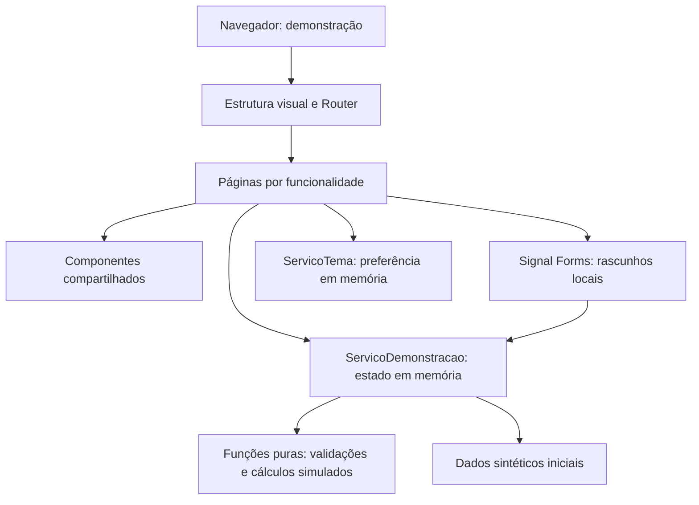
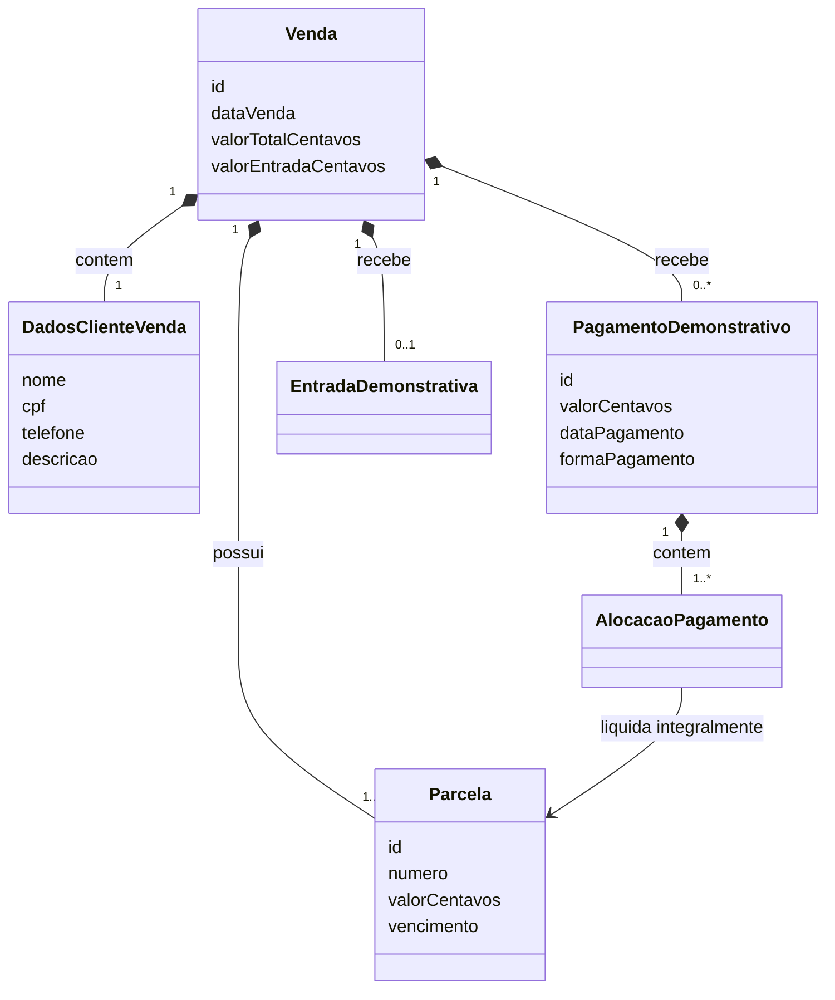
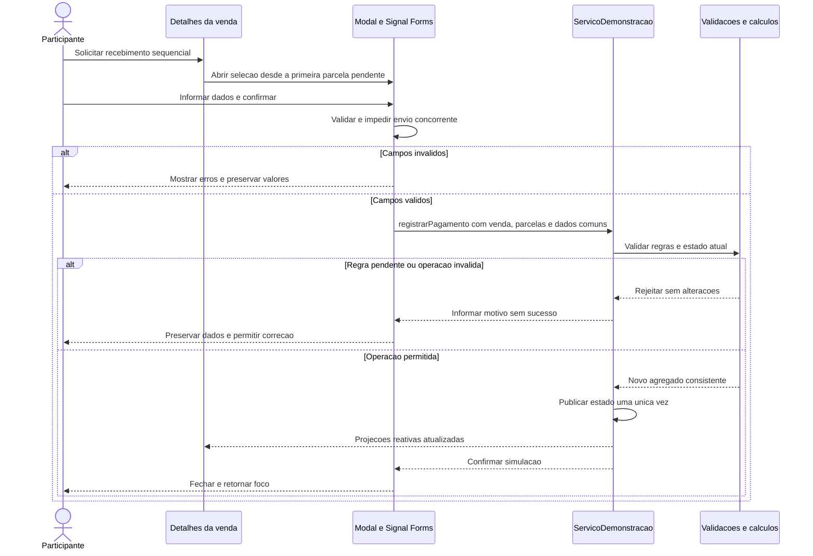

# TDD — Mercadão dos Óculos - Vendas em Aberto

> Technical Design Document: documento de desenho técnico do MVP visual. Não representa
> implementação, aprovação da ótica ou desenvolvimento orientado a testes. Todos os fluxos,
> arquivos e testes descritos como planejados ainda precisam de implementação autorizada.

## 1. Identificação e situação

**Acompanhamento de implementação — 18/11/2026:** reutilizados PRD 1.8 e TDD
1.12, sem novas regras/decisões. Apply autorizado no Harness, em
`feature/edicao-identificacao-vendas`, após integração documental do PR #13.
DEC-019 implementada no núcleo: validadores puros compartilhados, identificação
sintética compatível e comando `editarCliente`, com cópia defensiva, revalidação
do agregado e publicação atômica. O adaptador sem estado `PreparadorEdicaoCliente`
segue a fronteira de recebimento existente e permite doubles exclusivos do TestBed.
Sem nova dependência, rota ou UI de negócio. Verificações reais no README:
265 testes em 21 arquivos, 36 E2E da aplicação, 8 da fixture, build/formatação.
FASE-006 continua parcial, exigindo SDD próprio para interfaces. PEN-013/014 e
HIP-006 não foram encerradas por testes automatizados. Sync/archive, revisão,
merge e aceite não são presumidos; as descrições de planejamento abaixo são históricas.

**Registro do planejamento — revisão 1.12, 17/11/2026:** PRD 1.8 revisado primeiro por decisões
explícitas no Harness. PEN-008/010 resolvidas documentalmente: edição restrita aos
quatro campos do cliente em qualquer venda e identificação conforme RN-022/023.
DEC-019 planeja validação compartilhada, comando restrito e futura adequação do seed;
não altera código, contratos existentes ou dados nesta revisão. Change documental
`decisoes-edicao-identificacao-avaliacao`, com implementação dependente de novo pedido.
PEN-013 tem máquina/ambiente definidos, mas versão Chrome, viewport útil e execução
ainda pendentes. PEN-014 mantém papéis/autoridade, metas e confirmação de entrevistas
abertos; solicitante e equipe da ótica são participantes previstos, não avaliação feita.
HIP-006 e MET-001 a MET-005 permanecem para discussão. Esta revisão atualiza o mesmo
PR #13 sem autorizar apply, sync/archive de novos requisitos ou merge.

**Entrega vigente da FASE-005 — revisão 1.11 conciliada:** PRD 1.7 conciliado primeiro,
sem mudança de requisitos ou decisões. FASE-005 integrada pelo PR #9; ajustes de
DEC-018 integrados pelo [PR #10](https://github.com/Thig0S/TCC-Academia---Programation/pull/10),
commit `59af9a2`, confirmado no GitHub (18/11/2026 às 01:19 UTC, 17/11 local).
As Changes 004 e 005 estão arquivadas. Os deltas de `ajutes-fase-005` foram
sincronizados nas specs principais pelo commit `72ade92` da `main`; o registro da Change fica
em `openspec/changes/archive/2026-11-17-ajutes-fase-005/`. Essa consolidação documental
foi integrada à `main` pelo [PR #12](https://github.com/Thig0S/TCC-Academia---Programation/pull/12),
commit `c845ce9`, em 18/11/2026 às 01:51:53 UTC (17/11 local), conforme confirmação
no GitHub. O hash anterior `91208a7` pertence à branch original, não à `main`.

Listas paginadas sem cartões, filtros compactos, detalhe e links de DEC-017/018
estão implementados. A verificação integrada anterior em `frontend/README.md`
registra 197 testes unitários/componentes, 36 E2E reais, 8 E2E de fixtures e
build/formatação aprovados, com limitações explícitas: Chromium/Windows nos dois
viewports técnicos, zoom nativo por relato manual, aviso Sass e auditoria de
dependências pendente de análise. Nenhuma suíte de aplicação foi reexecutada nesta
revisão documental. FASE-006 e conteúdo financeiro da FASE-007 não foram antecipados.
As decisões atuais de PEN-008/010 estão na DEC-019; avaliação de PEN-013/014 permanece
pendente. Os registros anteriores
de planejamento e ausência de implementação são históricos; não exigem novo apply
das consultas entregues nem comprovam aceite comercial ou conclusão do MVP.

**Registro histórico — revisão 1.10, 16/11/2026:** PRD 1.6 revisado primeiro.
Planejamento dos ajustes transferido, por confirmação no Harness, para a nova
Change `ajutes-fase-005`; `fase-005` preserva o planejamento e as 20 tarefas anteriores.
Refinamento documental da consulta existente na `feature/ajustes-fase-005`, limpa
antes das edições; Change com 20/20 tarefas anteriores marcadas e commits locais de
implementação/verificação, sem nova execução ou confirmação de merge remoto.
DEC-018 substitui a exigência anterior de cartões em Vendas e a ausência de paginação
na DEC-017. Novos ajustes ainda não implementados; não alterar fonte, dependências,
regras financeiras ou seed. A regra civil de atraso no dia seguinte é mantida.
Visão Geral permanece planejada na FASE-007, não antecipada por esta revisão.
As descrições de indisponibilidade das consultas e da Change 004 não consolidada
abaixo são históricas: o histórico local já registra `b6a3f8b` de seu arquivamento.

**Registro anterior — revisão 1.9, 16/11/2026:** PRD 1.5 revisado primeiro, com
PEN-005/012 resolvidas no Harness. FASE-004 implementada na `main` (PR #7,
merge `1f184e3`, confirmado no GitHub e Git local); 156 testes e 26 E2E registrados
em `frontend/README.md`, sem reexecução nesta revisão. A Change 004 ainda não está
sincronizada/arquivada; isso fica fora do escopo. Esta revisão desenha a FASE-005:
listas, quatro cartões globais em Vendas, busca nas duas coleções, filtro de situação
somente nas abertas e detalhe/parcelas
somente leitura. Não implementa consultas ou mutações. Autorizados somente PRD/TDD
e artefatos OpenSpec da nova Change; novo pedido de apply após sua apresentação.
DEC-017 detalha a proposta técnica; o roadmap abaixo passa a refletir esse estado.
Afirmações históricas de ausência do núcleo, patches pendentes ou merge ainda não
executado não descrevem a situação vigente. Nenhum aceite da ótica é alegado.

**Verificação da FASE-004 — registro anterior ao merge, 16/11/2026:** seed adaptativo e integração implementados;
regressão limpa da FASE-004 com 156 testes e 26 E2E aprovados, build e formatação
saída 0. Evidências/limitações em `frontend/README.md`. O bloqueio anterior do seed
foi resolvido pela política e refinamento abaixo. Não comprova aceite de produto,
UI comercial ou integração na main; merge permanece sujeito a autorização.

**Decisão vigente — 16/11/2026, revisão 1.8:** PRD 1.4 aprovado no Harness, seguido
da aprovação desta política técnica para retomar o apply da FASE-004. Manter a
referência capturada e 12 vendas; limitar o mês calculado de cada venda entre
janeiro/0001 e novembro/9999, preservando o dia-base ou o último dia do mês-alvo.
Usar até quatro parcelas, reduzindo a quantidade ao número de meses disponíveis até
dezembro/9999. Calcular valores e liquidações pelas preparações puras existentes,
sem pressupor parcela de 20.000 centavos após reduzir a quantidade. Preservar o
conjunto anterior onde couber; variedade de situações só é dispensada onde impossível.
Testar bordas, transições e calendário gregoriano, determinismo e isolamento, além
da integração do serviço, reconciliação e recriação. Sem restrição adicional do
domínio, fallback de referência, UI nova ou dependências. Atualizar SDD antes do
código. O bloqueio e as evidências descritos abaixo são históricos.

Refinamento aprovado após revisão: o dia-base sintético e o prefixo pago também
podem variar nas bordas. Para próximos dias no início, usar 01/01/0001 (primeira
parcela 01/02); para atraso em fevereiro/0001, usar a mesma venda. Em dezembro/9999,
usar 31/10 com duas parcelas e a primeira liquidada para representar vencimento
pendente em 31/12 (aberto enquanto distante mais de sete dias e próximo depois).
No grupo próximo, esse histórico é necessário em 31/12; nos demais dias de dezembro
o mês anterior preserva o dia. Continuar somando os valores efetivos dos prefixos.

**Estado do apply em 15/11/2026:** núcleo de recebimentos e sessão implementados na
`feature/fase-004` (commits `72fba45`/`17255d2`), com regressão limpa registrada em
`frontend/README.md`: 143/143 testes e 26/26 E2E. Progresso 18/21; não é conclusão
da FASE-004. Revisão final identificou que o seed usa três meses anteriores e quatro
vencimentos futuros, podendo extrapolar 0001–9999 nas referências extremas. O
solicitante escolheu pausar para revisão: nenhum limite adicional ou fallback foi
aprovado, e a tarefa 4.1 foi reaberta. Resolver requisito no PRD antes de revisar o
desenho e SDD; sem PR, merge, sync ou arquivamento nesta retomada. Os estados e
avaliações anteriores abaixo são históricos, não evidência de entrega integral.

- **Produto:** Mercadão dos Óculos - Vendas em Aberto, demonstração de acompanhamento de vendas a prazo de uma ótica.
- **Etapa:** MVP visual no navegador, exclusivamente frontend.
- **Data e revisão:** 17/11/2026, revisão 1.12.
- **Destino:** `docs/tdd/tdd.md`, relativo à raiz do repositório.
- **Situação:** núcleo financeiro e consultas da FASE-005 com refinamentos DEC-018
  entregues; PRD 1.8 define edição e identificação, ainda não implementadas.
  Avaliação, aceite e controles posteriores conservam suas pendências.
- **Origem:** solicitação de especificação técnica baseada no `AGENTS.md`, com Angular 22,
  standalone, zoneless e Signals, seguida de duas rodadas de perguntas.
- **Autoridade:** escolhas técnicas e direção de temas confirmadas pelo solicitante nesta
  conversa. Não houve validação das regras comerciais pela equipe da ótica.
- **Implementação observada em 14/11/2026:** base técnica e FASE-003 presentes na `main` local,
  com rotas, temas, aviso e Configurações explicativa; mudança arquivada em
  `openspec/changes/archive/2026-11-14-fase-003/`. Evidências anteriores em `frontend/README.md`,
  incluindo complemento manual de zoom. Não se verificou PR remoto nesta revisão.
  FASE-001 global parcial; FASE-004 a FASE-008 não implementadas. Esta revisão apenas planeja.

As decisões completas estão centralizadas na seção 15. As demais seções detalham sua aplicação,
sem criar registros concorrentes. Pendências de produto são referidas como `PRD/PEN-xxx` e
hipóteses como `PRD/HIP-xxx`, para não confundir seus IDs com os deste documento.

**Atualização 1.7 durante apply autorizado:** o pedido explícito de apply `fase-004`
autoriza o núcleo descrito, não UI comercial. Os registros de planejamento 1.6 acima
e nas tabelas são históricos: utilitários e domínio de vendas possuem commits e
102 testes aprovados em `frontend/README.md`. Progresso atual 9/21 tarefas; recebimentos
parciais sem commit, fonte de sessão não implementada. Uma execução posterior passou
127/128 testes; a falha foi no mock de módulo, não evidência de atomicidade. A revisão
pontual de DEC-016 abaixo foi aprovada pelo solicitante; sua solução ainda não foi
implementada ou verificada. PRD 1.3 e suas regras permanecem inalterados.

## 2. Contexto, objetivos e limites

O MVP deve permitir validar navegação, cadastro e consulta de vendas, visualização de parcelas,
recebimentos simulados e resumos financeiros. A implementação futura deve ser pequena,
compreensível e consistente, sem antecipar infraestrutura de produção.

### Objetivos técnicos

1. Separar apresentação, estado demonstrativo e cálculos simulados.
2. Manter uma única fonte de dados em memória entre rotas, com indicadores derivados.
3. Evitar mutações parciais, submissões duplicadas e alterações ao cancelar formulários.
4. Usar APIs reativas compatíveis com execução zoneless e TypeScript estrito.
5. Suportar temas claro e escuro, teclado, foco e situações compreensíveis além da cor.
6. Permitir testes de regras, componentes e fluxos no navegador sem backend.

### Escopo e exclusões — DEC-001

Incluem-se os quatro módulos previstos no README e PRD: Visão Geral, Vendas, Relatórios e
Configurações. Quitadas pertence a Vendas. Dados do cliente ficam no cadastro e detalhe da
venda, sem cadastro mestre, unicidade de CPF ou módulo independente de clientes. Parcelas são
consultadas no contexto da venda; uma pasta de domínio não implica um módulo de navegação.

Ficam excluídos backend, HTTP de dados, banco, persistência em navegador ou arquivo, login,
integrações, dados reais, importação de planilha, exportação real, SSR, PWA e empacotamento
Tauri. Tauri, ASP.NET Core e SQLite permanecem somente como direção futura.

O aviso permanente deve dizer, em linguagem equivalente: **“Demonstração com dados fictícios.
As alterações são perdidas ao recarregar.”** Cadastro e pagamento são simulações, não cobranças.

### Critérios para avaliar o desenho

- Uma mutação aceita altera uma única fonte e todas as projeções observam a mesma versão.
- Cancelamento e falha mantêm o estado anterior; erros não produzem mensagem de sucesso.
- Valores são centavos inteiros; datas civis não mudam de dia por fuso.
- Nenhuma regra pendente é resolvida silenciosamente por código.
- Rotas, formulários, modais e temas possuem cenários de verificação descritos na seção 12.

## 3. Fontes e estado atual

| Fonte | Caminho ou URL e seção | Versão/consulta | Contribuição |
| --- | --- | --- | --- |
| FON-001 | `AGENTS.md`, escopo, estrutura, componentes, formulários e verificação | Leitura em 12/11/2026 | Restrições técnicas e limites obrigatórios |
| FON-002 | `README.md`, direção visual, módulos e fluxos de vendas | Leitura em 12/11/2026 | Escopo funcional e conflito de tema |
| FON-003 | `docs/prd/vendas-em-aberto.md`, requisitos, critérios e pendências | Revisão 1.0, leitura em 12/11/2026 | Rastreabilidade e regras não decididas |
| FON-004 | Solicitação e respostas às duas rodadas de perguntas nesta conversa | 12/11/2026 | Angular 22 e confirmações técnicas |
| FON-005 | Inspeção de `frontend/`, `frontend/src/app/`, `openspec/specs/`, `openspec/changes/` e busca por `package.json` | 12/11/2026 | Estado local, não execução |
| FON-006 | https://angular.dev/reference/versions | Documentação v22, 12/11/2026 | Compatibilidade de Node.js, TypeScript e RxJS |
| FON-007 | https://angular.dev/guide/zoneless | Documentação v22, 12/11/2026 | Zoneless, notificações e testes |
| FON-008 | https://angular.dev/guide/forms/signals/overview e https://angular.dev/api/forms/signals/form | Documentação v22, 12/11/2026 | Signal Forms; `form` estável desde v22.0 |
| FON-009 | https://angular.dev/guide/forms/signals/form-submission | Consulta pelo Context7 em 12/11/2026 | Validação, `submit`, erros e concorrência |
| FON-010 | https://angular.dev/guide/testing | Documentação v22, 12/11/2026 | Integração Angular CLI, Vitest e jsdom |
| FON-011 | https://playwright.dev/docs/test-webserver | Consulta pelo Context7 em 12/11/2026 | Servidor local e configuração de E2E |
| FON-012 | https://developer.mozilla.org/en-US/docs/Web/HTML/Reference/Elements/dialog | Consulta em 12/11/2026 | Modal nativo, teclado e foco |
| FON-013 | https://getbootstrap.com/docs/5.3/customize/ e https://getbootstrap.com/docs/5.3/customize/color-modes/ | Bootstrap 5.3.8, consulta via Context7 em 12/11/2026 | Personalização Sass, variáveis CSS e temas com `data-bs-theme` |
| FON-014 | Solicitação de revisão para utilizar Bootstrap em vez de CSS puro | 12/11/2026, revisão 1.2 | Substituição da base visual própria por Bootstrap; DEC-013 |
| FON-015 | Respostas do solicitante no planejamento OpenSpec das FASE-001/002 | 12/11/2026, revisão 1.3 | Recorte das duas fases, Prettier sem lint e smoke E2E Chromium/Windows; autorização de revisão pontual deste TDD, não de implementação |
| FON-016 | Documentação via Context7: Angular CLI `/angular/angular-cli/v22.2.2`, Playwright `/microsoft/playwright`, Prettier `/prettier/prettier` e Bootstrap `/twbs/bootstrap/v5.3.8` | 12/11/2026 | Builder de testes/build, webServer e viewport, formatação e importação Sass; não prova compatibilidade local dos patches |
| FON-017 | Respostas do solicitante no planejamento `fase-004`; PRD 1.3, RN-011 a RN-017, CA-024/025 | 14/11/2026 | Regras demonstrativas confirmadas; lote sequencial amplia o recebimento original; não autoriza apply |
| FON-018 | `frontend/src/app/nucleo/configuracao/servico-tema.ts`, seu teste com RouterTestingHarness, `reatividade.spec.ts`, `app.config.ts`, rotas, testes de conteúdo e manifesto | 14/11/2026, inspeção sem execução | Padrão de serviço raiz, Signals e testes; páginas comerciais indisponíveis, nenhum domínio financeiro existente |
| FON-019 | Context7 `/websites/angular_dev`, guia Signals e API WritableSignal (`https://angular.dev/guide/signals`, `https://angular.dev/api/core/WritableSignal`) | 14/11/2026 | Signal privado e leitura readonly; `asReadonly` não impede mutações profundas. Consulta geral, não comprova execução no patch 22.2.6 |
| FON-020 | PRD 1.5; Harness de 16/11/2026; fonte, rotas, conteúdo, seed e testes existentes | Inspeção nesta revisão | Busca nas duas coleções aprovada; IDs com barras (`seed/venda/1`), serviço readonly e testes de indisponibilidade a revisar somente em Vendas |
| FON-021 | Context7 `/websites/angular_dev`, `https://angular.dev/api/router/Router`, `https://angular.dev/guide/signals` | 16/11/2026 | Router constrói URLs por segmentos; signals/computed derivam filtros. Consulta geral, não comprova comportamento do patch 22.2.6; round-trip de ID e navegação precisam de teste local no apply |
| FON-022 | PRD 1.6/FON-010; imagens de `frontend/public/imgs/exemplos/`; respostas no Harness | 16/11/2026 | Desktop 1366×768/100%, paginação de 10 nas duas coleções, detalhe compacto com excedente interno, links integrados, atraso civil mantido; autorização exclusivamente documental |
| FON-023 | PRD 1.8/FON-011 e aprovação no Harness; inspeção de `venda.validacoes.ts`, `servico-demonstracao.ts`, seed e specs principais; consulta local do Windows | 17/11/2026 | Edição só de nome/CPF/telefone/descrição, CPF com verificadores, telefone 10/11, adequação futura do seed e ambiente do solicitante com escala 125%; sem implementação ou novas APIs de biblioteca |

As consultas ao Context7 incluíram Angular e Playwright. Para Angular 22, as páginas oficiais
v22 foram usadas para confirmar a compatibilidade e resolver a falta de precisão dos trechos
retornados para a branch `22.0.x`. Não foram enviados arquivos privados às consultas.

### Evidências locais e divergências

**Atualização da revisão 1.4:** os itens abaixo registram a inspeção histórica inicial,
não o estado atual. A base técnica foi entregue e a mudança arquivada em
`openspec/changes/archive/2026-11-13-preparar-base-tecnica-frontend/`, com capacidade
`demonstracao-inicial` consolidada. O PR #4 está mesclado e seu commit consta na `main`.
`frontend/README.md` registra build, 5 testes unitários/componentes e 8 execuções E2E
aprovados anteriormente, sem nova execução nesta revisão. O solicitante confirmou dois
temas com escuro inicial e autorizou conciliar o PRD 1.1; PEN-006 está resolvida
documentalmente. HIP-004 foi aceita para Configurações explicativa; filtros de Quitadas
continuam pendentes em PRD/PEN-012. Os registros históricos não revogam essas atualizações.

- Existem `frontend/src/app/`, `public/`, `.vscode/`, `dist/` e `.angular/`; a pasta da aplicação
  está vazia e não foi encontrado manifesto. Saídas e caches não provam implementação.
- `openspec/specs/` contém `.gitkeep`; não há mudança ativa visível em `openspec/changes/`.
  O TDD é independente e não modifica configuração ou artefatos OpenSpec.
- A ausência absoluta de pasta de aplicação descrita no `AGENTS.md` está desatualizada quanto
  à estrutura, mas não comprova a existência de código ou testes.
- `AGENTS.md` pede tema claro; README pede dois temas com escuro inicial. O solicitante
  **confirmou dois temas com escuro inicial para este desenho**: DEC-006. O PRD e as instruções
  permanecem intactos; sua conciliação documental exige tarefa posterior. Uma implementação
  futura deve observar essa divergência e as instruções então vigentes.
- A árvore recomendada no `AGENTS.md` inclui clientes e parcelas. Ela é organizacional, não
  obrigação de criar páginas que contrariem o recorte funcional explícito do README e PRD.

## 4. Síntese da entrevista técnica

| Tema | Resposta explícita | Decisão |
| --- | --- | --- |
| Framework | Angular 22, standalone, zoneless e Signals | DEC-002 |
| Execução e diretório | SPA no navegador, em `frontend/`, sem SSR ou Tauri nesta etapa | DEC-001, DEC-003 |
| Estilos | SCSS e componentes próprios na entrevista inicial; base visual substituída por Bootstrap na revisão 1.2 | DEC-006, DEC-013 |
| Temas | Claro e escuro; escuro na abertura | DEC-006 |
| Estado | Serviço demonstrativo com Signals, sem biblioteca adicional | DEC-004 |
| Qualidade | Testes unitários, de componentes e E2E; plano Vitest + Playwright confirmado | DEC-008 |
| Ambiente | Node.js 24 a partir de 24.15.0, npm, lockfile e TypeScript 6.0.x | DEC-009 |
| Modais e ícones | `dialog` nativo e SVG local | DEC-007 |
| Regras abertas | Registrar pendências; não decidir regras de produto neste TDD | DEC-011 |
| Entrega | Consolidar o plano com diagramas Mermaid em `tdd.md` | DEC-012 |

Signal Forms já é exigência de FON-001 e foi incluído no resumo do plano confirmado.
Nenhuma resposta aprovou as hipóteses demonstrativas do PRD nem políticas financeiras.

## 5. Arquitetura e responsabilidades

### Visão proposta — DEC-003, DEC-004 e DEC-005



O diagrama representa dependências propostas, não comunicação com backend. As páginas
orquestram interação; o serviço concentra os comandos de cadastro, edição e recebimento;
funções puras fazem cálculos verificáveis. Os componentes compartilhados não importam páginas
nem acessam diretamente o estado financeiro. O serviço não depende de HTML, Router ou modal.

| Parte | Responsabilidade | Não deve fazer |
| --- | --- | --- |
| Estrutura visual | Navegação, aviso demonstrativo e área de conteúdo | Calcular saldos ou modificar vendas |
| Páginas | Consultar projeções e encaminhar comandos validados | Manter cópias concorrentes de totais |
| Formulários | Rascunho, validação de campos e interação de envio | Editar objetos originais antes de confirmar |
| Fonte demonstrativa | Estado canônico e mutações atômicas | Persistir, simular HTTP ou definir política comercial |
| Utilitários de domínio | Dinheiro, datas, parcelas e projeções conforme regras confirmadas | Depender de componentes ou acessar DOM |
| Componentes compartilhados | Apresentação e eventos tipados | Virar plataforma genérica de tabelas |
| Serviço de tema | Tema ativo e alternância da sessão | Salvar preferência no navegador |

Na FASE-004 somente o núcleo de domínio e seus testes serão acrescentados; as páginas
continuarão honestamente indisponíveis. DEC-015/016 detalham os contratos propostos.
Não haverá repositório abstrato, interface HTTP fictícia ou camadas vazias “para o futuro”.
A futura integração exigirá planejamento próprio; os modelos internos não são contratos de API.

## 6. Linguagem, framework e ferramentas

| Tecnologia | Uso planejado | Versão/faixa | Situação e referência |
| --- | --- | --- | --- |
| Angular e Angular CLI | SPA, componentes, rotas e build | Linha 22.x, pacotes Angular compatíveis e alinhados | Confirmado; DEC-002 e DEC-009 |
| TypeScript | Aplicação e configurações | `>=6.0.0 <6.1.0` | Confirmado; tabela oficial FON-006 |
| Node.js | CLI e ferramentas, não servidor de negócio | Linha 24.x, `>=24.15.0 <25.0.0` | Confirmado; FON-006 |
| npm | Dependências e scripts | Versão compatível com Node.js escolhido, a fixar na base | Gerenciador confirmado; patch pendente |
| RxJS | Dependência do ecossistema Angular quando necessária | Linha 7 compatível com `^7.4.0` | Faixa permitida por FON-006; não biblioteca de estado |
| Signal Forms | Cadastro, edição e recebimento | `@angular/forms/signals`, mesma linha do Angular | Confirmado; `form` estável em v22.0, FON-008 |
| Bootstrap | Base visual: layout responsivo, utilitários, tabelas, botões e campos | Linha estável 5.3.x; patch a fixar na base, referência consultada 5.3.8 | Escolha confirmada; somente estilos, sem plugins JavaScript; DEC-013 e FON-013 |
| SCSS | Personalizações do Bootstrap e estilos específicos da aplicação | Ferramenta compatível com CLI 22 e Sass do Bootstrap, a verificar e fixar | Complementar ao Bootstrap; não base visual independente; DEC-013 |
| Vitest e jsdom | Unitários e componentes | Versões compatíveis com CLI 22 e TypeScript escolhido | Ferramentas confirmadas; versões exatas pendentes |
| Playwright Test | E2E em navegador real | Versão a verificar e fixar na criação da base | Ferramenta confirmada, não instalação validada |

Faixas não substituem o lockfile: na criação da base, resolver patches compatíveis, verificar
`peerDependencies` e `engines`, registrar versões e gerar `package-lock.json`. Não copiar
versões de ferramentas antigas nem adotar a próxima major automaticamente.

### Convenções Angular — DEC-002

- Bootstrap standalone com `bootstrapApplication`; configuração em `app.config.ts` e rotas
  em `app.routes.ts`. Sem `AppModule` ou módulos próprios de funcionalidades.
- Zoneless é o padrão em Angular 21+ segundo FON-007. Não adicionar `zone.js`,
  `zone.js/testing` ou `provideZoneChangeDetection` na base nova.
- Atualizar a interface por signals lidos no template e eventos vinculados. Evitar depender
  de `NgZone.onStable` ou de alteração silenciosa de propriedades comuns.
- Componentes compatíveis com `OnPush`; explicitar a estratégia quando útil para tornar o
  contrato evidente, sem tratá-la como requisito isolado para ativar zoneless.
- `signal` para estado, `computed` para projeções, `effect` somente para efeitos externos
  indispensáveis. Não usar effects para sincronizar cópias de saldo.
- Preferir `inject()`, dependências internas `private readonly`, membros do template
  `protected`, referências de signals `readonly` e tipos públicos de retorno explícitos.
- HTML separado, imports explícitos, `@if`, `@for` com `track` por identificador estável.
- TypeScript e templates estritos; sem `any` para contornar os contratos de domínio.

## 7. Organização estrutural e convenções

### Árvore proposta, relativa à raiz — DEC-003

```text
frontend/
  package.json                 (a criar)
  package-lock.json            (a gerar pelas ferramentas)
  angular.json                 (a criar)
  tsconfig.json                (a criar)
  playwright.config.ts         (a criar para E2E)
  public/                      (pasta existente; conteúdo não auditado)
  e2e/                         (cenários a criar)
  src/
    main.ts
    index.html
    styles.scss
    estilos/
      _tokens.scss
      _temas.scss
    app/                       (pasta existente, vazia na inspeção)
      app.ts
      app.html
      app.scss
      app.config.ts
      app.routes.ts
      nucleo/
        configuracao/
          servico-tema.ts
        demonstracao/
          servico-demonstracao.ts
          dados-demonstrativos.ts
          demonstracao.modelos.ts
      compartilhado/
        componentes/
          barra-navegacao/
          cabecalho/
          indicador-resumo/
          selo-situacao/
          modal/
      funcionalidades/
        vendas/
          listar-vendas/
          listar-vendas-quitadas/
          cadastrar-venda/
          editar-venda/
          detalhes-venda/
          formulario-venda/
          venda.modelos.ts
          venda.validacoes.ts
          venda.calculos.ts
        parcelas/
          registrar-pagamento/
          parcela.modelos.ts
          parcela.calculos.ts
        visao-geral/
        relatorios/
        configuracoes/
```

A árvore descreve destino, não arquivos entregues. Só criar componentes e arquivos quando
necessários. Testes `*.spec.ts` ficam junto ao código; não foram repetidos na árvore.
`parcelas/` contém domínio e interação de recebimento, não uma rota independente de listagem.
Dados do cliente serão um tipo interno de venda, sem duplicar um cadastro mestre.

Direção das dependências: páginas importam componentes, contratos e fonte; a fonte importa
modelos e funções de domínio; modelos não importam serviços ou componentes. Funções de um
domínio permanecem nele; dinheiro e datas só são compartilhados se houver reutilização real.

Nomes próprios seguem português sem acentos nos identificadores: `Venda`, `Parcela`,
`PagamentoDemonstrativo`, `clienteSelecionado`, `registrarPagamento` e seletores `app-...`.
Textos e comentários usam acentuação normal. Preservar nomes de APIs e arquivos convencionais.
UTF-8, dois espaços, aspas simples e largura de formatação de 100 caracteres.

### Rotas propostas

| Caminho | Conteúdo |
| --- | --- |
| `/visao-geral` | Indicadores gerais |
| `/vendas` | Vendas em aberto |
| `/vendas/quitadas` | Vendas quitadas |
| `/vendas/cadastrar` | Cadastro com dados do cliente |
| `/vendas/editar/:id` | Edição futura somente dos quatro campos do cliente, conforme DEC-019 |
| `/vendas/:id` | Detalhes e parcelas da venda |
| `/relatorios` | Resumo financeiro demonstrativo |
| `/configuracoes` | Página de configurações e limites da demonstração |

Carregar páginas com `loadComponent` quando adequado. Declarar caminhos específicos antes do
dinâmico `:id`. Encaminhar a entrada vazia à Visão Geral e oferecer retorno para caminho
desconhecido. Registro ausente deve ser distinto de coleção vazia. Caso se adotem inputs de
rota, habilitar a vinculação correspondente e usar `id` consistentemente. O mecanismo exato
de vinculação não foi decidido; não é necessário para consolidar os caminhos propostos.

## 8. Estado, dados e cálculos

### Estado canônico — DEC-004

`ServicoDemonstracao`, com escopo raiz da aplicação, possui um signal privado para o agregado
demonstrativo e expõe leitura e consultas derivadas. Não fornecer outra instância nas páginas
lazy, o que reiniciaria os dados ao navegar. A recarga cria uma nova instância e restaura o
conjunto sintético inicial.

Usar modelos somente leitura para consultas e atualizações imutáveis. `asReadonly()` não faz
congelamento profundo: não expor referências mutáveis como se fossem seguras. Formulários
recebem cópias independentes e a coleção inicial não é modificada em operações da sessão.

Cada comando valida primeiro e constrói um novo agregado antes de publicar uma única
atualização. Erros de validação não alteram estado; exceções imprevistas também não podem
deixar venda, parcelas e pagamentos em versões diferentes. O resultado interno deve distinguir
sucesso, validação, regra pendente e registro inexistente, com mensagens em português.

### Modelos conceituais propostos — DEC-005



Este é um modelo interno proposto, não esquema SQL ou contrato HTTP. Cada venda mantém
seus dados de cliente. Conforme DEC-015 e PRD/RN-013/016, um pagamento pertence a uma venda
e aloca o valor integral de uma ou mais parcelas consecutivas; cada parcela possui zero ou
uma alocação aceita. A entrada é separada, nunca uma parcela ou alocação de pagamento.

- Identificadores são estáveis, independentes do índice de uma lista ou nome do cliente.
- Ausência de descrição, data de pagamento ou forma deve ser representada explicitamente,
  sem inventar valores. A nulabilidade depende da semântica, não de conveniência de template.
- Não manter `totalPago`, `saldoDevedor` e totais de painel como valores editáveis duplicados:
  são projeções da mesma fonte segundo as regras confirmadas.
- Situações de parcela e venda são derivadas pelas prioridades de PRD/RN-014, não armazenadas
  como campos editáveis nem inferidas a partir de cores. Próximo vencimento é a menor data
  entre parcelas pendentes, inclusive vencidas; ausente quando todas forem liquidadas.

### Dinheiro e datas — DEC-005 e DEC-011

Representar valores monetários por inteiros seguros em centavos. Converter entradas textuais
explicitamente, rejeitando valores ambíguos ou inválidos; não calcular finanças com frações
binárias nem arredondar silenciosamente o resultado final. Converter centavos para BRL somente
na apresentação, usando recursos de internacionalização da plataforma/Angular.

Fórmula: `valorAParcelarCentavos = valorTotalCentavos - valorEntradaCentavos`.
A distribuição, os limites financeiros e a contabilização seguem PRD/RN-012/013/017,
centralizados tecnicamente em DEC-015. Somar ou multiplicar centavos exige verificar também
o resultado como inteiro seguro, inclusive nas projeções globais; overflow rejeita o comando.

Representar datas civis com formato interno `AAAA-MM-DD` validado, não como instantes UTC.
Separar parse, comparação civil e formatação `DD/MM/AAAA`. Não usar conversão para UTC como
atalho para obter o dia local. Operações de calendário não devem somar blocos de 24 horas ou
30 dias para produzir meses. Meses sem o dia original seguem PRD/RN-011, usando o último dia
do mês afetado sem alterar o dia-base dos seguintes. Contrato técnico: calendário gregoriano,
anos 0001 a 9999; rejeitar datas inválidas ou geração que ultrapasse esse intervalo.

A referência é capturada no início da aplicação e mantida na sessão, conforme PRD/RN-015.
A data da venda inicia nessa referência e pode ser alterada no cadastro para uma data não futura;
após cadastro, não é editável por DEC-019. Entrada usa a data da venda. Testes fornecem
a referência explicitamente; funções de domínio
não leem relógio nem fuso. DEC-016 define inicialização e injeção testável.

## 9. Fluxos técnicos e tratamento de falhas

### Cadastro e edição — DEC-004, DEC-010 e DEC-019

1. Criar o rascunho a partir de valores iniciais centralizados ou cópia da venda existente.
2. Construir Signal Forms sobre esse rascunho; a prévia é derivada e não grava registros.
3. Ao confirmar, validar identificação por RN-022/023 também no núcleo. Na edição, enviar
   somente nome, CPF, telefone e descrição; não usar o comando de cadastro para recriar
   parcelas. Todos os dados financeiros e a data da venda permanecem fora do rascunho editável.
4. Encaminhar comando tipado ao serviço, que revalida os dados e a elegibilidade atual.
5. Em sucesso, publicar o novo agregado e comunicar que o registro foi simulado.
6. Em falha, manter rascunho, apresentar erro e liberar nova tentativa. Cancelar descarta o
   rascunho sem chamar o comando. A edição não deve reescrever pagamentos por conveniência.

### Recebimento proposto — DEC-007, DEC-010, DEC-011 e DEC-015



O fluxo representa a futura interface da FASE-006; na FASE-004 são planejados somente
o comando e suas funções puras. Elegibilidade, integralidade, ordem, antecipação, datas e
formas seguem PRD/RN-016. Revalidar o prefixo de parcelas pendentes no estado atual antes
de construir qualquer alocação. Uma seleção obsoleta ou repetida rejeita o lote inteiro,
mesmo se o formulário anteriormente fosse válido. Não exigir datas cronologicamente crescentes
entre lotes: somente o intervalo aprovado entre venda e referência, sem regra adicional.

Se a quitação integral for válida segundo as decisões de produto, a venda passa das abertas
para quitadas por projeções do estado, sem copiar ou mover registros entre coleções canônicas.
Cancelar, inclusive por Escape, nunca confirma recebimento. Exceção inesperada deve preservar
o agregado anterior e não deixar o formulário permanentemente em envio.

### Busca, navegação e relatórios

- Busca será local e derivada, conforme PRD/RN-018/019 e DEC-017; PEN-005 foi
  resolvida para a FASE-005. Não adotar debounce ou rede fictícia sem necessidade.
- Navegação preserva o estado da sessão, mas não exige persistência dos rascunhos abandonados.
- Coleção vazia, filtro sem resultado e venda inexistente têm mensagens e ações distintas.
- Relatórios e painéis leem a fonte compartilhada. Não substituir métricas por números fixos
  incompatíveis com as mutações; universos e períodos seguem PRD/RN-015.
- Exportação permanece ilustrativa, sem arquivo e sem mensagem falsa de conclusão.

## 10. Interface, estilos, formulários e acessibilidade

**Contrato vigente do refinamento 1.10:** aplicar DEC-018 e PRD/CA-027/028/029 às
listas/detalhe e aos links compartilhados afetados. As restrições históricas de não
refinar o conteúdo principal ou de exigir sublinhado permanente cedem ao padrão das
referências, sem retirar foco, semântica, contraste ou indicação de página atual.
Não redesenhar a logo nem introduzir funcionalidades copiadas das imagens.

### Estilos e temas — DEC-006 e DEC-013

**Registro histórico do refinamento visual 1.5, baseado no PRD 1.2:** a lateral terá superfície vermelha no tema
claro e degradê vertical estático vermelho → vinho no escuro, seguindo os dois exemplos
indicados pelo solicitante. Interpretar “transição” como gradação espacial, não animação.
Usar propriedades CSS locais de fundo, texto/ícones, texto secundário, bordas, foco, hover
e ativo, aplicadas sob `data-bs-theme`, sem substituir os tokens do conteúdo principal.
No claro, ativo com superfície clara e texto vermelho escuro; no escuro, ativo vermelho
destacado com texto claro, sempre sujeito aos mínimos de contraste. Preservar sublinhado,
aria-current e Quitadas, inclusive no bloco responsivo. A logo permanece intacta.
Não adicionar dependências nem plugins. A verificação deve cobrir os dois viewports,
extremos e região intermediária do degradê, texto secundário/perfil, ativo/hover e foco:
4,5:1 para texto comum e 3:1 para foco/controles essenciais. Os resultados anteriores
continuam históricos; repetir a regressão afetada. Zoom nativo 200% segue pendente e não
será substituído por CSS zoom; nenhuma abertura de PR antes de concluir a Change.

Bootstrap será a base visual no lugar de construir a interface somente com estilos próprios.
Usar seu layout responsivo, utilitários e estilos de tabelas, botões e campos, preservando os
componentes Angular por funcionalidade. SCSS continua apenas para personalizações e necessidades
específicas; não se trata de eliminar CSS, mas de evitar reconstruir os padrões já fornecidos.

Planejar a dependência `bootstrap` pelo npm e a inclusão global de seus estilos em
`styles.scss`, sem CDN ou duplicação da folha completa em cada componente. Verificar o pipeline
Sass na criação da base. Tokens próprios para superfícies, texto, bordas, destaque e situações
devem se alinhar às variáveis do Bootstrap, evitando dois sistemas visuais concorrentes.
Preservar classes, atributos e variáveis externas como `btn`, `form-control` e `--bs-*`;
identificadores próprios continuam em português. Não adicionar Tailwind, ng-bootstrap ou
ngx-bootstrap por consequência dessa escolha.

Utilizar somente a camada de estilos do Bootstrap, sem seus plugins JavaScript, bundle ou
Popper. Angular continua responsável por estado e interações; o modal permanece o `dialog`
nativo da DEC-007, sem migrar para o modal JavaScript do Bootstrap. A aparência do modal pode
reutilizar estilos compatíveis, sem classes que dependam do plugin para funcionar.

`ServicoTema` mantém um signal com tema claro ou escuro; o inicial é escuro por decisão do
solicitante. Aplicar o tema ao contêiner da aplicação e manter todos os modais sob o mesmo
contexto visual. Vincular o tema ao atributo `data-bs-theme`, mapeando os valores internos para
`light` e `dark`, conforme FON-013. Não consultar preferência do sistema para contrariar o padrão escolhido nem
salvar em `localStorage`. Recarregar volta ao escuro. Alternância tem nome acessível e indicação
do tema ativo, preservando contraste e foco em ambos.

Layout otimizado para desktop e adaptável, com tabela sem perda de informação e rolagem
horizontal quando necessária. Tamanhos mínimos e máquina de validação ainda não estão
aprovados. Gráficos são opcionais: não adicionar biblioteca antes de justificar a necessidade.

### Formulários — DEC-010

- Usar `form` e `FormField` de `@angular/forms/signals`, sem duplicar estado com Reactive Forms.
  A API `form` é estável desde Angular 22.0; confirmar a estabilidade das demais APIs utilizadas
  na versão exata antes da implementação, sem ativar recursos experimentais por padrão.
- O signal fornecido a `form` é a fonte dos valores. Nunca vinculá-lo diretamente ao objeto
  canônico da venda em edição: a documentação alerta que alterações escrevem no modelo.
- Centralizar valores iniciais e esquema de validação. Regras estruturais e validações de
  domínio devem ser reutilizadas pela fonte, sem copiar lógica financeira para componentes.
- Tratar submissão pelo caminho oficial de Signal Forms (`submit` ou integração documentada
  de `FormRoot`), revelando erros de campos inválidos e focando o primeiro campo pertinente.
- `submit` bloqueia submissões concorrentes e pode rejeitar a Promise se a ação lançar erro.
  Tratar tanto erros retornados quanto exceções; não fechar o modal apenas porque a Promise
  resolveu sem examinar o resultado. Ação local não exige RxJS ou atraso artificial.
- Bloquear o botão durante envio não basta: revalidar no caminho de confirmação e na fonte.
  Cancelar deve ser um botão que não submete; campos preenchidos permanecem após falha.

### Modal e acessibilidade — DEC-007

Encapsular `<dialog>` em componente próprio e abrir com `showModal()`, não apenas com atributo
`open`. O navegador fornece modalidade e torna o restante da página inerte. A camada própria
fornece título associado, foco inicial adequado, botão de cancelar/fechar, tratamento coerente
dos eventos de cancelamento e fechamento e retorno ao acionador.

Não adicionar `tabindex` ao elemento `dialog`. Se o acionador desaparecer após quitação,
retornar foco a uma ação lógica remanescente, não a um nó removido. Escape deve cancelar e o
rascunho não pode ser confirmado pelo fechamento. Os comportamentos serão testados no browser:
jsdom não comprova top layer, contenção de foco ou acessibilidade nativa.

Usar `lang="pt-BR"`, rótulos ligados aos campos, erros associados via `aria-describedby` quando
aplicável, títulos hierárquicos, nomes em botões de ícone e estados ARIA coerentes. Ícones
decorativos SVG ficam ocultos de tecnologias assistivas; texto comunica situação além da cor.
Mensagens de resultado devem ser anunciáveis sem roubar foco indevidamente. Respeitar
preferência de movimento reduzido; não introduzir animação como requisito de compreensão.

## 11. Bibliotecas e alternativas

| Necessidade | Escolha | Alternativa considerada | Impactos e limites | Decisão |
| --- | --- | --- | --- | --- |
| Estado | Signals e serviço próprio | NgRx ou outra store | Sem dependência adicional; requer disciplina de imutabilidade | DEC-004 |
| Formulários | Signal Forms | Reactive Forms | Alinhado ao AGENTS.md; API compatível com v22 | DEC-010 |
| Estilos | Bootstrap 5.3.x, com personalização SCSS e componentes Angular próprios | Somente estilos próprios; Tailwind; biblioteca de componentes Angular | Dependência visual adicional; reduz reconstrução de padrões, mas exige personalização e verificação de acessibilidade | DEC-013; substitui a parte de estilos da DEC-006 |
| Modal | `dialog` nativo encapsulado | Angular CDK ou biblioteca visual | Requer testes reais de foco e retorno | DEC-007 |
| Ícones | SVG local | Biblioteca de ícones | Sem importação de catálogo inteiro; verificar procedência de assets | DEC-007 |
| Unitários/componentes | Vitest, jsdom e TestBed | Karma/Jasmine | Integração padrão documentada da CLI atual; DOM não é browser real | DEC-008 |
| E2E | Playwright Test | Só roteiro manual | Testa browser real; requer binários e ambiente compatíveis | DEC-008 |
| Datas/dinheiro | Funções pequenas de domínio e plataforma | Biblioteca adicional | Evita custo desnecessário; exige casos de borda bem testados | DEC-005 |

Não há novas dependências instaladas por este documento. Patches, licenças exatas e requisitos
transitivos devem ser verificados na criação do manifesto; esta consulta não foi auditoria de
licenças ou vulnerabilidades. SVG copiado de terceiro exige licença compatível e atribuição
quando aplicável. Sem origem definida, não presumir que um ícone pode ser redistribuído.

## 12. Qualidade e plano de verificação

### Estratégia confirmada — DEC-008

Vitest com integração da Angular CLI para funções, serviços e componentes; TestBed zoneless;
jsdom para DOM simulado. Playwright Test para E2E, incluindo dialog nativo e teclado nas fases
funcionais. O smoke inicial usa DEC-014; versões exatas e requisitos do Windows devem ser
conferidos na base, sem antecipar testes de funcionalidades ainda ausentes.

Preferir eventos e `await fixture.whenStable()` a forçar atualização indiscriminadamente com
`detectChanges()`, evitando mascarar ausência de notificações zoneless. Cenários E2E devem
isolar sessões por recarga/contexto novo, sem persistir dados ou criar endpoints de teste.

**Revisão 1.7 — falhas de preparação:** não usar mock de exportação de módulo relativo
para o núcleo puro no runner Angular existente. Usar a fronteira específica
`PreparadorRecebimento` de DEC-016, substituível por doubles em TestBed, preservando a
preparação pura e a comparação de snapshots completos em falhas posteriores e finais.
Não excluir esses cenários nem aceitar a falha do mecanismo de mock como teste aprovado.

| Área | Cenários e resultado esperado | Nível | Referências |
| --- | --- | --- | --- |
| Dinheiro | Parse, inteiros seguros, soma, entrada e invariantes sem arredondamento silencioso | Unitário | DEC-005; PRD/CA-008 e CA-014 |
| Parcelamento | Soma exata, resto nas primeiras e parcela mínima de um centavo | Unitário, planejado | PRD/CA-009; RN-012/017 |
| Datas | Fusos distintos, bissexto, dia-base preservado e último dia no mês afetado | Unitário, planejado | PRD/CA-009/020; RN-011 |
| Estado | Cancelamento não altera; erro mantém agregado; sucesso publica versão coerente | Serviço | PRD/CA-016 e CA-017 |
| Formulários | Descrição opcional, obrigatórios, envio inválido revela erros, rascunho preservado | Componente e E2E | PRD/CA-006, CA-007, CA-016 |
| Identificação e edição restrita | CPF com/sem pontuação, verificadores/sequências; telefone 10/11 sem +55; CPF repetido; edição em venda sem recebimentos/com entrada/paga/quitada sem alterar finanças ou outras vendas; seed compatível e busca preservada | Unitário, serviço e integração futuros; UI na FASE-006, sem execução nesta revisão | DEC-019; PRD/RN-021/022/023 e CA-007/012/016/017/030 |
| Duplicidade | Clique repetido não duplica pagamento; parcela já liquidada é revalidada | Serviço e E2E | PRD/CA-013 |
| Busca | Vazios, ausência de resultados e critérios conforme política aprovada | Unitário, componente e E2E | PRD/CA-004, CA-005, CA-019 |
| Navegação | Quatro módulos, quitadas interna, ID ausente e retorno | Componente e E2E | PRD/CA-001, CA-003, CA-018 |
| Pagamento | Lote integral consecutivo, rejeição de salto/duplicidade/erro sem mutação, soma reconciliada com entrada | Serviço na FASE-004; UI/E2E de negócio na FASE-006 | PRD/CA-008/011/013/014/024 |
| Referência e projeções | Data fixa por sessão, mês civil inclusivo, cartões globais, contagem incluindo quitadas e vazio zero | Funções e serviço na FASE-004; UI nas fases seguintes | PRD/CA-025; RN-015 |
| Temas | Escuro inicial, alternância global e recarga restaurando escuro | Componente e E2E | DEC-006; PRD/PEN-006 |
| Bootstrap | Layout responsivo, tabelas e campos legíveis, erros acessíveis, temas em páginas e `dialog`, sem dependência de plugins JavaScript | Componente, E2E e inspeção manual | DEC-013; FON-013 |
| Refinamento de consulta | Paginação após critérios, limites/reset/redução de coleção; sem cartões em Vendas/Quitadas; geometria sem rolagem da página no cenário padrão; detalhe com excedente interno; links e comparação visual light/dark | Evidências anteriores de unitários/componentes, E2E e inspeção visual no README; zoom por relato manual, sem reexecução nesta revisão | DEC-018; PRD/CA-027/028/029 |
| Modal | Teclado, foco inicial, Escape, retorno, acionador removido e cancelamento | E2E e inspeção manual | DEC-007; PRD/CA-016 |
| Demonstração | Aviso visível, memória preservada entre rotas e descartada na recarga | E2E | PRD/CA-021 |
| Relatórios | Projeções coerentes, zero com coleção vazia e exportação ilustrativa | Unitário e E2E | PRD/CA-014 e CA-015 |

Critério de conclusão técnica proposto: build estrito aprovado, cenários aplicáveis aprovados,
ausência de erros inesperados no console, verificação manual de teclado e contraste em ambos
os temas e registro explícito das limitações de produto. Não há percentual de cobertura
aprovado; cobertura futura não substitui casos críticos.

Formatação deve aplicar as convenções da seção 7 com Prettier, conforme DEC-014. Lint fica
fora do recorte inicial; não há script de lint ou cobertura existente comprovado. Metas de
desempenho do PRD são propostas, não medições ou compromissos já aceitos.

## 13. Segurança, privacidade e desempenho

- Conjunto inicial com 10 a 15 vendas sintéticas, variado e identificável como demonstração.
  Não copiar dados pessoais da planilha ou das entrevistas.
- Não coletar CPF real ou enviar formulários a serviços externos. Inputs e identificadores
  continuam sendo dados não confiáveis, mesmo em uma demonstração.
- Renderizar textos por mecanismos seguros de template; não transformar descrições em HTML
  arbitrário nem contornar sanitização para apresentar dados sintéticos.
- Não incluir segredos no frontend, logs de dados pessoais, rastreamento ou telemetria.
- Assets locais evitam depender de CDN de fontes ou ícones durante apresentação. Avaliar fontes
  do sistema antes de adicionar uma fonte redistribuída e conferir licença se houver inclusão.
- Usar carregamento de páginas sob demanda, `track` estável e projeções sem duplicar estado.
  Não adicionar cache persistente ou biblioteca de otimização sem evidência de necessidade.
- Medir busca e atualizações somente no ambiente de avaliação definido; não alegar ganho de
  desempenho por adotar Signals ou zoneless sem medição local.

## 14. Execução, entrega e evolução

### Pré-requisitos e comandos — registro inicial de planejamento

**Atualização 1.6:** manifesto e scripts já existem. As declarações de indisponibilidade
abaixo pertencem ao planejamento inicial; evidências anteriores ficam em `frontend/README.md`.
Esta revisão não executa instalação, build ou testes. Usar os scripts existentes no apply,
sem upgrades incidentais. O complemento manual de 14/11 supera o bloqueio antigo de zoom.

Diretório de execução: `frontend/`, após existir um manifesto válido. Node.js 24 compatível,
npm, TypeScript 6.0.x e dependências alinhadas conforme DEC-009. Não executar scaffolding
sobre as pastas existentes sem inspecioná-las; não apagar `dist/` ou `.angular/` como parte
deste planejamento.

Os comandos abaixo vêm de FON-001 e devem ser associados aos scripts correspondentes na
criação da base. **Não estão disponíveis nem foram executados nesta entrega.**

```powershell
npm.cmd ci
npm.cmd start
npm.cmd run build
npm.cmd test -- --watch=false
```

`npm.cmd ci` pressupõe `package-lock.json` coerente. `start`, `build` e `test` deverão apontar
para comandos da CLI compatível. O script E2E inicial será `test:e2e`, com configuração
planejada pela DEC-014 e ainda não criada. O servidor local dos E2E deve usar
a mesma URL configurada no runner; sua porta é de desenvolvimento e não contrato de backend.
Não fixar porta de serviço .NET nem política de implantação neste TDD.

**Recorte histórico confirmado da revisão 1.3:** planejar FASE-001 + FASE-002, sem executar código.
A base terá apenas página técnica mínima com identidade e aviso demonstrativo, sem navegação
dos módulos, dados comerciais, formulários ou serviço de tema. Bootstrap deve ter sua compilação
Sass comprovada na base, sem antecipar a identidade visual da FASE-003. DEC-014 define as
automações iniciais. PRD/PEN-013 continua aberto para avaliação do produto; o ambiente técnico
de smoke test não o resolve. PEN-006 continua bloqueando temas, não esta base sem alternância.
A preparação pode ser concluída para esse recorte com bloqueios explicitamente diferidos;
a FASE-001 global permanece parcial enquanto depender de decisões das fases seguintes.

### Roadmap de implementação — fases propostas, não autorização

O roadmap detalha a sequência sem autorizar implementação. FASE-002/003/004/005 possuem
evidências anteriores; FASE-001 permanece parcial e FASE-006 a FASE-008 aguardam entrega.
PRD 1.7 concilia o estado das consultas sem mudar as regras. Não há nova execução de aplicação nesta revisão.
Prazos, estimativas e responsáveis não foram definidos. As referências
`PEN-xxx` abaixo pertencem à seção 16, que mantém a correspondência com as pendências do PRD.

| Fase | Objetivo e entregas | Dependências e bloqueios | Critérios verificáveis de conclusão |
| --- | --- | --- | --- |
| FASE-001 — Preparação e decisões de desbloqueio | Inspecionar a estrutura existente, confirmar o recorte a implementar e registrar decisões necessárias com exemplos de aceite, sem adotar hipóteses como regras. | DEC-001/011; autorização explícita para implementação. PEN-006 exige conciliação documental autorizada antes de implementar temas. Demais pendências são resolvidas antes dos respectivos casos. | Recorte e bloqueios rastreáveis; nenhuma divergência tratada como resolvida sem decisão. A fase permanece parcial enquanto houver decisões necessárias em aberto. |
| FASE-002 — Base técnica e automações | Criar a base em `frontend/`, configurações estritas, versões compatíveis, lockfile, formatação, scripts reais e infraestrutura mínima de testes unitários, componentes e E2E. | Inspeção e autorização da FASE-001; DEC-002/003/008/009; PEN-015/016 para versões e automações; PEN-013 para o ambiente E2E. | Instalação reprodutível, build estrito e testes mínimos aprovados no ambiente definido; comandos e versões registrados, sem sobrescrever conteúdo existente. |
| FASE-003 — Estrutura visual e navegação | Construir navegação dos quatro módulos, rotas e retornos, aviso demonstrativo, tokens, temas e componentes compartilhados efetivamente necessários. Conteúdos dependentes do domínio entram nas fases seguintes. | FASE-002; DEC-003/006/007; PEN-006 antes dos temas. | Navegação e caminho desconhecido verificados; aviso visível; teclado e foco funcionais; alternância, contraste e recarga dos temas verificados conforme a decisão conciliada. |
| FASE-004 — Domínio demonstrativo e estado | Modelos, 12 vendas sintéticas, funções puras, estado raiz, cadastro e recebimento sequencial internos, projeções e testes. | DEC-004/005/015/016; PRD 1.4. Sem UI comercial ou edição. | Implementada e integrada via PR #7; evidências anteriores: 156 testes, 26 E2E e build/formatação aprovados. Specs consolidadas e Change arquivada via PR #8. |
| FASE-005 — Consulta de vendas e parcelas | Consultas somente leitura, busca/filtro e detalhe; refinamento sem cartões, paginação de 10 nas duas coleções, barra horizontal, detalhe compacto e links fiéis às referências. | FASE-003/004; DEC-017/018; PRD 1.7/RN-018/019/020/CA-026 a CA-029, sem novos requisitos. | Implementada via PR #9 e refinada via PR #10; 20/20 tarefas da base e 9/9 dos ajustes. Evidências anteriores: 197 testes, 36 E2E reais, 8 E2E de fixtures; geometria/contraste e zoom manual registrados no README. Specs sincronizadas na main em `72ade92`; consolidação documental e arquivamento integrados pelo PR #12 (`c845ce9`), sem aceite da ótica. |
| FASE-006 — Cadastro, edição e recebimento | Signal Forms com rascunhos, prévia, edição somente dos quatro campos do cliente, validação CPF/telefone e seed compatível; modal de lote sequencial e atualização das consultas. | FASE-005; DEC-004/005/007/010/015/019; PRD/RN-021/022/023 resolve PEN-008/010. Change de decisões planeja apenas regras internas/seed, não toda a UI da fase; desenho SDD da UI e novo apply ainda necessários. Recebimento segue RN-016. | CA-007/012/016/017/030, inválido/cancelamento/falha sem mutação financeira ou entre vendas; lote atômico; teclado/Escape/foco da UI. Planejada, não implementada. |
| FASE-007 — Visão Geral, relatórios e configurações | Concentrar os quatro indicadores globais exclusivamente na Visão Geral; integrar análises por período em Relatórios sem duplicar essa faixa; preservar Configurações. | FASE-005/006; DEC-003/004/005/015/018; PRD/RF-009/010/RN-015. Controles e filtros adicionais exigem recorte próprio. | Indicadores reconciliados e vazios coerentes; sem métricas fixas ou exportação real/falso sucesso. Não antecipada pelo refinamento da 005; Configurações explicativa possui evidências anteriores. |
| FASE-008 — Verificação integrada e entrega para validação | Executar regressão da seção 12, revisar teclado/foco/contraste e preparar roteiro demonstrativo com limitações. | FASE-003 a FASE-007 no recorte aprovado; DEC-008/019; máquina de PEN-013 definida, versão Chrome/viewport útil a registrar; papéis/autoridade e metas de PEN-014/HIP-006 pendentes. | Resultados e limitações registrados no ambiente real; não equiparar resolução física a viewport CSS nem evidência Chromium a Chrome. Aceite somente por responsável ainda a definir após avaliação explícita, distinto da conclusão técnica. |

Estado vigente das fases em 17/11/2026, sem nova execução de aplicação:

| Fase | Estado da implementação |
| --- | --- |
| FASE-001 | Parcial; decisões das fases futuras ainda abertas |
| FASE-002 | Implementada com evidências anteriores em frontend/README.md |
| FASE-003 | Implementada com evidências anteriores e Change arquivada; sem aceite da ótica |
| FASE-004 | Implementada e integrada na main via PR #7; specs consolidadas e Change arquivada via PR #8 |
| FASE-005 | Consultas e ajustes integrados na main pelos PRs #9/#10; base arquivada pelo PR #11; specs dos ajustes sincronizadas em `72ade92` e registro em archive integrado pelo PR #12 (`c845ce9`) |
| FASE-006 | Parcial na feature em 18/11/2026: identificação, seed e edição interna implementados/testados na Change de decisões; cadastro/edição/recebimento visíveis ainda exigem SDD próprio e implementação |
| FASE-007 | Conteúdo financeiro não implementado; Configurações explicativa entregue na FASE-003 |
| FASE-008 | Não concluída; regressões técnicas anteriores não são validação do MVP completo |

**Recorte histórico da FASE-003 — revisão 1.4, entregue posteriormente:** somente estrutura visual, navegação e temas.
Destinos `/visao-geral`, `/vendas`, `/vendas/quitadas`, `/relatorios` e `/configuracoes`;
entrada vazia redirecionada à Visão Geral e caminho desconhecido com retorno explícito.
Quatro módulos principais, Quitadas interna e perfil Administrador claramente estático.
Páginas comerciais mostram indisponibilidade honesta, não tabelas vazias que sugiram
consulta realizada, cartões numéricos, filtros, cadastro, edição ou pagamento.
Configurações explica os limites confirmados em PRD/HIP-004 e CA-022, sem controles
fictícios. A alternância é global e acessível, escuro inicial, preservada somente entre
rotas da sessão; recarga volta ao escuro (PRD/CA-023). Usar Bootstrap já instalado,
SCSS complementar e somente componentes compartilhados consumidos nesta fase.
`@angular/router` ainda não consta no manifesto e deverá ser acrescentado no apply na
mesma versão dos pacotes Angular existentes (22.2.6), após conferir peers, sem upgrade
incidental. Não acrescentar Forms, modal, selos financeiros ou serviço demonstrativo.
O design da mudança detalha foco pós-navegação, comportamento em viewport pequeno e
evolução dos testes da página técnica. Chromium/Windows nos dois viewports existentes
é a base de verificação técnica; PRD/PEN-013/014 continuam abertos para aceite de produto.

**Ordem e paralelismo:** após a base, estrutura visual (FASE-003) e núcleo demonstrativo
(FASE-004) podem avançar em paralelo nos trechos desbloqueados. A resolução de pendências da
FASE-001 acompanha o trabalho, sem exigir que decisões não relacionadas bloqueiem toda a base.
Consultas integram essas duas frentes; mutações vêm depois para que seus efeitos sejam verificáveis.
O layout dos resumos pode avançar antes, mas sua conclusão depende das projeções e mutações.
Testes e acessibilidade fazem parte de cada fase; a FASE-008 consolida a regressão, não inicia
a qualidade. Avanço de fase não significa aprovação automática das dependências ainda abertas.

**Recorte atual da FASE-004 — revisão 1.6:** somente domínio e testes, conforme DEC-015/016.
Não acrescentar Forms, modais, rotas, listas, indicadores visíveis, HTTP ou dependências.
As páginas e os testes de conteúdo indisponível da FASE-003 permanecem válidos; a inicialização
do núcleo na aplicação não torna consultas comerciais disponíveis. Comandos de cadastro e
recebimento são internos e testáveis, não ações da interface. Edição aguarda PRD/PEN-008;
busca aguarda PEN-005; CPF/telefone possuem apenas presença obrigatória, sem validação de
formato/checksum inventada, até resolver o restante de PEN-010 antes da interface de cadastro.
PEN-012/013/014 não são resolvidas por este planejamento. A FASE-004 não satisfaz sozinha
os critérios de interação CA-018/021/024/025; comprova apenas suas responsabilidades de domínio.

**Controle de conclusão:** uma fase só poderá ser marcada como concluída com evidências dos
critérios aplicáveis. Entrega parcial deve listar os casos bloqueados, sem apresentá-los como
funcionais nem declarar concluído o escopo integral. A avaliação com a ótica não comprova
persistência, regras definitivas ou aptidão para uso operacional.

**Inclusão do Bootstrap no roadmap — revisão 1.2:** a FASE-002 deve fixar a dependência e
verificar sua compilação Sass com o ambiente adotado. A FASE-003 deve integrar os estilos
globais, aplicar padrões Bootstrap e conectar `data-bs-theme` ao serviço de tema, conforme
DEC-013. Nas FASE-005 a FASE-007, reutilizar esses padrões em tabelas, formulários e resumos.
Os critérios de conclusão incluem a linha Bootstrap da seção 12, sem substituir o modal nativo
ou introduzir plugins JavaScript. A FASE-008 confirma a regressão visual e de acessibilidade.

### Evolução futura

A direção Tauri → Angular → ASP.NET Core → SQLite permanece apenas uma referência de evolução:
Tauri será janela, Angular interface, backend regras definitivas e acesso ao SQLite. Nenhum
contrato de API, esquema, autenticação, inicialização de processo .NET ou empacotamento foi
decidido aqui. Não acessar SQLite pelo Angular. Uma nova etapa deverá reavaliar modelos,
validações, comunicação e migração da fonte demonstrativa, sem tratar o serviço em memória
como um backend definitivo.

## 15. Registro central de decisões técnicas

Os registros de decisão abaixo preservam o histórico de desenho. As marcações originais
“Não implementada” descrevem a época de cada registro. Para o estado atual, prevalecem a
seção 1, a tabela de estado do roadmap e as evidências em `frontend/README.md`; esta revisão
não implementa comportamento novo. DEC-006 possui evidências anteriores da FASE-003;
DEC-015/016 possuem evidências do núcleo na FASE-004; DEC-017/018 possuem evidências
das consultas e refinamentos na FASE-005. Textos de verificação futura nas decisões
originais descrevem o plano histórico; os resultados ficam em `frontend/README.md`.

| ID | Tema | Escolha | Situação | Dependências |
| --- | --- | --- | --- | --- |
| DEC-001 | Escopo | MVP visual SPA, sem infraestrutura operacional | Confirmada | FON-001 e FON-004 |
| DEC-002 | Angular | Linha 22, standalone, zoneless e Signals | Confirmada | DEC-009 |
| DEC-003 | Estrutura | `frontend/`, funcionalidades e rotas lazy | Confirmada quanto à direção; árvore e rotas propostas | DEC-001 e DEC-002 |
| DEC-004 | Estado | Serviço raiz com Signals e mutações atômicas | Confirmada | DEC-005 e DEC-011 |
| DEC-005 | Dados | Centavos inteiros e datas civis, cálculos fora dos componentes | Confirmada; modelos detalhados propostos | DEC-011 |
| DEC-006 | Visual | Dois temas e escuro inicial mantidos; base de estilos próprios substituída pela DEC-013 | Confirmada; implementada com evidências anteriores da FASE-003 | Novos componentes mantêm o contrato |
| DEC-007 | Interações | Dialog nativo e SVG local | Confirmada | Testes em browser |
| DEC-008 | Testes | Vitest, TestBed/jsdom e Playwright E2E | Confirmada | DEC-009 e regras de produto |
| DEC-009 | Ambiente | Node.js 24, npm/lockfile e TypeScript 6.0.x | Confirmada; patches pendentes | FON-006 e verificação da base |
| DEC-010 | Formulários | Signal Forms, rascunho independente e revalidação | Confirmada | DEC-002, DEC-004 e DEC-011 |
| DEC-011 | Regras abertas | Manter pendências sem políticas presumidas | Confirmada | Decisões posteriores de produto |
| DEC-012 | Documento | TDD central em `docs/tdd/tdd.md`, com Mermaid e roadmap | Confirmada | FON-004 e solicitação de revisão 1.1 |
| DEC-013 | Base visual | Bootstrap 5.3.x somente para estilos, SCSS complementar e interações Angular | Bootstrap confirmado pelo solicitante; integração técnica planejada | DEC-002/007/009; FON-013/014 |
| DEC-014 | Automações iniciais | Prettier sem lint; smoke Playwright Chromium no Windows em dois viewports | Confirmada; não implementada | DEC-008/009; FON-015/016; patches em PEN-015 |
| DEC-015 | Domínio financeiro | Entrada separada, parcelas integrais, recebimento com alocações de lote sequencial e regras do PRD 1.3 | Confirmada; implementada com evidências da FASE-004 em frontend/README.md | DEC-004/005/011; PRD/RN-011 a RN-017 |
| DEC-016 | Ciclo de vida e verificação do núcleo | Inicialização explícita na abertura, referência injetável, agregado imutável, comandos sem UI e testes de domínio/integração | Confirmada no apply anterior; implementada com evidências da FASE-004 | DEC-002/004/008/015; PRD/RN-009/015 |
| DEC-017 | Consultas visíveis e busca | Consumir projeções readonly, derivar pesquisa local e vincular detalhe por ID opaco com Router | Implementada no PR #9; cartões e refinamentos substituídos pela DEC-018 no PR #10 | DEC-003/004/005/008/013; PRD 1.7/RN-018/019/CA-026 |
| DEC-018 | Refinamento compacto da consulta | Paginação local de 10, sem cartões em Vendas, detalhe compacto, links e temas fiéis às referências | Implementada no PR #10; evidências anteriores no README, sem aceite da ótica | DEC-017; PRD 1.7/RN-014/020/CA-027/028/029 |
| DEC-019 | Edição, identificação e avaliação | Comando restrito aos dados do cliente, validação compartilhada, seed compatível futuro e avaliação separada de homologação | Regras confirmadas pelo solicitante; desenho proposto, não implementado; metas/aceite pendentes | DEC-004/010/015/016; PRD 1.8/RN-021/022/023/CA-030 e PEN-013/014 |

### DEC-001 — MVP visual no navegador

- **Problema/contexto:** validar fluxos sem construir infraestrutura de produção.
- **Escopo/restrições:** dados sintéticos e estado em memória; FON-001, FON-003 e FON-004.
- **Alternativas:** SPA simples; SSR; aplicação desktop já nesta etapa. As duas últimas
  acrescentam responsabilidades não necessárias ou não autorizadas.
- **Escolha/justificativa:** SPA no navegador, sem backend ou Tauri. Minimiza escopo e mantém
  a validação centrada na experiência visual.
- **Consequências:** não oferece armazenamento, contas ou uso operacional real.
- **Origem/situação:** instruções e resposta explícita; Confirmada, Não implementada.
- **Validação/revisão:** verificar ausência de integrações e descarte ao recarregar; reavaliar
  somente quando houver solicitação explícita para outra etapa.

### DEC-002 — Angular 22 standalone, zoneless e Signals

- **Problema/contexto:** selecionar abordagem reativa coerente com a solicitação.
- **Escopo/restrições:** frontend novo; FON-001, FON-004 e FON-007.
- **Alternativas:** módulos próprios e execução com ZoneJS; standalone e notificações nativas
  reativas. A primeira não corresponde à direção solicitada.
- **Escolha/justificativa:** Angular 22 standalone, padrão zoneless e Signals, sem ZoneJS.
- **Consequências:** código e dependências devem notificar atualizações corretamente;
  compatibilidade zoneless precisa ser verificada em componentes e testes.
- **Origem/situação:** solicitação explícita; Confirmada, Não implementada.
- **Dependências/validação:** DEC-009; build estrito e testes sem ZoneJS. Rever ao mudar a major
  ou se uma dependência necessária não suportar a abordagem.

### DEC-003 — Organização por funcionalidade em frontend/

- **Problema/contexto:** estruturar o projeto sem confundir domínio com navegação.
- **Escopo/restrições:** árvore de FON-001 é recomendação; produto tem quatro módulos.
- **Alternativas:** camadas globais por tipo; funcionalidades com compartilhamento criterioso.
- **Escolha/justificativa:** funcionalidades em `frontend/src/app`, núcleo demonstrativo e
  componentes compartilhados pequenos; páginas sob demanda quando adequado.
- **Consequências:** não criar cadastro mestre de cliente, módulos visuais de parcelas ou
  abstração genérica de tabela. Árvore e caminhos detalhados da seção 7 são propostas coerentes,
  não uma aprovação individual de cada arquivo.
- **Origem/situação:** FON-001 e resposta explícita; direção Confirmada, Não implementada.
- **Dependências/validação:** DEC-001 e DEC-002; revisar imports, fronteiras e navegação.
  Reavaliar a árvore apenas se a implementação demonstrar necessidade real.

### DEC-004 — Fonte única em memória com Signals

- **Problema/contexto:** impedir divergência entre detalhes, listas e painéis após mutações.
- **Escopo/restrições:** sessão local sem persistência; FON-001 e FON-004.
- **Alternativas:** estado isolado por página; store externa; serviço compartilhado.
- **Escolha/justificativa:** serviço raiz com estado privado e projeções `computed`, sem store
  adicional. Atualizar agregado de forma imutável e atômica.
- **Consequências:** responsabilidade por validação e invariantes fica explícita no serviço;
  navegação preserva a sessão, recarga descarta os dados.
- **Origem/situação:** resposta explícita; Confirmada, Não implementada.
- **Dependências/validação:** DEC-005 e DEC-011; testes de cancelamento, erro, duplicidade e
  reconciliação. Revisar abordagem se houver nova complexidade comprovada, não por antecipação.

### DEC-005 — Representação monetária e temporal

- **Problema/contexto:** evitar perda de centavos e deslocamento do dia por fuso.
- **Escopo/restrições:** cálculos demonstrativos, não validações financeiras definitivas.
- **Alternativas:** reais em ponto flutuante e instantes UTC; centavos inteiros e datas civis.
- **Escolha/justificativa:** segunda alternativa, com funções puras e conversão na apresentação.
- **Consequências:** parse e calendário exigem testes; modelos conceituais da seção 8 permanecem
  propostas internas sem contrato externo. Não define política de arredondamento ou vencimento.
- **Origem/situação:** FON-001; Confirmada no padrão técnico, Não implementada.
- **Dependências/validação:** DEC-011; invariantes de soma, limites inteiros, fusos e meses.
  Revisar regras somente após decisões de domínio rastreáveis.

### DEC-006 — SCSS, componentes próprios e temas

> Registro histórico: a revisão 1.2 substitui a parte de base visual por DEC-013. Dois temas,
> escuro inicial e componentes Angular próprios permanecem; SCSS passa a ser complementar.

- **Problema/contexto:** escolher direção visual e resolver a divergência claro/escuro.
- **Escopo/restrições:** evitar biblioteca visual grande; não persistir preferência.
- **Alternativas:** SCSS, Tailwind ou biblioteca visual; somente claro ou dois temas.
- **Escolha/justificativa:** SCSS com tokens, componentes próprios e dois temas, escuro inicial.
  Corresponde às respostas explícitas e ao pedido visual do README.
- **Consequências:** a equipe assume estilização e acessibilidade. Na revisão 1.4, PRD 1.1
  conciliado com dois temas; AGENTS.md atual não mantém a restrição histórica de claro.
- **Origem/situação:** FON-004 e confirmação do solicitante na exploração da FASE-003;
  Confirmada e conciliada documentalmente em 13/11/2026, não implementada.
- **Dependências/validação:** verificar contraste, alternância global e recarga na FASE-003;
  modais e componentes comerciais somente quando existirem. Substitui a direção provisória
  de tema claro de PRD/PEN-006; preferência exclusivamente em memória.

### DEC-007 — Modal nativo e ícones locais

- **Problema/contexto:** oferecer interações acessíveis sem pacote visual grande.
- **Escopo/restrições:** navegação por teclado e foco obrigatório; FON-001 e FON-012.
- **Alternativas:** dialog nativo; CDK; biblioteca visual completa. SVG local ou biblioteca de ícones.
- **Escolha/justificativa:** `dialog` encapsulado com `showModal()` e SVG local, conforme resposta.
- **Consequências:** testar foco/retorno em navegador e conferir procedência dos ícones. Não
  usar comportamento de atributo novo sem verificar suporte do navegador escolhido.
- **Origem/situação:** resposta explícita; Confirmada, Não implementada.
- **Dependências/validação:** DEC-008; E2E de Escape, cancelamento e acionador removido. Rever
  se os requisitos reais de acessibilidade não forem atendidos pela implementação nativa.

### DEC-008 — Verificação em três níveis

- **Problema/contexto:** regras e DOM simulado não bastam para validar fluxos acessíveis.
- **Escopo/restrições:** sem alegar cobertura, aprovação ou resultados existentes.
- **Alternativas:** somente manual; unitários/componentes; unitários/componentes e E2E.
- **Escolha/justificativa:** Vitest com TestBed/jsdom e Playwright Test, com inspeção manual.
  CLI documenta Vitest como padrão; browser real cobre modal e navegação.
- **Consequências:** há configuração e binários de E2E a manter. A versão exata e seus requisitos
  ainda serão conferidos; não se afirmou instalação bem-sucedida.
- **Origem/situação:** confirmação explícita; Confirmada, Não implementada.
- **Dependências/validação:** DEC-009 e DEC-011; matriz da seção 12. Rever ferramentas se a
  compatibilidade efetiva com a base escolhida não for atendida.

### DEC-009 — Base de versões e dependências

- **Problema/contexto:** evitar combinações incompatíveis ao criar a aplicação.
- **Escopo/restrições:** tabela Angular 22 em FON-006, sem manifesto atual.
- **Alternativas:** linhas Node.js 22, 24 ou 26 compatíveis; npm ou outro gerenciador.
- **Escolha/justificativa:** linha Node.js 24 a partir de 24.15.0, npm com lockfile e TypeScript
  6.0.x. Faixas compatíveis e confirmadas pelo solicitante; Angular/CLI na linha 22.
- **Consequências:** patches e ferramentas transitivas precisam de verificação na base;
  não prometer compatibilidade de toda biblioteca apenas por aceitar Node.js 24.
- **Origem/situação:** FON-004 e FON-006; Confirmada nas faixas, Não implementada.
- **Validação/revisão:** conferir engines, peers, lockfile, build e testes em Windows; mudanças
  de major exigem revisão. Não há decisão de atualização automática de majors.

### DEC-010 — Signal Forms e rascunhos isolados

- **Problema/contexto:** permitir validação reativa sem alterar registros antes de confirmar.
- **Escopo/restrições:** novos formulários usam Signal Forms por FON-001; FON-008 e FON-009.
- **Alternativas:** Reactive Forms; Signal Forms sobre registro canônico; Signal Forms sobre cópia.
- **Escolha/justificativa:** Signal Forms sobre rascunho independente, com envio oficial e
  revalidação na fonte. Evita mutação ao editar campos e mantém compatibilidade reativa.
- **Consequências:** erros da operação devem ser traduzidos para formulário/mensagem sem
  confundir rejeição, exceção e sucesso; sem RxJS para operações locais síncronas.
- **Origem/situação:** instrução normativa e confirmação do plano; Confirmada, Não implementada.
- **Dependências/validação:** DEC-002, DEC-004 e DEC-011; testes de envio inválido, duplicidade,
  falha e cancelamento. Conferir API da versão exata antes de escrever código.

### DEC-011 — Não presumir regras de produto

- **Problema/contexto:** existem lacunas financeiras e de busca que alteram comportamento.
- **Escopo/restrições:** nenhuma recomendação técnica equivale à regra confirmada da loja.
- **Alternativas:** inventar políticas; aprovar recorte demonstrativo; manter dependências abertas.
- **Escolha/justificativa:** registrar pendências e bloquear a implementação dos casos dependentes
  até decisão explícita. O usuário preferiu não resolver regras de produto nesta entrevista.
- **Consequências:** arquitetura pode avançar no planejamento; fluxos completos não estão
  especificados para todos os casos. Hipóteses do PRD continuam propostas não aprovadas.
- **Origem/situação:** resposta explícita; Confirmada, Não implementada.
- **Dependências/validação:** resolver pendências da seção 16; garantir que nenhum default
  silencioso as tenha substituído. Rever cada dependência quando sua regra for confirmada.

### DEC-012 — Centralização documental e diagramas

- **Problema/contexto:** manter decisões rastreáveis em um artefato técnico único.
- **Escopo/restrições:** documentação apenas; não alterar PRD, AGENTS.md ou OpenSpec.
- **Alternativas:** arquivos paralelos de decisões; TDD central com referências.
- **Escolha/justificativa:** `docs/tdd/tdd.md`, registro central de decisões e Mermaid para
  arquitetura, relacionamentos e recebimento. Explicações textuais acompanham diagramas.
  A revisão 1.1 registra o destino indicado pelo solicitante e detalha o roadmap de implementação
  por fases na seção 14, preservando escopo e decisões anteriores.
- **Consequências:** revisões devem preservar IDs e apontar substituições, sem duplicar decisões.
- **Origem/situação:** solicitação e confirmação explícitas; Confirmada, Não implementada
  quanto ao produto; este artefato é a entrega documental.
- **Validação/revisão:** revisar referências e coerência; renderização Mermaid não validada.
  Revisar quando novas decisões modificarem as fronteiras ou fluxos.

### DEC-013 — Bootstrap como base visual

- **Problema/contexto:** substituir a construção visual somente com estilos próprios por
  padrões reutilizáveis do Bootstrap, conforme solicitação da revisão 1.2.
- **Escopo/restrições:** frontend demonstrativo, sem instalação nesta entrega. Preservar
  standalone, Signals, Signal Forms e o modal nativo; não alterar regras de produto.
- **Alternativas:** manter SCSS como base independente; Bootstrap somente para estilos;
  Bootstrap com plugins JavaScript ou biblioteca de componentes Angular adicional.
- **Escolha/justificativa:** Bootstrap como base visual, com linha 5.3.x planejada e patch a
  fixar após verificação na base. SCSS personaliza identidade e tokens. A integração apenas
  de estilos evita controle concorrente do DOM por plugins e preserva as interações existentes
  no desenho. Não adotar uma versão alpha por ser mais recente.
- **Consequências:** acrescenta dependência visual e exige conferir Sass, tamanho do CSS,
  contraste e personalizações. Classes Bootstrap não garantem acessibilidade automaticamente.
  Temas usam `data-bs-theme`; nomes externos não são traduzidos. Não incluir JavaScript do
  Bootstrap, ng-bootstrap ou ngx-bootstrap neste recorte. Popper pode existir somente como
  peer transitivo instalado pelo npm; não importar, executar ou incluir no bundle da aplicação.
- **Origem/situação:** FON-014 confirma Bootstrap; FON-013 fundamenta os temas e a
  personalização. Detalhes de integração são planejados, não compatibilidade já comprovada.
  Não implementada.
- **Dependências/validação:** DEC-002/007/009, PEN-015 para versões e pipeline; build estrito,
  testes e cenários visuais da seção 12. Revisar se a combinação Sass/CLI não for compatível,
  sem alterar silenciosamente a versão ou substituir o modal.
- **Substitui:** somente a parte de base visual independente da DEC-006; preserva seus temas
  e demais decisões não afetadas.

**Esclarecimento autorizado durante o apply das FASE-001/002 (12/11/2026):**
o pacote Bootstrap 5.3.9 declara `@popperjs/core` como peer obrigatório. O solicitante
autorizou sua presença apenas como dependência transitiva instalada pelo npm, preservando
a proibição de uso em runtime. Conferir a ausência de Popper e plugins Bootstrap no bundle,
sem ignorar peers, usar flags de força ou importar JavaScript desses pacotes.

### DEC-014 — Automações e limite da base inicial

- **Problema/contexto:** fechar as escolhas de ferramentas da FASE-002 sem antecipar aceite
  de compatibilidade, telas ou regras comerciais.
- **Escopo/restrições:** FASE-001 + FASE-002; PRD/RNF-001/004/008/010 e RF-011 quanto ao
  aviso, sem alegar atendimento completo de CA-021 antes dos fluxos comerciais.
- **Alternativas:** somente verificação manual; acrescentar lint e múltiplos motores agora;
  formatação e testes mínimos automatizados. Escolhida a terceira para limitar configuração.
- **Escolha:** Prettier, dois espaços, aspas simples e largura 100; scripts propostos `format`
  e `format:check`, limitados ao frontend. Sem lint nesta mudança. Vitest/TestBed/jsdom mantidos
  pela DEC-008; script proposto `test:e2e` com Playwright e Chromium no Windows, projetos de
  viewport 1366 × 768 e 390 × 844, sem alegar emulação ou suporte a dispositivo móvel.
- **Justificativa/contrapartidas:** base verificável com baixo escopo; não cobre Firefox,
  WebKit, todas as dimensões, desempenho ou acessibilidade integral do produto.
- **Consequências:** `webServer` e `baseURL` devem usar a mesma URL local; testes de abertura,
  identidade, aviso, idioma e ausência de erros inesperados em console/pageerror. Teste de
  componente deve comprovar uma atualização por signal em ambiente zoneless sem acrescentar
  uma funcionalidade comercial apenas para teste. Saídas e caches ficam fora da formatação.
- **Origem/situação:** FON-015, confirmação explícita do solicitante; Confirmada, Não implementada.
- **Dependências/revisão:** fixar patches e verificar engines, peers e licenças em PEN-015;
  incompatibilidade bloqueia a tarefa, sem substituir major ou framework silenciosamente.
  PEN-016 fica resolvida quanto às escolhas, não quanto à configuração executada.
- **Validação:** instalação limpa com lockfile, build estrito, formatação, unitários/componentes
  e ambos os projetos E2E, registrando comandos, versões e resultados reais na execução futura.

### DEC-015 — Modelo financeiro do MVP e recebimentos sequenciais

- **Problema/contexto:** a revisão anterior não podia definir cardinalidade de pagamentos,
  entrada, calendário e projeções sem decidir políticas do MVP. PRD 1.3 registra respostas
  explícitas do solicitante (FON-017), não regras operacionais validadas pela ótica.
- **Escopo/restrições:** núcleo FASE-004; PRD/RN-011 a RN-017. Sem UI comercial, edição,
  parcialidade, excedente, estorno, juros, desconto, persistência ou contratos externos.
- **Alternativas:** um pagamento por parcela duplica metadados de um lote; um valor agregado
  sem alocações perde rastreabilidade; pagamentos parciais ampliam o escopo rejeitado.
- **Escolha proposta:** venda contém cliente, parcelas, entrada opcional e recebimentos.
  Entrada contém valor/data/forma, com data igual à venda. Recebimento tem ID, data, forma,
  valor total e alocações `{parcelaId, valorCentavos}`; cada alocação quita integralmente
  uma parcela. Cada parcela é alocada no máximo uma vez. Não gravar saldo/estado derivados.
- **Origem/situação:** regras confirmadas pelo solicitante; representação interna é proposta
  técnica. Não implementada. A proposta não converte a confirmação em autorização de apply.
- **Consequências:** total pago = entrada + soma dos recebimentos, nunca soma de recebimentos
  e alocações simultaneamente; saldo = total − pago = soma das parcelas pendentes; quantidade
  paga ignora entrada. Todas as somas precisam ser inteiros seguros. Data/forma da parcela
  paga vêm do recebimento associado; ausentes enquanto pendente.
- **Fluxo:** comando recebe venda, IDs de parcelas, valor, data e forma. Rejeitar IDs duplicados,
  vazios, ausentes, pagos ou que não correspondam exatamente a um prefixo não vazio das parcelas
  pendentes por número. Ordem da lista de IDs do comando pode ser normalizada por número;
  normalização nunca preenche lacunas. Revalidar valor exato e intervalo/forma de PRD/RN-016.
  Construir todas as alocações e validar o agregado antes de uma única publicação.
- **Validação:** PRD/CA-008/009/011/013/014/020/024/025; invariantes, lote repetido/obsoleto,
  falha em item posterior, entrada e pagamento no mesmo mês sem dupla contagem. Caso qualquer
  validação ou preparação falhe, estado e histórico anteriores permanecem intactos.
- **Revisão:** somente nova decisão explícita de produto pode ampliar parcialidade, entrada
  integral ou edição; alternativas rejeitadas não são funcionalidades implícitas.

### DEC-016 — Núcleo de sessão, imutabilidade e testes sem antecipar telas

**Complemento 1.7 aprovado durante apply — fronteira de preparação testável:**

- O runner instalado `@angular/build` 22.2.6 empacota as funções locais: `vi.spyOn`
  falhou com `Cannot redefine property: prepararAlocacao`. O arquivo instalado
  `src/builders/unit-test/runners/vitest/build-options.js`, linhas 263–294,
  também proíbe `vi.mock` e métodos relacionados para imports relativos e orienta
  usar TestBed. Não contornar esse comportamento com caminhos artificiais ou upgrade.
- Manter `prepararPagamento` como função pura, sem Angular. Ela receberá contrato
  específico de operações tipadas de preparação: alocar uma parcela e validar o
  conjunto final, com implementação padrão que chama as funções puras existentes.
  Não é construtor genérico de comandos, mecanismo de persistência ou política financeira.
- Acrescentar `nucleo/demonstracao/preparador-recebimento.ts`, serviço raiz sem estado
  `PreparadorRecebimento`. Seus métodos delegam às funções puras e fornecem as
  operações ao preparar um lote; `ServicoDemonstracao` injeta esse adaptador. Ele
  não publica estado, não guarda venda, não gera IDs e não captura o relógio.
- Testes TestBed substituem métodos/instância por doubles tipados. Um double prepara
  o primeiro item e lança no posterior; outro lança na validação final. Comparar o
  agregado completo antes/depois, contador e histórico quando a fonte existir;
  comprovar nova tentativa válida e publicação única no sucesso. Falhas são lançadas
  exclusivamente nos testes; não adicionar flags, endpoints ou controles na aplicação.
- Funções puras continuam testadas diretamente para seleção, soma, datas, formas,
  repetição e reconciliação. O seed poderá usar a implementação pura padrão.
- Sem mudanças no PRD 1.3, dependências, scripts, runner ou critérios de aceite.
  Consulta Context7 ao guia oficial `https://angular.dev/guide/testing/services`
  confirmou substituição de dependências com `useValue`/`useClass` no TestBed;
  a compatibilidade concreta desta solução ainda requer apply e execução local.
  Este complemento substitui apenas o mecanismo de mock previsto para falhas.

- **Problema/contexto:** serviços raiz são instanciados sob demanda; apenas declarar
  `providedIn: 'root'` não garante capturar a referência na abertura. `asReadonly()` também
  não impede mutação profunda (FON-019). Páginas atuais não devem passar a prometer consultas.
- **Alternativas:** inicialização na primeira visita comercial conflita com referência da
  abertura; estado por rota duplica fontes; store externa e persistência ampliam o escopo.
- **Escolha proposta:** `ServicoDemonstracao` raiz, signal privado de agregado imutável,
  `computed` para abertas/quitadas/resumos e consultas puras por ID/período. Inicializar
  explicitamente a instância a partir da raiz da aplicação, sem expor controles ou dados na UI.
  Provedor de referência civil captura o relógio local uma vez na inicialização; testes
  substituem essa dependência por valor explícito. Sem timers, effects de sincronização ou HTTP.
- **Contratos:** cópia defensiva das entradas e congelamento recursivo dos objetos e arrays
  próprios publicados; tipos readonly em profundidade. Não expor referências mutáveis ao seed.
  IDs internos estáveis gerados localmente, independentes de nome e índice, sem contrato de API.
  Falha não consome estado parcial; rascunhos não são escritos até o comando ser aceito.
- **Comandos propostos:** cadastrar venda com presença de nome/CPF/telefone, descrição opcional
  e invariantes financeiras aprovadas; receber lote sequencial. Sem comando de editar até
  resolver PEN-008, nem validação inventada de formato/checksum até a FASE-006.
  Resultados tipados distinguem sucesso, validação, inexistência, inelegibilidade e falha
  inesperada, com mensagens em português, sem exceção convertida em sucesso.
- **Seed:** fábrica pura com referência explícita, 12 vendas fictícias, abertas, atrasadas,
  próximas e quitadas, com/sem entrada e nomes semelhantes. Usa as mesmas regras, datas não
  futuras e pagamentos históricos sequenciais válidos; nenhuma cópia de entrevistas ou imagens.
  CPF/telefone explicitamente demonstrativos, sem alegar que números plausíveis sejam de pessoas
  inexistentes; não exigir checksum enquanto pendente. Fixtures vazias só em testes, sem botão
  de limpeza ou falhas artificiais na UI.
- **Situação/origem:** proposta técnica para executar DEC-004/005 e PRD/RN-009/015 confirmados;
  FON-018/019 fundamentam o padrão. Não implementada nem medida.
- **Validação:** funções puras, Vitest/TestBed e RouterTestingHarness seguindo o teste do tema;
  mesma instância antes/depois de navegar nas rotas lazy, referência fixa, seed isolado por
  nova aplicação/injetor e atualização de host de teste zoneless. E2E existente comprova apenas
  regressão de estrutura/temas, não recebimento pelo navegador; isso pertence à FASE-006.
- **Contrapartidas/revisão:** congelamento custa percorrer os pequenos agregados; sem alegação
  de desempenho medido. Reavaliar somente com evidência ou mudança de escopo; não criar
  repositório abstrato, construtor de comandos genérico ou endpoints para testes.

### DEC-017 — Consultas visíveis sobre o núcleo existente

- **Problema/contexto:** listas e detalhes ainda são indisponíveis, embora a fonte
  exponha `abertas`, `quitadas`, `resumo`, `referencia` e `consultarVenda(id)`.
  RF-002/003/005/008 e CA-026 exigem consulta real, sem duplicar saldos ou antecipar mutações.
- **Origem/situação:** regras e recorte confirmados pelo solicitante no Harness;
  este mecanismo é proposta técnica baseada em FON-020/021, não implementação comprovada.
- **Alternativas:** rejeitar estado canônico por página, lista estática, serviço
  de busca com HTTP, table framework e dependências novas. Consumir a instância raiz
  existente, com componentes standalone/OnPush e templates separados.
- **Escolha proposta e estrutura:** manter páginas em `listar-vendas/` e
  `listar-vendas-quitadas/`; acrescentar `detalhes-venda/`, `venda.busca.ts` e testes.
  Compartilhar somente apresentação efetivamente usada: tabela de vendas, selo de
  situação e, se necessário, campo de busca/cartão. Nada de plataforma genérica.
  Domínio/busca não importam Angular ou páginas; páginas importam fonte e utilitários.
- **Busca:** função pura recebe coleção readonly e termo; signal local do termo e
  `computed` derivam resultados. Trim externo, nome com normalização Unicode sem
  diacríticos e caixa; comparação por substring. Identificação também admite busca
  textual de marcadores sintéticos (`CPF-DEMO-1`, `TEL-DEMO-1`) sem alterar o seed.
  Consulta exclusivamente numérica ou com pontuação usual de CPF/telefone (ponto,
  hífen, parênteses, espaço e +) compara substring dos dígitos, apenas se não vazia.
  Padrão completo DD/MM/AAAA tem precedência exclusiva: converter para data civil,
  validar com utilitário existente e comparar igualdade da data da venda; inválida
  retorna zero resultados. Sem data parcial, tokenização, AND entre campos de busca ou intervalo.
  Nas abertas, acrescentar seleção local Todas/Em aberto/Próximos dias/Atrasada.
  Função pura recebe também esse critério e aplica busca E situação, preservando a
  ordem da coleção; Todas não restringe. Quitadas recebe somente o termo. Termo vazio
  remove apenas a restrição textual; Limpar pesquisa preserva situação e Limpar critérios
  redefine termo vazio e Todas. Signals locais e computed acompanham ambos os critérios;
  nenhum deles afeta resumo global, fonte financeira, URL ou armazenamento.
- **Estado e apresentação:** nenhuma chamada a comandos de cadastro/recebimento;
  sem providers da fonte por rota. Quatro cartões em Vendas leem `resumo()` global,
  nunca a lista filtrada. Ambas as listas e detalhes identificam `referencia`.
  Reutilizar `formatarDinheiro` do utilitário existente `dinheiro.ts`
  e `formatarDataCivil`, sem DatePipe/UTC para datas civis. Null de vencimento ou
  pagamento aparece como ausência explícita; entrada permanece separada das parcelas.
- **Rotas e IDs:** acrescentar `/vendas/:id` após `/vendas/quitadas` e demais
  caminhos estáticos existentes, antes do wildcard. IDs contêm `/`: usar link por
  segmentos (`['/vendas', venda.id]`) e serialização do Router, não concatenação
  de URL ou dupla codificação. `ActivatedRoute.paramMap` convertido por `toSignal`
  alimenta consulta derivada com `computed`; não capturar só o snapshot inicial.
  Testar round-trip do ID completo, recarga/direto, troca A→B→inexistente na mesma
  instância e ausência distinta de rota desconhecida. Não mudar IDs do núcleo.
- **Navegação:** detalhe oferece links explícitos para Vendas e Quitadas, sem
  depender de histórico/query params; foco no h1 pelo mecanismo existente de App.
  Vendas permanece módulo ativo nos detalhes, sem falso aria-current da lista.
  Não exigir preservação do termo ao retornar. Não criar rotas de cadastro/edição.
- **Estilos/acessibilidade:** Bootstrap instalado e SCSS complementar; tabela com
  caption/cabeçalhos, valores alinhados, link de cliente e Visualizar com nomes
  inequívocos, selo textual além de cor. Busca com rótulo visível, orientação de
  data e ação Limpar que preserva/devolve foco ao campo. Contagem/sem resultados
  anunciáveis sem deslocar foco. Rolagem horizontal restrita à tabela com região
  identificada acessível por teclado, sem corte horizontal do restante da página.
  Dois temas, foco, contraste e zoom nativo 200% precisam de verificação real.
- **Conflito e migração das specs:** `navegacao-aplicacao` exige indisponibilidade
  nas páginas da FASE-003; modificar requisito/cenário para restringi-lo a Visão
  Geral/Relatórios e especificar consultas em Vendas/Quitadas. A delta 004 também
  registra ausência de UI. Acrescentar delta `estado-demonstrativo` nesta Change para
  modificar explicitamente o requisito Núcleo sem promessa de interface comercial,
  permitindo somente consultas da FASE-005 e preservando comandos internos. Não basta
  um comentário histórico em outra capacidade para substituir esse requisito.
  A consolidação da 004 deve preceder a sincronização da 005; não editar/arquivar a
  Change 004 nem incorporar a branch de arquivamento nesta solicitação.
  Revisar `conteudo.spec.ts` e E2E só nos destinos afetados,
  preservando restrições nas páginas ainda indisponíveis e controles de privacidade.
- **Verificação planejada:** unitários de busca (incluindo fixtures com CPF/telefone
  sintéticos formatados, nomes acentuados e datas extremas), TestBed com fonte e
  referência explícitas, coleção vazia em doubles somente de teste, navegação e
  atualização reativa após comando interno de teste. E2E lê seed pela UI, sem hooks
  globais/endpoints: pesquisar nome/identificação/data, limpar, abrir detalhes e
  navegar direto/recarregar, em ambos os viewports. Testes e revisão visual/manual
  por funcionalidade, regressão final nos scripts existentes, sem contagem antecipada.
- **Contrapartidas/limites:** filtros se perdem ao sair; consulta linear é proporcional
  às 12 vendas, sem alegar desempenho medido. Nenhum pacote Forms é necessário para
  um campo de pesquisa nativo com signal/evento, pois não é formulário de negócio;
  cadastro/edição/recebimento da FASE-006 continuam sujeitos à DEC-010/Signal Forms.
  Sem placeholders Nova venda/Editar/Registrar pagamento, modal, gráfico, relatório
  funcional ou mutação financeira pelo browser nesta fase. CA-021 completo continua
  dependente de interação futura. Compatibilidade e aceite de produto não comprovados.
- **Condição de revisão:** mudança nas regras RN-018/019, necessidade de manter filtros
  na URL ou falha comprovada do Router com IDs exige revisar o desenho antes do código
  afetado, nunca trocar IDs silenciosamente ou contornar testes.

**Refinamento da DEC-017 nesta conversa:** filtro de situação e combinação por E
confirmados via Harness; mecanismo técnico continua proposto, não implementado.
Testar cada situação, interseções positivas/negativas com nome/dígitos/data, limpeza
isolada e completa, contagem anunciável, foco no campo ao limpar e nos controles de
situação ao selecionar. Coleção fonte vazia difere de fonte não vazia sem resultados
por situação/busca. Resumos devem permanecer idênticos em todos esses casos.
Context7 consultado novamente em 16/11/2026 para Router/createUrlTree, paramMap/toSignal
e computed com múltiplas dependências; suporte documental geral, não execução no patch.

### DEC-018 — Densidade visual, paginação e links da consulta

- **Problema/contexto:** cartões e espaçamentos competem com as vendas/parcelas
  na primeira tela. FON-022 exige aproximação visual às imagens sem copiar suas
  funcionalidades conflitantes com o MVP.
- **Escolha confirmada:** retirar os quatro cartões de Vendas, sem eliminar as
  projeções financeiras da fonte. Sua exibição fica exclusivamente na Visão Geral,
  FASE-007. Não implementar esse módulo agora nem converter resumos em totais filtrados.
- **Paginação:** coleção → busca/situação → resultados completos → página de 10.
  Estado local de página por lista, inicialmente 1, sem URL/storage. Alterar termo,
  situação ou limpar critérios retorna à página 1; mudança da coleção limita a
  página ao intervalo válido. Total e faixa derivam dos resultados filtrados, não
  do seed ou da fatia. Zero resultados não gera páginas fictícias; uma página
  dispensa navegação. Mostrar números, anterior/próxima e página atual; reticências
  apenas como separador. Preservar ordem, IDs e coleção readonly. Usar operações
  nativas de coleção e apresentação específica, sem biblioteca ou tabela genérica.
  Paginação é navegação de resultados, não widget ARIA de abas; nomear a região e
  indicar página atual, mantendo foco no controle e anúncio de faixa/total.
- **Composição desktop:** 1366×768, zoom 100%, dois temas. Nas abertas, busca,
  situação e as duas limpezas na mesma faixa; Quitadas mantém somente busca/limpeza.
  Tabela com 10 linhas e paginação abaixo dentro do viewport. No detalhe, título e
  retorno compactos, cliente e dados financeiros lado a lado, entrada/descrição
  preservadas, seguidos da tabela com até 10 parcelas inteiras visíveis no cenário
  padrão. Mais de 10 parcelas: região de altura limitada e rolagem vertical interna
  acessível, cabeçalho identificável, sem paginação de parcelas e sem perder histórico.
  Não fixar alturas que cortem texto/foco. Conteúdo extenso, 390×844 e zoom 200%
  admitem reorganização/rolagem; não ocultar campos, aviso ou reduzir fonte para caber.
- **Fidelidade e links:** claro com superfícies brancas/fundo claro; escuro quase
  preto/grafite, bordas discretas, cantos e sombras suaves, densidade e tipografia
  comparáveis às referências. Vermelho de identidade nos destaques. Âncoras de menu,
  cliente, Visualizar e retorno/breadcrumb sem azul/sublinhado padrão permanente;
  texto contrastante na lateral e destaque vermelho conforme superfície. Hover/foco
  perceptíveis (sublinhado permitido); preservar destinos, semântica, indicação ativa,
  contraste e teclado. Ações que não navegam continuam botões. Não copiar dados
  pessoais, busca global duplicada, notificações, janela desktop ou mutações das imagens.
- **Regra temporal preservada:** RN-014 já classifica vencimento anterior à referência
  como atraso: vence 10/11, atrasa 11/11. Sem timer, tolerância extra ou mudança do seed.
- **Alternativas rejeitadas/contrapartidas:** lista infinita e só compactar espaços
  não limitam crescimento; dependência de tabela não se justifica. Paginação exige
  testes de reset/limites; rolagem interna exige teclado e cabeçalho acessíveis.
  Fidelidade visual não é cópia pixel a pixel de imagens com funcionalidades distintas.
- **Origem/situação:** respostas e revisão confirmadas no Harness; ajustes implementados
  e integrados pelo PR #10, com medições e verificações anteriores no README.
  Esta revisão 1.11 não reexecuta testes nem altera a decisão. Substitui cartões em Vendas,
  ausência de paginação e restrições visuais conflitantes da DEC-017, mantendo busca,
  IDs, fonte, somente leitura e arquitetura.
- **Verificação:** PRD/CA-027/028/029. Fixtures 0/1/10/11/21 vendas, navegação sem
  duplicação, reset e redução da coleção; integração com filtros e ausência de mutação.
  Capturas light/dark e medições de limites de controles, 10 linhas e rodapé contra
  viewport e ausência de overflow vertical da página no cenário padrão; repetir no
  detalhe com 1/10/11 parcelas, entrada e descrição curta, e textos longos sem perda.
  Regressão de datas ontem/hoje/amanhã, paga, meses/anos, teclado, foco, contraste,
  zoom nativo e viewport pequeno. Resultados do apply já registrados no README:
  197 testes, 36 E2E reais e 8 E2E de fixtures; zoom nativo por relato manual,
  sem homologação de outros ambientes ou aceite comercial.
- **Condição de revisão:** impossibilidade de CA-028 sem sacrificar legibilidade exige
  voltar ao solicitante, não ocultar campos ou alterar o critério silenciosamente.

### DEC-019 — Edição restrita, identificação e ambiente de avaliação

- **Problema/contexto:** o núcleo atual só verifica presença de identificação em
  `venda.validacoes.ts`; `ServicoDemonstracao` possui cadastro e recebimento, não
  edição. `dados-demonstrativos.ts` e testes usam CPF-DEMO/TEL-DEMO. A nova regra
  de identificação exige planejar domínio, seed e testes juntos, sem alegar entrega.
- **Escopo/restrições:** PRD 1.8/RN-021/022/023 e CA-007/012/016/017/030;
  preparação interna da FASE-006. Não executar UI, alteração do seed ou avaliação
  neste PR documental. Restrições de interface da FASE-005 continuam em vigor.
- **Alternativas:** edição financeira antes de receber foi retirada explicitamente;
  edição financeira após receber não aprovada. Preservar marcadores ou validar
  apenas campos alterados foi preterido pela futura adequação do seed. Não há
  cadastro mestre, unicidade de CPF, serviço externo ou novo pacote.
- **Escolha/desenho:** funções puras de identificação, compartilhadas por cadastro
  e edição no núcleo, em `funcionalidades/vendas/`, com testes próximos. Normalizar
  pontuação de CPF e espaços/parênteses/hífen de telefone antes de validar; rejeitar
  conteúdo fora dos formatos, não transformar letras em identificações válidas.
  CPF: 11 dígitos, verificadores e rejeição de sequências repetidas; telefone:
  10/11 dígitos incluindo DDD, sem +55, tabela de DDDs ou prefixos. Não confundir
  validação de campos completos com a busca parcial já entregue.
- **Comando proposto:** contrato específico com ID da venda e somente nome, CPF,
  telefone e descrição; preparar atualização a partir da venda atual, não por
  reaproveitamento do cadastro/geração de parcelas. Preservar identidade, data,
  total, entrada, parcelas e recebimentos; somente o bloco de cliente da venda
  selecionada muda. Aceitar qualquer situação financeira, inclusive Quitada.
  A fonte raiz revalida e publica atomicamente, mantendo erros tipados e cópia
  defensiva. Cancelamento não chama comando; falha/ausência/validação não publica.
- **Seed e regressão:** na implementação futura, substituir marcadores por números
  sintéticos válidos, mantendo 12 vendas, IDs, referência, datas, valores e situações.
  Atualizar fixtures dependentes das novas validações e cenários que exigem os
  marcadores, inclusive delta de `consulta-vendas`; não copiar dados de pessoas
  nem alegar anonimato ou inexistência de titulares. Preservar determinismo e
  cobertura nas bordas 0001–9999 e a busca por nome/dígitos/data.
- **Ambiente confirmado:** máquina do solicitante, i7-1165G7, 16 GB RAM, placa
  gráfica informada como 128 MB (modelo/memória total não inferidos), SSD 954 GB;
  Windows 11 Home 10.0.26200/build 26200 observado localmente; Chrome, versão a
  coletar; tela 1920×1080, escala Windows 125%, zoom Chrome 100%. Registrar viewport
  CSS real na execução; não substituir os viewports técnicos ou CA-028. Não é
  configuração de produção, medição, mínimo universal ou compatibilidade comprovada.
- **Pendências:** solicitante e equipe previstos, mas papéis e autoridade de aceite
  indefinidos; metas MET-001 a MET-005 e 300 ms/15 vendas mantidas para discussão;
  quantidade/consentimento e confirmação de entrevistas reconstruídas pendentes.
- **Origem/situação:** FON-023, confirmação final no Harness após corrigir escala
  para 125%. Regras de produto confirmadas; desenho proposto, não implementado.
  Sem nova API de framework, dependência ou mudança de versões; não foi necessária
  nova consulta de biblioteca para esta definição de regras/contratos internos.
- **Verificação futura:** unitários de formatos/limites/verificadores, equivalência
  com/sem pontuação, CPF repetido permitido; comandos e integração em todas as
  situações financeiras, inexistência/falha sem publicação, resumo invariável,
  isolamento entre vendas e rascunho; seed/busca e regressão existente. UI acessível
  terá SDD próprio na FASE-006. Avaliação/manual somente depois da preparação real
  e das definições ainda abertas, sem testes ou resultados inventados.
- **Substitui:** trechos históricos de DEC-010/015/016 que aguardavam PEN-008/010,
  sem substituir regras financeiras ou arquiteturas vigentes. Revisão necessária
  se forem solicitadas edição financeira, outros formatos/países ou uso operacional.

## 16. Riscos, hipóteses e pendências

### Riscos deste desenho

| ID | Descrição | Impacto | Mitigação |
| --- | --- | --- | --- |
| RIS-001 | Regras abertas implementadas como defaults | Comportamento financeiro enganoso | DEC-011 e bloqueio das tarefas dependentes |
| RIS-002 | Divergência histórica sobre temas | Retrabalho e conflito na implementação | Conciliação realizada com PRD 1.1; verificar DEC-006 e PRD/CA-023 no apply |
| RIS-003 | Cópias de estado ou mutações de rascunho no original | Saldos inconsistentes e cancelamento com efeito | Agregado único, imutabilidade e testes |
| RIS-004 | Teste jsdom interpretado como validação do dialog | Falhas reais de foco/teclado | Playwright e revisão manual |
| RIS-005 | Cache e saída existentes tratados como código entregue | Planejamento baseado em aplicação inexistente | Inspecionar fonte e manifesto, não inferir entrega |
| RIS-006 | Dependências escolhidas sem verificar peers/engines | Base não compilável | Fixar versões compatíveis ao criar o manifesto |

### Hipótese técnica proposta

| ID | Hipótese | Validação | Situação |
| --- | --- | --- | --- |
| HIP-001 | Um agregado em memória e funções puras atendem ao volume sintético sem biblioteca adicional de estado ou datas | Implementar e medir os cenários aplicáveis | Proposta; a escolha do serviço está confirmada, o desempenho não foi medido |

### Pendências rastreadas

| ID | Questão e origem | Impacto e decisões afetadas | Como resolver | Bloqueio |
| --- | --- | --- | --- | --- |
| PEN-001 | Vencimento em mês sem dia original; `PRD/PEN-001` | Calendário, DEC-005/015 | Resolvida por PRD/RN-011 em 14/11/2026 | Sem bloqueio no núcleo; não implementada |
| PEN-002 | Entrada nos pagamentos, saldos e recebimentos; `PRD/PEN-002` | Cadastro e resumos, DEC-004/005/015 | Resolvida por PRD/RN-013 em 14/11/2026 | Sem bloqueio no núcleo; não implementada |
| PEN-003 | Distribuição de centavos; `PRD/PEN-003` | Parcelamento, DEC-005/015 | Resolvida por PRD/RN-012 em 14/11/2026 | Sem bloqueio no núcleo; não implementada |
| PEN-004 | Hoje e próximos sete dias; `PRD/PEN-004` | Situações, DEC-005/015 | Resolvida por PRD/RN-014 em 14/11/2026 | Sem bloqueio no núcleo; não implementada |
| PEN-005 | Combinação, normalização e datas da pesquisa; `PRD/PEN-005` | Consulta, DEC-004/017 | PRD/RN-018/019 e respostas do Harness | Resolvida e implementada na FASE-005; PRs #9/#10, sem aceite comercial |
| PEN-006 | Conciliação dos temas com PRD e instruções | Direção visual, DEC-006 | PRD conciliado; evidências anteriores e specs da FASE-003 | Resolvida com evidências técnicas, sem aceite da ótica |
| PEN-007 | Situações gerais de vendas abertas; `PRD/PEN-007` | Projeções, DEC-004/005/015 | Resolvida por PRD/RN-014 em 14/11/2026 | Sem bloqueio no núcleo; não implementada |
| PEN-008 | Edição antes/depois de pagamentos; `PRD/PEN-008` | Integridade de histórico, DEC-004/010/019 | RN-021 e CA-012: somente nome/CPF/telefone/descrição, inclusive quitadas, sem propagação | Decisão resolvida, implementação futura; edição financeira fora do MVP |
| PEN-009 | Referência, períodos, universo e filtros dos resumos; `PRD/PEN-009` | Projeções, DEC-004/005/016 | Resolvida para núcleo por PRD/RN-015; controles visuais na FASE-007 | Sem bloqueio no núcleo; não implementada |
| PEN-010 | Validações de CPF/telefone e limites demonstrativos; `PRD/PEN-010` | Cadastro/edição/seed, DEC-010/015/019 | PRD/RN-017/022/023 e CA-030; verificadores CPF, telefone 10/11 sem +55 | Decisão resolvida; validações e seed compatível precisam de implementação antes da UI |
| PEN-011 | Integralidade, lote, ordem, antecipação, datas e formas; `PRD/PEN-011` | Pagamento, DEC-004/005/015 | Resolvida por PRD/RN-016 e CA-024 em 14/11/2026 | Sem bloqueio no núcleo; não implementada |
| PEN-012 | Configurações e filtros em quitadas; `PRD/PEN-012` | Telas secundárias, DEC-003/017 | Configurações entregue; PRD/RN-019 confirma mesma busca sem filtros extras | Resolvida no recorte do MVP; consulta de Quitadas entregue nos PRs #9/#10 |
| PEN-013 | Navegadores, dimensões e computador; `PRD/PEN-013` | Acessibilidade e desempenho, DEC-007/008/019 | Máquina do solicitante definida em DEC-019, escala 125%; registrar Chrome/viewport CSS e executar avaliação | Parcialmente resolvida; medições e aceite de compatibilidade pendentes |
| PEN-014 | Aprovadores, participantes e metas; `PRD/PEN-014` | Validação com a ótica | Solicitante/equipe previstos; papéis/autoridade, quantidade/consentimento, metas e entrevistas reconstruídas ainda a confirmar | Aprovação do produto; HIP-006 e MET mantidas para discussão |
| PEN-015 | Patches, engines/peers, licenças e versões das ferramentas | Base, DEC-008/009 | Manifesto/lockfile e verificações anteriores em frontend/README.md | Base entregue; não mudar versões na FASE-004; sem auditoria completa de licenças |
| PEN-016 | Formatação e configuração E2E | Qualidade, DEC-008/009/014 | Configuração existente e evidências anteriores de Prettier e E2E | Resolvida no recorte técnico da base, não aceite de produto |

Responsáveis e prazos não foram definidos. Nenhuma dessas pendências impede salvar o TDD;
elas impedem tratar os comportamentos afetados como especificação completa e implementável
sem nova decisão. PRD/HIP-004 e HIP-005 foram explicitamente aceitas em seus recortes;
HIP-001/003 do PRD foram superadas, não aprovadas, por regras concretas; HIP-002
foi superada por RN-021 na revisão 1.8 e HIP-006 permanece para discussão.
Nenhuma hipótese é aprovada por inferência. As pendências históricas de
PEN-008/010 em decisões originais foram substituídas pela DEC-019.

## 17. Rastreabilidade e revisão documental

| Requisito ou restrição | Fontes | Decisões | Seções | Verificação planejada |
| --- | --- | --- | --- | --- |
| Memória e demonstração; PRD/RF-011 | FON-001 e FON-003 | DEC-001/004 | 2, 8, 9 | Recarga e navegação |
| Angular solicitado e estrito | FON-001, FON-004 e FON-006/007 | DEC-002/009 | 6, 7 | Build e TestBed zoneless |
| Quatro módulos; PRD/RF-001/008/012 | FON-002 e FON-003 | DEC-003 | 2, 7 | Rotas e ID ausente |
| Cadastro/edição; PRD/RF-004/006 | FON-001 e FON-003 | DEC-004/010/011 | 8, 9, 10 | Inválido, cancelamento e falha |
| Pagamentos; PRD/RF-007 | FON-001 e FON-003 | DEC-004/005/007/010/011 | 8, 9 | Consistência e duplicidade |
| Busca; PRD/RF-003 | FON-002 e FON-003 | DEC-004/011 | 9, 12 | Política confirmada e vazios |
| Indicadores; PRD/RF-002/009/010 | FON-002 e FON-003 | DEC-004/005/011 | 8, 9, 12 | Reconciliação e períodos |
| Temas e acessibilidade | FON-001, FON-002, FON-004 e FON-012 | DEC-006/007 | 10 | Teclado, contraste e foco |
| Bootstrap como base visual | FON-013 e FON-014 | DEC-013 | 6, 10, 11, 12, 14 | Compilação dos estilos, temas, responsividade e acessibilidade |
| Base e automações iniciais | FON-015 e FON-016; PRD/RNF-008/010 | DEC-008/009/014 | 12, 14, 15 | Instalação, build estrito, Prettier e testes mínimos, sem aceite comercial |
| Fonte técnica centralizada | FON-004 | DEC-012 | 15, 16 | IDs, fontes e coerência |
| Consultas, pesquisa e recorte somente leitura; PRD/RF-002/003/005/008, RN-018/019, CA-026 | FON-020/021 | DEC-017 | 9, 14, 15 | Busca, URLs com ID opaco, vazio/inexistência e testes de UI entregues; cartões de Vendas retirados pela DEC-018; evidências anteriores no README |
| Refinamento de consultas; PRD/RF-001/002/003/005/008/009, RN-014/020, CA-027/028/029 | FON-022 | DEC-018 substitui os trechos conflitantes da DEC-017 | 10, 12, 14, 15 | Paginação, geometria/capturas, links, atraso civil e regressão com evidências anteriores no README; sem nova execução ou aceite comercial |
| Edição/identificação; PRD/RF-004/006, RN-021/022/023, CA-007/012/016/017/030; ambiente PEN-013/014 | FON-023 | DEC-019 | 9, 12, 14, 15, 16 | Planejamento na Change decisoes-edicao-identificacao-avaliacao; unitários/integração futuros; ambiente definido não comprova medição/aceite |

**Verificações documentais:** leitura das instruções e do modelo, inspeção da estrutura local,
revisão do PRD e das referências relevantes, confirmação das escolhas por perguntas, consulta
à compatibilidade oficial Angular 22 e documentação de formulários, zoneless e testes.
Essas verificações pertencem à revisão inicial. Na revisão 1.1, a conferência se limita à
coerência do roadmap com as decisões, pendências e matriz de testes existentes, aos caminhos
do documento e ao alinhamento da skill `generate-tdd` e de seu modelo. Não houve nova
verificação de compatibilidade das tecnologias ou de implementação.
Na revisão 1.2, foram consultadas as referências Bootstrap 5.3.8 pelo Context7 para
personalização e temas e revisada a coerência entre ferramentas, estilos, decisões, roadmap
e verificação. Compatibilidade efetiva com a futura base Angular/Sass permanece pendente;
nenhuma dependência foi instalada.

**Não executado:** instalação, scaffolding, build, testes, lint, cobertura, medição de desempenho,
auditoria de dependências, validação com a ótica, renderização Mermaid ou validação OpenSpec.
Nenhum código, configuração, PRD, README ou artefato OpenSpec é alterado por esta entrega.
As referências de critérios do PRD continuam sujeitas às condições e hipóteses nele registradas.

O desenho arquitetural respondido está consolidado; a especificação comportamental permanece
parcial por decisão explícita de registrar regras abertas. A geração do TDD não autoriza iniciar
implementação nem conciliar outros documentos silenciosamente.

## 18. Histórico de revisões

**Verificação da revisão 1.3:** releitura do PRD e do roadmap; inspeção de estrutura sem
arquivos verificáveis em `frontend/`; Node.js local observado em 24.21.0, sem comprovar o
restante da cadeia. O `AGENTS.md` atual não contém mais a orientação visual histórica citada
nas revisões anteriores; o conflito entre PRD e TDD sobre temas permanece. Consultas FON-016
fundamentam o plano, mas não confirmam instalação. Não executados scaffolding, instalação,
build, testes, formatação ou auditoria de dependências. Esta revisão não altera o PRD nem
aprova suas hipóteses; os artefatos OpenSpec serão produzidos pelo fluxo de planejamento
separadamente, após este registro técnico.

| Revisão e data | Alteração | Decisões | Origem |
| --- | --- | --- | --- |
| 1.0 — 12/11/2026 | Documento inicial, entrevista, arquitetura, Mermaid, plano de testes e pendências | DEC-001 a DEC-012 | Solicitação e respostas do usuário; fontes locais e documentação oficial |
| 1.1 — 12/11/2026 | Roadmap com oito fases, entregas, dependências, bloqueios e critérios de conclusão; correção do destino documental; skill e modelo passam a exigir roadmap | DEC-012 detalhada; demais decisões preservadas | Solicitação explícita do usuário para revisar o TDD e a skill de geração |
| 1.2 — 12/11/2026 | Bootstrap como base visual, SCSS complementar, integração de temas e atualização de ferramentas, roadmap e verificações | DEC-013 adicionada; DEC-006 parcialmente substituída | Solicitação explícita do usuário para usar Bootstrap em vez de CSS puro |
| 1.3 — 12/11/2026 | Recorte FASE-001/002 e automações iniciais, sem implementar; PEN-016 detalhada e demais bloqueios preservados | DEC-014 adicionada | Respostas explícitas no planejamento OpenSpec e autorização de revisão pontual do TDD |
| 1.4 — 13/11/2026 | Estado real da base referenciado; PEN-006 conciliada com PRD 1.1; recorte navegável da FASE-003 e Configurações explicativa | DEC-003/006/008/013 aplicadas sem nova arquitetura; PEN-012 parcialmente resolvida | Confirmações do solicitante; revisão documental, sem código ou testes de aplicação novos |
| 1.5 — 13/11/2026 | Refinamento cromático da barra lateral e regressão de contraste sobre degradê, conforme PRD 1.2 | DEC-006/013 refinadas sem nova arquitetura ou dependência | Pedido explícito de lateral vermelha nos dois temas durante o apply; zoom nativo pendente preservado |
| 1.6 — 14/11/2026 | PRD 1.3, estado local da FASE-003, núcleo da FASE-004, lote sequencial, referência e estratégia de testes sem UI; pendências e roadmap conciliados | DEC-015/016 adicionadas; DEC-004/005 preservadas | Respostas explícitas do solicitante e inspeção local; planejamento, sem apply |
| 1.7 — 14/11/2026 | Fronteira específica de preparação sem estado e doubles TestBed para falhas de atomicidade; funções puras preservadas | DEC-016 refinada, PRD 1.3 sem alteração | Bloqueio real do mock de módulo no apply e revisão técnica aprovada pelo solicitante; solução ainda não implementada |
| 1.8 — 16/11/2026 | Política adaptativa do seed nas bordas e refinamento de dia/prefixo; registros anteriores preservados | DEC-015/016 aplicadas | Aprovação e implementação da FASE-004; evidências em frontend/README.md |
| 1.9 — 16/11/2026 | Estado vigente da FASE-004 e roadmap; consulta de vendas da FASE-005 com busca aprovada, ID opaco e migração de testes/specs | DEC-017 proposta; PRD 1.5 | Autorização documental no Harness; fonte e documentação consultadas, sem código ou testes de aplicação |
| 1.10 — 16/11/2026 | PRD 1.6, refinamento visual, indicadores exclusivos da Visão Geral, paginação, links, detalhe compacto e roadmap/verificação | DEC-018 confirmada, ajustes não implementados | Pedido documental e confirmações no Harness; imagens locais inspecionadas, sem nova API, dependência, build ou teste de aplicação |
| 1.11 — 17/11/2026 | PRD 1.7; conciliar estado, roadmap e DEC-018 com entrega dos PRs #9/#10, arquivamentos e specs sincronizadas na branch documental | Decisões e IDs preservados; sem nova arquitetura | Solicitação de fechamento documental; evidências anteriores do README e merge confirmado no GitHub, sem reexecução de aplicação |
| 1.12 — 17/11/2026 | PRD 1.8, edição somente de cliente, validação CPF/telefone, seed compatível planejado e ambiente com escala Windows 125%; metas e autoridade ainda abertas | DEC-019; PEN-008/010 resolvidas documentalmente, PEN-013 parcial e PEN-014 aberta | Aprovação no Harness para documentos e Change de planejamento no PR #13; sem código, seed, novas APIs, avaliação ou aceite da ótica |

**Refinamento da revisão 1.9 — 16/11/2026:** reutilização explícita da feature
existente; filtro de situação nas abertas conforme PRD/RN-019 e delta adicional de
`estado-demonstrativo`. Arquivamento da 004 observado somente em outra branch,
`chore/arquivar-fase-004` (`94559ed`), fora da base desta feature; sua integração não
é executada neste planejamento. Registros anteriores de confirmação de PR remoto
não equivalem a nova consulta nesta revisão. Sem código, instalação, build ou testes.

**Verificação da revisão 1.4:** leitura da fonte, manifesto, testes e configuração E2E;
confirmação de merge do PR #4 e de ancestralidade de seu commit na `main`; consultas
Context7 Angular/Bootstrap e metadados npm de Router 22.2.6. A validação da proposta
`fase-003` será registrada em seu `tasks.md`. Não executados instalação, build ou testes
de aplicação nesta revisão. As declarações “não executado” das revisões anteriores
permanecem históricas e não substituem as evidências já registradas da base.

**Verificação da revisão 1.6:** PRD revisado antes deste TDD; fonte, manifesto e testes
existentes inspecionados sem execução. Consulta Context7 FON-019 confirma a limitação de
`asReadonly`; a consulta da branch Angular 22 retornou trechos insuficientes para esse ponto,
por isso foi complementada pelo guia oficial. Nenhuma compatibilidade nova foi testada.
PRD/TDD e artefatos da `fase-004` são planejamento conjunto; os registros anteriores sobre
entrega independente não descrevem esta revisão. Validações documentais reais serão
registradas em `openspec/changes/fase-004/tasks.md`. Sem instalação, build, testes de
aplicação, medição de desempenho, renderização Mermaid ou avaliação da ótica nesta revisão.
