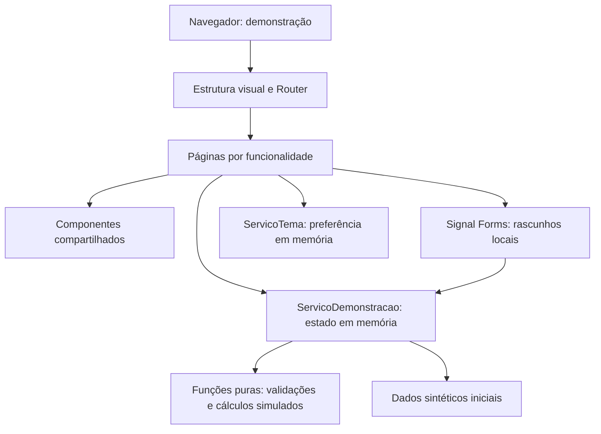
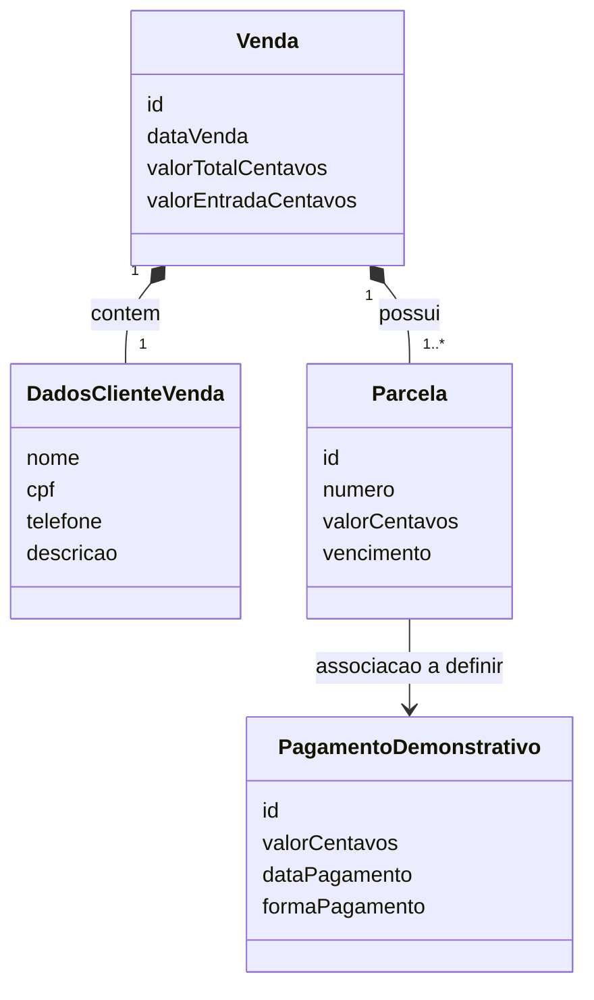
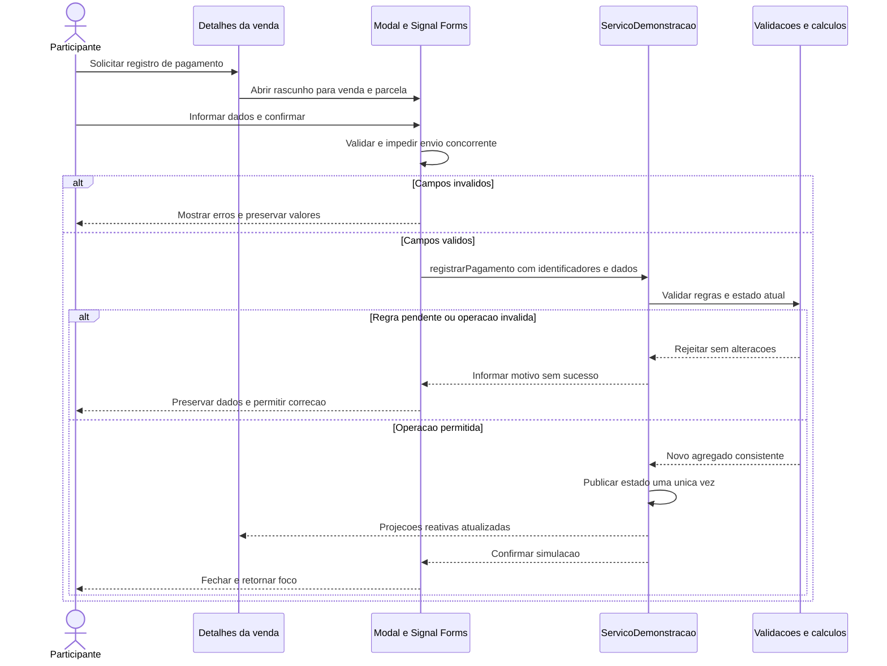

# TDD — Mercadão dos Óculos - Vendas em Aberto

> Technical Design Document: documento de desenho técnico do MVP visual. Não representa
> implementação, aprovação da ótica ou desenvolvimento orientado a testes. Todos os fluxos,
> arquivos e testes descritos como planejados ainda precisam de implementação autorizada.

## 1. Identificação e situação

- **Produto:** Mercadão dos Óculos - Vendas em Aberto, demonstração de acompanhamento de vendas a prazo de uma ótica.
- **Etapa:** MVP visual no navegador, exclusivamente frontend.
- **Data e revisão:** 12/11/2026, revisão 1.3.
- **Destino:** `docs/tdd/tdd.md`, relativo à raiz do repositório.
- **Situação:** desenho arquitetural consolidado para as escolhas respondidas; comportamentos
  dependentes das regras de produto continuam pendentes.
- **Origem:** solicitação de especificação técnica baseada no `AGENTS.md`, com Angular 22,
  standalone, zoneless e Signals, seguida de duas rodadas de perguntas.
- **Autoridade:** escolhas técnicas e direção de temas confirmadas pelo solicitante nesta
  conversa. Não houve validação das regras comerciais pela equipe da ótica.
- **Implementação:** não implementada de forma verificável. Não existe `package.json` encontrado
  na inspeção; `frontend/src/app/` está vazia.

As decisões completas estão centralizadas na seção 15. As demais seções detalham sua aplicação,
sem criar registros concorrentes. Pendências de produto são referidas como `PRD/PEN-xxx` e
hipóteses como `PRD/HIP-xxx`, para não confundir seus IDs com os deste documento.

## 2. Contexto, objetivos e limites

O MVP deve permitir validar navegação, cadastro e consulta de vendas, visualização de parcelas,
recebimentos simulados e resumos financeiros. A implementação futura deve ser pequena,
compreensível e consistente, sem antecipar infraestrutura de produção.

### Objetivos técnicos

1. Separar apresentação, estado demonstrativo e cálculos simulados.
2. Manter uma única fonte de dados em memória entre rotas, com indicadores derivados.
3. Evitar mutações parciais, submissões duplicadas e alterações ao cancelar formulários.
4. Usar APIs reativas compatíveis com execução zoneless e TypeScript estrito.
5. Suportar temas claro e escuro, teclado, foco e situações compreensíveis além da cor.
6. Permitir testes de regras, componentes e fluxos no navegador sem backend.

### Escopo e exclusões — DEC-001

Incluem-se os quatro módulos previstos no README e PRD: Visão Geral, Vendas, Relatórios e
Configurações. Quitadas pertence a Vendas. Dados do cliente ficam no cadastro e detalhe da
venda, sem cadastro mestre, unicidade de CPF ou módulo independente de clientes. Parcelas são
consultadas no contexto da venda; uma pasta de domínio não implica um módulo de navegação.

Ficam excluídos backend, HTTP de dados, banco, persistência em navegador ou arquivo, login,
integrações, dados reais, importação de planilha, exportação real, SSR, PWA e empacotamento
Tauri. Tauri, ASP.NET Core e SQLite permanecem somente como direção futura.

O aviso permanente deve dizer, em linguagem equivalente: **“Demonstração com dados fictícios.
As alterações são perdidas ao recarregar.”** Cadastro e pagamento são simulações, não cobranças.

### Critérios para avaliar o desenho

- Uma mutação aceita altera uma única fonte e todas as projeções observam a mesma versão.
- Cancelamento e falha mantêm o estado anterior; erros não produzem mensagem de sucesso.
- Valores são centavos inteiros; datas civis não mudam de dia por fuso.
- Nenhuma regra pendente é resolvida silenciosamente por código.
- Rotas, formulários, modais e temas possuem cenários de verificação descritos na seção 12.

## 3. Fontes e estado atual

| Fonte | Caminho ou URL e seção | Versão/consulta | Contribuição |
| --- | --- | --- | --- |
| FON-001 | `AGENTS.md`, escopo, estrutura, componentes, formulários e verificação | Leitura em 12/11/2026 | Restrições técnicas e limites obrigatórios |
| FON-002 | `README.md`, direção visual, módulos e fluxos de vendas | Leitura em 12/11/2026 | Escopo funcional e conflito de tema |
| FON-003 | `docs/prd/vendas-em-aberto.md`, requisitos, critérios e pendências | Revisão 1.0, leitura em 12/11/2026 | Rastreabilidade e regras não decididas |
| FON-004 | Solicitação e respostas às duas rodadas de perguntas nesta conversa | 12/11/2026 | Angular 22 e confirmações técnicas |
| FON-005 | Inspeção de `frontend/`, `frontend/src/app/`, `openspec/specs/`, `openspec/changes/` e busca por `package.json` | 12/11/2026 | Estado local, não execução |
| FON-006 | https://angular.dev/reference/versions | Documentação v22, 12/11/2026 | Compatibilidade de Node.js, TypeScript e RxJS |
| FON-007 | https://angular.dev/guide/zoneless | Documentação v22, 12/11/2026 | Zoneless, notificações e testes |
| FON-008 | https://angular.dev/guide/forms/signals/overview e https://angular.dev/api/forms/signals/form | Documentação v22, 12/11/2026 | Signal Forms; `form` estável desde v22.0 |
| FON-009 | https://angular.dev/guide/forms/signals/form-submission | Consulta pelo Context7 em 12/11/2026 | Validação, `submit`, erros e concorrência |
| FON-010 | https://angular.dev/guide/testing | Documentação v22, 12/11/2026 | Integração Angular CLI, Vitest e jsdom |
| FON-011 | https://playwright.dev/docs/test-webserver | Consulta pelo Context7 em 12/11/2026 | Servidor local e configuração de E2E |
| FON-012 | https://developer.mozilla.org/en-US/docs/Web/HTML/Reference/Elements/dialog | Consulta em 12/11/2026 | Modal nativo, teclado e foco |
| FON-013 | https://getbootstrap.com/docs/5.3/customize/ e https://getbootstrap.com/docs/5.3/customize/color-modes/ | Bootstrap 5.3.8, consulta via Context7 em 12/11/2026 | Personalização Sass, variáveis CSS e temas com `data-bs-theme` |
| FON-014 | Solicitação de revisão para utilizar Bootstrap em vez de CSS puro | 12/11/2026, revisão 1.2 | Substituição da base visual própria por Bootstrap; DEC-013 |
| FON-015 | Respostas do solicitante no planejamento OpenSpec das FASE-001/002 | 12/11/2026, revisão 1.3 | Recorte das duas fases, Prettier sem lint e smoke E2E Chromium/Windows; autorização de revisão pontual deste TDD, não de implementação |
| FON-016 | Documentação via Context7: Angular CLI `/angular/angular-cli/v22.2.2`, Playwright `/microsoft/playwright`, Prettier `/prettier/prettier` e Bootstrap `/twbs/bootstrap/v5.3.8` | 12/11/2026 | Builder de testes/build, webServer e viewport, formatação e importação Sass; não prova compatibilidade local dos patches |

As consultas ao Context7 incluíram Angular e Playwright. Para Angular 22, as páginas oficiais
v22 foram usadas para confirmar a compatibilidade e resolver a falta de precisão dos trechos
retornados para a branch `22.0.x`. Não foram enviados arquivos privados às consultas.

### Evidências locais e divergências

- Existem `frontend/src/app/`, `public/`, `.vscode/`, `dist/` e `.angular/`; a pasta da aplicação
  está vazia e não foi encontrado manifesto. Saídas e caches não provam implementação.
- `openspec/specs/` contém `.gitkeep`; não há mudança ativa visível em `openspec/changes/`.
  O TDD é independente e não modifica configuração ou artefatos OpenSpec.
- A ausência absoluta de pasta de aplicação descrita no `AGENTS.md` está desatualizada quanto
  à estrutura, mas não comprova a existência de código ou testes.
- `AGENTS.md` pede tema claro; README pede dois temas com escuro inicial. O solicitante
  **confirmou dois temas com escuro inicial para este desenho**: DEC-006. O PRD e as instruções
  permanecem intactos; sua conciliação documental exige tarefa posterior. Uma implementação
  futura deve observar essa divergência e as instruções então vigentes.
- A árvore recomendada no `AGENTS.md` inclui clientes e parcelas. Ela é organizacional, não
  obrigação de criar páginas que contrariem o recorte funcional explícito do README e PRD.

## 4. Síntese da entrevista técnica

| Tema | Resposta explícita | Decisão |
| --- | --- | --- |
| Framework | Angular 22, standalone, zoneless e Signals | DEC-002 |
| Execução e diretório | SPA no navegador, em `frontend/`, sem SSR ou Tauri nesta etapa | DEC-001, DEC-003 |
| Estilos | SCSS e componentes próprios na entrevista inicial; base visual substituída por Bootstrap na revisão 1.2 | DEC-006, DEC-013 |
| Temas | Claro e escuro; escuro na abertura | DEC-006 |
| Estado | Serviço demonstrativo com Signals, sem biblioteca adicional | DEC-004 |
| Qualidade | Testes unitários, de componentes e E2E; plano Vitest + Playwright confirmado | DEC-008 |
| Ambiente | Node.js 24 a partir de 24.15.0, npm, lockfile e TypeScript 6.0.x | DEC-009 |
| Modais e ícones | `dialog` nativo e SVG local | DEC-007 |
| Regras abertas | Registrar pendências; não decidir regras de produto neste TDD | DEC-011 |
| Entrega | Consolidar o plano com diagramas Mermaid em `tdd.md` | DEC-012 |

Signal Forms já é exigência de FON-001 e foi incluído no resumo do plano confirmado.
Nenhuma resposta aprovou as hipóteses demonstrativas do PRD nem políticas financeiras.

## 5. Arquitetura e responsabilidades

### Visão proposta — DEC-003, DEC-004 e DEC-005



O diagrama representa dependências propostas, não comunicação com backend. As páginas
orquestram interação; o serviço concentra os comandos de cadastro, edição e recebimento;
funções puras fazem cálculos verificáveis. Os componentes compartilhados não importam páginas
nem acessam diretamente o estado financeiro. O serviço não depende de HTML, Router ou modal.

| Parte | Responsabilidade | Não deve fazer |
| --- | --- | --- |
| Estrutura visual | Navegação, aviso demonstrativo e área de conteúdo | Calcular saldos ou modificar vendas |
| Páginas | Consultar projeções e encaminhar comandos validados | Manter cópias concorrentes de totais |
| Formulários | Rascunho, validação de campos e interação de envio | Editar objetos originais antes de confirmar |
| Fonte demonstrativa | Estado canônico e mutações atômicas | Persistir, simular HTTP ou definir política comercial |
| Utilitários de domínio | Dinheiro, datas, parcelas e projeções conforme regras confirmadas | Depender de componentes ou acessar DOM |
| Componentes compartilhados | Apresentação e eventos tipados | Virar plataforma genérica de tabelas |
| Serviço de tema | Tema ativo e alternância da sessão | Salvar preferência no navegador |

Não haverá repositório abstrato, interface HTTP fictícia ou camadas vazias “para o futuro”.
A futura integração exigirá planejamento próprio; os modelos internos não são contratos de API.

## 6. Linguagem, framework e ferramentas

| Tecnologia | Uso planejado | Versão/faixa | Situação e referência |
| --- | --- | --- | --- |
| Angular e Angular CLI | SPA, componentes, rotas e build | Linha 22.x, pacotes Angular compatíveis e alinhados | Confirmado; DEC-002 e DEC-009 |
| TypeScript | Aplicação e configurações | `>=6.0.0 <6.1.0` | Confirmado; tabela oficial FON-006 |
| Node.js | CLI e ferramentas, não servidor de negócio | Linha 24.x, `>=24.15.0 <25.0.0` | Confirmado; FON-006 |
| npm | Dependências e scripts | Versão compatível com Node.js escolhido, a fixar na base | Gerenciador confirmado; patch pendente |
| RxJS | Dependência do ecossistema Angular quando necessária | Linha 7 compatível com `^7.4.0` | Faixa permitida por FON-006; não biblioteca de estado |
| Signal Forms | Cadastro, edição e recebimento | `@angular/forms/signals`, mesma linha do Angular | Confirmado; `form` estável em v22.0, FON-008 |
| Bootstrap | Base visual: layout responsivo, utilitários, tabelas, botões e campos | Linha estável 5.3.x; patch a fixar na base, referência consultada 5.3.8 | Escolha confirmada; somente estilos, sem plugins JavaScript; DEC-013 e FON-013 |
| SCSS | Personalizações do Bootstrap e estilos específicos da aplicação | Ferramenta compatível com CLI 22 e Sass do Bootstrap, a verificar e fixar | Complementar ao Bootstrap; não base visual independente; DEC-013 |
| Vitest e jsdom | Unitários e componentes | Versões compatíveis com CLI 22 e TypeScript escolhido | Ferramentas confirmadas; versões exatas pendentes |
| Playwright Test | E2E em navegador real | Versão a verificar e fixar na criação da base | Ferramenta confirmada, não instalação validada |

Faixas não substituem o lockfile: na criação da base, resolver patches compatíveis, verificar
`peerDependencies` e `engines`, registrar versões e gerar `package-lock.json`. Não copiar
versões de ferramentas antigas nem adotar a próxima major automaticamente.

### Convenções Angular — DEC-002

- Bootstrap standalone com `bootstrapApplication`; configuração em `app.config.ts` e rotas
  em `app.routes.ts`. Sem `AppModule` ou módulos próprios de funcionalidades.
- Zoneless é o padrão em Angular 21+ segundo FON-007. Não adicionar `zone.js`,
  `zone.js/testing` ou `provideZoneChangeDetection` na base nova.
- Atualizar a interface por signals lidos no template e eventos vinculados. Evitar depender
  de `NgZone.onStable` ou de alteração silenciosa de propriedades comuns.
- Componentes compatíveis com `OnPush`; explicitar a estratégia quando útil para tornar o
  contrato evidente, sem tratá-la como requisito isolado para ativar zoneless.
- `signal` para estado, `computed` para projeções, `effect` somente para efeitos externos
  indispensáveis. Não usar effects para sincronizar cópias de saldo.
- Preferir `inject()`, dependências internas `private readonly`, membros do template
  `protected`, referências de signals `readonly` e tipos públicos de retorno explícitos.
- HTML separado, imports explícitos, `@if`, `@for` com `track` por identificador estável.
- TypeScript e templates estritos; sem `any` para contornar os contratos de domínio.

## 7. Organização estrutural e convenções

### Árvore proposta, relativa à raiz — DEC-003

```text
frontend/
  package.json                 (a criar)
  package-lock.json            (a gerar pelas ferramentas)
  angular.json                 (a criar)
  tsconfig.json                (a criar)
  playwright.config.ts         (a criar para E2E)
  public/                      (pasta existente; conteúdo não auditado)
  e2e/                         (cenários a criar)
  src/
    main.ts
    index.html
    styles.scss
    estilos/
      _tokens.scss
      _temas.scss
    app/                       (pasta existente, vazia na inspeção)
      app.ts
      app.html
      app.scss
      app.config.ts
      app.routes.ts
      nucleo/
        configuracao/
          servico-tema.ts
        demonstracao/
          servico-demonstracao.ts
          dados-demonstrativos.ts
          demonstracao.modelos.ts
      compartilhado/
        componentes/
          barra-navegacao/
          cabecalho/
          indicador-resumo/
          selo-situacao/
          modal/
      funcionalidades/
        vendas/
          listar-vendas/
          listar-vendas-quitadas/
          cadastrar-venda/
          editar-venda/
          detalhes-venda/
          formulario-venda/
          venda.modelos.ts
          venda.validacoes.ts
          venda.calculos.ts
        parcelas/
          registrar-pagamento/
          parcela.modelos.ts
          parcela.calculos.ts
        visao-geral/
        relatorios/
        configuracoes/
```

A árvore descreve destino, não arquivos entregues. Só criar componentes e arquivos quando
necessários. Testes `*.spec.ts` ficam junto ao código; não foram repetidos na árvore.
`parcelas/` contém domínio e interação de recebimento, não uma rota independente de listagem.
Dados do cliente serão um tipo interno de venda, sem duplicar um cadastro mestre.

Direção das dependências: páginas importam componentes, contratos e fonte; a fonte importa
modelos e funções de domínio; modelos não importam serviços ou componentes. Funções de um
domínio permanecem nele; dinheiro e datas só são compartilhados se houver reutilização real.

Nomes próprios seguem português sem acentos nos identificadores: `Venda`, `Parcela`,
`PagamentoDemonstrativo`, `clienteSelecionado`, `registrarPagamento` e seletores `app-...`.
Textos e comentários usam acentuação normal. Preservar nomes de APIs e arquivos convencionais.
UTF-8, dois espaços, aspas simples e largura de formatação de 100 caracteres.

### Rotas propostas

| Caminho | Conteúdo |
| --- | --- |
| `/visao-geral` | Indicadores gerais |
| `/vendas` | Vendas em aberto |
| `/vendas/quitadas` | Vendas quitadas |
| `/vendas/cadastrar` | Cadastro com dados do cliente |
| `/vendas/editar/:id` | Edição, condicionada à política pendente |
| `/vendas/:id` | Detalhes e parcelas da venda |
| `/relatorios` | Resumo financeiro demonstrativo |
| `/configuracoes` | Página de configurações e limites da demonstração |

Carregar páginas com `loadComponent` quando adequado. Declarar caminhos específicos antes do
dinâmico `:id`. Encaminhar a entrada vazia à Visão Geral e oferecer retorno para caminho
desconhecido. Registro ausente deve ser distinto de coleção vazia. Caso se adotem inputs de
rota, habilitar a vinculação correspondente e usar `id` consistentemente. O mecanismo exato
de vinculação não foi decidido; não é necessário para consolidar os caminhos propostos.

## 8. Estado, dados e cálculos

### Estado canônico — DEC-004

`ServicoDemonstracao`, com escopo raiz da aplicação, possui um signal privado para o agregado
demonstrativo e expõe leitura e consultas derivadas. Não fornecer outra instância nas páginas
lazy, o que reiniciaria os dados ao navegar. A recarga cria uma nova instância e restaura o
conjunto sintético inicial.

Usar modelos somente leitura para consultas e atualizações imutáveis. `asReadonly()` não faz
congelamento profundo: não expor referências mutáveis como se fossem seguras. Formulários
recebem cópias independentes e a coleção inicial não é modificada em operações da sessão.

Cada comando valida primeiro e constrói um novo agregado antes de publicar uma única
atualização. Erros de validação não alteram estado; exceções imprevistas também não podem
deixar venda, parcelas e pagamentos em versões diferentes. O resultado interno deve distinguir
sucesso, validação, regra pendente e registro inexistente, com mensagens em português.

### Modelos conceituais propostos — DEC-005



Este é um modelo de relacionamentos internos proposto, não esquema SQL ou contrato HTTP.
Cada venda mantém seus dados de cliente. A cardinalidade e as condições de associação de
pagamentos permanecem dependentes de `PRD/PEN-011`; não se assume pagamento parcial ou
excedente. A entrada não é implicitamente um pagamento de parcela.

- Identificadores são estáveis, independentes do índice de uma lista ou nome do cliente.
- Ausência de descrição, data de pagamento ou forma deve ser representada explicitamente,
  sem inventar valores. A nulabilidade depende da semântica, não de conveniência de template.
- Não manter `totalPago`, `saldoDevedor` e totais de painel como valores editáveis duplicados:
  são projeções da mesma fonte segundo as regras confirmadas.
- Situações de parcela previstas: Aberto, Próximos dias, Atrasado e Paga. Limites temporais
  ainda não confirmados não podem ser escondidos em uma função de classificação.
- Quitada significa saldo integralmente liquidado. Outras situações gerais de venda dependem
  de `PRD/PEN-007`, sem inferir agregação a partir de cores de parcelas.

### Dinheiro e datas — DEC-005 e DEC-011

Representar valores monetários por inteiros seguros em centavos. Converter entradas textuais
explicitamente, rejeitando valores ambíguos ou inválidos; não calcular finanças com frações
binárias nem arredondar silenciosamente o resultado final. Converter centavos para BRL somente
na apresentação, usando recursos de internacionalização da plataforma/Angular.

Fórmula documentada: `valorAParcelarCentavos = valorTotalCentavos - valorEntradaCentavos`.
A distribuição do resultado pelas parcelas só pode ser consolidada após a decisão de centavos.
O exemplo de R$ 1.000,00 com R$ 200,00 de entrada e quatro parcelas resulta em R$ 200,00 por
parcela, mas não resolve o registro da entrada nos recebimentos.

Representar datas civis com formato interno `AAAA-MM-DD` validado, não como instantes UTC.
Separar parse, comparação civil e formatação `DD/MM/AAAA`. Não usar conversão para UTC como
atalho para obter o dia local. Operações de calendário não devem somar blocos de 24 horas ou
30 dias para produzir meses. A política para meses sem o dia original continua pendente.

A data da venda inicia com o dia local do cadastro e é editável. A data de referência dos
indicadores, seu ciclo de atualização e os períodos aguardam `PRD/PEN-009`. Testes devem poder
fornecer uma referência explícita; não ler o relógio implicitamente em cada cálculo.

## 9. Fluxos técnicos e tratamento de falhas

### Cadastro e edição — DEC-004 e DEC-010

1. Criar o rascunho a partir de valores iniciais centralizados ou cópia da venda existente.
2. Construir Signal Forms sobre esse rascunho; a prévia é derivada e não grava registros.
3. Ao confirmar, verificar validade e regras ainda abertas. Uma política não definida não é
   uma validação “aprovada” apenas porque o campo possui um número.
4. Encaminhar comando tipado ao serviço, que revalida os dados e a elegibilidade atual.
5. Em sucesso, publicar o novo agregado e comunicar que o registro foi simulado.
6. Em falha, manter rascunho, apresentar erro e liberar nova tentativa. Cancelar descarta o
   rascunho sem chamar o comando. A edição não deve reescrever pagamentos por conveniência.

### Recebimento proposto, condicionado às regras — DEC-007, DEC-010 e DEC-011



O fluxo explica a fronteira técnica; não aprova quitação parcial, pagamento antecipado,
formas disponíveis ou datas permitidas. Se uma parcela deixar de ser elegível, o serviço
rejeita nova operação mesmo que o modal tenha sido aberto antes. O controle de formulário
impede concorrência de envio, mas não substitui a validação do estado no serviço.

Se a quitação integral for válida segundo as decisões de produto, a venda passa das abertas
para quitadas por projeções do estado, sem copiar ou mover registros entre coleções canônicas.
Cancelar, inclusive por Escape, nunca confirma recebimento. Exceção inesperada deve preservar
o agregado anterior e não deixar o formulário permanentemente em envio.

### Busca, navegação e relatórios

- Busca será local e derivada; sua combinação, normalização e interpretação de datas dependem
  de `PRD/PEN-005`. Não adotar debounce ou rede fictícia sem necessidade.
- Navegação preserva o estado da sessão, mas não exige persistência dos rascunhos abandonados.
- Coleção vazia, filtro sem resultado e venda inexistente têm mensagens e ações distintas.
- Relatórios e painéis leem a fonte compartilhada. Não substituir métricas por números fixos
  incompatíveis com as mutações; universos e períodos dependem de `PRD/PEN-009`.
- Exportação permanece ilustrativa, sem arquivo e sem mensagem falsa de conclusão.

## 10. Interface, estilos, formulários e acessibilidade

### Estilos e temas — DEC-006 e DEC-013

Bootstrap será a base visual no lugar de construir a interface somente com estilos próprios.
Usar seu layout responsivo, utilitários e estilos de tabelas, botões e campos, preservando os
componentes Angular por funcionalidade. SCSS continua apenas para personalizações e necessidades
específicas; não se trata de eliminar CSS, mas de evitar reconstruir os padrões já fornecidos.

Planejar a dependência `bootstrap` pelo npm e a inclusão global de seus estilos em
`styles.scss`, sem CDN ou duplicação da folha completa em cada componente. Verificar o pipeline
Sass na criação da base. Tokens próprios para superfícies, texto, bordas, destaque e situações
devem se alinhar às variáveis do Bootstrap, evitando dois sistemas visuais concorrentes.
Preservar classes, atributos e variáveis externas como `btn`, `form-control` e `--bs-*`;
identificadores próprios continuam em português. Não adicionar Tailwind, ng-bootstrap ou
ngx-bootstrap por consequência dessa escolha.

Utilizar somente a camada de estilos do Bootstrap, sem seus plugins JavaScript, bundle ou
Popper. Angular continua responsável por estado e interações; o modal permanece o `dialog`
nativo da DEC-007, sem migrar para o modal JavaScript do Bootstrap. A aparência do modal pode
reutilizar estilos compatíveis, sem classes que dependam do plugin para funcionar.

`ServicoTema` mantém um signal com tema claro ou escuro; o inicial é escuro por decisão do
solicitante. Aplicar o tema ao contêiner da aplicação e manter todos os modais sob o mesmo
contexto visual. Vincular o tema ao atributo `data-bs-theme`, mapeando os valores internos para
`light` e `dark`, conforme FON-013. Não consultar preferência do sistema para contrariar o padrão escolhido nem
salvar em `localStorage`. Recarregar volta ao escuro. Alternância tem nome acessível e indicação
do tema ativo, preservando contraste e foco em ambos.

Layout otimizado para desktop e adaptável, com tabela sem perda de informação e rolagem
horizontal quando necessária. Tamanhos mínimos e máquina de validação ainda não estão
aprovados. Gráficos são opcionais: não adicionar biblioteca antes de justificar a necessidade.

### Formulários — DEC-010

- Usar `form` e `FormField` de `@angular/forms/signals`, sem duplicar estado com Reactive Forms.
  A API `form` é estável desde Angular 22.0; confirmar a estabilidade das demais APIs utilizadas
  na versão exata antes da implementação, sem ativar recursos experimentais por padrão.
- O signal fornecido a `form` é a fonte dos valores. Nunca vinculá-lo diretamente ao objeto
  canônico da venda em edição: a documentação alerta que alterações escrevem no modelo.
- Centralizar valores iniciais e esquema de validação. Regras estruturais e validações de
  domínio devem ser reutilizadas pela fonte, sem copiar lógica financeira para componentes.
- Tratar submissão pelo caminho oficial de Signal Forms (`submit` ou integração documentada
  de `FormRoot`), revelando erros de campos inválidos e focando o primeiro campo pertinente.
- `submit` bloqueia submissões concorrentes e pode rejeitar a Promise se a ação lançar erro.
  Tratar tanto erros retornados quanto exceções; não fechar o modal apenas porque a Promise
  resolveu sem examinar o resultado. Ação local não exige RxJS ou atraso artificial.
- Bloquear o botão durante envio não basta: revalidar no caminho de confirmação e na fonte.
  Cancelar deve ser um botão que não submete; campos preenchidos permanecem após falha.

### Modal e acessibilidade — DEC-007

Encapsular `<dialog>` em componente próprio e abrir com `showModal()`, não apenas com atributo
`open`. O navegador fornece modalidade e torna o restante da página inerte. A camada própria
fornece título associado, foco inicial adequado, botão de cancelar/fechar, tratamento coerente
dos eventos de cancelamento e fechamento e retorno ao acionador.

Não adicionar `tabindex` ao elemento `dialog`. Se o acionador desaparecer após quitação,
retornar foco a uma ação lógica remanescente, não a um nó removido. Escape deve cancelar e o
rascunho não pode ser confirmado pelo fechamento. Os comportamentos serão testados no browser:
jsdom não comprova top layer, contenção de foco ou acessibilidade nativa.

Usar `lang="pt-BR"`, rótulos ligados aos campos, erros associados via `aria-describedby` quando
aplicável, títulos hierárquicos, nomes em botões de ícone e estados ARIA coerentes. Ícones
decorativos SVG ficam ocultos de tecnologias assistivas; texto comunica situação além da cor.
Mensagens de resultado devem ser anunciáveis sem roubar foco indevidamente. Respeitar
preferência de movimento reduzido; não introduzir animação como requisito de compreensão.

## 11. Bibliotecas e alternativas

| Necessidade | Escolha | Alternativa considerada | Impactos e limites | Decisão |
| --- | --- | --- | --- | --- |
| Estado | Signals e serviço próprio | NgRx ou outra store | Sem dependência adicional; requer disciplina de imutabilidade | DEC-004 |
| Formulários | Signal Forms | Reactive Forms | Alinhado ao AGENTS.md; API compatível com v22 | DEC-010 |
| Estilos | Bootstrap 5.3.x, com personalização SCSS e componentes Angular próprios | Somente estilos próprios; Tailwind; biblioteca de componentes Angular | Dependência visual adicional; reduz reconstrução de padrões, mas exige personalização e verificação de acessibilidade | DEC-013; substitui a parte de estilos da DEC-006 |
| Modal | `dialog` nativo encapsulado | Angular CDK ou biblioteca visual | Requer testes reais de foco e retorno | DEC-007 |
| Ícones | SVG local | Biblioteca de ícones | Sem importação de catálogo inteiro; verificar procedência de assets | DEC-007 |
| Unitários/componentes | Vitest, jsdom e TestBed | Karma/Jasmine | Integração padrão documentada da CLI atual; DOM não é browser real | DEC-008 |
| E2E | Playwright Test | Só roteiro manual | Testa browser real; requer binários e ambiente compatíveis | DEC-008 |
| Datas/dinheiro | Funções pequenas de domínio e plataforma | Biblioteca adicional | Evita custo desnecessário; exige casos de borda bem testados | DEC-005 |

Não há novas dependências instaladas por este documento. Patches, licenças exatas e requisitos
transitivos devem ser verificados na criação do manifesto; esta consulta não foi auditoria de
licenças ou vulnerabilidades. SVG copiado de terceiro exige licença compatível e atribuição
quando aplicável. Sem origem definida, não presumir que um ícone pode ser redistribuído.

## 12. Qualidade e plano de verificação

### Estratégia confirmada — DEC-008

Vitest com integração da Angular CLI para funções, serviços e componentes; TestBed zoneless;
jsdom para DOM simulado. Playwright Test para E2E, incluindo dialog nativo e teclado nas fases
funcionais. O smoke inicial usa DEC-014; versões exatas e requisitos do Windows devem ser
conferidos na base, sem antecipar testes de funcionalidades ainda ausentes.

Preferir eventos e `await fixture.whenStable()` a forçar atualização indiscriminadamente com
`detectChanges()`, evitando mascarar ausência de notificações zoneless. Cenários E2E devem
isolar sessões por recarga/contexto novo, sem persistir dados ou criar endpoints de teste.

| Área | Cenários e resultado esperado | Nível | Referências |
| --- | --- | --- | --- |
| Dinheiro | Parse, inteiros seguros, soma, entrada e invariantes sem arredondamento silencioso | Unitário | DEC-005; PRD/CA-008 e CA-014 |
| Parcelamento | Conservação da soma e centavos residuais após definição da política | Unitário, bloqueado pela regra | PRD/PEN-003 |
| Datas | Dia civil preservado em fusos distintos, bissexto e mês sem dia original | Unitário; calendário pendente | PRD/CA-020, PEN-001 |
| Estado | Cancelamento não altera; erro mantém agregado; sucesso publica versão coerente | Serviço | PRD/CA-016 e CA-017 |
| Formulários | Descrição opcional, obrigatórios, envio inválido revela erros, rascunho preservado | Componente e E2E | PRD/CA-006, CA-007, CA-016 |
| Duplicidade | Clique repetido não duplica pagamento; parcela já liquidada é revalidada | Serviço e E2E | PRD/CA-013 |
| Busca | Vazios, ausência de resultados e critérios conforme política aprovada | Unitário, componente e E2E | PRD/CA-004, CA-005, CA-019 |
| Navegação | Quatro módulos, quitadas interna, ID ausente e retorno | Componente e E2E | PRD/CA-001, CA-003, CA-018 |
| Pagamento | Operação elegível atualiza detalhes, abertas, quitadas e resumos uma única vez | Serviço e E2E; regras pendentes | PRD/CA-011, CA-014 |
| Temas | Escuro inicial, alternância global e recarga restaurando escuro | Componente e E2E | DEC-006; PRD/PEN-006 |
| Bootstrap | Layout responsivo, tabelas e campos legíveis, erros acessíveis, temas em páginas e `dialog`, sem dependência de plugins JavaScript | Componente, E2E e inspeção manual | DEC-013; FON-013 |
| Modal | Teclado, foco inicial, Escape, retorno, acionador removido e cancelamento | E2E e inspeção manual | DEC-007; PRD/CA-016 |
| Demonstração | Aviso visível, memória preservada entre rotas e descartada na recarga | E2E | PRD/CA-021 |
| Relatórios | Projeções coerentes, zero com coleção vazia e exportação ilustrativa | Unitário e E2E | PRD/CA-014 e CA-015 |

Critério de conclusão técnica proposto: build estrito aprovado, cenários aplicáveis aprovados,
ausência de erros inesperados no console, verificação manual de teclado e contraste em ambos
os temas e registro explícito das limitações de produto. Não há percentual de cobertura
aprovado; cobertura futura não substitui casos críticos.

Formatação deve aplicar as convenções da seção 7 com Prettier, conforme DEC-014. Lint fica
fora do recorte inicial; não há script de lint ou cobertura existente comprovado. Metas de
desempenho do PRD são propostas, não medições ou compromissos já aceitos.

## 13. Segurança, privacidade e desempenho

- Conjunto inicial com 10 a 15 vendas sintéticas, variado e identificável como demonstração.
  Não copiar dados pessoais da planilha ou das entrevistas.
- Não coletar CPF real ou enviar formulários a serviços externos. Inputs e identificadores
  continuam sendo dados não confiáveis, mesmo em uma demonstração.
- Renderizar textos por mecanismos seguros de template; não transformar descrições em HTML
  arbitrário nem contornar sanitização para apresentar dados sintéticos.
- Não incluir segredos no frontend, logs de dados pessoais, rastreamento ou telemetria.
- Assets locais evitam depender de CDN de fontes ou ícones durante apresentação. Avaliar fontes
  do sistema antes de adicionar uma fonte redistribuída e conferir licença se houver inclusão.
- Usar carregamento de páginas sob demanda, `track` estável e projeções sem duplicar estado.
  Não adicionar cache persistente ou biblioteca de otimização sem evidência de necessidade.
- Medir busca e atualizações somente no ambiente de avaliação definido; não alegar ganho de
  desempenho por adotar Signals ou zoneless sem medição local.

## 14. Execução, entrega e evolução

### Pré-requisitos e comandos planejados

Diretório de execução: `frontend/`, após existir um manifesto válido. Node.js 24 compatível,
npm, TypeScript 6.0.x e dependências alinhadas conforme DEC-009. Não executar scaffolding
sobre as pastas existentes sem inspecioná-las; não apagar `dist/` ou `.angular/` como parte
deste planejamento.

Os comandos abaixo vêm de FON-001 e devem ser associados aos scripts correspondentes na
criação da base. **Não estão disponíveis nem foram executados nesta entrega.**

```powershell
npm.cmd ci
npm.cmd start
npm.cmd run build
npm.cmd test -- --watch=false
```

`npm.cmd ci` pressupõe `package-lock.json` coerente. `start`, `build` e `test` deverão apontar
para comandos da CLI compatível. O script E2E inicial será `test:e2e`, com configuração
planejada pela DEC-014 e ainda não criada. O servidor local dos E2E deve usar
a mesma URL configurada no runner; sua porta é de desenvolvimento e não contrato de backend.
Não fixar porta de serviço .NET nem política de implantação neste TDD.

**Recorte confirmado da revisão 1.3:** planejar FASE-001 + FASE-002, sem executar código.
A base terá apenas página técnica mínima com identidade e aviso demonstrativo, sem navegação
dos módulos, dados comerciais, formulários ou serviço de tema. Bootstrap deve ter sua compilação
Sass comprovada na base, sem antecipar a identidade visual da FASE-003. DEC-014 define as
automações iniciais. PRD/PEN-013 continua aberto para avaliação do produto; o ambiente técnico
de smoke test não o resolve. PEN-006 continua bloqueando temas, não esta base sem alternância.
A preparação pode ser concluída para esse recorte com bloqueios explicitamente diferidos;
a FASE-001 global permanece parcial enquanto depender de decisões das fases seguintes.

### Roadmap de implementação — fases propostas, não autorização

O roadmap detalha a sequência anterior sem alterar as decisões de arquitetura ou aprovar regras
de produto. Todas as fases estão **Não implementadas neste planejamento**, sem evidência nova
de execução nesta revisão. Prazos, estimativas e responsáveis não foram definidos. As referências
`PEN-xxx` abaixo pertencem à seção 16, que mantém a correspondência com as pendências do PRD.

| Fase | Objetivo e entregas | Dependências e bloqueios | Critérios verificáveis de conclusão |
| --- | --- | --- | --- |
| FASE-001 — Preparação e decisões de desbloqueio | Inspecionar a estrutura existente, confirmar o recorte a implementar e registrar decisões necessárias com exemplos de aceite, sem adotar hipóteses como regras. | DEC-001/011; autorização explícita para implementação. PEN-006 exige conciliação documental autorizada antes de implementar temas. Demais pendências são resolvidas antes dos respectivos casos. | Recorte e bloqueios rastreáveis; nenhuma divergência tratada como resolvida sem decisão. A fase permanece parcial enquanto houver decisões necessárias em aberto. |
| FASE-002 — Base técnica e automações | Criar a base em `frontend/`, configurações estritas, versões compatíveis, lockfile, formatação, scripts reais e infraestrutura mínima de testes unitários, componentes e E2E. | Inspeção e autorização da FASE-001; DEC-002/003/008/009; PEN-015/016 para versões e automações; PEN-013 para o ambiente E2E. | Instalação reprodutível, build estrito e testes mínimos aprovados no ambiente definido; comandos e versões registrados, sem sobrescrever conteúdo existente. |
| FASE-003 — Estrutura visual e navegação | Construir navegação dos quatro módulos, rotas e retornos, aviso demonstrativo, tokens, temas e componentes compartilhados efetivamente necessários. Conteúdos dependentes do domínio entram nas fases seguintes. | FASE-002; DEC-003/006/007; PEN-006 antes dos temas. | Navegação e caminho desconhecido verificados; aviso visível; teclado e foco funcionais; alternância, contraste e recarga dos temas verificados conforme a decisão conciliada. |
| FASE-004 — Domínio demonstrativo e estado | Definir modelos internos, dados sintéticos, fonte única em memória, funções de dinheiro e datas, validações e projeções confirmadas; testar invariantes e atomicidade. | FASE-002; DEC-004/005/011. PEN-001/002/003/004/007/009/011 bloqueiam os cálculos, classificações e modelos afetados, não os utilitários independentes. | Testes de centavos e datas civis aprovados; fonte não duplicada entre rotas; falhas preservam o agregado; regras ainda abertas permanecem explicitamente bloqueadas. |
| FASE-005 — Consulta de vendas e parcelas | Implementar listas de abertas e quitadas, detalhes com dados do cliente e parcelas, busca e filtros aprovados, coleção vazia, ausência de resultados e registro inexistente. | FASE-003/004; DEC-003/004/011; PEN-004/005/007/012 para classificações, pesquisa e filtros afetados. | Consultas refletem a mesma fonte; critérios de busca aprovados testados; estados vazios distintos; navegação por identificadores e acesso por teclado verificados. |
| FASE-006 — Cadastro, edição e recebimento | Construir Signal Forms com rascunhos independentes, prévia de parcelas e comandos locais atômicos; integrar modal de pagamento, mensagens e atualização reativa das consultas. | FASE-005; DEC-004/005/007/010/011; PEN-001/002/003/008/010/011 para os respectivos fluxos. Edição e recebimento aguardam seus recortes aprovados. | Testes de envio inválido, cancelamento, falha e duplicidade aprovados; valores preservados após erro; sucesso atualiza a fonte uma única vez; Escape e retorno de foco verificados no navegador. |
| FASE-007 — Visão Geral, relatórios e configurações | Integrar indicadores e resumos derivados, períodos e filtros aprovados, conteúdo de Configurações e exportação apenas ilustrativa. | FASE-005/006; DEC-003/004/005/011; PEN-002/004/007/009/012 para métricas e conteúdos afetados. | Indicadores reconciliados com vendas e pagamentos simulados; vazios coerentes; nenhuma métrica fixa contradiz mutações; nenhuma exportação produz arquivo ou falso sucesso. |
| FASE-008 — Verificação integrada e entrega para validação | Executar regressão da seção 12, revisar teclado, foco e contraste, conferir perda de alterações ao recarregar e preparar roteiro demonstrativo com limitações e evidências. | FASE-003 a FASE-007 no recorte aprovado; DEC-008; PEN-013 para compatibilidade e PEN-014 para avaliação com a ótica. | Build e cenários aplicáveis aprovados, sem erros inesperados no console; resultados e limitações registrados. Aprovação de produto somente após avaliação explícita, distinta da conclusão técnica. |

**Ordem e paralelismo:** após a base, estrutura visual (FASE-003) e núcleo demonstrativo
(FASE-004) podem avançar em paralelo nos trechos desbloqueados. A resolução de pendências da
FASE-001 acompanha o trabalho, sem exigir que decisões não relacionadas bloqueiem toda a base.
Consultas integram essas duas frentes; mutações vêm depois para que seus efeitos sejam verificáveis.
O layout dos resumos pode avançar antes, mas sua conclusão depende das projeções e mutações.
Testes e acessibilidade fazem parte de cada fase; a FASE-008 consolida a regressão, não inicia
a qualidade. Avanço de fase não significa aprovação automática das dependências ainda abertas.

**Controle de conclusão:** uma fase só poderá ser marcada como concluída com evidências dos
critérios aplicáveis. Entrega parcial deve listar os casos bloqueados, sem apresentá-los como
funcionais nem declarar concluído o escopo integral. A avaliação com a ótica não comprova
persistência, regras definitivas ou aptidão para uso operacional.

**Inclusão do Bootstrap no roadmap — revisão 1.2:** a FASE-002 deve fixar a dependência e
verificar sua compilação Sass com o ambiente adotado. A FASE-003 deve integrar os estilos
globais, aplicar padrões Bootstrap e conectar `data-bs-theme` ao serviço de tema, conforme
DEC-013. Nas FASE-005 a FASE-007, reutilizar esses padrões em tabelas, formulários e resumos.
Os critérios de conclusão incluem a linha Bootstrap da seção 12, sem substituir o modal nativo
ou introduzir plugins JavaScript. A FASE-008 confirma a regressão visual e de acessibilidade.

### Evolução futura

A direção Tauri → Angular → ASP.NET Core → SQLite permanece apenas uma referência de evolução:
Tauri será janela, Angular interface, backend regras definitivas e acesso ao SQLite. Nenhum
contrato de API, esquema, autenticação, inicialização de processo .NET ou empacotamento foi
decidido aqui. Não acessar SQLite pelo Angular. Uma nova etapa deverá reavaliar modelos,
validações, comunicação e migração da fonte demonstrativa, sem tratar o serviço em memória
como um backend definitivo.

## 15. Registro central de decisões técnicas

Todos os registros abaixo estão **Não implementados**. Confirmação é de desenho, não de código.

| ID | Tema | Escolha | Situação | Dependências |
| --- | --- | --- | --- | --- |
| DEC-001 | Escopo | MVP visual SPA, sem infraestrutura operacional | Confirmada | FON-001 e FON-004 |
| DEC-002 | Angular | Linha 22, standalone, zoneless e Signals | Confirmada | DEC-009 |
| DEC-003 | Estrutura | `frontend/`, funcionalidades e rotas lazy | Confirmada quanto à direção; árvore e rotas propostas | DEC-001 e DEC-002 |
| DEC-004 | Estado | Serviço raiz com Signals e mutações atômicas | Confirmada | DEC-005 e DEC-011 |
| DEC-005 | Dados | Centavos inteiros e datas civis, cálculos fora dos componentes | Confirmada; modelos detalhados propostos | DEC-011 |
| DEC-006 | Visual | Dois temas e escuro inicial mantidos; base de estilos próprios substituída pela DEC-013 | Parcialmente substituída pela DEC-013 | Conciliação documental de temas pendente |
| DEC-007 | Interações | Dialog nativo e SVG local | Confirmada | Testes em browser |
| DEC-008 | Testes | Vitest, TestBed/jsdom e Playwright E2E | Confirmada | DEC-009 e regras de produto |
| DEC-009 | Ambiente | Node.js 24, npm/lockfile e TypeScript 6.0.x | Confirmada; patches pendentes | FON-006 e verificação da base |
| DEC-010 | Formulários | Signal Forms, rascunho independente e revalidação | Confirmada | DEC-002, DEC-004 e DEC-011 |
| DEC-011 | Regras abertas | Manter pendências sem políticas presumidas | Confirmada | Decisões posteriores de produto |
| DEC-012 | Documento | TDD central em `docs/tdd/tdd.md`, com Mermaid e roadmap | Confirmada | FON-004 e solicitação de revisão 1.1 |
| DEC-013 | Base visual | Bootstrap 5.3.x somente para estilos, SCSS complementar e interações Angular | Bootstrap confirmado pelo solicitante; integração técnica planejada | DEC-002/007/009; FON-013/014 |
| DEC-014 | Automações iniciais | Prettier sem lint; smoke Playwright Chromium no Windows em dois viewports | Confirmada; não implementada | DEC-008/009; FON-015/016; patches em PEN-015 |

### DEC-001 — MVP visual no navegador

- **Problema/contexto:** validar fluxos sem construir infraestrutura de produção.
- **Escopo/restrições:** dados sintéticos e estado em memória; FON-001, FON-003 e FON-004.
- **Alternativas:** SPA simples; SSR; aplicação desktop já nesta etapa. As duas últimas
  acrescentam responsabilidades não necessárias ou não autorizadas.
- **Escolha/justificativa:** SPA no navegador, sem backend ou Tauri. Minimiza escopo e mantém
  a validação centrada na experiência visual.
- **Consequências:** não oferece armazenamento, contas ou uso operacional real.
- **Origem/situação:** instruções e resposta explícita; Confirmada, Não implementada.
- **Validação/revisão:** verificar ausência de integrações e descarte ao recarregar; reavaliar
  somente quando houver solicitação explícita para outra etapa.

### DEC-002 — Angular 22 standalone, zoneless e Signals

- **Problema/contexto:** selecionar abordagem reativa coerente com a solicitação.
- **Escopo/restrições:** frontend novo; FON-001, FON-004 e FON-007.
- **Alternativas:** módulos próprios e execução com ZoneJS; standalone e notificações nativas
  reativas. A primeira não corresponde à direção solicitada.
- **Escolha/justificativa:** Angular 22 standalone, padrão zoneless e Signals, sem ZoneJS.
- **Consequências:** código e dependências devem notificar atualizações corretamente;
  compatibilidade zoneless precisa ser verificada em componentes e testes.
- **Origem/situação:** solicitação explícita; Confirmada, Não implementada.
- **Dependências/validação:** DEC-009; build estrito e testes sem ZoneJS. Rever ao mudar a major
  ou se uma dependência necessária não suportar a abordagem.

### DEC-003 — Organização por funcionalidade em frontend/

- **Problema/contexto:** estruturar o projeto sem confundir domínio com navegação.
- **Escopo/restrições:** árvore de FON-001 é recomendação; produto tem quatro módulos.
- **Alternativas:** camadas globais por tipo; funcionalidades com compartilhamento criterioso.
- **Escolha/justificativa:** funcionalidades em `frontend/src/app`, núcleo demonstrativo e
  componentes compartilhados pequenos; páginas sob demanda quando adequado.
- **Consequências:** não criar cadastro mestre de cliente, módulos visuais de parcelas ou
  abstração genérica de tabela. Árvore e caminhos detalhados da seção 7 são propostas coerentes,
  não uma aprovação individual de cada arquivo.
- **Origem/situação:** FON-001 e resposta explícita; direção Confirmada, Não implementada.
- **Dependências/validação:** DEC-001 e DEC-002; revisar imports, fronteiras e navegação.
  Reavaliar a árvore apenas se a implementação demonstrar necessidade real.

### DEC-004 — Fonte única em memória com Signals

- **Problema/contexto:** impedir divergência entre detalhes, listas e painéis após mutações.
- **Escopo/restrições:** sessão local sem persistência; FON-001 e FON-004.
- **Alternativas:** estado isolado por página; store externa; serviço compartilhado.
- **Escolha/justificativa:** serviço raiz com estado privado e projeções `computed`, sem store
  adicional. Atualizar agregado de forma imutável e atômica.
- **Consequências:** responsabilidade por validação e invariantes fica explícita no serviço;
  navegação preserva a sessão, recarga descarta os dados.
- **Origem/situação:** resposta explícita; Confirmada, Não implementada.
- **Dependências/validação:** DEC-005 e DEC-011; testes de cancelamento, erro, duplicidade e
  reconciliação. Revisar abordagem se houver nova complexidade comprovada, não por antecipação.

### DEC-005 — Representação monetária e temporal

- **Problema/contexto:** evitar perda de centavos e deslocamento do dia por fuso.
- **Escopo/restrições:** cálculos demonstrativos, não validações financeiras definitivas.
- **Alternativas:** reais em ponto flutuante e instantes UTC; centavos inteiros e datas civis.
- **Escolha/justificativa:** segunda alternativa, com funções puras e conversão na apresentação.
- **Consequências:** parse e calendário exigem testes; modelos conceituais da seção 8 permanecem
  propostas internas sem contrato externo. Não define política de arredondamento ou vencimento.
- **Origem/situação:** FON-001; Confirmada no padrão técnico, Não implementada.
- **Dependências/validação:** DEC-011; invariantes de soma, limites inteiros, fusos e meses.
  Revisar regras somente após decisões de domínio rastreáveis.

### DEC-006 — SCSS, componentes próprios e temas

> Registro histórico: a revisão 1.2 substitui a parte de base visual por DEC-013. Dois temas,
> escuro inicial e componentes Angular próprios permanecem; SCSS passa a ser complementar.

- **Problema/contexto:** escolher direção visual e resolver a divergência claro/escuro.
- **Escopo/restrições:** evitar biblioteca visual grande; não persistir preferência.
- **Alternativas:** SCSS, Tailwind ou biblioteca visual; somente claro ou dois temas.
- **Escolha/justificativa:** SCSS com tokens, componentes próprios e dois temas, escuro inicial.
  Corresponde às respostas explícitas e ao pedido visual do README.
- **Consequências:** a equipe assume estilização e acessibilidade. A decisão diverge da
  orientação de tema claro em AGENTS.md e do PRD atual, sem alterá-los nesta tarefa.
- **Origem/situação:** FON-004; Confirmada pelo solicitante para o TDD, Não implementada.
- **Dependências/validação:** conciliar instruções antes da implementação; verificar contraste,
  alternância, modais e recarga. Substitui, neste desenho, a direção provisória de tema claro
  apontada em `PRD/PEN-006`, mas não atualiza o registro do PRD automaticamente.

### DEC-007 — Modal nativo e ícones locais

- **Problema/contexto:** oferecer interações acessíveis sem pacote visual grande.
- **Escopo/restrições:** navegação por teclado e foco obrigatório; FON-001 e FON-012.
- **Alternativas:** dialog nativo; CDK; biblioteca visual completa. SVG local ou biblioteca de ícones.
- **Escolha/justificativa:** `dialog` encapsulado com `showModal()` e SVG local, conforme resposta.
- **Consequências:** testar foco/retorno em navegador e conferir procedência dos ícones. Não
  usar comportamento de atributo novo sem verificar suporte do navegador escolhido.
- **Origem/situação:** resposta explícita; Confirmada, Não implementada.
- **Dependências/validação:** DEC-008; E2E de Escape, cancelamento e acionador removido. Rever
  se os requisitos reais de acessibilidade não forem atendidos pela implementação nativa.

### DEC-008 — Verificação em três níveis

- **Problema/contexto:** regras e DOM simulado não bastam para validar fluxos acessíveis.
- **Escopo/restrições:** sem alegar cobertura, aprovação ou resultados existentes.
- **Alternativas:** somente manual; unitários/componentes; unitários/componentes e E2E.
- **Escolha/justificativa:** Vitest com TestBed/jsdom e Playwright Test, com inspeção manual.
  CLI documenta Vitest como padrão; browser real cobre modal e navegação.
- **Consequências:** há configuração e binários de E2E a manter. A versão exata e seus requisitos
  ainda serão conferidos; não se afirmou instalação bem-sucedida.
- **Origem/situação:** confirmação explícita; Confirmada, Não implementada.
- **Dependências/validação:** DEC-009 e DEC-011; matriz da seção 12. Rever ferramentas se a
  compatibilidade efetiva com a base escolhida não for atendida.

### DEC-009 — Base de versões e dependências

- **Problema/contexto:** evitar combinações incompatíveis ao criar a aplicação.
- **Escopo/restrições:** tabela Angular 22 em FON-006, sem manifesto atual.
- **Alternativas:** linhas Node.js 22, 24 ou 26 compatíveis; npm ou outro gerenciador.
- **Escolha/justificativa:** linha Node.js 24 a partir de 24.15.0, npm com lockfile e TypeScript
  6.0.x. Faixas compatíveis e confirmadas pelo solicitante; Angular/CLI na linha 22.
- **Consequências:** patches e ferramentas transitivas precisam de verificação na base;
  não prometer compatibilidade de toda biblioteca apenas por aceitar Node.js 24.
- **Origem/situação:** FON-004 e FON-006; Confirmada nas faixas, Não implementada.
- **Validação/revisão:** conferir engines, peers, lockfile, build e testes em Windows; mudanças
  de major exigem revisão. Não há decisão de atualização automática de majors.

### DEC-010 — Signal Forms e rascunhos isolados

- **Problema/contexto:** permitir validação reativa sem alterar registros antes de confirmar.
- **Escopo/restrições:** novos formulários usam Signal Forms por FON-001; FON-008 e FON-009.
- **Alternativas:** Reactive Forms; Signal Forms sobre registro canônico; Signal Forms sobre cópia.
- **Escolha/justificativa:** Signal Forms sobre rascunho independente, com envio oficial e
  revalidação na fonte. Evita mutação ao editar campos e mantém compatibilidade reativa.
- **Consequências:** erros da operação devem ser traduzidos para formulário/mensagem sem
  confundir rejeição, exceção e sucesso; sem RxJS para operações locais síncronas.
- **Origem/situação:** instrução normativa e confirmação do plano; Confirmada, Não implementada.
- **Dependências/validação:** DEC-002, DEC-004 e DEC-011; testes de envio inválido, duplicidade,
  falha e cancelamento. Conferir API da versão exata antes de escrever código.

### DEC-011 — Não presumir regras de produto

- **Problema/contexto:** existem lacunas financeiras e de busca que alteram comportamento.
- **Escopo/restrições:** nenhuma recomendação técnica equivale à regra confirmada da loja.
- **Alternativas:** inventar políticas; aprovar recorte demonstrativo; manter dependências abertas.
- **Escolha/justificativa:** registrar pendências e bloquear a implementação dos casos dependentes
  até decisão explícita. O usuário preferiu não resolver regras de produto nesta entrevista.
- **Consequências:** arquitetura pode avançar no planejamento; fluxos completos não estão
  especificados para todos os casos. Hipóteses do PRD continuam propostas não aprovadas.
- **Origem/situação:** resposta explícita; Confirmada, Não implementada.
- **Dependências/validação:** resolver pendências da seção 16; garantir que nenhum default
  silencioso as tenha substituído. Rever cada dependência quando sua regra for confirmada.

### DEC-012 — Centralização documental e diagramas

- **Problema/contexto:** manter decisões rastreáveis em um artefato técnico único.
- **Escopo/restrições:** documentação apenas; não alterar PRD, AGENTS.md ou OpenSpec.
- **Alternativas:** arquivos paralelos de decisões; TDD central com referências.
- **Escolha/justificativa:** `docs/tdd/tdd.md`, registro central de decisões e Mermaid para
  arquitetura, relacionamentos e recebimento. Explicações textuais acompanham diagramas.
  A revisão 1.1 registra o destino indicado pelo solicitante e detalha o roadmap de implementação
  por fases na seção 14, preservando escopo e decisões anteriores.
- **Consequências:** revisões devem preservar IDs e apontar substituições, sem duplicar decisões.
- **Origem/situação:** solicitação e confirmação explícitas; Confirmada, Não implementada
  quanto ao produto; este artefato é a entrega documental.
- **Validação/revisão:** revisar referências e coerência; renderização Mermaid não validada.
  Revisar quando novas decisões modificarem as fronteiras ou fluxos.

### DEC-013 — Bootstrap como base visual

- **Problema/contexto:** substituir a construção visual somente com estilos próprios por
  padrões reutilizáveis do Bootstrap, conforme solicitação da revisão 1.2.
- **Escopo/restrições:** frontend demonstrativo, sem instalação nesta entrega. Preservar
  standalone, Signals, Signal Forms e o modal nativo; não alterar regras de produto.
- **Alternativas:** manter SCSS como base independente; Bootstrap somente para estilos;
  Bootstrap com plugins JavaScript ou biblioteca de componentes Angular adicional.
- **Escolha/justificativa:** Bootstrap como base visual, com linha 5.3.x planejada e patch a
  fixar após verificação na base. SCSS personaliza identidade e tokens. A integração apenas
  de estilos evita controle concorrente do DOM por plugins e preserva as interações existentes
  no desenho. Não adotar uma versão alpha por ser mais recente.
- **Consequências:** acrescenta dependência visual e exige conferir Sass, tamanho do CSS,
  contraste e personalizações. Classes Bootstrap não garantem acessibilidade automaticamente.
  Temas usam `data-bs-theme`; nomes externos não são traduzidos. Não incluir JavaScript do
  Bootstrap, Popper, ng-bootstrap ou ngx-bootstrap neste recorte.
- **Origem/situação:** FON-014 confirma Bootstrap; FON-013 fundamenta os temas e a
  personalização. Detalhes de integração são planejados, não compatibilidade já comprovada.
  Não implementada.
- **Dependências/validação:** DEC-002/007/009, PEN-015 para versões e pipeline; build estrito,
  testes e cenários visuais da seção 12. Revisar se a combinação Sass/CLI não for compatível,
  sem alterar silenciosamente a versão ou substituir o modal.
- **Substitui:** somente a parte de base visual independente da DEC-006; preserva seus temas
  e demais decisões não afetadas.

### DEC-014 — Automações e limite da base inicial

- **Problema/contexto:** fechar as escolhas de ferramentas da FASE-002 sem antecipar aceite
  de compatibilidade, telas ou regras comerciais.
- **Escopo/restrições:** FASE-001 + FASE-002; PRD/RNF-001/004/008/010 e RF-011 quanto ao
  aviso, sem alegar atendimento completo de CA-021 antes dos fluxos comerciais.
- **Alternativas:** somente verificação manual; acrescentar lint e múltiplos motores agora;
  formatação e testes mínimos automatizados. Escolhida a terceira para limitar configuração.
- **Escolha:** Prettier, dois espaços, aspas simples e largura 100; scripts propostos `format`
  e `format:check`, limitados ao frontend. Sem lint nesta mudança. Vitest/TestBed/jsdom mantidos
  pela DEC-008; script proposto `test:e2e` com Playwright e Chromium no Windows, projetos de
  viewport 1366 × 768 e 390 × 844, sem alegar emulação ou suporte a dispositivo móvel.
- **Justificativa/contrapartidas:** base verificável com baixo escopo; não cobre Firefox,
  WebKit, todas as dimensões, desempenho ou acessibilidade integral do produto.
- **Consequências:** `webServer` e `baseURL` devem usar a mesma URL local; testes de abertura,
  identidade, aviso, idioma e ausência de erros inesperados em console/pageerror. Teste de
  componente deve comprovar uma atualização por signal em ambiente zoneless sem acrescentar
  uma funcionalidade comercial apenas para teste. Saídas e caches ficam fora da formatação.
- **Origem/situação:** FON-015, confirmação explícita do solicitante; Confirmada, Não implementada.
- **Dependências/revisão:** fixar patches e verificar engines, peers e licenças em PEN-015;
  incompatibilidade bloqueia a tarefa, sem substituir major ou framework silenciosamente.
  PEN-016 fica resolvida quanto às escolhas, não quanto à configuração executada.
- **Validação:** instalação limpa com lockfile, build estrito, formatação, unitários/componentes
  e ambos os projetos E2E, registrando comandos, versões e resultados reais na execução futura.

## 16. Riscos, hipóteses e pendências

### Riscos deste desenho

| ID | Descrição | Impacto | Mitigação |
| --- | --- | --- | --- |
| RIS-001 | Regras abertas implementadas como defaults | Comportamento financeiro enganoso | DEC-011 e bloqueio das tarefas dependentes |
| RIS-002 | Tema do TDD diverge das instruções atuais | Retrabalho e conflito na implementação | Registrar resposta e conciliar fontes em tarefa própria |
| RIS-003 | Cópias de estado ou mutações de rascunho no original | Saldos inconsistentes e cancelamento com efeito | Agregado único, imutabilidade e testes |
| RIS-004 | Teste jsdom interpretado como validação do dialog | Falhas reais de foco/teclado | Playwright e revisão manual |
| RIS-005 | Cache e saída existentes tratados como código entregue | Planejamento baseado em aplicação inexistente | Inspecionar fonte e manifesto, não inferir entrega |
| RIS-006 | Dependências escolhidas sem verificar peers/engines | Base não compilável | Fixar versões compatíveis ao criar o manifesto |

### Hipótese técnica proposta

| ID | Hipótese | Validação | Situação |
| --- | --- | --- | --- |
| HIP-001 | Um agregado em memória e funções puras atendem ao volume sintético sem biblioteca adicional de estado ou datas | Implementar e medir os cenários aplicáveis | Proposta; a escolha do serviço está confirmada, o desempenho não foi medido |

### Pendências rastreadas

| ID | Questão e origem | Impacto e decisões afetadas | Como resolver | Bloqueio |
| --- | --- | --- | --- | --- |
| PEN-001 | Vencimento em mês sem dia original; `PRD/PEN-001` | Calendário, DEC-005 e DEC-010 | Confirmar exemplos como dia 31 e fevereiro | Casos afetados |
| PEN-002 | Entrada nos pagamentos, saldos e recebimentos; `PRD/PEN-002` | Cadastro com entrada e relatórios, DEC-004/005 | Definir contabilização, data e forma | Casos com entrada |
| PEN-003 | Distribuição de centavos; `PRD/PEN-003` | Parcelamento, DEC-005 | Aprovar distribuição preservando a soma | Divisões não exatas |
| PEN-004 | Hoje e limites dos próximos sete dias; `PRD/PEN-004` | Situações e painéis, DEC-005 | Aprovar tabela de bordas temporais | Classificação completa |
| PEN-005 | Combinação, normalização e datas da pesquisa; `PRD/PEN-005` | Consulta, DEC-004 | Definir exemplos e resultados esperados | Busca completa |
| PEN-006 | Conciliar dois temas/escuro inicial com AGENTS.md e PRD | Direção visual, DEC-006 | Atualizar as fontes em tarefa autorizada; decisão no TDD já confirmada | Conciliação antes da implementação |
| PEN-007 | Situações gerais de vendas abertas; `PRD/PEN-007` | Projeções e selos, DEC-004/005 | Confirmar nomes e agregações | Classificação geral |
| PEN-008 | Edição antes/depois de pagamentos; `PRD/PEN-008` | Integridade de histórico, DEC-004/010 | Definir campos e repercussões permitidas | Edição completa |
| PEN-009 | Referência temporal, períodos, universo e filtros dos resumos; `PRD/PEN-009` | Painéis e testes, DEC-004/005 | Confirmar referência fixa/dinâmica e exemplos | Indicadores conclusivos |
| PEN-010 | Validações de CPF/telefone e limites demonstrativos; `PRD/PEN-010` | Cadastro, DEC-010 | Confirmar formato versus regra comercial | Validação completa |
| PEN-011 | Parcial, excedente, antecipação, datas e formas; `PRD/PEN-011` | Pagamento e modelos, DEC-004/005/010 | Definir recorte e elegibilidade explícitos | Recebimento completo |
| PEN-012 | Configurações e filtros em quitadas; `PRD/PEN-012` | Telas secundárias, DEC-003 | Confirmar conteúdo sem inventar controles | Conteúdo detalhado |
| PEN-013 | Navegadores, dimensões e computador; `PRD/PEN-013` | Acessibilidade, E2E e desempenho, DEC-007/008 | Definir ambiente de avaliação | Aceite de compatibilidade |
| PEN-014 | Aprovadores, participantes e metas; `PRD/PEN-014` | Validação com a ótica | Confirmar responsáveis e roteiro | Aprovação do produto |
| PEN-015 | Patches, engines/peers, licenças e versões das ferramentas | Criação da base, DEC-008/009 | Conferir manifestos oficiais e gerar lockfile compatível | Instalação reprodutível |
| PEN-016 | Ferramenta de formatação, eventual lint e configuração E2E | Automação de qualidade, DEC-008/009/014 | Escolhas resolvidas pela DEC-014; configuração e execução ainda não realizadas | Verificação das respectivas automações na FASE-002 |

Responsáveis e prazos não foram definidos. Nenhuma dessas pendências impede salvar o TDD;
elas impedem tratar os comportamentos afetados como especificação completa e implementável
sem nova decisão. Não há autorização implícita para adotar `PRD/HIP-001` a `PRD/HIP-006`.

## 17. Rastreabilidade e revisão documental

| Requisito ou restrição | Fontes | Decisões | Seções | Verificação planejada |
| --- | --- | --- | --- | --- |
| Memória e demonstração; PRD/RF-011 | FON-001 e FON-003 | DEC-001/004 | 2, 8, 9 | Recarga e navegação |
| Angular solicitado e estrito | FON-001, FON-004 e FON-006/007 | DEC-002/009 | 6, 7 | Build e TestBed zoneless |
| Quatro módulos; PRD/RF-001/008/012 | FON-002 e FON-003 | DEC-003 | 2, 7 | Rotas e ID ausente |
| Cadastro/edição; PRD/RF-004/006 | FON-001 e FON-003 | DEC-004/010/011 | 8, 9, 10 | Inválido, cancelamento e falha |
| Pagamentos; PRD/RF-007 | FON-001 e FON-003 | DEC-004/005/007/010/011 | 8, 9 | Consistência e duplicidade |
| Busca; PRD/RF-003 | FON-002 e FON-003 | DEC-004/011 | 9, 12 | Política confirmada e vazios |
| Indicadores; PRD/RF-002/009/010 | FON-002 e FON-003 | DEC-004/005/011 | 8, 9, 12 | Reconciliação e períodos |
| Temas e acessibilidade | FON-001, FON-002, FON-004 e FON-012 | DEC-006/007 | 10 | Teclado, contraste e foco |
| Bootstrap como base visual | FON-013 e FON-014 | DEC-013 | 6, 10, 11, 12, 14 | Compilação dos estilos, temas, responsividade e acessibilidade |
| Base e automações iniciais | FON-015 e FON-016; PRD/RNF-008/010 | DEC-008/009/014 | 12, 14, 15 | Instalação, build estrito, Prettier e testes mínimos, sem aceite comercial |
| Fonte técnica centralizada | FON-004 | DEC-012 | 15, 16 | IDs, fontes e coerência |

**Verificações documentais:** leitura das instruções e do modelo, inspeção da estrutura local,
revisão do PRD e das referências relevantes, confirmação das escolhas por perguntas, consulta
à compatibilidade oficial Angular 22 e documentação de formulários, zoneless e testes.
Essas verificações pertencem à revisão inicial. Na revisão 1.1, a conferência se limita à
coerência do roadmap com as decisões, pendências e matriz de testes existentes, aos caminhos
do documento e ao alinhamento da skill `generate-tdd` e de seu modelo. Não houve nova
verificação de compatibilidade das tecnologias ou de implementação.
Na revisão 1.2, foram consultadas as referências Bootstrap 5.3.8 pelo Context7 para
personalização e temas e revisada a coerência entre ferramentas, estilos, decisões, roadmap
e verificação. Compatibilidade efetiva com a futura base Angular/Sass permanece pendente;
nenhuma dependência foi instalada.

**Não executado:** instalação, scaffolding, build, testes, lint, cobertura, medição de desempenho,
auditoria de dependências, validação com a ótica, renderização Mermaid ou validação OpenSpec.
Nenhum código, configuração, PRD, README ou artefato OpenSpec é alterado por esta entrega.
As referências de critérios do PRD continuam sujeitas às condições e hipóteses nele registradas.

O desenho arquitetural respondido está consolidado; a especificação comportamental permanece
parcial por decisão explícita de registrar regras abertas. A geração do TDD não autoriza iniciar
implementação nem conciliar outros documentos silenciosamente.

## 18. Histórico de revisões

**Verificação da revisão 1.3:** releitura do PRD e do roadmap; inspeção de estrutura sem
arquivos verificáveis em `frontend/`; Node.js local observado em 24.21.0, sem comprovar o
restante da cadeia. O `AGENTS.md` atual não contém mais a orientação visual histórica citada
nas revisões anteriores; o conflito entre PRD e TDD sobre temas permanece. Consultas FON-016
fundamentam o plano, mas não confirmam instalação. Não executados scaffolding, instalação,
build, testes, formatação ou auditoria de dependências. Esta revisão não altera o PRD nem
aprova suas hipóteses; os artefatos OpenSpec serão produzidos pelo fluxo de planejamento
separadamente, após este registro técnico.

| Revisão e data | Alteração | Decisões | Origem |
| --- | --- | --- | --- |
| 1.0 — 12/11/2026 | Documento inicial, entrevista, arquitetura, Mermaid, plano de testes e pendências | DEC-001 a DEC-012 | Solicitação e respostas do usuário; fontes locais e documentação oficial |
| 1.1 — 12/11/2026 | Roadmap com oito fases, entregas, dependências, bloqueios e critérios de conclusão; correção do destino documental; skill e modelo passam a exigir roadmap | DEC-012 detalhada; demais decisões preservadas | Solicitação explícita do usuário para revisar o TDD e a skill de geração |
| 1.2 — 12/11/2026 | Bootstrap como base visual, SCSS complementar, integração de temas e atualização de ferramentas, roadmap e verificações | DEC-013 adicionada; DEC-006 parcialmente substituída | Solicitação explícita do usuário para usar Bootstrap em vez de CSS puro |
| 1.3 — 12/11/2026 | Recorte FASE-001/002 e automações iniciais, sem implementar; PEN-016 detalhada e demais bloqueios preservados | DEC-014 adicionada | Respostas explícitas no planejamento OpenSpec e autorização de revisão pontual do TDD |
