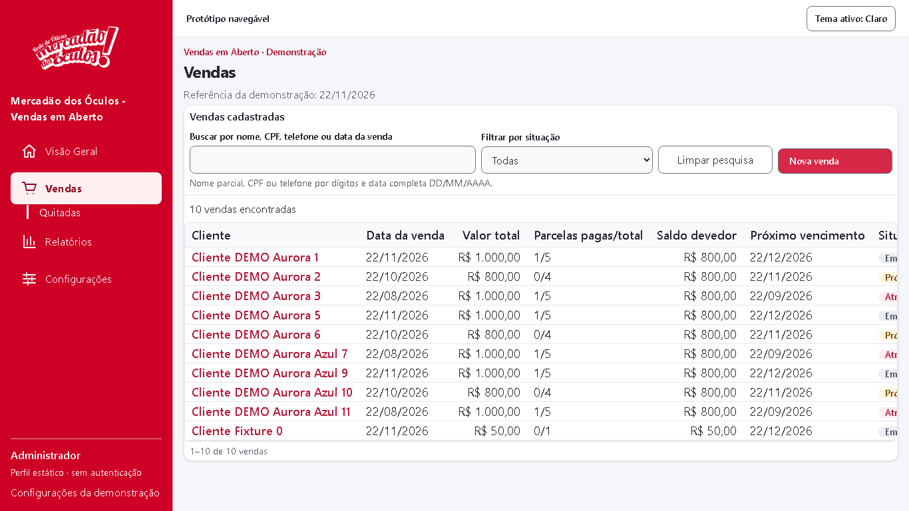
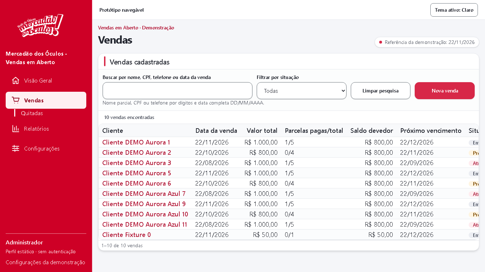
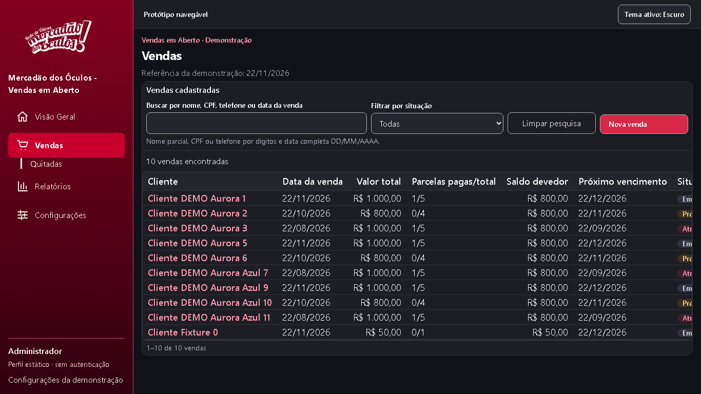
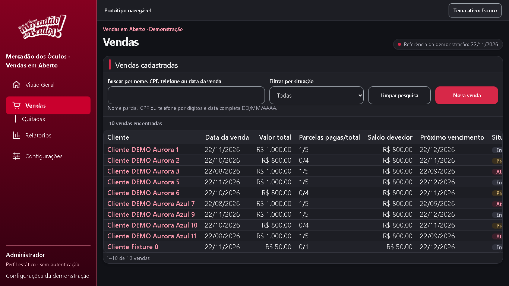
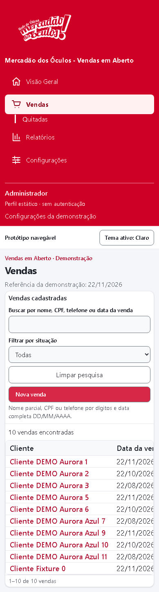
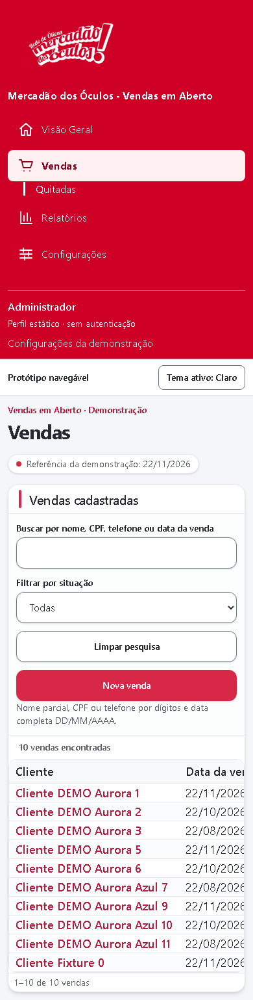
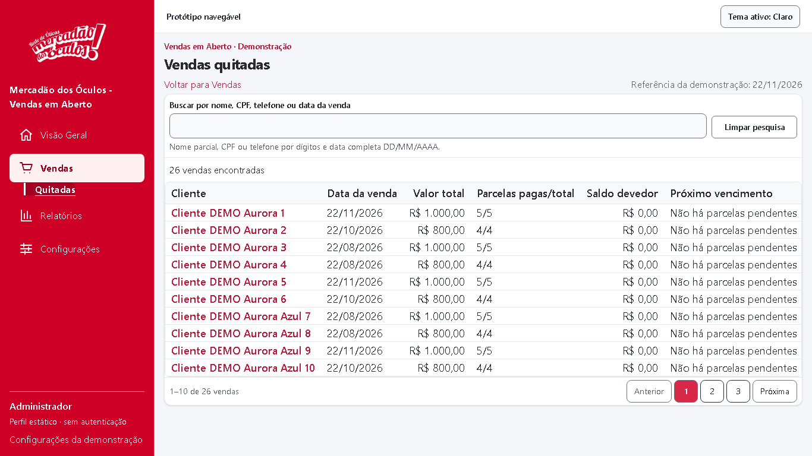
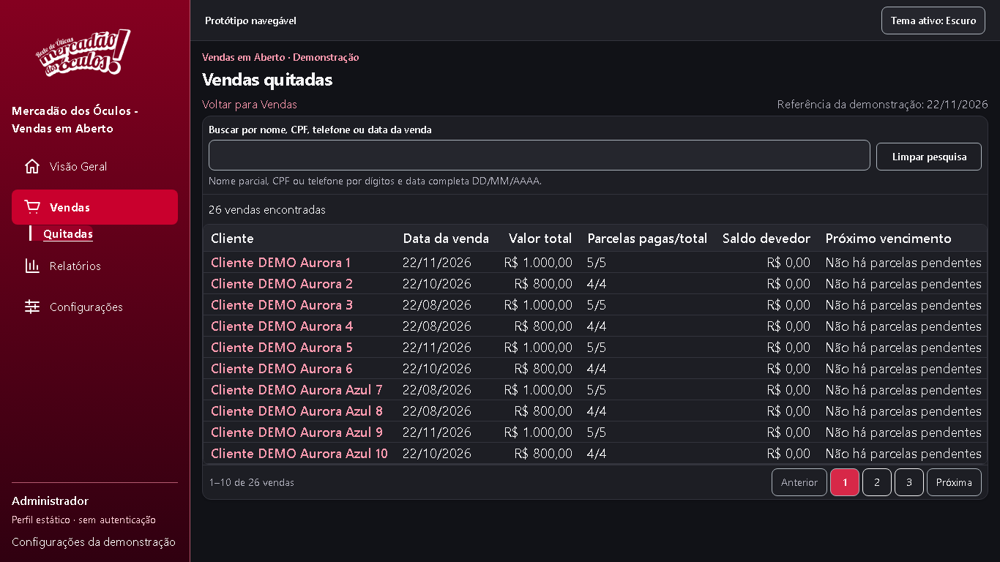
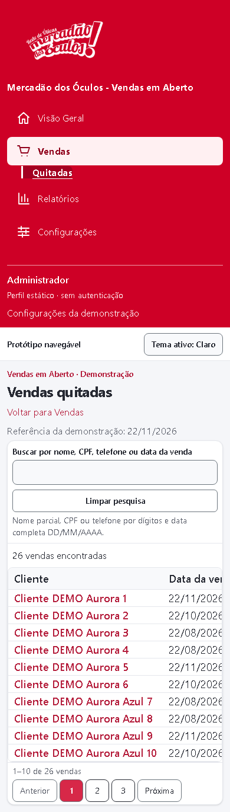

# Comparação visual do piloto — capturas sintéticas

As capturas de Vendas usam a mesma fixture de dez vendas. Cada par mostra a
baseline à esquerda e a hierarquia final à direita, no mesmo viewport e tema.

## Vendas abertas

### 1366×768 · claro

| Antes | Depois |
| --- | --- |
|  |  |

### 1366×768 · escuro

| Antes | Depois |
| --- | --- |
|  |  |

### 390×844 · claro

| Antes | Depois |
| --- | --- |
|  |  |

### 390×844 · escuro

| Antes | Depois |
| --- | --- |
|  |  |

## Quitadas · controle de não regressão

Quitadas não recebeu a variante visual do piloto. Os PNGs abaixo foram capturados
depois da implementação para conferir as combinações de tema e viewport; a
equivalência de estilos foi verificada em E2E contra os valores anteriores da
variante compartilhada.

| Viewport/tema | Captura posterior |
| --- | --- |
| 1366×768 · claro |  |
| 1366×768 · escuro |  |
| 390×844 · claro |  |
| 390×844 · escuro |  |

Referência estética principal: [mockup Mercadão](../../../references/a_clean_modern_dashboard_ui_using_the_mercadão_do.png).
Os cards de KPI, busca global, filtro por data e ações ilustrativas do mockup foram
intencionalmente omitidos; ver `frontend/README.md` e o delta OpenSpec para os
contratos preservados.
